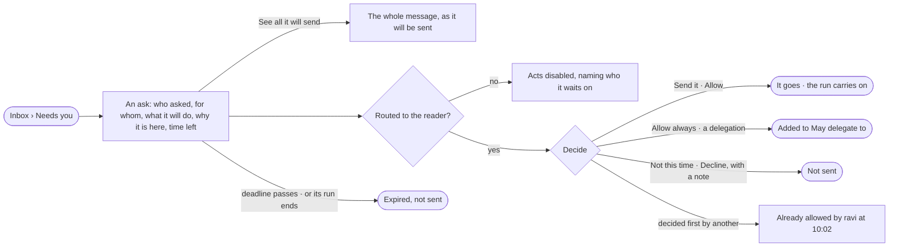

# IN-01 · Decide what an agent asks before it acts

**As** the owner of an agent, a view of the graph or a run **I want** every ask routed to me — access, budget, a
delegation, a send, a question — showing exactly what it will do **so that** nothing set to Ask leaves, changes or
spends without my yes — the agent proposes the act, and I decide whether it goes.

Tasks: [task.md](task.md) · Feature: [IN-F01](../../feature.md)

## Who can

| Lens | Can | Otherwise sees |
|---|---|---|
| Admin | Read every pending ask in the Graph; decide an ask routed to them | An ask routed to others reads, its acts disabled, naming who it waits on — being Admin does not widen it |
| Operator | Read every pending ask in the Graph; decide an ask routed to them | An ask routed to others reads, its acts disabled, naming who it waits on |

## Flow

## Acceptance criteria

| # | Given | When | Then |
|---|---|---|---|
| IN-01.1 | An agent step that wants to send a message | the step reaches the send | it holds, and an ask appears in Needs you for the people it is routed to; the rest of the run carries on |
| IN-01.2 | An ask to send | it is read | it shows exactly what will be sent — To, Subject and the start of the body — with *See all it will send* opening the whole message as it will go |
| IN-01.3 | Any ask | it is read | it names who asked and on whose behalf (*ravi ▸ Route analyst*), what it wants in one line, who it is routed to and why, how long it has waited, the deadline as time left, and its run |
| IN-01.4 | An ask | it is raised | it is routed by its kind — access to the owner of the view of the graph; a delegation or a send to the target agent's owner; budget to the person who started the run; a question to the task's author; workers to an install admin; more than a mode allows to whoever may change it at the level that denied it — and says which |
| IN-01.5 | An ask to send, routed to the reader | they press *Send it* | exactly what was shown is sent, never a re-render, and the run carries on |
| IN-01.6 | An ask routed to the reader | they press *Not this time* or *Decline* with a note | nothing is sent, the step ends *not sent*, and the note is kept |
| IN-01.7 | An ask for access, routed to the reader | they press *Allow* | it is allowed for this run, for that agent only, never its children |
| IN-01.8 | An ask to delegate | the reader picks *Allow always* | the target is added to the caller's *May delegate to*; *Allow always* is offered on no other kind |
| IN-01.9 | An ask another approver decided first | the reader acts on it | it is refused, reading *Already allowed by ravi at 10:02 UTC on Oct 25* in place of the acts |
| IN-01.10 | An ask nobody has decided | half the time to its deadline passes | one reminder reaches each approver who has not decided |
| IN-01.11 | An ask nobody decides | its deadline passes | it reads *expired, not sent*; nothing is sent; the approvers and the requester are told in the Inbox |
| IN-01.12 | The engine was down at the deadline | it comes back | the ask expires with the deadline as its time — never approved late |
| IN-01.13 | A pending ask | its run ends — served, failed or stopped | the ask leaves Needs you and closes expired; what it held is not sent |
| IN-01.14 | A finished scheduled run whose outward delivery waits | its ask is allowed | the held deliveries are sent; declining leaves the run's own status unchanged |
| IN-01.15 | A breaking model publish | its ask is read | it shows the impact list; *Allow* opens the migration run; declining or expiry leaves the draft unpublished; it is routed to the Graph's owners other than the requester |
| IN-01.16 | An approver who left the Graph | an ask still names them | the others may decide; with none left it expires at its deadline |
| IN-01.17 | An Owner who is not among the people an ask is routed to | they open it | it reads; the acts are disabled, naming who it waits on |
| IN-01.18 | An Operator the ask is not routed to | they open it | it reads with what it will do; the acts are disabled, naming who it waits on |
| IN-01.19 | An agent | it tries to allow an ask | it is refused; only a person decides |
| IN-01.20 | A decided ask | History is read | it shows who decided, when, and the note (IN-F03) |
| IN-01.21 | An ask from an agent's run | the reader opens *How it got here* | it shows the run's steps and sources up to the step that asked, and the mode that made it ask, its level and who set it |
| IN-01.22 | An agent's ask with more than one way to answer | it is shown in *Needs you* | the agent's recommended answer is marked, with its reason; the person answers with one click |

## Screens

| Surface | Lens | First use | Empty after a filter | Loading | Has data | Failed | Agent working or proposing | No access |
|---|---|---|---|---|---|---|---|---|
| Needs you — an ask | Admin | inbox · Nothing needs you | inbox · Nothing matches | inbox · Loading | inbox | inbox · Could not load | inbox · An agent asks to send | — |
| Needs you — an ask | Operator | inbox · Nothing needs you | inbox · Nothing matches | inbox · Loading | inbox | inbox · Could not load | inbox · An agent asks to send | inbox · Not yours to answer |
| An ask — what it will send | Admin | — | — | inbox · Loading | inbox · See all it will send | inbox · Already decided | inbox · An agent asks to send | — |
| An ask — what it will send | Operator | — | — | inbox · Loading | inbox · See all it will send | inbox · Already decided | inbox · An agent asks to send | inbox · Not yours to answer |
| An ask — expired | Admin | — | — | — | inbox · Expired, not sent | — | — | — |
| An ask — expired | Operator | — | — | — | inbox · Expired, not sent | — | — | inbox · Expired, not sent |
