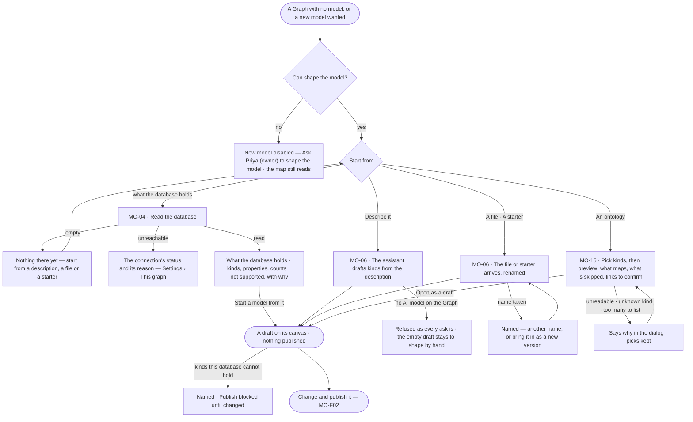
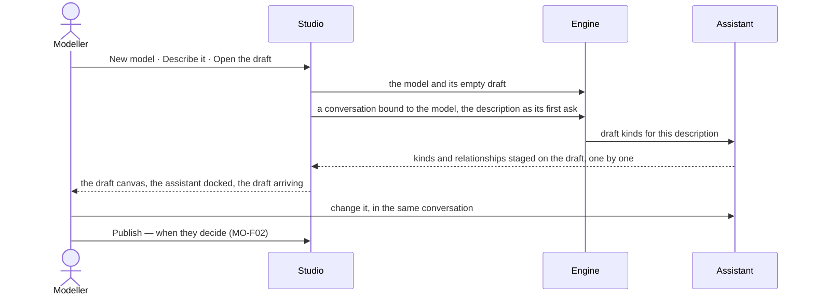

# Start a model

> A model is never started from a blank page: Invana drafts it from what the database already holds, from a
> description the assistant turns into kinds, from a file, a starter or an ontology a field already published. The
> person decides what to keep, and nothing is published until they publish it.

## User journey

Journeys this feature is a step of: [J01 · From an empty install to a first answer](../../../../journeys/J01-from-an-empty-install-to-a-first-answer.md)

## Stories

| ID | Story | Status |
|---|---|---|
| MO-04 | [Draft a model from the database](stories/MO-04-draft-a-model-from-the-database/story.md) | idea |
| MO-06 | [Start a model from a description, a file or a starter](stories/MO-06-start-a-model-from-a-description-a-file-or-a-starter/story.md) | idea |
| MO-15 | [Start a model from an ontology](stories/MO-15-start-a-model-from-an-ontology/story.md) | idea |

## Access

| Act | Role (`.claude/team/TEAM.md` §7) | Everyone else sees |
|---|---|---|
| See the models, the drafts and what the database holds | Operator — every member | — |
| Read the database · start a model from it | `modeller` · shown as *Can shape the model* | *Read the database* disabled — *Ask Priya (owner) to shape the model* |
| New model — describe it, a file, a starter, an ontology | `modeller` · shown as *Can shape the model* | *New model* disabled — *Ask Priya (owner) to shape the model* |
| Connect the database while creating a Graph | `owner` — the person creating the Graph is its owner | — |

## States

| State | What the person sees |
|---|---|
| First use | No model yet: the map says *No model yet* with *New model*, and *Read the database* when the database holds records |
| Empty after a filter | The ontology picker's search matches no kind: *No kind matches "<text>"* · *Clear* |
| Loading | *Reading the database…* with counts first; *Reading the ontology…*; a draft's canvas fills as kinds arrive |
| Has data | The new draft open on its canvas, its kinds staged, the draft bar counting them |
| Failed | The database unreachable, an unreadable file or ontology, a name taken — said in a sentence where it happened, with the next act; nothing half-made |
| Agent working or proposing | The assistant drafting kinds from a description, docked beside the draft, each kind arriving staged |
| No access | Every start disabled with *Ask Priya (owner) to shape the model*; the map and drafts still read |

## Rules

| Rule | Detail |
|---|---|
| A start is always a draft | Every way in lands on the new model's draft canvas; nothing publishes until a person does (MO-F02) |
| What the database holds is not the model | It is named as such, shown with the time it was read, and compared against the model; it never grounds an answer |
| A model is named for its domain | `Routes`, `Weather`, `Crews` — portable between Graphs; a Graph holds many, meeting only through declared links (MO-F03) |
| The database decides what a property can be | A property type the connected database cannot hold is refused when it is authored, naming the type and the database version; an import with one lands as a draft that cannot publish, naming it |
| Starters are ordinary models | Memory and Provenance ship as model files, renamed on arrival; nothing in Invana depends on their kind names |
| An ontology maps into Invana's model | RDFS, an OWL subset and schema.org, from JSON-LD, Turtle or RDF/XML. Subclasses are flattened; what Invana cannot hold is skipped and listed; equivalences come back as links to confirm, never made |
| Every kind keeps where it came from | A kind or property from an ontology keeps its source address |
| Leans on | Settings › This graph — the connection · MO-F02 — change and publish the draft · MO-F03 — links between models · Explore's assistant — the conversation that drafts |

## Data touched

| Record | Read or write |
|---|---|
| What the database holds — kinds, properties, counts, the time read | Read · write on each read |
| Model and its draft version — kinds, properties, keys, constraints, description, source addresses | Write |
| Starter model files shipped with Invana | Read |
| The conversation that drafts a described model | Write |

## Decisions

| Decision | Detail |
|---|---|
| One dialog for a new model | Name, description, then where to start — *Describe it* · *From a file* · *From an ontology* · *From a starter* · *Import a model file*; *Import* on the map opens it on *From a file* |
| *Describe it* is a conversation | *Open the draft* makes the model and its empty draft, then opens a conversation bound to it whose first ask is the description; the draft canvas opens with the assistant docked, and the person replies in the same thread |
| The description is the model's | What the person typed is kept as the model's description, shown on its head — not a hidden prompt |
| Reading the database is a run, and no view narrows it | It reads the whole database: what every view of the graph narrows is defined against it |
| The engine never fetches an ontology | Studio reads schema.org's current release, a URL or a file in the browser and sends the text; a server that refuses the browser is named, with *Download the file and choose From a file* |
| An ontology import is two steps in one dialog | Pick, then preview; *Back* keeps the picks; nothing survives a reload |
| The picker is the all-kinds preview | Up to 500 classes are listed with their property counts; above 500 the picker takes names |
| A first version changed everything | The first published version is compared against nothing, so every kind reads as added |

## Open questions

| Question | Who answers |
|---|---|
| — | — |

## Not building

| Item | Why not |
|---|---|
| Continuous sync with the database | Drift is shown on demand (MO-F04); a background sync invents a source of truth |
| Publishing a model by itself | A schema nobody chose is not a model |
| Guessing property types from sampled values | The database's own type report is the honest input |
| Inheritance between kinds | Flattening is clearer; inheritance leaks into every query |
| Free-form property bags | A model that allows anything grounds nothing |
| Reserved kinds, a starter marketplace, domain starters | Naming kinds forces one vocabulary on every domain; files and git are the registry |
| SHACL shapes, GQL graph types, OWL export | Later, in that order; source addresses make export cheap |
| Reasoning, inference, OWL restrictions as constraints | Invana's model is not a reasoner; they are listed as skipped |
| Fetching URLs or following `owl:imports` on the engine | The engine never fetches |
| Records from an ontology's individuals | A model, not data — data comes in through Data |
| Upgrading an ontology-made model from a newer ontology | An ontology import always creates a new model |
