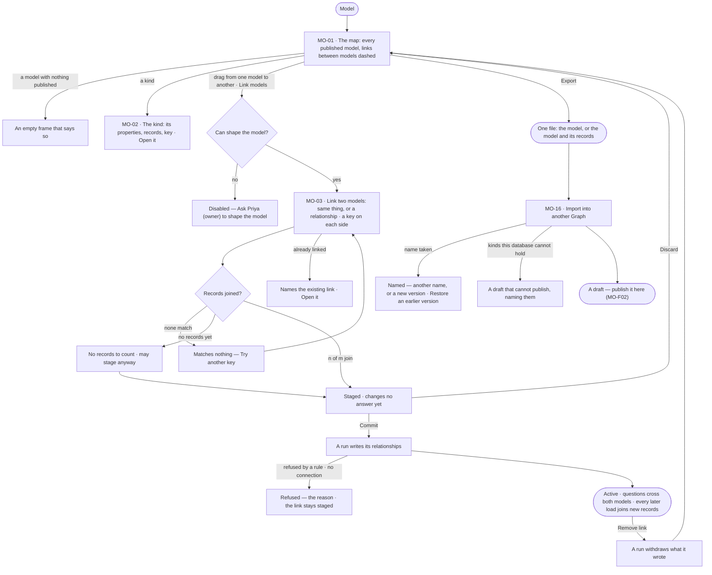
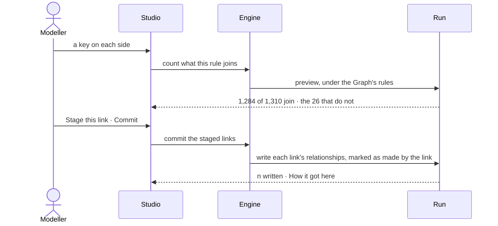

# Link and share models

> Every published model on one map, the links between them declared by a person — never guessed — and each model
> carried to another Graph as one file. The decision it helps make: *do these two models describe the same thing, and
> on which key?* — answered with the count of records each rule joins before it is made.

## User journey

## Stories

| ID | Story | Status |
|---|---|---|
| MO-01 | [See every model on one map](stories/MO-01-see-every-model-on-one-map/story.md) | idea |
| MO-02 | [Open a model and a kind](stories/MO-02-open-a-model-and-a-kind/story.md) | idea |
| MO-03 | [Link two models](stories/MO-03-link-two-models/story.md) | idea |
| MO-16 | [Export and import a model](stories/MO-16-export-and-import-a-model/story.md) | idea |

## Access

| Act | Role (`.claude/team/TEAM.md` §7) | Everyone else sees |
|---|---|---|
| Read the map, a model, a kind, the links between models and their history | Operator — every member | — |
| Link two models · commit or discard staged links · remove a link | `modeller` · shown as *Can shape the model* | *Link models* disabled — *Ask Priya (owner) to shape the model*; a drag between models does nothing and says why |
| Export a model, with or without its records | Operator — every member — a read; carrying confidential or personal data, or made by a key or an agent, a send ([An export](../../../../foundation/settings/product.md#decisions)) | — |
| Import a model · restore an earlier version | `modeller` · shown as *Can shape the model* | *Import a model file* disabled — *Ask Priya (owner) to shape the model* |

## States

| State | What the person sees |
|---|---|
| First use | No model published: each model an empty frame saying *Nothing published yet*; no link: *Links between models 0 — drag from one model to another to link them* |
| Empty after a filter | *Show* one model, or a search on links that matches none: *No link matches "<text>"* · *Clear* |
| Loading | The map lays out and frames itself before it shows; a link's count reads *Counting…*; the links count reads `—`, never `0` |
| Has data | Frames per model in their own hue, links dashed, the left section listing models, kinds and links |
| Failed | A refused link names the side, kind or key; a commit or removal refused by a rule or a missing connection keeps the link as it was; an unreadable file says why |
| Agent working or proposing | A run counting, writing or withdrawing a link's relationships; an ontology's equivalences offered as links to confirm |
| No access | The map, kinds and links read; linking, committing, removing and importing are disabled with *Ask Priya (owner) to shape the model* |

## Rules

| Rule | Detail |
|---|---|
| Declared, never guessed | Every link is declared by a person, on a key on each side matched exactly or ignoring case; nothing is inferred, no similarity score, no key guessed from a name |
| Two kinds of link | *Same thing* — two kinds are one entity, both kept, joined by a *same as* relationship. *Relationship* — a relationship between two kinds, its ends found by a key on each side, or by its own rows in a dataset — never both |
| Linking never merges | Both records stay; questions cross the link |
| Links bind published versions | A draft cannot be linked. A new version carries its links; links on the version it replaced stay as history |
| The whole model is derived | Every published model plus its active links, computed when read, never stored — and it is what every question is grounded in |
| A link stages before it counts | Declared links are listed, drawn and counted as *staged* and change no answer until committed; *Commit* activates every staged link at once, *Discard* drops them |
| An active link stands | Committing writes its relationships; every later load joins the records it brings. Writing again never writes twice |
| A link's relationships say so | Each is marked as made by its link, with the rule and when; removing the link removes exactly those, and only once they are gone does the link go |
| Every read and write is a run, under the Graph's rules | Counting, committing and removing a link; a rule that denies either model refuses it, with the reason — never counted around |
| A model travels as one file | A published version exports with its kinds, keys and constraints; links travel only when both ends are in the same file. Its identity is its package and its content, not its name, so a later import is recognised as a new version. Files and git are the registry |
| Leans on | MO-F01 · MO-F02 — the versions links bind · Data — datasets that bring a relationship's rows · Explore — questions that cross links |

## Data touched

| Record | Read or write |
|---|---|
| Model versions — published, and each kind's latest record count | Read |
| Link between models — kind, both models and kinds, both keys, match, relationship, status, who declared it, when, where from, relationships held | Read · write |
| Relationships a link writes in the graph | Write on commit and on each load · delete on removal |
| The link's history — declared, committed, removed, with the rule and what was withdrawn | Read · write |
| Queries that crossed each link over 30 days | Read |
| Model file — package, content hash, kinds, keys, constraints, links in the file; records, one file per kind, with where they came from | Read · write |

## Decisions

| Decision | Detail |
|---|---|
| The map is Model's landing | Every published model on one full-bleed canvas, each a frame in its own hue with its kinds inside; a link is the only line that crosses a frame, and every link is dashed. *Show* draws all models or one; *Detail* is circles · cards · property cards. Map · Health · History are its tabs |
| The left section lists | Models · Kinds of node · Links between models, each with its count; a model is opened from the list, the map or a breadcrumb |
| A kind opens in a peek | Its properties with type and *Must be*, its records, its key, *Change in a draft* and *Open <kind>*; open, it is a page of its model with Properties · Indexes · Constraints · Mappings |
| Link from the map or the list | Dragging a kind onto a kind in another model, or *Link models*, opens one card with both sides filled: *Same thing* or *Relationship*, *Source* and *Target*, a key on each side; a relationship adds its name and where its ends come from — *These keys* or *Its own rows* |
| The count fires itself | Naming both keys counts what they join — *1,284 of 1,310 join* — before anything is made; a zero disables *Stage this link* and offers *Try another key*, listing the keys that matched nothing |
| No records is not a verdict | With nothing loaded on a side, the card reads *No records to count* and stages anyway: a model is linked before its data lands |
| A refusal names what it refused | A pair already linked shows the existing link's rule with *Open the existing link* |
| A link reads whole | Selected, it shows its ends with their records, the rule with *n joined* or *n relationships*, the queries that crossed it in 30 days, who declared it and when, and its history; *Remove link* confirms first |
| Removed links are listed | From their removal, with who removed them, when and what was withdrawn |
| Export and import live in New model | *Export a model* is one act from *New model*; *Import a model file* opens a file as a draft, or, onto a model of the same name, *Restore* — a new draft with the exported version's kinds, what returns and what goes listed, a breaking removal reviewed at publish |
| Records travel in a bundle | *The model and its records* writes one file with the model, a records file per kind, and where they came from; importing it loads the records as an ordinary load after the model is published. Restore does not load records by default — the database already holds them |

## Open questions

| Question | Who answers |
|---|---|
| — | — |

## Not building

| Item | Why not |
|---|---|
| Inferred links, guessed keys, key transforms (trim, prefix, pattern) | A person decides what is the same; data that needs reshaping is reshaped in the dataset |
| Merging linked records | Lossy, with no undo |
| A stored whole model | Derived when read, so nothing to keep in sync |
| Linking drafts | Links bind published versions |
| Composite keys | One property a side — a rule read in one line is a rule someone audits |
| A relationship with both keys and its own rows | Two sources of truth for one relationship |
| Editing a model on the map | The map draws published versions; a model changes in its draft |
| A saved map layout | The arrangement is a view |
| Removing a link from the canvas | A link is removed where it is named in words |
| A hosted model registry | Files and git version and share them |
| Automatic upgrade on import | A schema change is a decision |
| Importing some kinds of a model file | A model is the unit; splitting it is a new model |
