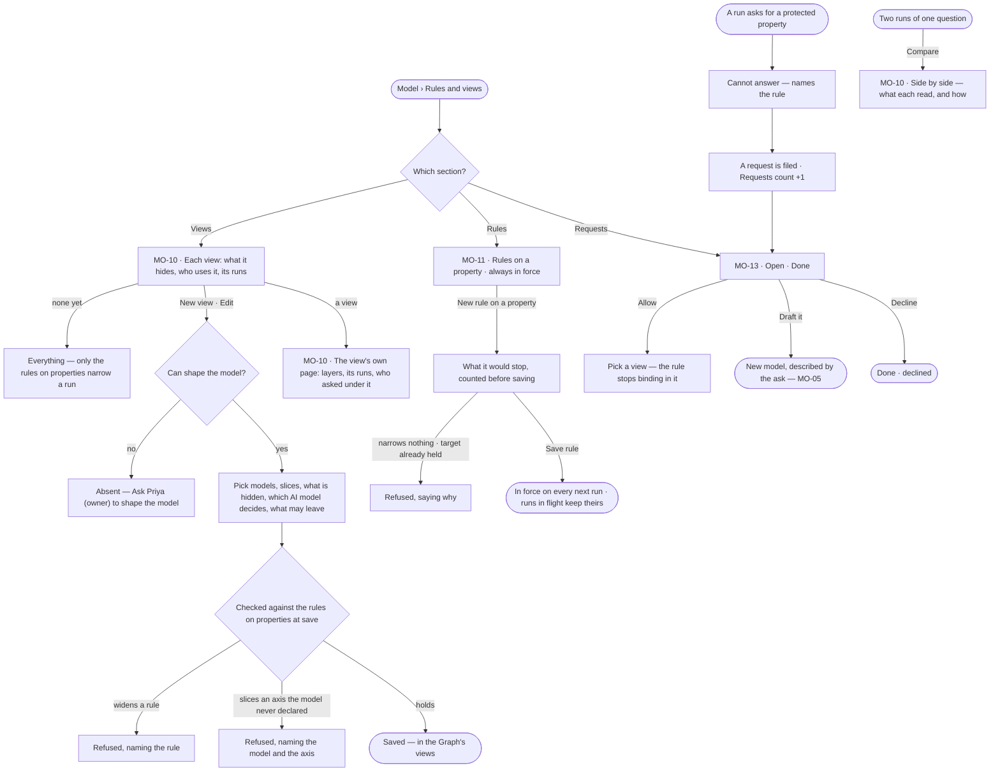

# Views of the graph and what must always hold

> What agents may see when they answer — a view of the graph picked per question and compared — inside the rules on
> properties that hold in every view, and one place for what people and agents asked to see or have modelled. The
> decision it helps make: *what may this answer rest on, and what must no answer ever read or send?*

## User journey



```mermaid
sequenceDiagram
  actor P as Analyst
  participant S as Studio
  participant E as Engine
  actor M as Modeller
  P->>S: asks in "EU · H1 2026"
  S->>E: the question and the view
  E->>E: composes the rules on properties, the agent's own and the view — frozen on the run
  E-->>S: the answer and what grounded it
  P->>S: Retune — a narrower view from this run
  S->>E: the same question, the new view
  E-->>S: a second run
  P->>S: Compare
  S-->>P: what each run read, and how each read differed
  E-->>S: a run reads Deal.price — cannot answer, naming the rule; a request filed
  M->>S: Requests · Allow in a view, Draft it, or Decline
```

## Stories

| ID | Story | Status |
|---|---|---|
| MO-10 | [Narrow what agents may see](stories/MO-10-narrow-what-agents-may-see/story.md) | idea |
| MO-11 | [Keep protected data protected](stories/MO-11-keep-protected-data-protected/story.md) | idea |
| MO-13 | [Act on what people and agents ask of the model](stories/MO-13-act-on-what-people-and-agents-ask-of-the-model/story.md) | idea |

## Access

| Act | Role (`.claude/team/TEAM.md` §7) | Everyone else sees |
|---|---|---|
| Read every view, every rule on a property and every request | Operator — every member | — |
| Pick a view for a question · compare two runs | Operator — every member | — |
| Retune from their own run into a view kept private to that run | Operator — every member | — |
| Name a view (it joins the Graph's views) · create, edit, duplicate or delete a view | `modeller` · shown as *Can shape the model* | Absent; *Ask Priya (owner) to shape the model* under the list |
| Create, edit or delete a rule on a property | `modeller` · shown as *Can shape the model* | Absent, not disabled; one line names who may edit |
| Allow, Draft it or Decline a request | `modeller` · shown as *Can shape the model* | The rows read; no acts |
| File a request — *Ask for a change* | Operator — every member | — |

## States

| State | What the person sees |
|---|---|
| First use | No view: *Everything — inside the rules on properties*, with *New view*. No rule on a property: *No rules on properties — every property may be read and may leave*. No request: *Nothing asked yet — refusals and asks the Graph could not answer land here* |
| Empty after a filter | *No rules here — Everywhere* · *This graph* · *A project*, with the filter to clear |
| Loading | The section heads hold their shape; rows are skeletons; *Save rule* waits while the impact reads *Counting…* |
| Has data | Views with what they hide and who uses them; rules with their scope and what they stop; requests Open, then Done folded |
| Failed | The section that could not load says which and why; a save the engine refused names the rule, model, axis or view behind it |
| Agent working or proposing | — |
| No access | Every section reads; authoring and resolving acts are absent, and a line names who may act |

## Rules

| Rule | Detail |
|---|---|
| Rules and views is one sheet | Opened from Model: *Rules* (what must always hold) · *Views* (what agents may see) · *Requests* (asked of the model by people and agents), the open requests counted in its head |
| A view narrows, never widens | A view may hide models, kinds and properties, slice a model, pick the AI model that decides and say what may leave. It never widens a rule on a property; one that would is refused at save, naming the rule |
| Five layers | A view narrows along graph data · AI models · third-party sources · cache · people; worker capacity is not a layer |
| Hidden is structural | A hidden property does not exist for the run — a query naming it is refused, and a whole record comes back without it. Nothing is filtered afterwards |
| Only declared axes slice | A published model declares which property carries time, which carries place and which are selectable dimensions; it declares none until a person does. A view slices only along declared axes — any other is refused naming the model and the axis. The axes travel with the model's file, and a declared axis naming a property the model lacks is refused at import |
| Default is the widest | A Graph with no view and no rule sees every published model, every AI model its owner configured and every third-party source its agents may use |
| Naming shares | A view made by retuning a run is private to that run. Naming it adds it to the Graph's views; the name field reads *Name it to add it to Views*. The name is unique in the Graph; only the first naming shares, a rename renames |
| One view per run | A run composes the rules on properties, its agent's own bound and its view once, when it opens, and keeps that; a later edit reaches only the next run |
| A view is picked, never typed | Every control offers what the Graph declares — published model versions, their axes, configured AI models, caches — with *any version* beside each exact version |
| Transaction time is the view's | A view may be pinned to what was known on a date; it is a field of the view, never a control beside the question |
| A rule on a property is one line | *When a run touches* `Kind.property` (either side may be *any*) · *it may* Read · Read in counts only · Never read · *and the result* May leave · Stays in the Graph. One rule per property, named from the rule — `Deal.price never leaves` |
| Counts only computes | *Read in counts only* lets a query filter, count and sum the property and never return its value |
| Stays in the Graph fails closed | It keeps record values out of every AI model and third-party call in the run, not only the one property's |
| A refusal files a request | A run that needs a protected property ends *cannot answer*, naming the rule, and the ask lands in Requests; the same open ask by the same person or agent adds to one request |
| Allow edits the rule | *Allow* adds a view to the rule's exceptions; runs asked in that view do not carry the rule. It is the rule's one exception and is named on it |
| Every edit is recorded | Creating, editing, deleting and allowing are events with before and after, in History |
| The engine counts every number | What a rule would stop, a view's runs, the open requests, compare's tallies — Studio formats, never derives |
| Leans on | MO-F02 — declaring axes in a draft · MO-F06 — the other rules in the same list · Explore — the view in the composer and *Ask for a change* · Agents › Runs — *Retune* and each run's layers |

## Data touched

| Record | Read or write |
|---|---|
| View — name, what it narrows per layer, the AI model per role, transaction time, its version | Read · write |
| Rule on a property — target, access, may leave, the views it is allowed in | Read · write |
| Request — the ask, who asked through what, the rule it met, its resolution | Read · write |
| Run — the frozen view and rules, what each step touched and what it was refused | Read |
| Published model versions and their declared axes | Read |
| Events — every edit and resolution | Write |

## Decisions

| Decision | Detail |
|---|---|
| One record, two uses | A view and a rule on a property are one kind of record, enforced on one path and frozen together onto a run — so *what was this run allowed to see* is one document |
| A view opens on the model | The Views section reads a view on the model's kinds — hidden ones dimmed, protected properties shielded — beside *Sees · Answers go · Used by*; with no view picked, the rules on properties alone |
| A view's own page is for auditing | Its head and *Edit*; tiles — rules · closed layers · in force · runs in 30 days · last used; the five layers with their state; the agents whose runs asked under it, read from the runs |
| Validated at save, not at run | A view that cannot legally run cannot be saved |
| Compare is two real runs | The same question in two views, each run properly, side by side — what each read, and for a shared read how it differed: slice, hidden properties, projection, models. Nothing is simulated; it is reached from a run |
| No count of what was hidden | A narrowed read records the rows it returned, never what an unnarrowed one would have |
| Deleting a used view is refused | Refused naming the schedules or agents that use it |
| A view naming an unpublished version | Listed with a warning naming the version; picking it is refused before a run opens |
| A rule on a property is read beside the model | *Rule · Refusals · History*; from a request, the request rides above it with *Allow* · *Decline* |
| Impact before saving | The engine counts the views and schedules that read the property today, before the write |
| A rule that narrows nothing is refused | *Read* with *May leave* permits everything |
| Requests are filed by the engine | Where the ask fails — a refusal by a rule, or *cannot answer · outside this graph* asked by a person or an agent, never an eval — and by *Ask for a change* |
| Draft it opens New model | Described by the ask; creating the draft resolves the request as modelled |
| Done rows say what was done | *declined* · *allowed in EU · H1 2026* · *modelled in Fares*, written by the engine |
| An agent's own bound is the agent's | Authored on the agent (AG-F01); this sheet lists the Graph's rules alone |

## Open questions

| Question | Who answers |
|---|---|
| — | — |

## Not building

| Item | Why not |
|---|---|
| Worker capacity as a layer | Workers are capacity, not something a view allows or denies |
| A view per step | The view is the run's circumstances; narrowing a step is its plan's job |
| Folders or tags for views | A Graph that needs to file its views has too many; naming is the filter |
| Views suggested from run history | *Allowed but never read* is already the suggestion, and a person reads it |
| Comparing two views without running them | What differs is in the answers and what they read, and those need runs |
| Sharing a view across Graphs | A Graph is the reasoning boundary |
| Masking what leaves | A view decides whether data may go, never a transformation of it |
| Most-specific-rule-wins | A deny a narrower allow can punch through is not a bound; a deny wins at any level |
| Separate rules for reading and writing | One address, one verdict |
| Alerting when a layer lights up | Invana is not a monitoring platform |
| Rules on properties per AI model or per call | What leaves is decided per class of data, not per property |
| An approval for a rule change | The event is the record |
| Rules that expire | A bound with a timer is a bound nobody watches |
| Applying a rule to past runs | A run keeps what it was frozen with, so its answer can be rebuilt |
| Starter sets of rules | A set that fits nobody is edited blindly |
| A rule on a whole layer | A rule on a property is one property; a layer bound is a view's or an agent's |
| Assigning a request to a person | One list for the Graph's modellers; the event names who resolved it |
| Reopening a done request | Asking again files a new one |
| A notification per request | The open count carries it |
