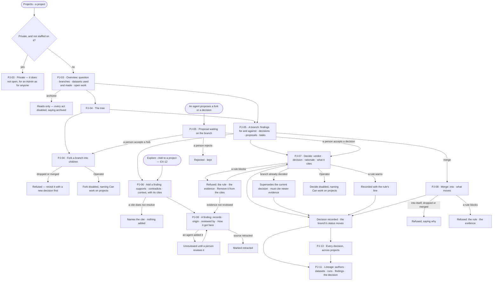
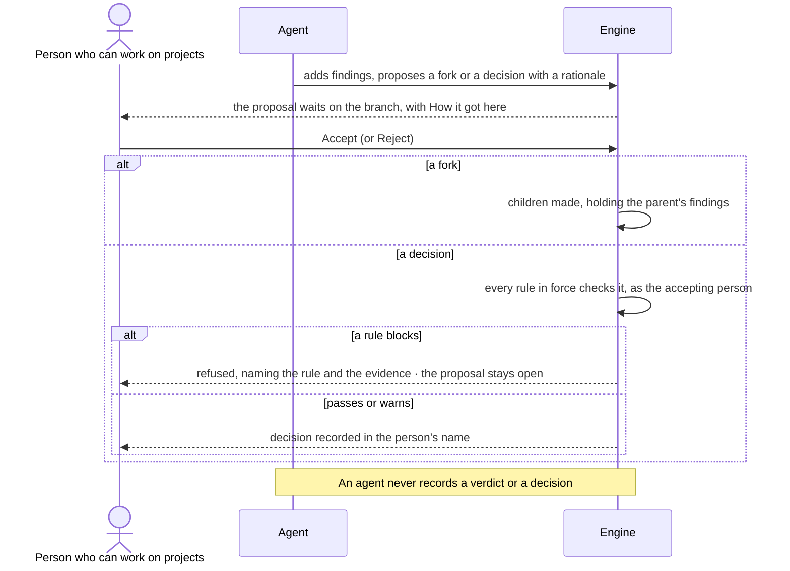

# Branches, findings and decisions

> A project is one question. Its lines of inquiry are branches; the evidence for and against each is a finding; a person
> closes a line with a verdict and a decision that the rules check. Agents propose; people decide. The decisions it
> helps make: *which line do we pursue, park, drop or merge — and what does it rest on?*

## User journey

Journeys this feature is a step of: [J03 · Give an agent work and decide on the result](../../../../journeys/J03-give-an-agent-work-and-decide-on-the-result.md)

## Stories

| ID | Story | Status |
|---|---|---|
| PJ-03 | [See where a project stands](stories/PJ-03-see-where-a-project-stands/story.md) | idea |
| PJ-04 | [Fork a line of inquiry and see the tree](stories/PJ-04-fork-a-line-of-inquiry-and-see-the-tree/story.md) | idea |
| PJ-05 | [Read a branch with its evidence and proposals](stories/PJ-05-read-a-branch-with-its-evidence-and-proposals/story.md) | idea |
| PJ-06 | [Weigh a finding and the records behind it](stories/PJ-06-weigh-a-finding-and-the-records-behind-it/story.md) | idea |
| PJ-07 | [Record a verdict and a decision the rules check](stories/PJ-07-record-a-verdict-and-a-decision-the-rules-check/story.md) | idea |
| PJ-08 | [Merge what one branch learned into another](stories/PJ-08-merge-what-one-branch-learned-into-another/story.md) | idea |
| PJ-11 | [Follow a decision back to the original authors](stories/PJ-11-follow-a-decision-back-to-the-original-authors/story.md) | idea |
| PJ-13 | [Audit every decision in one place](stories/PJ-13-audit-every-decision-in-one-place/story.md) | idea |

## Access

| Act | Role (`.claude/team/TEAM.md` §7) | Everyone else sees |
|---|---|---|
| Read a project the person may see, its branches, findings, decisions, lineage and the Decisions page | Operator — every member | A private project reads only to the people staffed on it; nobody else, an Admin included, can open it |
| Fork, merge, add or review a finding, record a verdict and a decision, accept or reject a proposal, file a task on a branch | `contributor` · shown as *Can work on projects* · Admin | Everything reads; each act is disabled, naming *Can work on projects* |
| Add findings, propose a fork or a decision | An agent | A proposal reads as waiting, with its rationale and *How it got here* |
| Record a verdict or a decision | A person with *Can work on projects*, never an agent | An agent can only propose |

## States

| State | What the person sees |
|---|---|
| First use | A project just started: the question as one open branch, *No findings yet*; a branch with no findings says so with *Add a finding*; Decisions says *No decisions yet* |
| Empty after a filter | The lineage narrowed by *Show* to an origin that holds nothing says so |
| Loading | The page is drawn at once; the lists, the tree and the lineage fill in |
| Has data | The overview, tree, branch, finding, decisions and lineage as their stories describe |
| Failed | The page could not load, saying why, with *Try again*; an act the engine refuses names the reason and changes nothing |
| Agent working or proposing | A proposal waits on its branch, an agent's finding reads *Unreviewed*; each opens *How it got here* |
| No access | A private project does not open; for an Operator without *Can work on projects* everything reads and each act is disabled, naming *Can work on projects* |

## Rules

| Rule | Detail |
|---|---|
| The type carries the words | A project's type sets what a branch, a finding, a verdict and a decision are called (below); the records underneath are the same for every type. Changing the type only relabels |
| One question, one tree | A project has one question; its first branch is the question as asked, open. Branches live inside the project and are never projects of their own |
| Branch status | open (the question, or a line not yet worked) · pursuing · parked (evidence kept) · dropped (kept, struck through) · merged. A decision moves it: pursue, park, drop, merge |
| Fork | Children hold the parent's findings and datasets; open tasks stay on the parent; the parent's status does not change |
| A finding has a stance | supports · contradicts · context; it cites records, dataset versions and runs. Origin and review come from where it was added |
| A person's finding is reviewed; an agent's is not | A person's is reviewed by them at once; an agent's waits for a person's *Review* |
| Verdict | In the type's words, separate from the decision; it addresses every contradicting finding on the branch |
| Rules check every decision | The rules in force on the install, the Graph and the project that check a decision (MO-F06): block refuses, naming the rule and the evidence that broke it; warn records it with a line; report records the check in History |
| Append-only | A decision is never edited or deleted. Revisiting one is a new decision that names the one it supersedes and cites a finding added after it |
| Merge is a decision | It carries chosen findings into another branch of the same project; findings are shared, never copied; both branches keep their history; the source is always marked merged |
| Agents propose | A fork or a decision, with a rationale; a person accepts or rejects; accepting a decision runs the full rule check as the accepting person |
| Datasets used | The dataset versions a branch's findings cite — no second list |
| Private projects | Seen only by the people staffed on them, an Admin included (PJ-F01) |
| Archived | An archived project reads; every act is disabled |
| Numbers are the engine's | Branch, finding, decision and proposal numbers, balances and *current · recorded* are stored by the engine; Studio formats them |
| Leans on | Projects and tasks (PJ-F01) · dataset versions and their retraction (DA-F01) · adding an answer as a finding (EX-F02) · runs and *How it got here* (AG-F03) · rules (MO-F06) |

| Project type | A branch is a | Evidence is a | Verdict | Decision |
|---|---|---|---|---|
| Research | Hypothesis | Finding | supported · refuted · inconclusive | pursue · park · drop |
| Policy | Option | Evidence | effective · harmful · unclear | adopt · amend · reject |
| General | Option | Evidence | supported · against · unclear | choose · park · drop |
| Investment | Thesis | Signal | holds · broken · unclear | invest · hold · pass |
| Market | Position | Insight | validated · invalidated · mixed | go · revise · no-go |
| Investigation | Lead | Evidence | confirmed · ruled out · open | escalate · monitor · close |

## Data touched

| Record | Read or write |
|---|---|
| Branches — number, parent, title, status, merged into | Write · read |
| Findings — statement, stance, cites, added by (person or agent), reviewed by | Write · read |
| Decisions — verdict, decision, rationale, cites, addressed findings, merged into, supersedes, rules checked, warnings, decided by | Write · read |
| Proposals — fork or decision, rationale, agent, who sent it, accepted or rejected, by whom | Write · read |
| Tasks filed on a branch (PJ-F01) | Write · read |
| Dataset versions cited, retraction notices (DA-F01) | Read |
| Runs cited and their steps (AG-F03) | Read |
| Rules in force (MO-F06) | Read |
| History rows of every fork, finding, review, decision and proposal (IN-F03) | Write · read |

## Decisions

| Decision | Detail |
|---|---|
| Launched types | Research, Policy and General are chosen at creation (PJ-F01); the other types carry their words but are not offered |
| Studio fills in what the engine requires | *Decide* addresses every contradicting finding and supersedes the current decision without asking |
| A refusal names what broke | A rule's refusal is drawn as a card naming the rule and the findings, with *Remove fN from the cites*; reviewing one is the finding page's *Review* |
| The tree is drawn | A fork is an edge, a merge a dashed *merged* edge, a dropped branch hollow; clicking a branch opens it; fork, decide and merge are acts on its page. The Overview keeps the indented list |
| Merge asks only what moves | What moves is also what the decision cites; the source is always marked merged — there is no *stays parked* |
| Levels of the path are named | *Projects › the project › H2 · title › the finding's statement*; a project, branch and finding are named for what they are, never their key |
| The page's state survives a reload | The open tab, branch, finding and decision ride in the address; moving to another project clears them |
| A finding's page | The statement is its title; *Added by* and *reviewed by* name the person or agent through the project's staff, as *By* does on Decisions; a run cite reads `run 8195c5e8` and opens the run |
| Lineage is built from records | A decision, its cited findings, their run and dataset cites, each dataset's author chain — never inferred; every node opens its source; *Show* narrows the datasets and their authors to one origin; a list of every node's hops under the drawing serves readers who cannot use it |
| Who decided | Decisions names a decider from each project's staff and the signed-in person; anyone else reads *a person*. *Export for audit* is a CSV of the rows shown |
| Current is counted by the engine | *2 current · 5 recorded*; it reads *5* alone when they match |
| Add from Explore | A settled answer reaches *Add a finding* through *Add to a project* (EX-12) |

## Open questions

| Question | Who answers |
|---|---|
| May a branch be decided with no findings cited? The source is silent. Recommend: yes, the dialog says *This cites nothing* and the rules decide whether to block it, so a project can record a decision taken without evidence rather than hide it | Ravi |

## Not building

| Item | Why not |
|---|---|
| Editing or deleting a decision or a finding | Append-only is the point; a newer finding or a superseding decision replaces |
| Agents deciding | Agents propose; people decide |
| Type authoring | Six built-in types |
| A dataset list per branch | The datasets used are the dataset versions its findings cite |
| A *Datasets* tab, and a branch's *Runs* and *Schedules* tabs | Not yet: the Overview lists datasets used; runs and schedules are listed elsewhere |
| A *stays parked* choice on merge | A merge always marks the source merged |
| Lineage from the command line | Not yet; Studio draws it from the same records |
| Simulation and impact on a branch | PJ-F04 |
| Reports drafted from the records | PJ-F05 |
| Staffing other people from Studio | Not yet; the creator is staffed (PJ-F01) |
