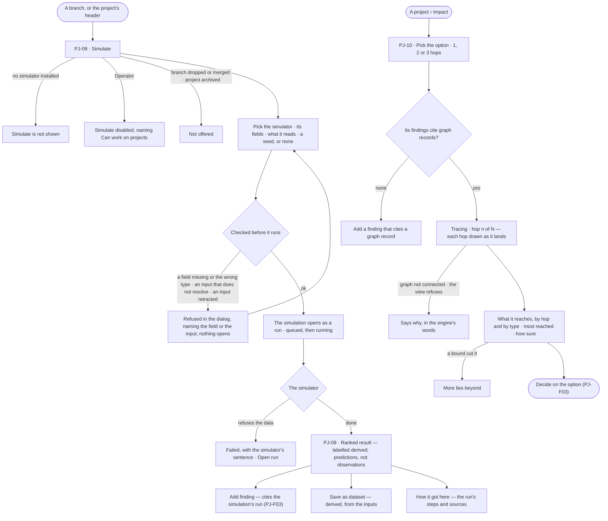
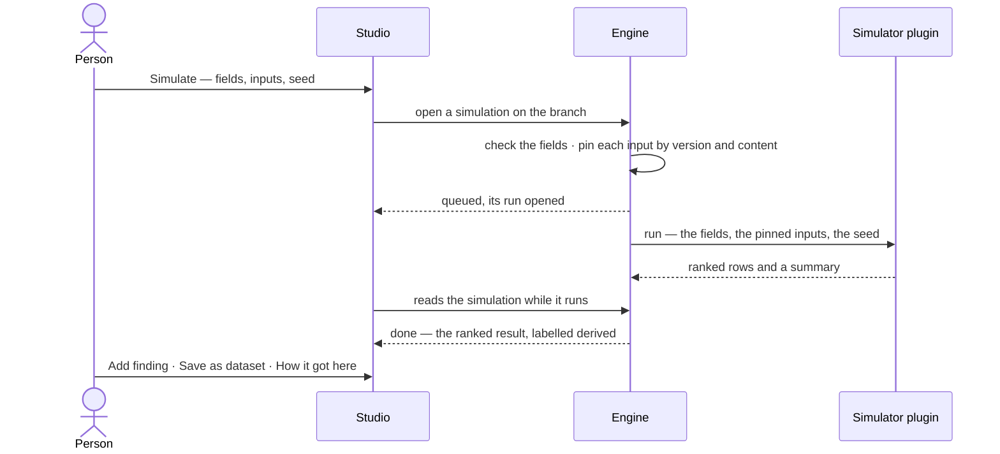

# Simulation and impact

> Before committing to a branch, try it: run a simulator over pinned datasets to rank what is likely to work, and see
> what the option reaches over the graph, hop by hop. The decisions it helps make: *which bet is worth a season?* —
> and *who does this decision reach before I commit to it?*

## User journey

## Stories

| ID | Story | Status |
|---|---|---|
| PJ-09 | [Simulate before committing](stories/PJ-09-simulate-before-committing/story.md) | idea |
| PJ-10 | [See what a decision reaches](stories/PJ-10-see-what-a-decision-reaches/story.md) | idea |

## Access

| Act | Role (`.claude/team/TEAM.md` §7) | Everyone else sees |
|---|---|---|
| Read a project's simulations, their results and their runs | Operator — every member who can see the project | — |
| Simulate · add a finding from a result · save a result as a dataset | `contributor` · shown as *Can work on projects* · Admin; saving a dataset also needs what DS-F01 asks to publish one | *Simulate*, *Add finding* and *Save as dataset* disabled, naming *Can work on projects* |
| Read the impact of an option | Operator — every member who can see the project; every read is under the Graph's view | — |
| Install a simulator | Admin — as a plugin (ST-F04) | — |

## States

| State | What the person sees |
|---|---|
| First use | A branch with no simulations: its *Simulations* tab reads *No simulations yet*, with *Simulate*. Impact with no record cites: *Add a finding that cites a graph record* |
| Empty after a filter | — |
| Loading | The result and the Impact tab drawn at once; rows and rings land in place |
| Has data | A ranked result, labelled derived; impact rings by hop and by type, with the most reached records and how sure the evidence is |
| Failed | A refused simulation stays in the dialog naming the field or input; a failed run shows the simulator's sentence beside *Open run*; an impact read that is refused says why |
| Agent working or proposing | A simulation queued or running, its run's status shown and followed; impact tracing, saying which hop it is on |
| No access | Results and impact read; *Simulate*, *Add finding* and *Save as dataset* disabled, naming *Can work on projects* |

## Rules

| Rule | Detail |
|---|---|
| The simulator does the science | A simulator is a plugin; Invana checks its fields, pins its inputs, runs it and labels the result — it never computes a figure itself |
| A simulation is a run | It runs the simulator's plan under the Graph's rules, with no agent; its run page, trace and tokens are the run's own, and its result is read from the run |
| Inputs are pinned | Each input dataset is pinned by version and content at open; a version retracted since is refused before any record is read |
| Reproducible | The seed is kept — Invana picks one when none is given; the same simulator version, fields, inputs and seed give the same result |
| Fields are what the simulator declares | The dialog draws one control per declared field; a missing or mistyped field is refused before a run opens. Data a simulator cannot use is its own refusal, in its words |
| Where it is offered | On a branch's header, and on the project's with the branch to pick. Never on a dropped or merged branch or an archived project; a parked branch may be simulated. Hidden while no simulator is installed |
| Always derived | Every result reads *derived* and says its rows are predictions, not observations; saved as a dataset it is derived, from the simulation's inputs |
| Reuse, not new acts | *Add finding* is the finding of PJ-F03, citing the simulation's run; *Save as dataset* is DS-F01's dataset |
| Numbered per project | *s1*, *s2*, like branches and findings, because people type them |
| A record, never edited | A simulation is kept as it ran; to change it, simulate again. A simulator removed since still reads, with the version it ran |
| Reach starts from the evidence | Impact starts from the graph records the option's findings cite, every stance, and walks 1, 2 or 3 hops (2 by default); each hop is what the one before reached, less what was already reached |
| Bounded, and says so | At most 12 records expanded per hop, each to 50 neighbours, the most-reached first; a cut reach reads *More lies beyond* |
| Under the view | Every impact read is Explore's expand, under the Graph's view, so a type the view hides is never reached |
| How sure is the evidence's | How many of the findings it starts from a person reviewed, and the origins of the datasets they cite — never a score |
| Reach only | No what-if values and no figure in any currency |
| Leans on | Branches and findings (PJ-F03) · datasets and their versions (DS-F01) · runs (AG-F03) · Explore's expand (EX-F01) · plugins (ST-F04) |

## Data touched

| Record | Read or write |
|---|---|
| Simulations — branch, number, simulator and its version, fields, seed, pinned inputs, the run, who and when | Write · read |
| The simulation's run and its result (AG-F03) | Write · read |
| Dataset versions it reads, and the derived dataset it may save (DS-F01) | Read · write |
| Findings citing a simulation's run (PJ-F03) | Write |
| The graph, through Explore's expand, for impact | Read |

## Decisions

| Decision | Detail |
|---|---|
| Simulating is project work | It needs *Can work on projects*, like any act on a branch; no new role |
| The result is a drill-in of the project | It follows the run while it runs and stays on reload; the branch lists its simulations in a *Simulations* tab, newest first |
| Impact is a tab of the project | The option and the hops are picked on it and kept on reload; it is read from the graph each time, never saved |
| One option at a time | Impact shows one option's reach; switching the option replaces it |
| Words for every reader | The impact canvas is also listed in words, every group and link, for a reader who cannot see it |

## Open questions

| Question | Who answers |
|---|---|
| — | — |

## Not building

| Item | Why not |
|---|---|
| What-if values per node | A simulator's job, when a policy model exists |
| Parameter sweeps · game theory | After 1.0 |
| An agent simulating | A simulation is a person's act on a branch; an agent proposes |
| Editing or deleting a simulation | It is the record of a run; simulate again |
| Comparing two options' impact side by side | One option at a time |
| Impact saved as a record | A decision cites findings, not a reach |
| Enabling a simulator per Graph | A simulator is there whenever its plugin is installed |
