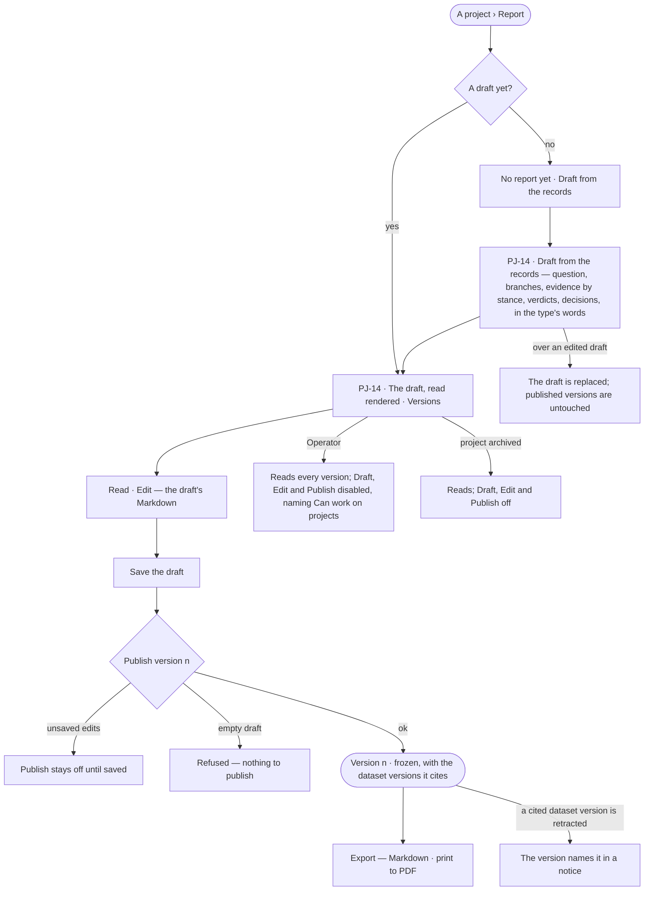

# Project reports

> A project written up from its own records — drafted, edited by a person, and published as frozen versions that cite
> the dataset versions behind them. The decision it helps make: *is this what we decided, and is it ready to
> circulate?* — and later, *does a retracted source change what we published?*

## User journey

Journeys this feature is a step of: [J03 · Give an agent work and decide on the result](../../../../journeys/J03-give-an-agent-work-and-decide-on-the-result.md)

## Stories

| ID | Story | Status |
|---|---|---|
| PJ-14 | [Publish what we decided](stories/PJ-14-publish-what-we-decided/story.md) | idea |

## Access

| Act | Role (`.claude/team/TEAM.md` §7) | Everyone else sees |
|---|---|---|
| Read the draft and every version · export a version | Operator — every member who can see the project | — |
| Draft from the records · edit the draft · publish a version | `contributor` · shown as *Can work on projects* · Admin | Every version reads; *Draft from the records*, *Edit* and *Publish* disabled, naming *Can work on projects* |

## States

| State | What the person sees |
|---|---|
| First use | *No report yet*, with *Draft from the records* |
| Empty after a filter | — |
| Loading | The Report tab drawn at once; the draft lands in place |
| Has data | The draft or a version, read rendered, its cites numbered and listed once under *Cites*; *Versions* counts the draft and every version |
| Failed | The report could not load, saying why, with *Try again*; publishing an empty draft is refused |
| Agent working or proposing | — |
| No access | The draft and every version read; *Draft from the records*, *Edit* and *Publish* disabled, naming *Can work on projects* |

## Rules

| Rule | Detail |
|---|---|
| Drafted from the records | The draft is written by a template from the project's question, branches, evidence by stance, verdicts and decisions, in the project type's words — nothing invented, no AI model |
| A person edits | The draft is Markdown, edited by a person before it is published |
| One report per project | A single draft and its numbered versions |
| Published is frozen | A version freezes its body and the dataset versions its findings cite at that moment; nothing changes it. A later change is a new version |
| What is published is saved | *Publish* stays off while the draft has unsaved edits |
| Read, never stored | A version that cites a dataset version retracted since names it in a notice, read each time it is opened |
| Read rendered | Headings, lists, bold and paragraphs in the kit's typography; a finding's cites as numbered marks listed once under *Cites*, a run as *run 8195c5e8*. *Read · Edit* switches the draft to its Markdown |
| Export | Markdown — the version's body, or the draft's, as it reads; PDF — the browser's print of the rendered version |
| An archived project | Its report reads; drafting, editing and publishing are off |
| Leans on | Branches, findings and decisions (PJ-F03) · dataset versions and retraction (DA-F01) |

## Data touched

| Record | Read or write |
|---|---|
| The report — its draft, who last edited it and when | Write · read |
| Report versions — number, body, the dataset versions cited, who published and when | Write · read |
| The project's question, branches, findings, verdicts and decisions (PJ-F03) | Read |
| Dataset versions and their retraction (DA-F01) | Read |
| History rows of every draft and publish (IN-F03) | Write |

## Decisions

| Decision | Detail |
|---|---|
| A template drafts, not a model | *Nothing invented* is a property of the template; a rewrite by the assistant is a later act on the draft, never the draft itself |
| A report is a tab of the project | The draft and its versions sit on the project's Report tab |

## Open questions

| Question | Who answers |
|---|---|
| The `projects.report` board draws the draft as written by an agent (*Route analyst*); the rules say a template drafts it. Redraw the board, or let an agent draft it? Recommend: redraw — a template keeps *nothing invented* provable | Ravi |

## Not building

| Item | Why not |
|---|---|
| PDF made by the engine | The browser's print of the rendered version is the PDF |
| Drafting by an AI model | A template draws only on the records |
| Several reports per project | One draft, numbered versions |
| Editing a published version | Publish a new one |
