# ST-14 · Name, describe and connect this graph

**As** a Graph owner **I want** the Graph's name, instructions and the one database it reads in one place, proven to
work before anything depends on it **so that** the Graph is grounded and reachable, and nothing is built on a
connection that was never proven.

Tasks: [task.md](task.md) · Feature: [ST-F01](../../feature.md)

## Who can

| Lens | Can | Otherwise sees |
|---|---|---|
| Admin | Change name, description and instructions; archive and unarchive; change the connection after a passing test; read the database's types again | — |
| Operator | Read the Graph's name, description, instructions and its connection — engine, version, address, user, database, status | Fields read-only; the password field is absent; *Save*, *Archive*, *Test connection* shown as *Ask Priya (owner)* |

## Flow

```mermaid
flowchart TD
  s([Settings › This graph]) --> g["General: name · description · instructions"]
  g -->|setup unfinished| tl["The setup timeline leads"]
  g --> sv{"Save"}
  sv -->|refused| sf["Says what is wrong"]
  sv -->|ok| gs(["Saved"])
  g --> ar["Archive · confirm"] --> ad(["Archived · Unarchive offered"])
  s --> c["Connection: engine · version · address · status · last connected"]
  c --> ch["Change address, user, password or database"]
  ch --> t{"Test connection"}
  t -->|fails| tf["The database's own error · Save stays off"]
  t -->|passes| ok(["Save · reconnects · status refreshes"])
  ch -->|untested| off["Save off · Test the connection to save it"]
  c --> rd["Read the database's types again"]
  c -->|without Owner| ask(["Reads · acts show Ask Priya (owner)"])
```

## Acceptance criteria

| # | Given | When | Then |
|---|---|---|---|
| ST-14.1 | An owner | they change name, description or instructions and save | it saves; a refused save says what is wrong, in the engine's words |
| ST-14.2 | Required setup unfinished | General opens | the setup timeline leads it |
| ST-14.3 | An owner | they archive the Graph, confirming | it is archived and *Unarchive* is offered |
| ST-14.4 | A Graph with a connection | Connection opens | a summary reads — engine and server version, connector and address, status and the last time it connected — then address, user, password, database, server version and read-only |
| ST-14.5 | A saved connection | Connection opens | the user reads back; the password field is blank, saying it is stored encrypted and blank keeps it |
| ST-14.6 | A change to address, user, password, database or connector | it has not passed *Test connection* | *Save* is off, saying *Test the connection to save it* |
| ST-14.7 | A test that fails | it returns | the database's own error shows under the fields and *Save* stays off |
| ST-14.8 | A test that passes | the owner saves | the Graph reconnects; the status reads connector, server version, type count and read-write, in that order |
| ST-14.9 | A blank password | the owner tests or saves | the stored password is used |
| ST-14.10 | A saved connection | the owner looks for the connector | it is fixed; only address, user, password and database change |
| ST-14.11 | A blank database | the connection reads | it says *connector default*, never an invented name |
| ST-14.12 | A connection marked read-only | anything would write to it | nothing writes to it, by any path |
| ST-14.13 | Credentials rotated outside Invana | the status is read | it reads unreachable, with the last time it connected |
| ST-14.14 | A test | it runs | History records who tested it and when (IN-F03) |
| ST-14.15 | An Operator | they open General or Connection | everything reads but the password; *Save*, *Archive* and *Test connection* are shown as *Ask Priya (owner)* |

## Screens

| Surface | Lens | First use | Empty after a filter | Loading | Has data | Failed | Agent working or proposing | No access |
|---|---|---|---|---|---|---|---|---|
| General | Admin | settings.people · General · Setup unfinished | — | settings.people · Loading | settings.people · General | settings.people · General · Could not save | — | — |
| General | Operator | settings.people · General · Setup unfinished | — | settings.people · Loading | settings.people · General · Read only | settings.people · Could not load | — | settings.people · General · Read only |
| Connection | Admin | — | — | settings.people · Loading | settings.people · Connection | settings.people · Connection · Test failed | — | — |
| Connection | Operator | — | — | settings.people · Loading | settings.people · Connection · Read only | settings.people · Connection · Unreachable | — | settings.people · Connection · Read only |
