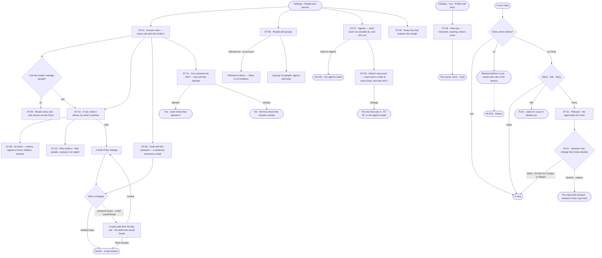
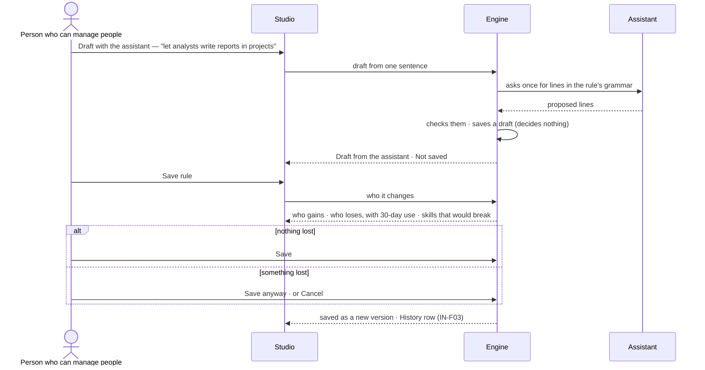

# People and access

> Who may do what in this Graph — people, groups, agents and keys — read as sentences in one sheet, changed on
> purpose, and proven before anything runs. The decision it helps make: *should this person, team, agent or key be
> able to do this — and what breaks if I change it?*

## User journey

Journeys this feature is a step of: [J05 · Join a Graph someone set up](../../../../journeys/J05-join-a-graph-someone-set-up.md) · [J06 · Set what an agent may touch](../../../../journeys/J06-set-what-an-agent-may-touch.md)

## Stories

| ID | Story | Status |
|---|---|---|
| ST-01 | [Read every access rule and who holds it](stories/ST-01-read-every-access-rule-and-who-holds-it/story.md) | idea |
| ST-02 | [Say exactly what an access rule allows](stories/ST-02-say-exactly-what-an-access-rule-allows/story.md) | idea |
| ST-03 | [Set limits on an access rule](stories/ST-03-set-limits-on-an-access-rule/story.md) | idea |
| ST-05 | [Draft an access rule and see who it changes](stories/ST-05-draft-an-access-rule-and-see-who-it-changes/story.md) | idea |
| ST-06 | [Read access without the grant and know who to ask](stories/ST-06-read-access-without-the-grant-and-know-who-to-ask/story.md) | idea |
| ST-07 | [See why an agent can or cannot](stories/ST-07-see-why-an-agent-can-or-cannot/story.md) | idea |
| ST-08 | [Grant a team once, with people and groups](stories/ST-08-grant-a-team-once-with-people-and-groups/story.md) | idea |
| ST-09 | [Mint a key that acts as its holder, narrowed](stories/ST-09-mint-a-key-that-acts-as-its-holder-narrowed/story.md) | idea |
| ST-10 | [See and change who holds an access rule](stories/ST-10-see-and-change-who-holds-an-access-rule/story.md) | idea |
| ST-11 | [Test whether someone can do something](stories/ST-11-test-whether-someone-can-do-something/story.md) | idea |
| ST-30 | [See what an agent may touch](stories/ST-30-see-what-an-agent-may-touch/story.md) | idea |
| ST-31 | [A denied agent asks for more](stories/ST-31-a-blocked-agent-asks-for-more/story.md) | idea |

## Access

| Act | Role (`.claude/team/TEAM.md` §7) | Everyone else sees |
|---|---|---|
| Read every access rule, its lines, limits, holders and versions | Operator — every member | — |
| Read people, service accounts, groups and each agent's access | Operator — every member | — |
| *Can someone do this?* — test access | Operator — every member | — |
| New rule · Edit · Delete · Draft with the assistant · Save | `iam-admin` · shown as *Can manage people* | The act is shown as *Ask Priya*, naming someone who can manage people; the tooltip names the grant |
| Add people, a group or an agent to a rule · take them off | `iam-admin` · shown as *Can manage people* | As above |
| Add person · New service account · New group · a group's members | `iam-admin` · shown as *Can manage people* | As above |
| Mint and revoke one's own key | Operator — every member | — |
| Mint a key for a service account · revoke another holder's key | `iam-admin` · shown as *Can manage people* | The holder field offers only *You*; *Revoke* on another's key is disabled, naming who can manage people |
| An agent's access from its own sheet | Read: every member · attach a rule: `iam-admin` | As above |
| Read what an agent may touch — every item's mode, its level and who set it | Operator — every member | — |
| Set a mode on a rule's line | `iam-admin` · shown as *Can manage people*, as writing the rule | As above |
| Edit an agent's own rule — tighten only | `builder` · shown as *Can build agents* · Admin, from the agent's sheet (AG-F01) | Each mode reads; changing it is disabled, naming *Can build agents* |
| Decide an agent's ask for more | Whoever may change the mode that denied it (IN-F01) | The ask reads; its acts are disabled, naming who it waits on |

## States

| State | What the person sees |
|---|---|
| First use | Only the six built-in rules, one per grant, and a rule for everyone if there is one; *New rule* and *Draft with the assistant* lead. People: the Graph's members; Groups: *No groups yet — attach a rule once, to a team* with *New group*. Keys: *No keys yet* — what a key is for, and *New key* |
| Empty after a filter | *Nothing matches*, with the filter named and *Clear filters* |
| Loading | The sheet opens at once; lists show loading rows; counts read `—` until the engine gives them |
| Has data | Access rules one row each, the selected one beside them: what it allows, its limits, who holds it |
| Failed | What could not load or save, in a sentence, with *Try again*; a refused save says why in place, naming the line or the name |
| Agent working or proposing | *Draft from the assistant · Not saved*, with who it changes, before anything changes · an agent denied by a mode, asking for more in Needs you |
| No access | Every rule, person, group and agent reads; each write is shown as *Ask Priya*, naming someone who can manage people |

## Rules

| Rule | Detail |
|---|---|
| Allowed only where every check allows | What the skill needs ∩ the agent's access rules ∩ the person who started the run ∩ the view of the graph ∩ every rule for everyone ∩ a key's own rule ∩ an agent's own rule. A refusal names the check and the rule (or the person) that refused |
| Nothing is allowed that no rule allows | Every line allows, except a Deny, which goes only on the *For everyone* rule and on an agent's own rule ([Deny inside one Graph](../../product.md#decisions)). A rule for everyone is how a Graph keeps something back; the other rules a holder has still add up |
| Five kinds of access rule | *Built in* — the six grants (Operator · Can work on projects · Can build agents · Can shape the model · Owner · Can manage people), read-only · *Custom* · *A key's own* — narrows one key · *An agent's own* — narrows one agent, edited from its sheet by *Can build agents*, and only tightens · *For everyone* — the most anyone in the Graph may do, held without being given |
| A line | What may be done · to what · with conditions · and, for agents, a mode — Allow · Ask · Deny ([the three modes](../../product.md#decisions)). Conditions are only: some fields (only these · all but these), helper depth (at most N levels), until (an instant) |
| What it reaches | Lines group by what they reach: graph data · AI models · outside (the web, MCP tools, mail) · cache · people · agents (making helpers, handing work on) · projects · datasets |
| Who holds access | People (members and service accounts), groups and agents. A key acts as its holder. Workers hold none — they only run steps |
| A group passes on what it holds | Every person and agent in it holds what the group holds, built-in rules included; nothing is copied |
| An agent never does more than its starter | A run a person started is bounded by what that person may do |
| Helpers hold their maker's access | A helper an agent makes holds its root agent's access, narrowed; never rules of its own. An agent handed work holds its own |
| A draft decides nothing | A new rule is a draft until saved; a saved rule changes by saving a new version, after its impact |
| Saving shows who it changes | Who gains, who loses (with each loss's use in the last 30 days), which agents move to another mode, and which skills would break — before the save |
| The tightest limit binds | Limits sit on rules; across a holder's rules the tightest wins. An agent's own settings sit under them; one above is refused when saved, naming the rule |
| A key can only narrow | A key acts as its holder and may carry its own rule; it is never wider than the holder, and the holder's own access still applies |
| Disabled, never hidden | Without *Can manage people* every write shows, shown as *Ask <name>* (design language §5); reading is every member's |
| Asks for access go to the Inbox | An ask for access, a higher limit, or more than a mode allows (ST-31) is an ask in Needs you (IN-01); allowed, it adds the holder for this run · N days · always, and *Who holds it* says when it ends |
| Leans on | Asks (IN-F01) · History of every change and refusal (IN-F03) · agents built in Agents (AG-F01) · views of the graph (MO-F05) · members of the Graph (ST-F01) |

## Data touched

| Record | Read or write |
|---|---|
| Access rules — kind, lines, limits, version, who drafted it | Write · read |
| Versions of a rule — who saved it, when, why | Write · read |
| Holdings — who holds a rule, how (directly · via a group · for a run), who added them, when it ends | Write · read |
| A line's mode for agents — Allow · Ask · Deny — and who set it | Write · read |
| Groups and their people and agents | Write · read |
| Service accounts | Write · read |
| Keys — name, holder, its own rule, expiry, last used | Write · read |
| Refusals in History (IN-F03) | Read |
| Usage against limits — tokens, agents at once, helpers — stored by the engine | Read |

## Decisions

| Decision | Detail |
|---|---|
| Access is a sheet in Settings | *Settings › People and access* opens as a sheet with tabs *Access rules · People and groups · Agents · Keys*; a rule, a group or an agent drills in and the crumb grows. It is not a product of its own |
| Access rules read as sentences | A rule's name and lines read as plain sentences (*Analysts can ask*); the exact lines are one click deeper |
| The grants are built-in rules | The six grants are the built-in rules; holding *Can build agents* is holding that rule. They cannot be edited or deleted |
| Agents are read here, built in Agents | The Agents tab reads each agent's access; *Open in Agents* opens its sheet. A rule added to an agent from either side is one record |
| Every member reads | Reading access is never gated; only changing it is |
| Test access writes nothing | *Can someone do this?* runs the engine's own check without running anything; a link may carry the check and opens filled |
| Keys are shown once | A key's secret is shown once, at creation, and never again |
| Rules as files | `invana iam apply · list · show` writes and reads custom and for-everyone rules as files, printing who it changes first |

## Open questions

| Question | Who answers |
|---|---|
| The board names a key *Access key* (*Profile and keys*); the glossary says *Personal access token*. Recommend: *key* on screen — shorter, and the board already reads it; the glossary changes with Ravi's yes | Ravi |
| What does *Ask Priya* do when pressed? The board links it to the Inbox; the source docs build no access-request flow and only name who to ask. Recommend: it raises an ask for the grant in that person's Needs you (IN-01), as an agent's ask for access does | Ravi |
| The board's limits read *Tokens a day* and *Runs at once*; the rules carry tokens a month and a run, and agents at once. Recommend: a month and a run, as the engine stores them; the board is redrawn | Ravi |

## Not building

| Item | Why not |
|---|---|
| Lines that forbid, beyond Deny | Deny goes only on the *For everyone* rule and an agent's own rule; anywhere else, precedence is where access gets unreadable |
| Conditions beyond fields, depth and until | Time windows, addresses and tags are unproven |
| Rules shared across Graphs | Everything is per Graph |
| Rules on workers | Workers run any agent's steps; access belongs to the agent |
| Nested groups | One level carries teams |
| Custom grants | A custom rule carries what a grant cannot; the six grants stay the product's words |
| Per-record permissions | What a rule reaches is the unit; a finer grain is unproven |
| Invitations | A member is added directly by email or username |
| Stored connections — OAuth or API keys for outside sources | Invana pulls from and pushes to no outside source yet; an MCP server's credential lives on the workers |
| Sign-in providers | Password sign-in first; single sign-on is install setup, later |
| A page of requests | An ask for access is an ask in the Inbox (IN-01) |
| Building agents here | Agents builds them (AG-F01); this reads them |
| Showing a key's secret again | A secret that can be read back is a stored password |
| What a key did, per key | Last used is the key's only record of use; History records the person |
