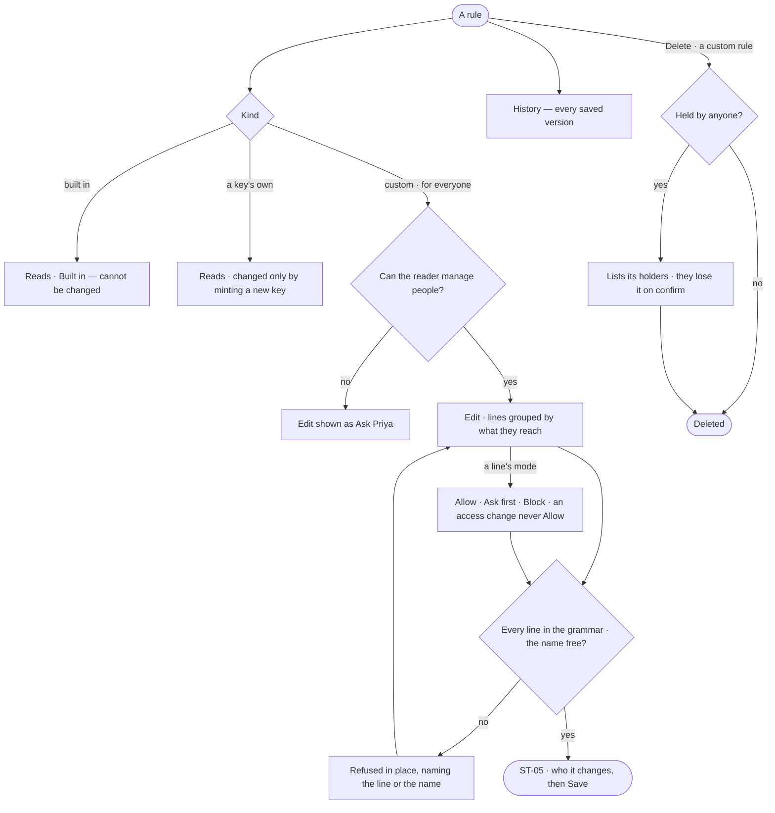

# ST-02 · Say exactly what an access rule allows

**As** someone who can manage people **I want** an access rule written as lines — what may be done, to what, with
conditions — grouped by what each reaches **so that** I grant exactly what a job needs and nothing more.

Tasks: [task.md](task.md) · Feature: [ST-F02](../../feature.md)

## Who can

| Lens | Can | Otherwise sees |
|---|---|---|
| Admin | Read a rule's lines and versions; write a custom or for-everyone rule; delete one | A built-in rule reads, *Built in — cannot be changed*, with no *Edit* |
| Operator | Read a rule's lines and versions | *Edit* and *New rule* shown as *Ask Priya*, naming someone who can manage people |

## Flow

## Acceptance criteria

| # | Given | When | Then |
|---|---|---|---|
| ST-02.1 | A rule | it is opened | *What it allows* reads as sentences (*Ask about Airport, Route*), and what it does not (*Change data*), grouped under what they reach — graph data · AI models · outside · cache · people · agents · projects · datasets |
| ST-02.2 | A rule's sentences | the reader asks for the exact lines | each line shows what may be done, to what, and its conditions |
| ST-02.3 | A custom rule being edited | a line names something outside the grammar — an unknown reach, nothing to do, a condition that is not fields · depth · until | the save is refused in place, naming the line |
| ST-02.4 | A line with a condition on fields, depth or until | access is checked | it allows only inside its condition; a check its condition cannot judge does not allow |
| ST-02.5 | A new rule | its name is already used in the Graph | it is refused in place, naming the rule |
| ST-02.6 | A built-in rule | it is opened | its lines read, marked *Built in — cannot be changed*; there is no *Edit* and no *Delete* |
| ST-02.7 | A key's own rule | it is opened | it reads, naming its key; it changes only by minting a new key |
| ST-02.8 | A custom or for-everyone rule held by anyone | it is deleted | its holders are listed first, and lose it on confirm |
| ST-02.9 | A saved rule | its *History* is read | every version: who saved it, when, why, its line and limit counts |
| ST-02.10 | A rule for everyone, saved | any holder in the Graph is checked | it bounds them without being given to them; several all apply |
| ST-02.11 | An Operator | they open a custom rule | it reads; *Edit* and *Delete* are shown as *Ask Priya*, naming someone who can manage people |
| ST-02.12 | Someone who can manage people | they open a built-in rule | *Edit* is absent; the rule says it is built in |
| ST-02.13 | A line | it is read or edited | it carries a mode for agents — Allow · Ask first · Block — and a line set to none reads its default: Allow for a read, Ask first for a write, a send, a spend and an access change |
| ST-02.14 | A line reaching an access change | its mode is set to Allow | the save is refused in place, naming the line: an access change is never Allow for an agent |
| ST-02.15 | A line reaching data | it is written | it reaches data by sensitivity — public · internal · confidential · personal — or names one kind |

## Screens

| Surface | Lens | First use | Empty after a filter | Loading | Has data | Failed | Agent working or proposing | No access |
|---|---|---|---|---|---|---|---|---|
| A rule — what it allows | Admin | settings.access · New rule | — | settings.access · Loading | settings.access | settings.access · Line refused | — | settings.access · Built in |
| A rule — what it allows | Operator | — | — | shell.locked · Loading | shell.locked | shell.locked · Could not load | — | shell.locked |
| A rule — History | Admin | — | — | settings.access · Loading | settings.access · History | settings.access · Could not load | — | — |
| A rule — History | Operator | — | — | shell.locked · Loading | shell.locked · History | shell.locked · Could not load | — | shell.locked · History |
