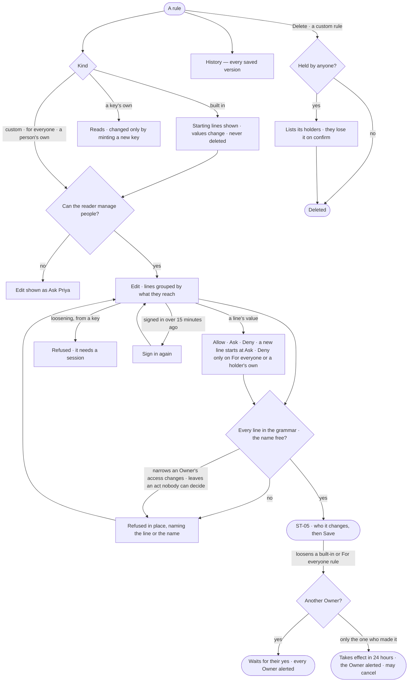

# ST-02 · Say exactly what an access rule allows

**As** someone who can manage people **I want** an access rule written as lines — what may be done, to what, with
conditions — grouped by what each reaches **so that** I grant exactly what a job needs and nothing more.

Tasks: [task.md](task.md) · Feature: [ST-F02](../../feature.md)

## Who can

| Lens | Can | Otherwise sees |
|---|---|---|
| Admin | Read a rule's lines and versions; write a custom, a person's own or the for-everyone rule; change a built-in rule's line values; delete a custom rule. Loosening a built-in or the for-everyone rule waits for an Owner who did not make it; an access change, a confidential or personal send and raising a limit need a sign-in within 15 minutes | A built-in rule has no *Delete*; the Owner's Allow on access changes reads *fixed*; another Owner's own rule is edited only by an Owner |
| Operator | Read a rule's lines and versions | *Edit* and *New rule* shown as *Ask Priya*, naming someone who can manage people |

## Flow

## Acceptance criteria

| # | Given | When | Then |
|---|---|---|---|
| ST-02.1 | A rule | it is opened | *What it allows* reads as sentences (*Ask about Airport, Route*), and what it does not (*Change data*), grouped under what they reach — graph data · AI models · outside · cache · people · agents · projects · datasets |
| ST-02.2 | A rule's sentences | the reader asks for the exact lines | each line shows what may be done, to what, and its conditions |
| ST-02.3 | A custom rule being edited | a line names something outside the grammar — an unknown reach, nothing to do, a condition that is not fields · depth · until | the save is refused in place, naming the line |
| ST-02.4 | A line with a condition on fields, depth or until | access is checked | it allows only inside its condition; a check its condition cannot judge does not allow |
| ST-02.5 | A new rule | its name is already used in the Graph | it is refused in place, naming the rule |
| ST-02.6 | A built-in rule | it is opened | its starting lines read, every one shown, marked *Built in*; there is no *Delete* and no rename |
| ST-02.7 | A key's own rule | it is opened | it reads, naming its key; it changes only by minting a new key |
| ST-02.8 | A custom or for-everyone rule held by anyone | it is deleted | its holders are listed first, and lose it on confirm |
| ST-02.9 | A saved rule | its *History* is read | every version: who saved it, when, why, its line and limit counts |
| ST-02.10 | A rule for everyone, saved | any holder in the Graph is checked | it bounds them without being given to them; several all apply |
| ST-02.11 | An Operator | they open a custom rule | it reads; *Edit* and *Delete* are shown as *Ask Priya*, naming someone who can manage people |
| ST-02.12 | Someone who can manage people | they open a built-in rule | each line's value may be changed; the Owner's Allow on access changes reads *fixed* and cannot be changed; the rule says it is built in |
| ST-02.13 | A line | it is read or edited | it carries one value for every holder — Allow · Ask · Deny — and a new line starts at Ask; Deny saves only on the *For everyone* rule and a holder's own rule, and elsewhere is refused in place ([Where Deny may sit](../../../../product.md#decisions)); what no line reaches reads as denied |
| ST-02.14 | A line reaching an access change, set to Allow | an agent holds it | for that agent it reads *Ask — fixed for agents*, or *Deny — fixed* where the change would widen or loosen ([An agent's access change is never Allow](../../../../product.md#decisions)) |
| ST-02.15 | A line reaching data | it is written | it reaches data by sensitivity — public · internal · confidential · personal — or names one kind |
| ST-02.16 | A change to a rule — from Studio, the API, a key or a rule file applied from the command line | it loosens a line, edits the *For everyone* rule, puts Deny where it may not sit, or moves the Owner's Allow on access changes | the engine treats every path alike: what Studio refuses, each other path refuses, naming the line; loosening a line, editing *For everyone*, or any change that widens a holder — a holding, a grant, a group's members, an unlock, clearing the *agent-operated* mark — made with a key is refused, naming that it needs a person's session |
| ST-02.17 | A property of a kind | someone who can shape the model sets its sensitivity | lines that reach data by sensitivity reach that property by it; a query's results are held to the lines element by element and property by property, and what a line denies is refused, naming the line |
| ST-02.18 | A line on any rule — *For everyone*, an Owner's own rule, a lock — from any path | it would make an Owner's access changes Ask or Deny, or someone who is not an Owner edits an Owner's own rule | it is refused, naming the line; *For everyone* never narrows the Owner's rule on access changes ([Someone can always decide](../../../../product.md#decisions)) |
| ST-02.19 | A change to any line | it would leave an act with nobody able to decide it | it is refused in place, naming the act; an ask that nobody but whoever it benefits could decide fails closed at once, saying why, but for the one-Owner delay |
| ST-02.20 | Someone who can manage people | they save a change that loosens a built-in rule or the *For everyone* rule | it waits for an Owner who did not make it, and every Owner is alerted; with only one Owner, who made it, it takes effect after 24 hours, with an alert to that Owner and a History row, and the Owner may cancel it until then |
| ST-02.21 | A person whose last sign-in was over 15 minutes ago | they make or allow an access change, a send of confidential or personal data, or raising a limit | they sign in again first; nothing changes until they do |

## Screens

| Surface | Lens | First use | Empty after a filter | Loading | Has data | Failed | Agent working or proposing | No access |
|---|---|---|---|---|---|---|---|---|
| A rule — what it allows | Admin | settings.access · New rule | — | settings.access · Loading | settings.access | settings.access · Line refused | — | settings.access · Built in |
| A rule — what it allows | Operator | — | — | shell.locked · Loading | shell.locked | shell.locked · Could not load | — | shell.locked |
| A change that waits for an Owner | Admin | — | — | — | settings.access · Waits for an Owner | settings.access · Nobody could decide | — | — |
| A change that waits for an Owner | Operator | — | — | — | — | — | — | shell.locked |
| Sign in again | Admin | — | — | — | settings.access · Sign in again | settings.access · Sign in again · Wrong password | — | — |
| Sign in again | Operator | — | — | — | settings.access · Sign in again | settings.access · Sign in again · Wrong password | — | — |
| A rule — History | Admin | — | — | settings.access · Loading | settings.access · History | settings.access · Could not load | — | — |
| A rule — History | Operator | — | — | shell.locked · Loading | shell.locked · History | shell.locked · Could not load | — | shell.locked · History |
