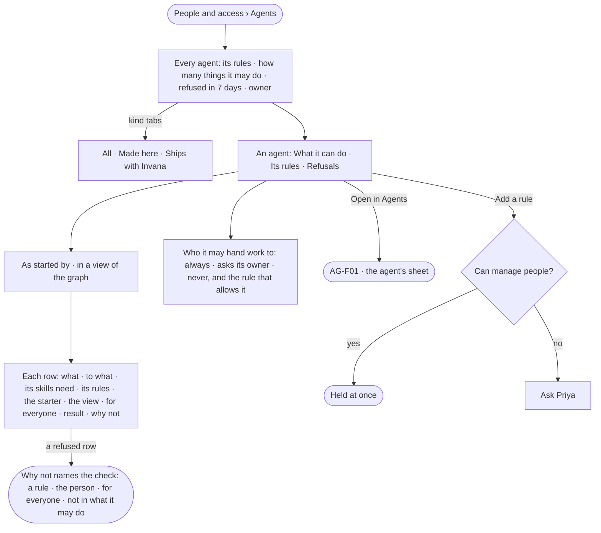

# ST-07 · See why an agent can or cannot

**As** the owner of a Graph **I want** every agent's access rules and what it can actually do, read-only, with why
each thing is allowed or refused **so that** I see why an agent can or cannot, and a refusal never surprises anyone in
a run.

Tasks: [task.md](task.md) · Feature: [ST-F02](../../feature.md)

## Who can

| Lens | Can | Otherwise sees |
|---|---|---|
| Admin | Read every agent's access; add a rule to an agent | — |
| Operator | Read every agent's access, its rules and its refusals | *Add a rule* shown as *Ask Priya*, naming someone who can manage people |

## Flow

## Acceptance criteria

| # | Given | When | Then |
|---|---|---|---|
| ST-07.1 | A Graph's agents | *Agents* is read | one row per agent made here or shipped with Invana — its rules, how many things it may do, refused in 7 days, its owner; helpers are counted on their maker, not listed |
| ST-07.2 | The tab | it is read | it says *An agent holds access rules like a person does — it is built in Agents. Workers hold none — they only run steps* |
| ST-07.3 | An agent | it is opened | tabs *What it can do · Its rules · Refusals*, and *Open in Agents* |
| ST-07.4 | *What it can do* | the reader picks *As started by* a person, and a view of the graph | each row reads what · to what · its skills need · its rules · the starter · the view · for everyone · the result · why not, grouped by what it reaches |
| ST-07.5 | A refused row | *Why not* is read | it names the first check that refuses — *Analysts can ask does not allow change data on Airport* · *priya, who started it, is an Operator* · *for everyone: no-pii-out* · *not in what it may do* |
| ST-07.6 | An agent holding no rule | *What it can do* is read | every row reads *refused · holds no access rule*, and *Add a rule* leads |
| ST-07.7 | A thing a rule allows that no skill needs | it is listed | it reads *no skill needs it* |
| ST-07.8 | A run no person started | its access is read | *Started by* reads `—` and refuses nothing |
| ST-07.9 | A helper an agent made | its access is checked | it holds its maker's root agent's access, never rules of its own |
| ST-07.10 | An agent's group | it holds a rule | the agent holds it too |
| ST-07.11 | *Who it may hand work to* | it is read | each agent it may hand work to, the rule that allows it, and *always · asks its owner · never* |
| ST-07.12 | A run's step | its checks refuse | the step fails *refused* before it runs, naming the rule or the person; the refusal is in *Refusals* and History (IN-F03) |
| ST-07.13 | Someone who can manage people | they add a rule from here or from the agent's sheet in Agents | it is one holding; the agent holds it at once |
| ST-07.14 | An Operator | they open an agent | everything reads; *Add a rule* is shown as *Ask Priya* |
| ST-07.15 | A refused step | the reader opens *How it got here* on its run | it shows the step, the check that refused it and the rule it named |

## Screens

| Surface | Lens | First use | Empty after a filter | Loading | Has data | Failed | Agent working or proposing | No access |
|---|---|---|---|---|---|---|---|---|
| Agents — the list | Admin | settings.access · No agents yet | settings.access · Nothing matches | settings.access · Loading | settings.access · Agents | settings.access · Could not load | — | — |
| Agents — the list | Operator | shell.locked · No agents yet | shell.locked · Nothing matches | shell.locked · Loading | shell.locked · Agents | shell.locked · Could not load | — | shell.locked · Agents |
| An agent — what it can do | Admin | settings.access · Holds no access rule | — | settings.access · Loading | settings.access · What it can do | settings.access · Could not load | — | — |
| An agent — what it can do | Operator | shell.locked · Holds no access rule | — | shell.locked · Loading | shell.locked · What it can do | shell.locked · Could not load | — | shell.locked · What it can do |
| An agent — refusals | Admin | settings.access · No refusals | — | settings.access · Loading | settings.access · Refusals | settings.access · Could not load | — | — |
| An agent — refusals | Operator | shell.locked · No refusals | — | shell.locked · Loading | shell.locked · Refusals | shell.locked · Could not load | — | shell.locked · Refusals |
