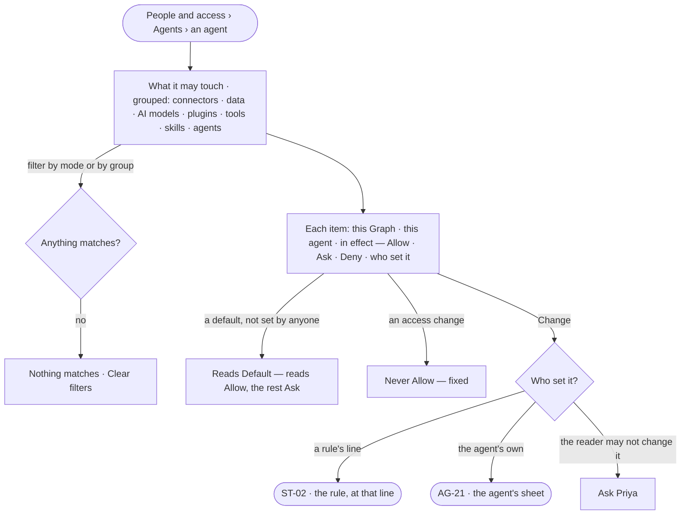

# ST-30 · See what an agent may touch

**As** the owner of a Graph **I want** one read of everything an agent may touch — every connector, data, AI model,
plugin, tool, skill and agent — with its mode in the Graph and for the agent, and who set each **so that** I know
before any run what it will do on its own, what it will ask about, and what it is denied, and where to change it.

Tasks: [task.md](task.md) · Feature: [ST-F02](../../feature.md)

## Who can

| Lens | Can | Otherwise sees |
|---|---|---|
| Admin | Read every item's mode at every level and who set it; open the line or the agent's sheet that sets it | — |
| Operator | Read every item's mode at every level and who set it | *Change* opens the line read-only; editing it is shown as *Ask Priya*, naming someone who can manage people. With *Can build agents*: changes the agent's own modes on its sheet (AG-21) |

## Flow

## Acceptance criteria

| # | Given | When | Then |
|---|---|---|---|
| ST-30.1 | An agent in People and access | *What it may touch* opens | every item it may touch reads, grouped — connectors · data · AI models · plugins · tools · skills · agents — each with its mode in this Graph and for this agent, and the mode in effect |
| ST-30.2 | An item's mode | it is read | it names who set it and where — a rule and its line, the agent's own, or *Default* |
| ST-30.3 | Levels that disagree | the mode in effect is read | it is the tightest — Deny over Ask over Allow — and the level that set it is marked |
| ST-30.4 | An item nobody set | it is read | it reads *Default*: Allow for a read; Ask for a write, a send, a spend and an access change |
| ST-30.5 | An access change | it is read | it is Ask or Deny, never Allow, and says it is fixed |
| ST-30.6 | Data | it is read | each line that reaches data names whether it reaches by sensitivity or by kind, and the kind or the sensitivity |
| ST-30.7 | A filter by mode or by group with no match | it is applied | *Nothing matches*, naming the filter, with *Clear filters* |
| ST-30.8 | An item | the reader presses *Change* | the place that sets it opens — the rule at that line or the agent's sheet; nothing is changed here |
| ST-30.9 | An Operator | they open *What it may touch* | everything reads; *Change* on a rule opens it read-only, its edit shown as *Ask Priya* |
| ST-30.10 | An agent's step | its run is read in *How it got here* | each step names its mode, the level and who set it, matching *What it may touch* when the run opened |

## Screens

| Surface | Lens | First use | Empty after a filter | Loading | Has data | Failed | Agent working or proposing | No access |
|---|---|---|---|---|---|---|---|---|
| What it may touch | Admin | settings.access · What it may touch · Defaults only | settings.access · What it may touch · Nothing matches | settings.access · What it may touch · Loading | settings.access · What it may touch | settings.access · What it may touch · Could not load | — | — |
| What it may touch | Operator | shell.locked · What it may touch · Defaults only | shell.locked · What it may touch · Nothing matches | shell.locked · What it may touch · Loading | shell.locked · What it may touch | shell.locked · What it may touch · Could not load | — | shell.locked · What it may touch |
