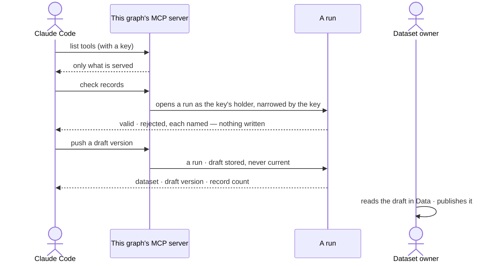

# Plugins and outside tools

> Where the install meets the outside, in both directions: plugins that reach the web, mail and science sources, the
> outside MCP servers whose tools agents may call, and this Graph's own MCP server that Claude Code and other callers
> use. The decision it helps make: *what may agents reach outside Invana, and what may the outside reach in here?*

## User journey

```mermaid
flowchart TD
  s([Settings › Invana]) --> pl["ST-29 · Plugins: every plugin, its functions, skills and plans"]
  pl -->|not installed| ni["Names the extra that installs it"]
  pl -->|Admin turns a tool plugin on| on(["Agents may call its functions · from the next step"])
  pl -->|without Admin| pa["Switch disabled · names the Admin"]
  s --> ai["Settings › AI and connections"]
  ai --> mc["ST-26 · Add an MCP server by address and name"]
  mc -->|cannot list its tools| mf["Names the address and what failed · nothing stored"]
  mc -->|listed| fz(["Its tools frozen as functions · off until turned on"])
  fz --> rf["ST-26 · Read its tools again → a new revision"]
  ai --> sv["ST-27 · This graph's MCP server: what it serves · Claude Code line · recent calls"]
  sv -->|Can build agents| sw(["Serve an agent or a function"])
  sv -->|without the grant| sd["Switches disabled · Ask Priya"]
  out([Claude Code · any MCP client · a bot]) -->|a key| call{"Key valid, here, allows it?"}
  call -->|no| rj["Refused · names the key and its rule · recorded"]
  call -->|yes| run(["ST-27 · A run, as the key's holder ∩ the agent · in History"])
  run -->|a draft dataset version| pub(["A person publishes it (DA-F01)"])
  run -->|calls a tool that sends · Ask by default| ap["Waits for a yes in Needs you (IN-01)"]
```



## Stories

| ID | Story | Status |
|---|---|---|
| ST-26 | [Add an outside tool server and let agents call its tools](stories/ST-26-add-an-outside-tool-server-and-let-agents-call-its-tools/story.md) | idea |
| ST-27 | [Let Claude Code and other callers use this graph](stories/ST-27-let-claude-code-and-other-callers-use-this-graph/story.md) | idea |
| ST-29 | [See every plugin and turn a tool plugin on](stories/ST-29-see-every-plugin-and-turn-a-tool-plugin-on/story.md) | idea |

## Access

| Act | Role (`.claude/team/TEAM.md` §7) | Everyone else sees |
|---|---|---|
| Read every plugin, its functions, skills, plans and versions | Operator — every member | — |
| Turn a tool or MCP plugin on or off | Admin | The switch is disabled, naming the Admin |
| Add an MCP server · read its tools again | Admin | *Add a server* is disabled, naming the Admin |
| Read this graph's MCP server — address, what it serves, the Claude Code line, recent calls | Operator — every member | — |
| Serve an agent or a function over this graph's MCP server | `builder` · shown as *Can build agents* | The switches are disabled — *Ask Priya*, naming someone who can build agents |
| Call this graph from outside | Whoever holds a key minted in this Graph (ST-09), as that holder, narrowed by the key | Refused, naming the key and its rule |
| Publish a draft version pushed from outside | The dataset's owner (DA-F01) | As DA-F01 |
| Say yes to a tool that sends | As IN-F01 | As IN-F01 |

## States

| State | What the person sees |
|---|---|
| First use | Plugins: core plugins on, tool plugins off · MCP servers: none, *Add a server* · this graph's server: nothing served, *No calls yet* with the line to connect |
| Empty after a filter | Plugins filtered to none: *No plugin matches* |
| Loading | The section opens at once; rows fill in place |
| Has data | Plugins with their switches · MCP servers with their tools and revision · what this graph serves and its recent calls |
| Failed | A server that cannot be reached, named with what failed; a plugin not installed, naming its extra; a call refused, naming the key and its rule |
| Agent working or proposing | A run reaching a tool that sends waits for a yes in Needs you (IN-01) |
| No access | Every list reads; switches and *Add a server* are disabled, naming who can |

## Rules

| Rule | Detail |
|---|---|
| A plugin is a package | A versioned package of functions, skills and plans; Invana ships core plugins, tool plugins reach the web, mail and science sources, an MCP server is a plugin of its own |
| Core is always on | Core plugins and simulators are the product and never switch; tool and MCP plugins are off until an Admin turns them on |
| Turning on is a gate, not an install | It takes effect from the next step dispatched — no restart. What a process can run is fixed when it starts |
| Installed is the engine's word | A tool plugin whose extra is not installed is listed as not installed, naming the extra; its functions cannot be planned |
| A function keeps its version | Each function versions on its own; a run records the version it ran; after a breaking version the previous one serves re-runs for a while |
| Plans come two ways | *Generated* from a skill's instructions, or *packaged* in a plugin; a person never writes a plan in Studio |
| A tool that sends is Ask by default | A function that sends — mail, any MCP tool its server does not mark read-only — is Ask unless a person sets its mode otherwise ([the three modes](../../product.md#decisions)); asking, it waits for a yes in Needs you, and a no fails it as *not sent* |
| Each tool shows its mode | Every function reads its mode for this Graph — Allow · Ask · Deny — and who set it |
| Outside work runs on workers | Tool and MCP steps run on workers, never in the engine serving Studio; with no worker free they wait, then fail saying no worker took them |
| Secrets stay on the workers | A function reads only the secrets its plugin declares, from the worker's environment; nothing rides a run |
| The web tools cite and respect robots.txt | Every row a web or science tool returns carries its address; a page robots.txt disallows is not read |
| An MCP server's tools are frozen | The list an Admin saw when adding it; a later change on the server reaches no plan until an Admin reads its tools again |
| One server, one plugin | Its tools are functions `mcp.<server>.<tool>`; reading them again is a new revision, and only a changed tool's version moves |
| This graph's server serves what a builder chose | Everything starts not served; an agent is served as *ask* it, a function by its tool name |
| Only a key connects | A caller connects with a key minted in this Graph; a sign-in session is refused |
| Every call is a run | As the key's holder, narrowed by the key's own rule, in Runs and History; a refusal before a run is recorded, not run |
| Outside callers read, with sources | Every answer carries where its records came from; anything out of a key's reach is refused, never silently filtered |
| The only write is a draft | A draft dataset version — numbered, never current — that a person publishes |
| Leans on | Keys (ST-09) · plans and functions (AG-F06) · asks in Needs you (IN-F01) · draft dataset versions (DA-F01) · workers (ST-F06) · History (IN-F03) |

## Data touched

| Record | Read or write |
|---|---|
| Plugins and whether each is on | Read · write |
| MCP servers — address, revision, frozen tools | Read · write |
| What this graph serves | Read · write |
| Runs triggered over MCP, with the tool, key and client | Write · read |
| Draft dataset versions (DA-F01) | Write |
| History rows of every switch, add, refusal and call (IN-F03) | Write |

## Decisions

| Decision | Detail |
|---|---|
| Plugins and connections are Settings › Invana | Plugins, MCP servers, this graph's server and outside agents are administered in Settings, not in Agents; Agents lists the functions they add |
| MCP carries tools, outside agents carry tasks | Outside agents are AG-F05; this feature is tools and callers |
| Streamable HTTP only | An MCP server is reached by address; Invana starts no third-party process on its own machine |
| One bearer token per outside server | Set on the workers, never stored in Invana |
| No retries for an outside tool | A blind retry of a send is a second send |
| Served functions | *Check records* and *Push a draft version*; served agents answer one question each |
| The engine writes the result line | Each call's one-line outcome is stored when its run settles; Recent calls only shows it |

## Open questions

| Question | Who answers |
|---|---|
| Plugins has no board (the Settings modal's *Invana › Plugins* entry draws none). Recommend: the designer draws `settings.plugins`; ST-29's cells name it once drawn | Ravi |
| May an Admin remove an MCP server? Recommend: no — turning it off stops every call, and removing would orphan the versions old runs recorded | Ravi |

## Not building

| Item | Why not |
|---|---|
| Starting outside servers on Invana's machine (stdio) | No third-party processes beside the engine |
| OAuth for outside servers or callers | A bearer token or a key covers it now |
| MCP resources, prompts, sampling, elicitation | Plans call tools; the rest has no place in a plan |
| Following a server's changed tool list | The list is frozen until an Admin reads it again |
| An Admin marking a tool read-only | The server's own hint decides; turn the plugin off to stop it |
| Hot-loading a new or refreshed server | What a process runs is fixed when it starts |
| A raw graph query as a served tool | Served agents answer with records cited |
| A general write path from outside | Writes have contracts; only a draft push writes, and a person publishes |
| Webhooks | Polling with sources is simpler to reason about and to audit |
| Third-party plugin packages outside the engine | Later — plugins live in the engine for now |
| A secrets store in Invana | The worker's environment is enough for now |
