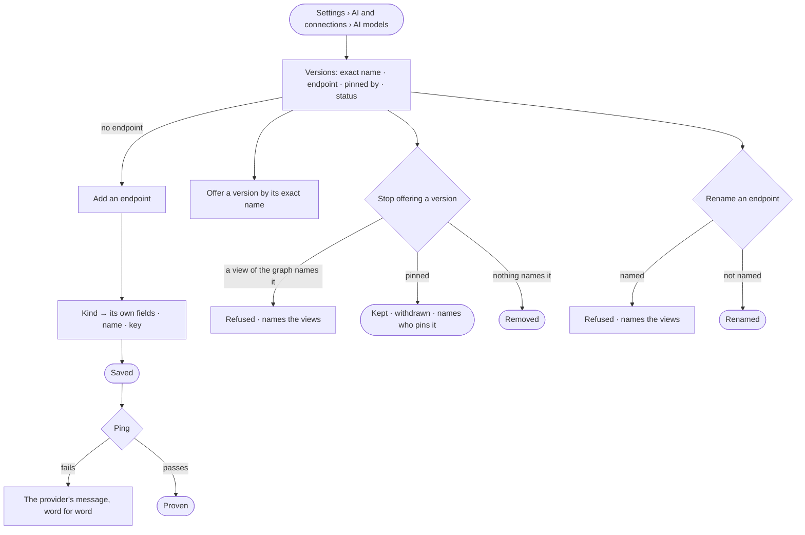

# ST-28 · Offer the model versions agents may pin

**As** an install admin **I want** every model endpoint and model version by its exact name, who pins which, and what
is withdrawn **so that** the first question never fails on configuration, and no agent breaks on a model
nobody serves.

Tasks: [task.md](task.md) · Feature: [ST-F05](../../feature.md)

## Who can

| Lens | Can | Otherwise sees |
|---|---|---|
| Admin | Add, edit, rename and remove an endpoint; ping it; offer and stop offering a version | — |
| Operator | Read every endpoint, version, status and who pins it | *Add a model*, *Ping* and each act disabled, naming the Admin; keys are never shown |

## Flow

## Acceptance criteria

| # | Given | When | Then |
|---|---|---|---|
| ST-28.1 | A member | they open *AI models* | every model version reads by its exact name, with its endpoint, who pins it — agents, skill versions, eval judges — and its status: offered · withdrawn · not offered |
| ST-28.2 | An install with no endpoint | the section opens | it says no question can be answered yet and offers *Add an endpoint* |
| ST-28.3 | An Admin adding an endpoint | they pick its kind | only that provider's fields show; the Claude Agent SDK may use a local sign-in rather than a key |
| ST-28.4 | A new endpoint | it is saved | it is stored, then *Ping* proves it; a failure shows the provider's message word for word |
| ST-28.5 | A saved endpoint | it is edited with the key left blank | the stored key is kept; the key is never read back |
| ST-28.6 | A version a view of the graph names | the Admin removes it, or renames its endpoint | it is refused, naming the views |
| ST-28.7 | A version an agent pins | the Admin stops offering it | it stays listed as *withdrawn*, with a warning naming who pins it; those agents' runs refuse, naming the pin, and nothing falls back |
| ST-28.8 | A version nothing names | the Admin removes it | it is removed |
| ST-28.9 | An endpoint name | it is not lowercase letters, digits, hyphens and underscores | it is refused, naming the rule |
| ST-28.10 | A provider that rate-limits, a local model that is not running, or a rotated key | a run calls it | the run fails, naming the endpoint and the provider's message — never as *cannot answer* |
| ST-28.11 | A ping | it runs | it is a run; History records who pinged, when and the result (IN-F03) |
| ST-28.12 | An Operator | they open AI models | everything reads but keys; *Add a model*, *Ping* and every act are disabled, naming the Admin |
| ST-28.13 | A model version | it is read | it shows its mode for this Graph — Allow · Ask · Deny — and who set it |
| ST-28.14 | A model call to an outside provider | it carries data above the endpoint's clearance | it counts as a send, held to the line on sends; an ask names the data, its sensitivity and the provider |

## Screens

| Surface | Lens | First use | Empty after a filter | Loading | Has data | Failed | Agent working or proposing | No access |
|---|---|---|---|---|---|---|---|---|
| AI models | Admin | settings.ai · No endpoint | — | settings.ai · Loading | settings.ai | settings.ai · Withdrawn | — | — |
| AI models | Operator | settings.ai · No endpoint | — | settings.ai · Loading | settings.ai · Read only | settings.ai · Withdrawn | — | settings.ai · Read only |
| An endpoint | Admin | settings.ai · Add an endpoint | — | settings.ai · Pinging | settings.ai · Endpoint | settings.ai · Ping failed | — | — |
| An endpoint | Operator | — | — | settings.ai · Loading | settings.ai · Endpoint · Read only | settings.ai · Ping failed | — | settings.ai · Read only |
