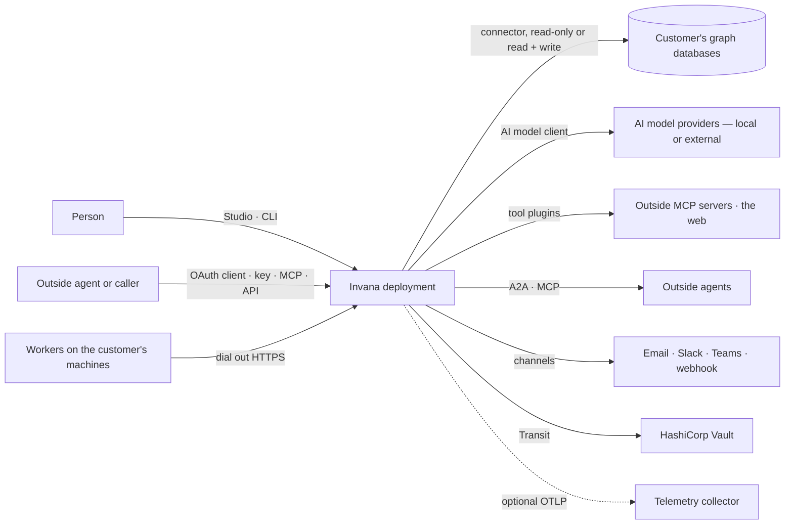
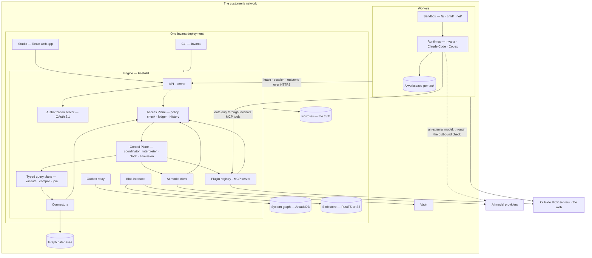
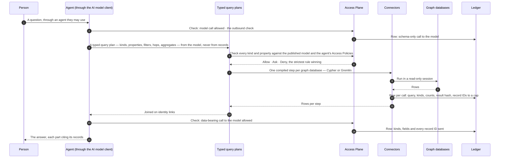

# System design

> How Invana's technology delivers its stories, and how well. What a person can do is the stories in
> [capabilities](capabilities/) and [os](os/); this file is the high-level design and the non-functional requirements.
> Each feature's low-level design is its `feature.md` › `## Engine`; a fact stated there is linked here, never restated.

| § | Section | Answers |
|---|---|---|
| 1 | [Context and scope](#1-context-and-scope) | What the system is, who and what it talks to |
| 2 | [Functional requirements](#2-functional-requirements) | What it does — by link to the stories |
| 3 | [Non-functional requirements](#3-non-functional-requirements) | How well, as numbers |
| 4 | [Constraints](#4-constraints) | What the design may not change |
| 5 | [Capacity estimates](#5-capacity-estimates) | How big it gets |
| 6 | [Data and storage](#6-data-and-storage) | Where facts are kept, who owns each, how they are encrypted |
| 7 | [Architecture and components](#7-architecture-and-components) | The deployment, its services, the parts and their boundaries |
| 8 | [APIs and events](#8-apis-and-events) | How the parts and the outside talk |
| 9 | [Distributed execution](#9-distributed-execution) | How work runs across processes and machines |
| 10 | [AI and agents](#10-ai-and-agents) | How agents plan, query, act, are bounded and are judged |
| 11 | [Failure modes and the outside boundary](#11-failure-modes-and-the-outside-boundary) | What breaks, and what Invana does |
| 12 | [Qualities](#12-qualities) | Consistency · scalability · reliability · security · privacy · observability · accessibility |
| 13 | [Delivery and operations](#13-delivery-and-operations) | How it ships, installs, upgrades and is developed |
| 14 | [Evaluation](#14-evaluation) | Does the design meet each NFR |
| 15 | [Decisions, risks and not building](#15-decisions-risks-and-not-building) | System-level choices, open risks, non-goals |

## 1. Context and scope

Invana is a self-hosted engine and web app that sits between the people and agents who decide and the customer's own
graph databases. One deployment is everything: it connects any number of graph databases, each through its connector,
and stitches them into one Graph without copying a record. It keeps its own state in Postgres, its Memory in a
bundled system graph and its files in an S3-compatible blob store ([vision](vision.md#where-things-live)).

| In scope | Out of scope |
|---|---|
| One deployment is one organisation: its graph databases stitched into one Graph, its users, teams, agents and work | Multi-tenancy, workspaces, an Organisation record, any unit inside a deployment that holds a graph of its own |
| The ontology, Access Policies, runs, the ledger, History, boards and projects — in Postgres; Memory with its lineage, and identity links — in the system graph | A copy of the customer's records, an extractor, write-back to a system upstream of a graph database |
| People acting through agents, every agent held to the same Access Policies | A person acting on data without an agent |

| Quality goal (top 5) | Why it matters to the person deciding |
|---|---|
| Grounded and traceable | Every answer cites the records behind it; a decision can be followed back through the thinking graph to its sources ([NFR-SEC-5](#3-non-functional-requirements)) |
| Acts only as far as the person allows | Every Read, Write and Run is an agent's, Allow · Ask · Deny by its Access Policies, checked when it runs ([NFR-SEC-1](#3-non-functional-requirements)) |
| Nothing leaves unseen | Every call to an AI model, a tool or a graph database, and every other exit, is in the ledger; nothing confidential or personal leaves for an external target; a copy shows only as far as the reader's agent may read its sources ([NFR-SEC-7](#3-non-functional-requirements), [NFR-SEC-8](#3-non-functional-requirements), [NFR-SEC-11](#3-non-functional-requirements)) |
| Nothing lost, nothing hidden | Work survives a lost process; History is one append-only chain, provably unedited ([NFR-REL-1](#3-non-functional-requirements), [NFR-REL-4](#3-non-functional-requirements)) |
| Installs on the customer's ground | One command up, air-gappable, three bundled services ([NFR-OPS-1](#3-non-functional-requirements)) |

## 2. Functional requirements

What a person or an agent can do is the stories; every refusal they can meet is a criterion. The index of every story
and its status is [specs/README.md](README.md).

| Part | Product | Features |
|---|---|---|
| Operating system | Control Plane — `os/control/` · `CP` | Overview · runs · ops alerting · the Inbox and its channels · graph databases · find your way · workers and the queue · limits · AI models · plugins and MCP · skill scripts |
| Operating system | [Graph Plane](os/graph/product.md) · `GP` | Data — the Graph, read in place · Memory — Invana's own graph of the work |
| Operating system | [Access Plane](os/access/product.md) · `AC` | Sign-in, account and sessions · Access Policies · the Directory · keys · connect an MCP client · what an agent may touch · asks and approvals · ownership · access usage · what left the platform · History |
| Ontology | [Semantics](capabilities/semantics/product.md) · `SE` | Start a model · change and publish · meaning · taxonomies · standards · links and mappings · rules · inference · health and history |
| Intelligence | [Records](capabilities/records/product.md) · `RC` | Records by kind · bring records in · quality · bulk fixes · merge duplicates · provenance · annotations |
| Agents | [Agents](capabilities/agents/product.md) · `AG` | Build an agent · the catalogue · test an agent and a skill · skills · delegation and outside agents · plans and workflows · schedules · portable agents · learn from memory |
| Evidence | [Explore](capabilities/explore/product.md) · `EX` | The board · share · ask · the answer · how it reasons · edit on the board |
| Evidence | [Projects](capabilities/projects/product.md) · `PJ` | Projects and tasks · branches, findings and decisions · reports · alerts |

## 3. Non-functional requirements

Each NFR is a target, how it is measured and what enforces it. `review` means no check holds it yet; its § 14 row names
the recommendation that adds one. A feature names the NFRs it must meet in its `nfrs:`.

| ID | Quality | Target | Measured by | Enforced by | Constrains |
|---|---|---|---|---|---|
| NFR-REL-1 | A lost worker loses no work | A worker silent 30 s is lost; its steps are redelivered within 35 s under the same idempotency key — 0 steps lost, 0 run twice | `SIGKILL` a worker mid-run on the executor workload | `review` | CP-F03 · CP-F06 · SE-F08 · RC-F02 · RC-F03 · EX-F05 |
| NFR-REL-2 | A lost coordinator costs seconds, not runs | The coordinator lease lapses after 15 s; another engine process takes it and every run finishes — 0 lost, 0 duplicate steps | Kill the coordinator mid-run | `review` | CP-F03 · CP-F04 |
| NFR-REL-3 | A graph database outage stays in that graph database | Reconnect with a doubling delay from 1 s to 60 s; work that needs no step on it keeps answering; work that does is refused before it starts, naming the database; a connection test answers within 10 s | Stop one of two graph databases under load; `system.graph_reconnect` spans | `review` | CP-F05 · SE-F08 |
| NFR-REL-4 | History is provably unedited | One hash chain for the deployment, re-verified every 10 minutes; `seq` gapless; kept until an Admin sets a period, removed only in whole windows, each prune leaving a signed checkpoint the chain verifies from; none removed under a legal hold | The verify job's outcome; a tamper test; a prune-and-verify test | `review` | AC-F06 · AC-F12 |
| NFR-REL-5 | Telemetry never fails the product | With the collector down: 0 request errors; the CLI exits within its 5 s flush budget | Requests and a CLI command against a stopped collector | `review` | Every feature |
| NFR-REL-6 | The system graph follows Postgres | An outbox row reaches the system graph within 5 s p95; a failed apply retries with a doubling delay to 60 s and is never dropped; a system graph rebuilt from History equals the one it replaces | Outbox lag on the demo deployment; a drop-and-rebuild test | `review` | AC-F06 · RC-F06 · GP-F02 · AG-F09 |
| NFR-REL-7 | A long run continues, never restarts | At its session budget a run's next session starts within 30 s of the hand-off note being written; 0 steps lost or run twice across a continuation; a note that cannot record its sources fails the run, naming it; a lost worker's continuing session starts on another worker from the note | A continuation test on Invana's runtime and on each runtime plugin; a worker kill mid-continuation | `review` | AG-F05 · CP-F04 · CP-F10 · CP-F03 |
| NFR-SEC-1 | Every act is checked | 100% of routes and every step run the Access Policy check for their verb and resource; what no rule reaches is Deny; the strictest rule wins; a resource the person's agents may not Read is `404` | A route-table test over the API schema; a step test over the function catalogue | `review` | AC-F02 · AC-F03 · AC-F04 · AC-F05 · CP-F06 |
| NFR-SEC-2 | Credentials never leave | AI model keys, graph database credentials, channel secrets and outside credentials are encrypted at rest and returned by no route; 0 credentials in any event, log line, span or ledger row; `token` stripped from every recorded URL | Redaction tests over events, logs, spans and the ledger; route tests | `review` | CP-F08 · AC-F01 · AC-F03 · AC-F06 · CP-F01 · CP-F02 |
| NFR-SEC-3 | One door to an AI model, one keeper of keys | Provider SDKs are imported only by the AI model client; keys are read only by the secrets module; `boto3` only by the blob interface — 0 other importers | Three `import-linter` contracts | `review` | CP-F01 · AG-F01 |
| NFR-SEC-4 | Sessions are short and risky acts sign in again | A change to access, keys or credentials asks for the password again for that act; a key never does them; a reused refresh token ends every session of the account and is recorded; every session ends 7 days after sign-in whatever its renewals; Studio is served with a Content Security Policy that runs scripts from its own origin only | AC-F01 refusal tests; a header test on Studio | `review` | AC-F01 · AC-F02 · CP-F04 |
| NFR-SEC-5 | An agent reads only what its policies allow, and says where each fact came from | 0 reads outside the agent's Access Policies — a typed query plan is checked before it is compiled, never filtered after return; 100% of answer parts cite a record or a badged outside source | An eval over policies and grounding | `review` | AC-F04 · CP-F05 · RC-F06 · EX-F04 · EX-F05 |
| NFR-SEC-6 | Guessing is slow | 10 failed sign-ins to one account in 15 minutes lock it for 15 minutes; sign-in, renewal, the token endpoint and the MCP server take at most 30 requests a minute from one address; a lock and a limit are recorded | Rate-limit and lockout tests | `review` | AC-F01 · CP-F02 |
| NFR-SEC-7 | Every call is in the ledger | 100% of calls to an AI model, a tool or a graph database write one ledger row before the result is used; a call that cannot be recorded does not run | A ledger test over every caller; a fault test on the ledger write | `review` | AC-F06 · CP-F01 · CP-F02 · GP-F01 |
| NFR-SEC-8 | Nothing confidential or personal leaves | 0 values of a confidential or personal property, directly or through a copy's lineage, in any exit to an external target — a model, a tool's arguments, an outside agent or runtime, an MCP client, a channel, an export, a published report, pull-request text; a call is refused naming the property, a document leaves without the values naming them | An eval over every level and every exit kind, local and external | `review` | SE-F03 · CP-F01 · AC-F09 · CP-F02 · SE-F06 · EX-F02 · PJ-F05 |
| NFR-SEC-9 | A read never writes | 100% of reads, raw queries included, run in a read-only session the database itself enforces — the driver's read access mode, a read-only transaction or `ReadOnlyStrategy`; a write to a read-only graph database is refused before the wire, naming the database; no connector is supported until it passes the certification test | The connector certification test on every supported database | `review` | CP-F05 · GP-F01 · EX-F03 · EX-F06 · SE-F08 · RC-F02 · RC-F07 |
| NFR-SEC-11 | A copy shows only as far as the reader's agent reads | 0 copies — answers, findings, reports, snapshots, transcripts, notes, memory nodes, exports — shown with content whose sources the reader's default agent may not Read; a copy with no recorded sources never shows; no role reads past it | A lineage test over every copy kind and every surface that shows one | `review` | GP-F02 · AC-F09 · EX-F02 · PJ-F05 · RC-F06 · SE-F06 · SE-F03 · AC-F02 |
| NFR-SEC-12 | Every internal link is encrypted | 100% of connections between the browser and the engine, and from the engine and its workers to Postgres, the graph databases — the system graph among them — and the blob store, use TLS 1.2 or later with the peer's certificate verified; a plain connection is refused at start, naming the link | A start-up test per link with TLS off; a certificate-mismatch test | `review` | AC-F01 · CP-F05 · GP-F01 · CP-F03 · AC-F12 |
| NFR-SEC-13 | Every key rotates without downtime | The install key, the ledger key, keys and work connections each rotate while the deployment runs: a new install key rewraps every data key; a new ledger key signs from then on while old versions still verify what they signed; a key or a work connection is replaced before the old one is revoked — 0 failed requests and 0 unverifiable rows across a rotation | A rotation test for each under load | `review` | AC-F09 · AC-F06 · AC-F10 · CP-F02 · AC-F12 |
| NFR-SEC-14 | An outside runtime touches only what its agent may | 100% of a session's file, program and network acts on a worker pass the sandbox, which enforces the agent's `fs/` · `cmd/` · `net/` rules at the operating system whatever the runtime's own settings say; the runtime's allow list is generated each session, never kept by hand; the sandbox reaches no graph database and no host but the engine and those `net/` rules allow; 0 credentials in the workspace; every refusal recorded and alerted | A sandbox escape suite per runtime plugin — reads outside the workspace, an unlisted program, an unlisted host, a direct graph database connection | `review` | CP-F03 · CP-F02 · AC-F02 · AG-F01 |
| NFR-SEC-10 | Every file and secret is encrypted with its own key | 100% of blobs and stored secrets are sealed with AES-256-GCM under their own data key, wrapped by the install key; a purged object's data key is destroyed and the object is unreadable | Storage tests over the blob interface and the secrets module | `review` | RC-F02 · CP-F10 · CP-F01 · CP-F02 |
| NFR-PERF-1 | A question does not wait behind batch work | With a free slot, a question's `queue_ms` p95 ≤ 2 s; questions go before project tasks, project tasks before batch | `queue_ms` on `agents_runs`; `invana.runs.queue_wait` | `review` | CP-F03 · CP-F04 · EX-F03 |
| NFR-PERF-2 | Dispatch and fan-out | Dispatch p95 ≤ 10 ms; throughput within 15% of 409 · 716 · 1,309 steps/s on 1 · 3 · 9 workers; a 700-agent run reaches efficiency ≥ 0.7 at 27 workers; 10,000 parked runs hold no worker and no connection | The executor benchmark | `review` | CP-F03 · SE-F08 · AG-F05 · AG-F06 |
| NFR-PERF-3 | Lists answer fast | A list route answers ≤ 500 ms p95 server time over 10,000 rows with filters applied; at most 200 rows a page | `http.server.request.duration` by route on the demo deployment | `review` | CP-F07 · CP-F08 · AC-F02 · AC-F05 · AC-F06 · CP-F01 · CP-F02 · SE-F07 · RC-F02 · CP-F10 · AG-F04 · AG-F06 · AG-F07 · PJ-F01 |
| NFR-PERF-4 | The board stays usable | Layouts up to 3,000 nodes; switching presets glides in ≤ 400 ms under 2,000 nodes; a solve past 400 ms shows a cancellable toast | `ui.canvas.layout.duration` | `review` | SE-F06 · EX-F01 |
| NFR-PERF-5 | Reads on a person's behalf are bounded | A publish preview reads ≤ 1,000 records a kind; an answer speaks from ≤ 50 rows; an impact reach expands ≤ 12 records a hop, 50 neighbours each — and each says it is a sample | The criteria of SE-F02, EX-F04, PJ-F03 | test | SE-F02 · EX-F04 · PJ-F03 |
| NFR-PERF-6 | Stitching costs little over its slowest step | Validating and compiling a typed query plan takes ≤ 50 ms p95; joining step results on identity links adds ≤ 200 ms p95 for up to 1,000 rows a step | Spans on a two-database question over the demo deployment | `review` | EX-F03 · GP-F01 · SE-F06 |
| NFR-COST-1 | Spend stays inside its budget | Tokens are held before every AI model call; a run never passes its budget by more than the one held call; every limit is in tokens | CP-F04 admission and hold tests | `review` | CP-F01 · CP-F04 · AG-F01 · AG-F05 |
| NFR-COST-2 | Spend is tokens, never currency | 0 currency amounts in any record, route, event or screen | A schema and string check | `review` | CP-F04 · CP-F10 |
| NFR-COST-3 | Idle costs nothing extra | No telemetry endpoint: 0 exporters started; a worker idle 5 minutes above its group's minimum is drained; a parked run holds no worker | Start-up and drain tests | `review` | CP-F03 |
| NFR-OPS-1 | One command up, on every OS | `docker compose up -d` starts a working deployment — Postgres, the system graph, the blob store and demo data — on macOS, Linux and Windows; `pip install invana` plus `invana worker` is a whole worker | A CI matrix over the three | `review` | Every feature |
| NFR-OPS-2 | Upgrades by one explicit command | `invana migrate` takes Postgres and the system ontology to head; `invana start` never migrates; the migrated schema equals the models' | The schema and OpenAPI snapshots | CI gate | SE-F08 |
| NFR-OPS-3 | Every action is one trace | 100% of Studio actions open one trace that the engine continues; every 5xx is one error line with its `trace_id`; every run stores its `trace_id` | Span tests with an in-memory exporter | `review` | CP-F10 |
| NFR-OPS-4 | Tests cover the logic | ≥ 80% statements, branches, functions and lines for the engine and for Studio's logic | Coverage reports | CI gate (Studio) · `review` (engine) | Every feature |
| NFR-SUS-1 | The code keeps its shape | 0 violations of the band contracts, the file-shape checks, Studio's package boundaries, dead-code and Biome | `lint-imports` · `tests/golden` · `check-boundaries` · `knip` · Biome | CI gate | Every feature |
| NFR-SUS-2 | Every user-facing change is announced | 100% of user-facing changes carry a changeset | Changeset check | CI gate | Every feature |
| NFR-SUS-3 | Files stay readable | No engine module or Studio file over 400 lines, but listed canvas files | Line counts | `review` | Every feature |
| NFR-UX-1 | Studio is accessible | WCAG 2.2 AA; every control has an accessible name | axe in the end-to-end suite | `review` | Every feature |
| NFR-UX-2 | Every number is the engine's | 100% of numbers on screen are stored or served by the engine; Studio computes no rate, share, change or percentile | Code review against CP-F10's stored figures | `review` | AC-F02 · CP-F03 · SE-F10 · CP-F10 · AG-F09 |
| NFR-UX-3 | Every screen states where it is | Every screen draws loading, empty and error; every write answers with the engine's sentence | One end-to-end spec per surface | `review` | Every feature |

## 4. Constraints

| Constraint | Because |
|---|---|
| Self-hosted, single-tenant, air-gappable | The target is the enterprise's own ground; every added stateful service is the customer's ops cost |
| One deployment, one Graph | The deployment is the widest scope; every graph database it connects is part of its one Graph; no table, route or command is scoped below it ([vision](vision.md#scope)) |
| The customer's graph databases are theirs | Invana reads them in place through a connector and holds no copy; it writes only to a read + write graph database, and never to a system upstream of one |
| Supported databases: Neo4j, Memgraph, ArcadeDB (Cypher); JanusGraph, Amazon Neptune, TinkerGraph, ArcadeDB (Gremlin) | The connectors Invana ships ([GP-F01](os/graph/features/GP-F01-data/feature.md#mechanisms)) |
| Postgres is the source of truth; SQLite in development | Every record, event, the ledger, History and the queue in one transactional store; SQLite keeps a developer's setup to one command |
| Three bundled services: Postgres, ArcadeDB as the system graph, RustFS as the blob store; Vault in production | Each holds what Postgres cannot hold well — a graph of Invana's own thinking, and files; every other need runs on Postgres |
| Open licences only in the run path | No source-available or commercial part between a question and its answer |
| Python 3.14 engine, React 19 Studio, composed from `@invana/design-kit` and `@invana/canvas` | The stack every package is built on (CLAUDE.md) |
| Spend in tokens | No price is stored or shown |
| The same commands on macOS, Linux and Windows | Community contributors use all three |

## 5. Capacity estimates

Invana scales with acts, runs, calls and tokens — not with page views. The Graph's size is the customer's databases'.

| Quantity | Estimate | Reached by | Sizes |
|---|---|---|---|
| Graph database size | Unbounded by Invana; reads are bounded per act | Invana never loads a whole graph: a board draws ≤ 3,000 nodes, a preview reads ≤ 1,000 records a kind, an answer ≤ 50 rows | NFR-PERF-4 · NFR-PERF-5 |
| Graph databases per deployment | Up to 20 | A stitched question runs one step per graph database it needs; identity links are declared per pair of kinds | NFR-PERF-6 · NFR-REL-3 |
| Runs going at once | Hundreds per deployment; limits per team, user and agent set by an Admin | [CP-F04](os/control/features/CP-F04-limits/feature.md#engine) | NFR-PERF-1 · NFR-PERF-2 |
| Width of one run | 700 agents, 5,000 graph-query lanes | The fan-out acceptance workload | NFR-PERF-2 |
| Parked runs | 10,000 waiting on a person | A run held for days on an approval holds nothing | NFR-PERF-2 · NFR-COST-3 |
| Run length | Seconds to weeks | A run may wait on a person; every `*_ms` column is 64-bit ([CP-F10](os/control/features/CP-F10-runs-and-how-the-agents-are-doing/feature.md#engine)) | NFR-REL-2 |
| Events and History rows | About 10⁵ a day for an active deployment; kept until an Admin sets a period | One event per write, one History row per act, for people and agents alike | NFR-REL-4 |
| Ledger rows | About 10⁶ a day for an active deployment; kept until an Admin sets a period | One row per call to an AI model, a tool or a graph database; a read keeps at most 1,000 record IDs, a send keeps every ID | NFR-SEC-7 |
| System graph | About 10⁷ nodes a year for an active deployment | One node per plan, workflow, run, step, evidence, finding and decision; one edge per ledger row's record touched; identity links per match rule | NFR-REL-6 |
| Tokens | Per team, user and agent a period, set by an Admin | Every call held first | NFR-COST-1 |
| Blob store | Grows with loads, reports and run artifacts; artifacts expire before their run | Stored by digest, each object under its own data key | NFR-COST-3 · NFR-SEC-10 |

## 6. Data and storage

| Store | Holds | Consistency | Owner of each record |
|---|---|---|---|
| Postgres — the app database (SQLite in development) | Every record table of every feature; the event store; History; the ledger's rows; the outbox; the queue's own tables; encrypted secrets | The source of truth. Transactional per request: a write, its event and its outbox row commit together | The feature whose `## Engine` › *Records* declares the table |
| Event store — `events` in Postgres | Every write, append-only, with its user, the person behind it, its agent, parent event and trace | Same transaction as the write; a live tail by notify | [AC-F06](os/access/features/AC-F06-history/feature.md#engine) |
| The ledger — rows in Postgres, edges in the system graph | One row per call to an AI model, a tool or a graph database (§ 10) | Written before the call's result is used; the edges follow through the outbox | Access Plane › *What left the platform* |
| Queue — procrastinate's schema in Postgres | Step envelopes waiting for a worker | At-least-once delivery under one idempotency key; the outcome is a row | [CP-F03](os/control/features/CP-F03-workers-and-the-queue/feature.md#engine) |
| The system graph — bundled ArcadeDB | Memory — plans, workflows, runs, steps, evidence, findings, decisions and their outcome labels, with lineage; the ledger's edges; identity links materialised from match rules | Follows Postgres through the outbox, retried, rebuildable from History; governed by the system ontology; never customer data | The feature that owns the Postgres record it mirrors |
| The customer's graph databases | The records — nodes and relationships; the schema statements Invana pushes; annotations and derived facts on a read + write one | The database's own; Invana inherits it | Writes: [RC-F02](capabilities/records/features/RC-F02-bring-records-in/feature.md#engine) loads · [SE-F02](capabilities/semantics/features/SE-F02-change-and-publish-a-model/feature.md#engine) schema · [RC-F07](capabilities/records/features/RC-F07-annotations/feature.md#engine) annotations · [EX-F06](capabilities/explore/features/EX-F06-annotate-and-edit-the-data/feature.md#engine) edits · [SE-F08](capabilities/semantics/features/SE-F08-inference/feature.md#engine) derived facts · RC-F04 fixes · RC-F05 merges |
| The blob store — one interface over the S3 API | Files: uploads, load batches, reports, run artifacts and hand-off note bodies, by `sha256` digest | Written once, each object under its own data key; the record holds the digest — a hand-off note's row in Postgres, its body here | [RC-F02](capabilities/records/features/RC-F02-bring-records-in/feature.md#engine) load batches · [CP-F10](os/control/features/CP-F10-runs-and-how-the-agents-are-doing/feature.md#engine) artifacts · [AG-F05](capabilities/agents/features/AG-F05-delegation-and-outside-agents/feature.md#engine) hand-off notes |
| A task's workspace — a folder on a worker | The files an agent works on for one task, across its sessions | The worker's own disk; never copied to the engine; removed when the task closes | [CP-F03](os/control/features/CP-F03-workers-and-the-queue/feature.md#engine) |
| Plugin registry — files in the Claude plugin layout, frozen per process | Every plugin, its functions, skills, agents, declared needs and manifests; a Team pack's policy files | Read at start; nothing hot-loads | [CP-F02](os/control/features/CP-F02-plugins-and-outside-tools/feature.md#engine) |
| Secrets — encrypted columns, read by one module | AI model keys, graph database credentials, channel secrets, outside credentials (shared secrets and per-user OAuth tokens) | Sealed like a blob; never returned; redacted from every event and ledger row | [CP-F01](os/control/features/CP-F01-ai-models/feature.md#engine) keys · [CP-F05](os/control/features/CP-F05-graph-databases/feature.md#engine) credentials · [CP-F08](os/control/features/CP-F08-the-inbox/feature.md#engine) channel secrets · [CP-F02](os/control/features/CP-F02-plugins-and-outside-tools/feature.md#engine) outside credentials · [AC-F06](os/access/features/AC-F06-history/feature.md#engine) redaction |

| Decision | Choice | Trade-off | Detail in |
|---|---|---|---|
| Postgres is the truth, the system graph follows | A write lands in Postgres with an outbox row in the same transaction; a relay applies each row to the system graph in order, retrying with a doubling delay; the system graph can be dropped and rebuilt from History | The system graph lags by seconds; a reader that needs the latest reads Postgres | NFR-REL-6 |
| The system graph has its own ontology | A read-only, versioned system ontology ships with Invana and governs every node and edge in the system graph; `invana migrate` takes it to head | Invana's own graph changes only with a release | § 13 |
| One deployment, no scope column | No table carries a Graph or tenant id; a record that belongs to one graph database carries `database_id` and cascades from it | No row is shared between deployments, and none needs to be | Each feature's *Records* |
| One table, one owner | A table is written only by its feature's managers; another feature reads it through them and links its *Reads* row | A read across features is a call, not a join | Each feature's `## Engine` › *Records* · *Reads* |
| Every write is an event | A manager emits the event of its write in the write's transaction; History, the change list, notifications and traces are readings of it, never copies | Every write path pays one insert | [AC-F06](os/access/features/AC-F06-history/feature.md#engine) |
| Customer records stay in their graph database | Records are read in place; a dataset is a load batch — a file in the blob store, checked against the model, then loaded into a read + write graph database — never a second store of records | Every look at a record is a query on the customer's database | [RC-F02](capabilities/records/features/RC-F02-bring-records-in/feature.md#engine) |
| What Invana writes into a customer's graph database | Annotations, derived facts, loads, fixes and merges, only to a read + write graph database and only with Write permission; a derived fact is labelled *derived* with its rule and version; lineage lives in the system graph | A read-only graph database holds no annotation | [RC-F07](capabilities/records/features/RC-F07-annotations/feature.md#engine) · [SE-F08](capabilities/semantics/features/SE-F08-inference/feature.md#engine) |
| Identity links live in the system graph | Materialised from the match rules a Modeller declares per pair of kinds; never written into a customer's graph database, never guessed | A rule change re-materialises its links | [GP-F01](os/graph/features/GP-F01-data/feature.md#mechanisms) · match rules [SE-F06](capabilities/semantics/features/SE-F06-links-and-mappings/feature.md#engine) |
| Versions are immutable | Models, rules, skills, agents, workflows and Access Policies publish new versions; a run is frozen onto the versions it used | Storage grows with every publish | [SE-F02](capabilities/semantics/features/SE-F02-change-and-publish-a-model/feature.md#engine) · [AG-F01](capabilities/agents/features/AG-F01-build-an-agent/feature.md#engine) · [AG-F04](capabilities/agents/features/AG-F04-skills/feature.md#engine) · [AG-F06](capabilities/agents/features/AG-F06-plans-and-workflows/feature.md#engine) |
| Hard deletes, downward cascade | No soft delete, no trash, no undo; retention removes whole windows; a purged blob or secret is crypto-shredded; retire, retract and undoing a load keep history resolvable | A mistaken delete is gone | Each feature's *Refusals* |
| Kept until an Admin sets a period | Memory, History, the ledger, the query log and recall each keep everything by default; an Admin sets a period per store, and each store's owner prunes whole windows; a legal hold on memory or History stops pruning and erasure | Stores grow until a period is set | [AC-F12](os/access/features/AC-F12-leaving-and-keeping/feature.md#engine) · NFR-REL-4 |
| The engine stores every number | A per-row figure is a column written when the fact settles; a windowed figure is a query over those columns; a percentile is computed in the engine, so SQLite and Postgres agree | Figures are fixed at settle time | [CP-F10](os/control/features/CP-F10-runs-and-how-the-agents-are-doing/feature.md#engine) |
| Every element Invana writes says who wrote it | Each write path stamps its run, its time and its origin (`import` · `llm` · `user` · `third_party`) on the element, under the `_inv_` names its *Engine* lists; an element with none predates Invana or came by bulk load | Stamps add properties to the customer's graph database | [RC-F02](capabilities/records/features/RC-F02-bring-records-in/feature.md#engine) · [EX-F05](capabilities/explore/features/EX-F05-when-it-cannot-answer-and-how-it-reasons/feature.md#engine) · [RC-F06](capabilities/records/features/RC-F06-provenance/feature.md#engine) |
| One migration chain | Alembic revisions applied by `invana migrate`, then the queue's schema, then the system ontology; a rename keeps its rows; a migration is proved on Postgres | SQLite is not a migration target | § 13 |
| A table is declared before it is migrated | A new table is a row in its feature's *Records* before its migration is written | — | Each feature's *Records* |
| The data layer | SQLAlchemy 2 async with Alembic, behind the engine's managers and querysets | — | § 7 |

### Files and encryption

| Decision | Choice | Trade-off | Detail in |
|---|---|---|---|
| One blob interface, S3 API only | Every file goes through one interface built on `boto3`; RustFS, pinned by digest, is the bundled store; production uses Amazon S3 or the customer's S3-compatible store | No local-disk store, even in development | NFR-SEC-3 |
| Envelope encryption | Each blob and each stored secret is sealed with AES-256-GCM (`cryptography`) under its own data key; the data key is stored wrapped by the install key | One unwrap per read | NFR-SEC-10 |
| The install key | A file or an environment variable for a pilot — Studio warns an Admin while it is — and HashiCorp Vault Transit in production; the engine never holds an unwrapped install key at rest | Production needs Vault | NFR-SEC-10 |
| Purge by crypto-shredding | Destroying an object's data key makes it unreadable wherever a copy lies | A purge cannot be undone | NFR-SEC-10 |

## 7. Architecture and components

### The deployment

| Service | Runs | Holds | In development | In production |
|---|---|---|---|---|
| Engine | The API, the authorization server, the Control Plane, the Access Plane, the outbox relay, the clock | Nothing at rest | `invana start` or Compose | One or more processes; one coordinator by lease |
| Studio | The web app, served by the engine or on its own | Nothing at rest | Compose on `8300` | Bundled in the engine image or `invana/studio` |
| Postgres | The source of truth | Every record, event, ledger row, outbox row, the queue | Compose; SQLite for engine tests | The customer's Postgres |
| ArcadeDB | The system graph | Memory with its lineage, ledger edges, identity links | Compose | Bundled image, pinned by digest |
| RustFS | The blob store | Files, sealed | Compose, pinned by digest | Amazon S3 or the customer's S3-compatible store |
| Vault | Transit for the install key | The install key | Not used — a key file, with Studio's warning | The customer's Vault |
| Workers | Step envelopes; sessions of agents on their runtimes, inside the sandbox | A workspace per open task | Inline, or Compose | Docker, plain Python or Kubernetes, dialling out; a group carries the runtime plugins an Admin installed on it |

### The parts

| Component | Responsible for | Owns | Serves |
|---|---|---|---|
| Studio | Everything a person reads and does in a browser; formats, never derives | Nothing stored | Every feature with a board |
| CLI — `invana` | Anything scripted; one command per noun and verb over the same managers as the API | Nothing stored | Each feature's `### CLI` |
| API — `server` | Routes, the error-to-status map, the `{ message, data }` answer, `/`, `/health`, the telemetry relay, the generated admin | Nothing of a feature | § 8 |
| Authorization server | OAuth 2.1 for the deployment's MCP server: authorization code with PKCE, client registration, consent, metadata, audience-bound tokens, revocation | Connected clients, their grants and tokens | Access Plane › *Connect an MCP client* |
| Access Plane | The policy check on every Read · Write · Run; sign-in, sessions and keys; the Directory; asks and approvals; the ledger; History | Users, teams, Access Policies, keys, approvals, ledger rows, History | [AC-F01](os/access/features/AC-F01-sign-in-account-and-sessions/feature.md#engine) · [AC-F02](os/access/features/AC-F02-access-policies/feature.md#engine) · [AC-F04](os/access/features/AC-F04-what-an-agent-may-touch/feature.md#engine) · [AC-F05](os/access/features/AC-F05-asks-and-approvals/feature.md#engine) · [AC-F06](os/access/features/AC-F06-history/feature.md#engine) |
| Control Plane | Walks a plan: the frontier, fan-out, signals, pauses, cancel and resume; admits runs against limits and switches; graph databases, AI models, plugins and workers; one coordinator by lease | Runs, steps, the queue's envelopes, limits, graph database connections, switches | [CP-F03](os/control/features/CP-F03-workers-and-the-queue/feature.md#engine) · [CP-F04](os/control/features/CP-F04-limits/feature.md#engine) · [CP-F05](os/control/features/CP-F05-graph-databases/feature.md#engine) · [CP-F10](os/control/features/CP-F10-runs-and-how-the-agents-are-doing/feature.md#engine) |
| The clock | One shared tick for schedules, deadlines, ask reminders and expiry, chain verification and sweeps | Schedules and firings | [AG-F07](capabilities/agents/features/AG-F07-schedules/feature.md#engine) |
| Typed query plans | Validate a plan against the published model and the agent's policies, compile one step per graph database, join the results on identity links | Nothing stored | [EX-F03](capabilities/explore/features/EX-F03-ask-a-question/feature.md#engine) |
| Workers | Run step envelopes from their group's queues, and an agent's sessions on the runtime it runs with — Invana's, Claude Code or Codex — inside a sandbox that enforces the agent's `fs/` · `cmd/` · `net/` rules, in a workspace per task; no inbound port, no database credential | Workspaces; post outcomes, session ends and sandbox refusals back | [CP-F03](os/control/features/CP-F03-workers-and-the-queue/feature.md#engine) |
| AI model client | The only caller of an AI model; one structured call to the endpoint a run resolved, through the outbound check, ledgered | Nothing; endpoints are CP-F01's | [AG-F01](capabilities/agents/features/AG-F01-build-an-agent/feature.md#engine) · [CP-F01](os/control/features/CP-F01-ai-models/feature.md#engine) |
| Graph Plane — Data | Connectors: one package per database family, found by entry point; one credential per graph database; every read in a read-only session, proved by a certification test; raw queries through four layers; every call ledgered; the join across graph databases on identity links | Capabilities, cached with each connection; identity links in the system graph | [GP-F01](os/graph/features/GP-F01-data/feature.md#engine) |
| Graph Plane — Memory | Serves Invana's own graph of the work — the nodes and edges the outbox relay writes — and the lineage of every copy, withholding what a reader's default agent may not read | Nothing in Postgres; nodes and edges in the system graph | [GP-F02](os/graph/features/GP-F02-memory/feature.md#engine) |
| Plugins and MCP | Core, tool, Team pack and runtime plugins, each a Claude plugin — `.claude-plugin/plugin.json` with Invana's fields under `metadata`, `skills/`, `agents/`, `.mcp.json` — with their declared needs; a Team pack's agents the platform's and its policy files drafts until an Admin applies them; every tool plugin an MCP server on the workers; the deployment's one MCP server; outside credentials | The registry, switches, MCP servers | [CP-F02](os/control/features/CP-F02-plugins-and-outside-tools/feature.md#engine) · [CP-F06](os/control/features/CP-F06-skill-scripts/feature.md#engine) |
| Blob interface | Every file in and out of the blob store, sealed and unsealed | Nothing; objects are their feature's | § 6 *Files and encryption* |
| Outbox relay | Applies outbox rows to the system graph in order; rebuilds it from History | The relay's position | § 6 |
| Capability packages | Semantics · Records · Agents · Explore · Projects — each its own records, routes, events and boards | Their *Records* | Their features' `## Engine` |

| Decision | Choice | Trade-off | Detail in |
|---|---|---|---|
| A package per product | Each plane and capability is one package, its name the same from spec folder to board (§ 8) | A screen that composes several packages lives in the app's host | § 8 |
| One direction inside the engine | `routes → views → managers → querysets → models`; managers hold every rule and are the Python API; the request owns the transaction | More files per feature | § 13 |
| Two front-ends, one rule set | The API and the CLI are peers over the same managers; neither holds a rule | — | § 13 |
| The runtime talks down, packages talk up | The Control Plane reaches a package only through the closed function catalogue; a package reaches the Control Plane through protocols declared in `core` | A new step is a function, not a call | [AG-F06](capabilities/agents/features/AG-F06-plans-and-workflows/feature.md#engine) |
| A write across two packages is one manager's | The manager of the first write calls the other's manager in the same transaction, or the second acts on the first's event | — | Each feature's *Mechanisms* |
| Three callers out, one ledger | The AI model client, the connectors and the plugin layer are the only doors out of the engine, and each writes the ledger row of its call | A new door is a new ledger writer | § 10 |
| Studio packages by tag | `core` → `ui` → `canvases` → `assistant` → `shell` → a product → the app; a product never imports another product; `index.ts` is a package's only border | A shared widget moves down to `ui`, or to the design-kit when domain-free | § 13 |

## 8. APIs and events

| Convention | Rule | Detail in |
|---|---|---|
| One name across layers | A package's name is the same in its spec folder, engine module, tables (`<package>_<records>`), routes, resources, events (`<package>.<records>.<verb>`), spans, Studio package (`@invana-studio/<package>`), Studio routes and boards (`<package>.<surface>`). Packages: `control` · `access` · `graph` · `semantics` · `records` · `agents` · `explore` · `projects`; shared: `core` · `cli` · `server` | [migrations.md](migrations.md) M5 for the code |
| Records are plural nouns, said once | `access_policies`, `runs`; a record named as its package is said once | Each feature's *Records* |
| One route shape | `/api/v1/<package>/<records>` — no Graph, user or tenant segment; a route sits under the package that owns its records, never under the screen that calls it; Studio's routes follow without a Graph segment | Each feature's *Routes* |
| A read without access | `404` — what the person's agents may not Read is absent, not forbidden; an act they may see but not do is `403`, naming the rule | [AC-F02](os/access/features/AC-F02-access-policies/feature.md#engine) |
| Errors map once | Not found `404` · conflict `409` · unauthenticated `401` · denied `403` · a shape the model forbids `422` · rate-limited `429`; every error names the field, step, bound or rule, never a bare code | Each feature's *Refusals* |
| A write answers `{ message, data }` | The engine writes the sentence; Studio shows it and composes none; one gesture reports once | Each feature's *Routes* |
| `PUT` replaces, `PATCH` amends | A blank secret on `PUT` keeps the stored one | Each feature's *Routes* |
| Deletes are hard and cascade down | `409` while something still references it | Each feature's *Refusals* |
| One list contract | Every list takes `q` (plain text, contains, over named fields) · named filters (values of one field OR, fields AND; an undeclared one is `422`) · `sort` · `cursor` (keyset, bound to its sort) · `limit` (default 50, at most 200) and answers `Page[T]`: `items` · `total` · `unfiltered_total` · `next_cursor` · `applied` (each filter with its label). Studio carries filters in the URL as `?f.<field>=` and never narrows rows itself | Each feature's *Routes* |
| Streams are server-sent events | A `?token=` and `?traceparent=` fallback on a stream route only, where a header cannot be set; no other route reads a token from the URL | [CP-F10](os/control/features/CP-F10-runs-and-how-the-agents-are-doing/feature.md#engine) · [EX-F04](capabilities/explore/features/EX-F04-the-answer/feature.md#engine) |
| The generated client is the contract | Studio's types come from the API schema; nothing is hand-typed; the schema is a golden file | § 13 |
| Events name the act | `<package>.<records>.<verb>` — imperative when a user did it (`projects.create`), past tense when the system observed it (`access.auth.login_failed`); an event carries the user, the person behind it and the agent it ran through | [AC-F06](os/access/features/AC-F06-history/feature.md#engine) |
| One History chain | Every act in the deployment lands in one append-only, hash-chained History with a gapless `seq` | [AC-F06](os/access/features/AC-F06-history/feature.md#engine) |
| CLI shape | `invana <noun> <verb>`; `--database <name>` where a command targets one graph database; `--user` names who it acts as and is checked like the route it stands for; `--json` on every command; `--dry-run` on every write; prompts, or `--non-interactive` with every value a flag | Each feature's *CLI* |
| A CLI refusal names the next command | A route answers a refusal as a code and its facts; the CLI turns the code into what happened, what was written and the command that does what was meant; distinct exit codes for a validation failure | Each feature's *CLI* |
| A name on the wire is public | A module path stored in a row or imported by a connector package changes only through a migration that rewrites the stored values | [migrations.md](migrations.md) |

### Who calls, and how they prove it

| Caller | Credential | Acts as | Detail in |
|---|---|---|---|
| A person in Studio | Password sign-in; a short-lived access token and a rotated refresh token in the browser's local storage, under a strict Content Security Policy; every session ends at its absolute lifetime | The person, through the agents they may use | [AC-F01](os/access/features/AC-F01-sign-in-account-and-sessions/feature.md#engine) |
| A script or the CLI | A key — 30, 90 or 365 days, or never | The key and its owner together, narrowed further if the key says so; never manages credentials or access | Access Plane › *Keys* |
| An MCP client — Claude Code, an IDE | An OAuth 2.1 token from Invana's authorization server: authorization code with PKCE, registered client, consent, bound to the deployment's MCP server (RFC 8707); discovery by protected-resource metadata (RFC 9728) and authorization-server metadata (RFC 8414); a key still works | The person who consented, through the agents they may use | Access Plane › *Connect an MCP client* |
| A service user | Keys only; it never signs in | Operator by default, owned by people | Access Plane › *Directory* |
| A worker | A join key, then a worker credential | Its group; no database credential | [CP-F03](os/control/features/CP-F03-workers-and-the-queue/feature.md#engine) |
| An install Admin at `/admin` | A session for an Admin; no default secret | The Admin | § 13 |

Sign-in, renewal, the token endpoint and the MCP server are rate-limited with a lockout (NFR-SEC-6). Single sign-on
and MFA are not built ([AC-F01](os/access/features/AC-F01-sign-in-account-and-sessions/feature.md#not-building)).

## 9. Distributed execution

| Decision | Choice | Trade-off | Detail in |
|---|---|---|---|
| Invana runs its own work | A plan interpreter in the engine; no broker or scheduler to stand up first; workers on other machines are optional | The interpreter is Invana's to keep | [CP-F03](os/control/features/CP-F03-workers-and-the-queue/feature.md#engine) |
| The queue is procrastinate on Postgres | It matched or beat Dramatiq on throughput, fan-out and latency, recovered a killed worker as fast, and adds no service. Rejected: Prefect (send-bound, lost a dead worker's envelopes), Hatchet (a second service and source of truth), Temporal (heaviest install, history limits on a 700-agent run), DBOS (database access from workers), Restate (no dial-out, BSL), Argo (Kubernetes only) | No queue on SQLite: development runs `inline` | [CP-F03](os/control/features/CP-F03-workers-and-the-queue/feature.md#engine) |
| One protocol, versioned | Submit · report · cancel · reconcile; a runtime states its version and a mismatch is refused at start, naming it | — | [CP-F03](os/control/features/CP-F03-workers-and-the-queue/feature.md#engine) |
| One run, one executor | The interpreter runs inside one unit of work and reports its steps; a run never spans executors, and the engine never drives a run step by step from outside | Step granularity is reported, not orchestrated | [CP-F03](os/control/features/CP-F03-workers-and-the-queue/feature.md#engine) |
| A step travels as an envelope | JSON only; nothing live crosses; secrets never ride it — the worker resolves the ones the function declares | A step that hands over through in-process state stays in-process | [CP-F03](os/control/features/CP-F03-workers-and-the-queue/feature.md#engine) |
| At-least-once, effectively once | The idempotency key is `run_id:node_id:attempt`; a redelivered write returns the recorded outcome | Functions must be idempotent under their key | [CP-F03](os/control/features/CP-F03-workers-and-the-queue/feature.md#engine) |
| Workers dial out | Long-poll over HTTPS with a group credential; no inbound port, no database credential; hardware routed by queue labels; a worker runs as Docker, plain Python or on Kubernetes | A worker cannot be pushed to | [CP-F03](os/control/features/CP-F03-workers-and-the-queue/feature.md#engine) |
| One coordinator by lease | Renewed every 5 s, lapsing after 15 s; another engine process takes it, woken by notify | Up to 15 s without dispatch | NFR-REL-2 |
| Admission at the coordinator | Before dispatch: limits per team, user and agent, capacity pools, model rate limits, and every switch the work needs. Work needing a graph database or plugin switched off is refused before it starts, naming who switched it off; a schedule skips the firing and raises an alert; a workflow that depends on it is flagged and its runs refused. A waiting run holds nothing; questions go first | A saturated pool makes work wait, named | [CP-F04](os/control/features/CP-F04-limits/feature.md#engine) · [CP-F02](os/control/features/CP-F02-plugins-and-outside-tools/feature.md#engine) |
| Capacity is added by a person | The engine suggests how many workers each group needs; nothing scales by itself; an idle worker drains | No autoscaler | [CP-F03](os/control/features/CP-F03-workers-and-the-queue/feature.md#engine) |
| One writer for History | A row lock keeps the deployment's `seq` gapless | History writes serialise across the deployment | [AC-F06](os/access/features/AC-F06-history/feature.md#engine) |
| One relay for the system graph | The outbox relay applies rows in commit order, one position, retried; a lost relay resumes from its position | The system graph lags under a burst | NFR-REL-6 |

## 10. AI and agents

### How a question runs

| Decision | Choice | Trade-off | Detail in |
|---|---|---|---|
| A typed query plan, never a raw query | The AI model writes a typed plan — kinds, properties, filters, hops, aggregates — from the published model, never from records; the engine validates it against the model and the agent's Access Policies, then compiles it to Cypher or Gremlin per graph database. A question the plan cannot express is said so, and the agent offers a function — never a silent raw query | Some questions need a function first | [EX-F03](capabilities/explore/features/EX-F03-ask-a-question/feature.md#engine) |
| Stitched, never copied | One query step per graph database, in its own language; the engine joins the results on the identity links the system graph holds | A join across databases runs in the engine, bounded by NFR-PERF-5 | [GP-F01](os/graph/features/GP-F01-data/feature.md#mechanisms) · NFR-PERF-6 |
| The policy check | Every act is an agent's: users hold the agents they may use and one role, agents hold every Read · Write · Run. A rule is an effect, a verb and a resource `type/name` with whole-segment `*`; a rule has no term for a person or a team. Default deny; the strictest rule wins; a person's own acts run as built-in agents | Every act pays one check | [AC-F02](os/access/features/AC-F02-access-policies/feature.md#engine) · [AC-F04](os/access/features/AC-F04-what-an-agent-may-touch/feature.md#engine) |
| Declared needs | A skill, plugin or function declares what it needs; it is usable when the needs are within the agent's policies and the graph database's mode allows it, otherwise refused naming what is missing | A need not declared is not granted | [CP-F02](os/control/features/CP-F02-plugins-and-outside-tools/feature.md#engine) · [AG-F04](capabilities/agents/features/AG-F04-skills/feature.md#engine) |
| One door to an AI model | The AI model client makes one structured call to the endpoint the run resolved and records it in the ledger; the policy check decides before it | Every model feature goes through one interface | [AG-F01](capabilities/agents/features/AG-F01-build-an-agent/feature.md#engine) the client · [CP-F01](os/control/features/CP-F01-ai-models/feature.md#engine) endpoints and the cache |
| Local or external | Every target is local or external — an AI model as an Admin marks it, every outside tool, agent, runtime, MCP client, channel and file external; one outbound check on every exit: nothing confidential or personal leaves — a call is refused, a document or a result leaves without those values, naming them | A question over confidential or personal properties needs a local model | [AC-F09](os/access/features/AC-F09-what-left-the-platform/feature.md#engine) · [CP-F01](os/control/features/CP-F01-ai-models/feature.md#engine) · [SE-F03](capabilities/semantics/features/SE-F03-meaning/feature.md#engine) |
| Outside runtimes read through Invana | An outside runtime on a worker reads data only through Invana's MCP tools — each result withheld by lineage, through the outbound check, ledgered at the tool; the worker sandbox limits its network to the agent's `net/` rules | A runtime cannot query a graph database directly | [AC-F09](os/access/features/AC-F09-what-left-the-platform/feature.md#engine) · [CP-F03](os/control/features/CP-F03-workers-and-the-queue/feature.md#engine) |
| A model is pinned, never failed over | Agents, skills and judges pin an exact model version; a run records the one it called; one cache on the call, keyed by content | A provider outage fails the step | [CP-F01](os/control/features/CP-F01-ai-models/feature.md#engine) |
| The ledger | Every AI model, tool and graph database call, and every other exit, is one row: run · step · agent · person behind · direction (inbound or outbound) · target · class (schema-only or data-bearing) · kinds, fields and record IDs sent · response schema · tokens · keyed hashes. A read keeps its query, kinds, counts, result hash and at most 1,000 record IDs; anything sent to an AI model or a tool keeps every ID | Ledger rows grow with every call | Access Plane › *Access usage* · *What left the platform* · NFR-SEC-7 |
| Plans climb a ladder | One function → a published workflow with new arguments → a plan composed from workflows → a new plan drafted. A plan may call a published workflow as a pinned `composite` step, within a depth limit, with no cycles, the pre-run check covering the tree. Plans hold no data: literals become declared arguments on approval | No plan editor | [AG-F06](capabilities/agents/features/AG-F06-plans-and-workflows/feature.md#engine) |
| A plan becomes a workflow by approval | The agent's named approvers approve a plan into a workflow for reuse; the platform owns it and keeps who asked as its maker; a workflow is read-only and changes only as a new version. Approval is for reuse, never to run a one-off plan | — | [AG-F06](capabilities/agents/features/AG-F06-plans-and-workflows/feature.md#engine) |
| A closed catalogue of functions | Every step calls one function from a plugin switched on, or an approved library | A new capability is a plugin | [AG-F06](capabilities/agents/features/AG-F06-plans-and-workflows/feature.md#engine) · [CP-F02](os/control/features/CP-F02-plugins-and-outside-tools/feature.md#engine) |
| Skills are offered, not forced | A skill is bound to agents and offered by its match; its eval cases gate a publish | — | [AG-F04](capabilities/agents/features/AG-F04-skills/feature.md#engine) |
| Grounding is a contract | An answer states only what the records hold; zero rows is *the Graph does not hold this*; an outside fact is badged with its source; a what-if is evidence labelled *predicted*; a failure is not a cannot-answer | — | [EX-F04](capabilities/explore/features/EX-F04-the-answer/feature.md#engine) · [EX-F05](capabilities/explore/features/EX-F05-when-it-cannot-answer-and-how-it-reasons/feature.md#engine) |
| Three pauses | Clarification (*I do not know*), approval (*I may not proceed*), verdict (*I may not judge what I made*); a paused run holds nothing | — | [CP-F10](os/control/features/CP-F10-runs-and-how-the-agents-are-doing/feature.md#engine) · [AC-F05](os/access/features/AC-F05-asks-and-approvals/feature.md#engine) |
| An ask reaches its approvers | An Ask waits for the agent's named approvers — people or a team, else the Admins with a *no approver* alert, never the one it benefits — in the Inbox, email, Slack, Teams or a webhook; a yes covers that step of that run; unanswered it reminds, escalates to the Admins, then expires as refused, never allowed. Every decision is a History row whatever the channel | — | [AC-F05](os/access/features/AC-F05-asks-and-approvals/feature.md#engine) · [CP-F08](os/control/features/CP-F08-the-inbox/feature.md#engine) |
| Bounded four ways | Tokens held before each call; sub-task depth, count and tokens from the agent's budget; runs at once per team, user and agent; a fan-out ceiling | A wide question waits | [CP-F04](os/control/features/CP-F04-limits/feature.md#engine) · [AG-F05](capabilities/agents/features/AG-F05-delegation-and-outside-agents/feature.md#engine) |
| Delegation narrows at every hop | Delegating is a Run on `agent/<x>`; the callee runs with callee ∩ every caller in the chain — agent to agent only — within the caller's depth and fan-out; an agent delegates only to agents the person, or the run's chain, is granted. Outside agents over A2A and MCP are agents of kind *external*, outbound in the ledger, Ask by default | — | [AG-F05](capabilities/agents/features/AG-F05-delegation-and-outside-agents/feature.md#engine) |
| No agent accepts its own work | A finding, proposal or task an agent produced is reviewed by a person or another agent | — | [PJ-F03](capabilities/projects/features/PJ-F03-branches-findings-and-decisions/feature.md#engine) |
| Judged by evals | An agent's publish and model pin pass its eval gate in a practice graph database; drift is re-run on a schedule | Every change runs its cases | [AG-F01](capabilities/agents/features/AG-F01-build-an-agent/feature.md#engine) · [AG-F04](capabilities/agents/features/AG-F04-skills/feature.md#engine) |
| Agents learn from Memory | Every plan, workflow, run, step, evidence, finding and decision is a node of Memory, in the system graph; recall ranks by outcome — served, accepted, contradicted later, marked good or bad — and keeps failures as *avoid*; history is kept, recall ages out | No separate memory store | [GP-F02](os/graph/features/GP-F02-memory/feature.md#engine) · [AG-F09](capabilities/agents/features/AG-F09-learn-from-memory/feature.md#engine) |
| Run privacy | A run's content is readable by the person behind it and, for a project's run, by anyone whose default agent may read its sources; the Admin role adds nothing; anyone else sees that it ran, its status and its tokens | — | [CP-F10](os/control/features/CP-F10-runs-and-how-the-agents-are-doing/feature.md#engine) |

## 11. Failure modes and the outside boundary

| Fails | The person sees | Invana does | Proven by |
|---|---|---|---|
| A worker dies mid-step | The step running a little later | Marks it lost after 30 s and redelivers under the same key | NFR-REL-1 |
| The coordinator's process dies | Runs pause for seconds | Another engine process takes the lease after 15 s; runs move on | NFR-REL-2 · CP-07 |
| No worker carries a step's label | The step fails naming the label and the command that adds a worker | Fails after the step's limit plus the queue-wait allowance; never hangs | CP-F03 *Refusals* |
| A graph database is down | Work that needs it is refused, naming the database; other work answers | Retries with a doubling delay to 60 s; an ops alert to Admins | NFR-REL-3 |
| A graph database or plugin is switched off | Work that needs it is refused before it starts, naming who switched it off | A schedule skips its firing and raises an alert; a dependent workflow is flagged | CP-F02 *Refusals* |
| The system graph is down or behind | Recall and lineage say they are behind; questions still answer | Outbox rows wait and retry; nothing in Postgres is lost | NFR-REL-6 |
| The blob store is down | A load or a report says the store is unreachable | Nothing half-written; the record holds no digest until the object is sealed and stored | NFR-SEC-10 |
| Vault is unreachable | A file or a secret cannot be read, said plainly | No unwrapped key falls back to disk | NFR-SEC-10 |
| An AI model provider fails or rate-limits | The failure in the provider's own words, with the endpoint; a rate-limited step says it waits and roughly how long | No failover; a rate limit is backpressure before dispatch | CP-F01 · CP-F04 *Refusals* |
| An outside MCP server is down | The step fails naming the server | Never retried | CP-F02 *Refusals* |
| A run passes its budget | An ask to raise it, or the run held | Tokens are held before each call | NFR-COST-1 |
| Nobody decides an ask | Reminders, then the ask with the Admins, then refused at its deadline, naming who was asked | Expired as refused, never allowed | AC-F05 *Refusals* |
| The engine restarts mid-run | The run resumes | Running steps close `interrupted` and re-dispatch as new attempts | NFR-REL-2 |
| The telemetry collector is down | Nothing | Exporters drop; requests and the CLI carry on | NFR-REL-5 |
| A plan would read outside the agent's policies | A refusal naming the rule | Refused before it is compiled | NFR-SEC-5 |
| A step would send a confidential or personal value to an external target | A refusal naming the property and its level — or, for a document or a result, what was left out | Refused before the call, or left out before it leaves | NFR-SEC-8 |
| A copy's sources are out of the reader's agent's reach | *Withheld*, naming the first source | Content withheld; the copy lists | NFR-SEC-11 |
| A ledger row cannot be written | The step fails, naming the ledger | The call does not run | NFR-SEC-7 |
| Migrations are pending at start | The engine refuses to start, naming `invana migrate` | Never migrates on boot | NFR-OPS-2 |

| Outside system | Invana guarantees | Inherited from it |
|---|---|---|
| The customer's graph databases | One credential each; every query through one connector door, in a read-only session unless the act writes and the database is read + write; every call ledgered; every element Invana writes stamped | Availability, durability, capabilities and its own consistency ([CP-F05](os/control/features/CP-F05-graph-databases/feature.md#engine)) |
| AI model providers | Keys sealed and never read back; tokens held and every call ledgered; the exact model version recorded; nothing confidential or personal to an external model | Availability, latency, rate limits and the answer's content ([CP-F01](os/control/features/CP-F01-ai-models/feature.md#engine)) |
| Outside MCP servers and tool plugins | Work connections — service identities an Admin makes and attaches to agents — and personal connections for a person's own runs, sealed, never an environment variable; shared work only on work connections; outbound tools Ask by default; arguments through the outbound check; every call ledgered; every row cites its source; tools frozen until refreshed | Availability and its tool definitions ([CP-F02](os/control/features/CP-F02-plugins-and-outside-tools/feature.md#engine)) |
| Outside agents (A2A and MCP) | Agents of kind *external*; Ask by default; only allowed fields sent, ledgered outbound; the result goes to a person | Availability and what it returns ([AG-F05](capabilities/agents/features/AG-F05-delegation-and-outside-agents/feature.md#engine)) |
| Outside callers — the deployment's MCP server and API | An OAuth client token or a key, acting as a person through the agents they may use; every call a run in History and inbound in the ledger | — ([CP-F02](os/control/features/CP-F02-plugins-and-outside-tools/feature.md#engine)) |
| Channels — email, Slack, Teams, webhook | Asks and alerts delivered; a decision from a channel links back to its History row | Delivery ([CP-F08](os/control/features/CP-F08-the-inbox/feature.md#engine) · [AC-F05](os/access/features/AC-F05-asks-and-approvals/feature.md#engine)) |
| The blob store — RustFS, S3 or the customer's | Every object sealed before it leaves the engine | Availability and durability |
| Vault | The install key never leaves it unwrapped | Availability of Transit |
| Telemetry collector | Optional; carries shape, timing and ids, never record contents or credentials | Storage and alerting of signals |

Open formats Invana reads and writes, each at one pinned version. A format with no upstream version is pinned by the
date it was read; moving a pin is a spec change; a file at another version is refused, naming both.

| Standard | For | Invana | Pinned |
|---|---|---|---|
| Agent Skills — the `SKILL.md` folder | Skills ([AG-F04](capabilities/agents/features/AG-F04-skills/feature.md) · [AG-F08](capabilities/agents/features/AG-F08-portable-agents-and-skills/feature.md)) | Reads and writes; Invana's fields under `metadata:` | agentskills.io specification, read 2026-11-09 |
| Agent file — Markdown with YAML front matter | Agents ([AG-F08](capabilities/agents/features/AG-F08-portable-agents-and-skills/feature.md)) | Reads and writes; Invana's fields under `metadata:` | Claude Code subagent file, read 2026-11-09 |
| `AGENTS.md` · `CLAUDE.md` · an agent tool's folder — `.claude/`, `.codex/` | Agents ([AG-F08](capabilities/agents/features/AG-F08-portable-agents-and-skills/feature.md)) | Reads only | agents.md, read 2026-11-09 |
| Codex agent file — TOML | Agents ([AG-F08](capabilities/agents/features/AG-F08-portable-agents-and-skills/feature.md)) | Reads only | Codex CLI agent TOML, read 2026-11-09 |
| Claude plugin — `.claude-plugin/plugin.json`, `skills/`, `agents/`, `.mcp.json` | Every plugin and Team pack ([CP-F02](os/control/features/CP-F02-plugins-and-outside-tools/feature.md#mechanisms)); agents, skills and the MCP servers an imported one names ([AG-F08](capabilities/agents/features/AG-F08-portable-agents-and-skills/feature.md)) | Reads; Invana's plugins are written in it, Invana's fields under `metadata`; hooks and commands never load | Claude Code plugin manifest, read 2026-11-09 |
| Agent2Agent — the agent card | Outside agents ([AG-F05](capabilities/agents/features/AG-F05-delegation-and-outside-agents/feature.md)) | Client: reads cards, sends tasks | `1.0` |
| Model Context Protocol and its authorization — OAuth 2.1, RFC 9728, RFC 8414, RFC 8707, client registration | The deployment's MCP server and outside MCP servers ([CP-F02](os/control/features/CP-F02-plugins-and-outside-tools/feature.md#engine)) | Server and client; Invana is the authorization server for its own MCP server | `2026-07-28` |
| JSON Schema · Python entry points · Python in the sandbox | [CP-F02](os/control/features/CP-F02-plugins-and-outside-tools/feature.md#engine) · [GP-F01](os/graph/features/GP-F01-data/feature.md#engine) · [CP-F06](os/control/features/CP-F06-skill-scripts/feature.md#engine) | As each feature says | As each feature pins |
| S3 API | The blob store | Client, through `boto3` | The API RustFS and Amazon S3 share |

| Rule | Detail |
|---|---|
| Read many, write one | Agents are written as the Markdown agent file and skills as `SKILL.md` folders; every other agent format is read only |
| Invana's own stay Invana's | Functions' manifests, simulators, plans, workflows, evals and the system ontology have no open standard and keep Invana's formats; a plugin's folder is the Claude plugin layout |
| Declared, never granted | A plugin, a Team pack, an imported agent's `tools` and an agent tool's settings declare; only an Access Policy an Admin applied grants |

## 12. Qualities

### Consistency

| Decision | Choice | Trade-off | Detail in |
|---|---|---|---|
| Strong inside Postgres | A request is one transaction; a write, its event and its outbox row commit together | — | § 6 |
| Eventual in the system graph | The system graph follows Postgres through the outbox, in commit order | Seconds behind; rebuilt, never repaired by hand | NFR-REL-6 |
| The graph databases' own consistency | Invana inherits each; a load is a run that can be undone, never a distributed transaction across stores | A crash between stores is reconciled by the run, not by two-phase commit | [RC-F02](capabilities/records/features/RC-F02-bring-records-in/feature.md#engine) |
| Paging never repeats or skips | Keyset cursors bound to their sort | No jump to page *n* | § 8 |

### Scalability

| Decision | Choice | Trade-off | Detail in |
|---|---|---|---|
| Scale by workers, per label | Pools carry labels (`cpu` · `llm` · `egress` · `gpu` · `code`), one queue per label and step class | A person adds machines | [CP-F03](os/control/features/CP-F03-workers-and-the-queue/feature.md#engine) |
| Limits per team, user and agent | One place sets what each spends and runs at once; the deployment shares one pool of workers | One busy team can wait on another within its limits | [CP-F04](os/control/features/CP-F04-limits/feature.md#engine) |
| Bounded reads | Every read on a person's behalf has a ceiling and says it is a sample | — | NFR-PERF-5 |

### Reliability

| Decision | Choice | Trade-off | Detail in |
|---|---|---|---|
| Runs are durable | Steps hand over through declared outputs and Postgres; a run survives the process that started it | In-process state cannot cross a worker | [CP-F03](os/control/features/CP-F03-workers-and-the-queue/feature.md#engine) |
| Attempts and lanes are rows | A failed attempt is never overwritten by the one that succeeded | More rows per run | [CP-F10](os/control/features/CP-F10-runs-and-how-the-agents-are-doing/feature.md#engine) |
| Health tells the truth | `GET /health` is unauthenticated and cheap and names the component that is down — Postgres, the system graph, the blob store, Vault, a graph database | — | § 13 |

### Security

| Decision | Choice | Trade-off | Detail in |
|---|---|---|---|
| Agents only | Every Read · Write · Run is an agent's, checked against its Access Policies when it runs; default deny, the strictest rule wins; a person's own acts run as built-in agents | — | [AC-F02](os/access/features/AC-F02-access-policies/feature.md#engine) |
| One fixed role table | Operator · Modeller · Admin, one table of roles and features, enforced by the engine, never edited by a customer | No custom roles | [AC-F02](os/access/features/AC-F02-access-policies/feature.md#engine) |
| Connections read-only by default | One credential per graph database; a connection is read-only or read + write, set by an Admin and recorded; every read runs in a read-only session, part of the connector contract and proved by a certification test before a connector is supported | A write needs a second step by an Admin | NFR-SEC-9 · [GP-F01](os/graph/features/GP-F01-data/feature.md#engine) · [CP-F05](os/control/features/CP-F05-graph-databases/feature.md#engine) |
| Raw queries in four layers | A person's Cypher or Gremlin passes a static check against the agent's rules — an unlabelled pattern needs `data/<db>/*` — then runs in a read-only session, its result filtered to what the agent may read, with Gremlin steps only — no scripts or lambdas | Some valid queries are refused | NFR-SEC-5 · NFR-SEC-9 · [GP-F01](os/graph/features/GP-F01-data/feature.md#engine) |
| Password sign-in, short sessions | Identity in a short-lived access token; sessions in hashed, rotated refresh rows; reuse detected; an absolute lifetime; risky acts sign in again; rate limits and a lockout | No single sign-on or MFA | NFR-SEC-4 · NFR-SEC-6 · [AC-F01](os/access/features/AC-F01-sign-in-account-and-sessions/feature.md#engine) |
| Invana issues MCP tokens | Its own OAuth 2.1 authorization server for the deployment's MCP server; tokens bound to that server; keys still work for scripts | One more component to keep | § 8 |
| Keys act as key ∩ owner | A key never acts as more than its owner; managing credentials and access needs a session, never a key | Automation cannot change access | Access Plane › *Keys* |
| Keys only in the secrets module | Sealed under envelope encryption; workers resolve the secrets a function declares; credentials never enter an event or a ledger row, not even encrypted | — | NFR-SEC-2 · NFR-SEC-3 · NFR-SEC-10 |
| History is append-only and hash-chained | One chain for the deployment, verified every 10 minutes; exports carry each hash; each prune leaves a checkpoint signed with the ledger key, which the chain verifies from; names sit outside the hash, so pseudonymising a departed person edits no proof | — | [AC-F06](os/access/features/AC-F06-history/feature.md#engine) · NFR-REL-4 |
| TLS on every internal link | Browser ↔ engine, and the engine and its workers ↔ Postgres, the graph databases and the blob store, all over verified TLS; a plain link is refused at start | Each customer issues and renews the certificates | NFR-SEC-12 · § 13 |
| Keys rotate | The install key, the ledger key (versioned, old versions kept to verify), keys and work connections each rotate without downtime | Old ledger key versions are kept for as long as what they signed | NFR-SEC-13 · [AC-F12](os/access/features/AC-F12-leaving-and-keeping/feature.md) |
| Skill scripts run sandboxed | Approved once by hash; run unchanged | — | [CP-F06](os/control/features/CP-F06-skill-scripts/feature.md#engine) |

### Privacy

| Decision | Choice | Trade-off | Detail in |
|---|---|---|---|
| The graph stays home | Air-gappable; records are read in place, never copied; a remote worker keeps its data and artifacts in its own network; the engine holds only digests | — | [CP-F03](os/control/features/CP-F03-workers-and-the-queue/feature.md#engine) |
| What leaves the deployment | Only what the agent's Access Policies allow; one outbound check on every exit — nothing confidential or personal leaves for an external target; every exit ledgered schema-only or data-bearing | A question over confidential or personal data needs a local model | [AC-F09](os/access/features/AC-F09-what-left-the-platform/feature.md#engine) · NFR-SEC-8 |
| Four sensitivity levels | public · internal · confidential · personal on each property; Access Policies may reach one level of a kind; a derived value takes the highest level of its sources | One more thing a Modeller sets | [SE-F03](capabilities/semantics/features/SE-F03-meaning/feature.md#engine) · [SE-F08](capabilities/semantics/features/SE-F08-inference/feature.md#engine) |
| Lineage on every copy | Every answer, finding, report, snapshot, transcript, note, memory node and export records its sources; it shows only when the reader's default agent may Read every source, else it is withheld; no role reads past it; a run's content reads to the person behind it and, for a project's run, through lineage | A copy may be withheld from someone who saw its sources elsewhere | [GP-F02](os/graph/features/GP-F02-memory/feature.md#engine) · [AC-F09](os/access/features/AC-F09-what-left-the-platform/feature.md#engine) · NFR-SEC-11 |
| `/admin` holds no content | The generated admin shows no content column — no answer text, excerpt, note body or record value; every stored excerpt is sealed per object under its own data key | Debugging content needs the product's own surfaces | NFR-SEC-10 · § 13 |
| Access below the product | A person with the host, Postgres, the system graph or the blob store reads what the product would not show them; the install key, sealed excerpts and the ledger's keyed hashes narrow it; it is the operator's to control, and documented for the customer | Invana cannot police its own operators | § 13 |
| Leaving and keeping | A leaver names a successor who takes every slot; their personal-connection data is erased; their name kept or pseudonymised by one setting; a subject is forgotten through lineage; everything held about a person exports as JSON; the customer's graph databases are never written to for it | Erasure cannot be undone | [AC-F12](os/access/features/AC-F12-leaving-and-keeping/feature.md#engine) · [AC-F07](os/access/features/AC-F07-ownership/feature.md#engine) |
| The browser forgets on a change | A revoke, a role change, a grant change or a default agent change clears what Studio holds and reads again | One more read after each change | [AC-F03](os/access/features/AC-F03-directory/feature.md#engine) |
| The system graph holds no customer data | Thinking, ledger edges, identity links and lineage carry record IDs and keyed hashes, never values | Recall cites records, then reads them | § 6 |
| Who acted, never what they sent | Telemetry and logs carry user, origin and ids — never record contents, prompts, answers or credentials | Debugging content needs the record, not the log | Observability below |

### Observability

Telemetry is for whoever runs the server; no product surface reads it — a number a person reads is stored on the
record (§ 6).

| Decision | Choice | Trade-off | Detail in |
|---|---|---|---|
| Three signals over OpenTelemetry | Traces (what happened to one action) · metrics (how often, how slow) · logs (a discrete fact, with `trace_id` and `span_id`); OTLP gRPC from the engine, OTLP HTTP from Studio through the engine's `/api/v1/telemetry/*` relay | — | — |
| Optional | No endpoint means no exporter and no overhead; the relay accepts and drops; a collector that is down never surfaces as an error | — | NFR-REL-5 |
| One action, one trace | Rooted in Studio as `ui.<module>.<action>`, ended when its outcome arrives; streams carry `traceparent` in the URL; a run is a child span of the request that started it and may outlive it; work nobody clicked roots its own trace (`system.*`, `cli.*`) | — | NFR-OPS-3 |
| A record opens its trace | A run stores `trace_id` and `root_span_id`; an event and a ledger row store `trace_id` and `span_id`, filled by the writer | — | [CP-F10](os/control/features/CP-F10-runs-and-how-the-agents-are-doing/feature.md#engine) · [AC-F06](os/access/features/AC-F06-history/feature.md#engine) |
| Metric names follow the modules | `invana.<module>.*` and `ui.*`; HTTP and databases by the OpenTelemetry conventions; attributes bounded — never a user, run or record id; durations as histograms in seconds | — | — |
| One redaction rule for events, logs and the ledger | A sensitive field name is dropped at any depth, a secret-typed value masked, at write; `token` stripped from every recorded URL | — | NFR-SEC-2 |
| Logging configured once | The standard logger, configured at import with an overridable default; plain or one JSON object per line; lifecycle and failures at info and above | — | — |
| Sampling is parent-based | One ratio, recorded on the resource; a sampled action keeps its whole trace | — | — |
| Compose ships a collector | Development points both services at a bundled HyperDX with seeded dashboards | Production brings its own | § 13 |

### Accessibility

| Decision | Choice | Trade-off | Detail in |
|---|---|---|---|
| Accessible by the kit | Every screen composed from `@invana/design-kit`, which owns roles, names and focus | A gap is the kit's to fix | NFR-UX-1 · [design-language.md](design-language.md) |
| Every screen has three states | Loading, empty and error are part of the screen | — | NFR-UX-3 |

## 13. Delivery and operations

| Decision | Choice | Trade-off | Detail in |
|---|---|---|---|
| One monorepo | `engine/` · `studio/` · `integrations/` built together; one SemVer and CalVer tag | — | — |
| Core plus connectors | `pip install invana`, plus one `invana-<database>` package per connector; the core depends on no driver | — | [GP-F01](os/graph/features/GP-F01-data/feature.md#engine) |
| One image or two | `invana/engine` and `invana/studio` from one multi-target Dockerfile; Studio can be bundled in the engine; ArcadeDB and RustFS images pinned by digest | — | — |
| The deployment's own commands | `invana start` (the engine, and Studio when bundled) · `invana migrate` · `invana version` · `invana worker` · `invana users create` | — | [AC-F01](os/access/features/AC-F01-sign-in-account-and-sessions/feature.md#engine) · [CP-F03](os/control/features/CP-F03-workers-and-the-queue/feature.md#engine) · [CP-F05](os/control/features/CP-F05-graph-databases/feature.md#engine) |
| Migrations are explicit | `invana migrate` applies the Alembic chain, then the queue's schema, then the system ontology; `invana start` never migrates and refuses with migrations pending; Compose runs a migrate service the engine waits on | One more step in a deployment | NFR-OPS-2 |
| No default secret | No secret — the token signing secret, the admin session secret, the install key — has a built-in value; the engine refuses to start without each, naming it; development Compose generates them on first start into a local, untracked file | One generated file in development | — |
| Probes | `GET /` names the app, its version and its paths; `GET /health` separates liveness from readiness and names what is down | — | — |
| The generated admin | One view per app-state table at `/admin`, for an install Admin only; follows the product's rules — read-only where the product only appends, deletes only where the product deletes, secrets never shown, no customer records, no content column — excerpts stay sealed | Not a product surface | § 12 Privacy |
| Contributor setup | `docker compose up -d` starts Studio `8300`, the engine `8200`, Postgres, ArcadeDB as the system graph, RustFS, the supported graph databases and a telemetry collector; the same commands on every OS | A heavy first pull | NFR-OPS-1 |
| Tests against real databases | Engine and Studio end-to-end tests run against a live engine, a real graph database, a real system graph and a real blob store, never mocks; a few positive and negative tests per surface | Slower suites | NFR-OPS-4 |
| CI gates | Ruff · `lint-imports` · Studio package boundaries · Biome and names · `knip` · `check-types` · golden OpenAPI and schema snapshots · unit tests with coverage · a changeset check; end-to-end nightly | — | NFR-SUS-1 · NFR-SUS-2 · NFR-OPS-2 |
| Every user-facing change has a changeset | Changesets drive the release notes | — | NFR-SUS-2 |
| Code follows the specs | No code without its feature's `## Engine`; a deviation changes the spec first; a change not yet made is a row in [migrations.md](migrations.md) | — | Each feature's `## Engine` |

## 14. Evaluation

| NFR | Met by | Verdict | Gap |
|---|---|---|---|
| NFR-REL-1 | § 9 at-least-once envelopes, idempotency key, lost-worker sweep | at risk — benchmarked, no check | CP-F03 · CP-F06 · SE-F08 · RC-F02 · RC-F03 · EX-F05 |
| NFR-REL-2 | § 9 coordinator lease | gap — designed, not built | CP-F03 · CP-F04 |
| NFR-REL-3 | § 11 connector reconnect · § 9 admission refuses work on an unreachable database | gap — one graph database per unit today ([migrations.md](migrations.md) M7) | CP-F05 · SE-F08 |
| NFR-REL-4 | § 12 one hash-chained History | gap — three histories today, a fixed 365-day window, no checkpoint ([migrations.md](migrations.md) M18 · M33) | AC-F06 · AC-F12 |
| NFR-REL-5 | § 12 telemetry optional | at risk | Every feature |
| NFR-REL-6 | § 6 outbox · § 9 one relay | gap — no system graph ([migrations.md](migrations.md) M8) | AC-F06 · RC-F06 · GP-F02 · AG-F09 |
| NFR-SEC-1 | § 10 the policy check on every act | gap — the access model is not agents-only ([migrations.md](migrations.md) M10) | AC-F02 · AC-F03 · AC-F04 · AC-F05 · CP-F06 |
| NFR-SEC-2 | § 6 secrets · § 12 redaction | at risk — outbound MCP credentials in environment variables ([migrations.md](migrations.md) M15) | CP-F08 · AC-F01 · AC-F03 · AC-F06 · CP-F01 · CP-F02 |
| NFR-SEC-3 | § 10 one door to an AI model · § 6 one blob interface | gap — the contracts are designed, not built | CP-F01 · AG-F01 |
| NFR-SEC-4 | § 8 who calls · § 12 short sessions | gap — no reuse detection, no absolute lifetime, no CSP ([migrations.md](migrations.md) M13) | AC-F01 · AC-F02 · CP-F04 |
| NFR-SEC-5 | § 10 typed query plans checked before compile, grounding | gap — the model writes raw queries today ([migrations.md](migrations.md) M11) | AC-F04 · CP-F05 · RC-F06 · EX-F04 · EX-F05 |
| NFR-SEC-6 | § 8 rate limits and a lockout | gap — none built ([migrations.md](migrations.md) M13) | AC-F01 · CP-F02 |
| NFR-SEC-7 | § 7 three callers out, one ledger · § 10 the ledger | gap — a query log and run touches, not a ledger ([migrations.md](migrations.md) M17) | AC-F06 · CP-F01 · CP-F02 · GP-F01 |
| NFR-SEC-8 | § 10 local or external · § 12 what leaves | gap — no model mark, no levels, no outbound check on tools, clients, exports or reports ([migrations.md](migrations.md) M19 · M28) | SE-F03 · CP-F01 · AC-F09 · CP-F02 · SE-F06 · EX-F02 · PJ-F05 |
| NFR-SEC-9 | § 12 connections read-only by default · raw queries in four layers | gap — a query-text check, no driver read mode, no certification test ([migrations.md](migrations.md) M12 · M29) | CP-F05 · GP-F01 · EX-F03 · EX-F06 · SE-F08 · RC-F02 · RC-F07 |
| NFR-SEC-11 | § 12 lineage on every copy | gap — no lineage records, no withholding by the reader's agent ([migrations.md](migrations.md) M30) | GP-F02 · AC-F09 · EX-F02 · PJ-F05 · RC-F06 · SE-F06 · SE-F03 · AC-F02 |
| NFR-SEC-12 | § 12 TLS on every internal link | gap — plain connections are accepted ([migrations.md](migrations.md) M34) | AC-F01 · CP-F05 · GP-F01 · CP-F03 · AC-F12 |
| NFR-SEC-13 | § 12 keys rotate | gap — one Fernet key with no rotation; no versioned ledger key ([migrations.md](migrations.md) M9 · M34) | AC-F09 · AC-F06 · AC-F10 · CP-F02 · AC-F12 |
| NFR-SEC-10 | § 6 files and encryption | gap — one Fernet key, local disk ([migrations.md](migrations.md) M9) | RC-F02 · CP-F10 · CP-F01 · CP-F02 |
| NFR-PERF-1 | § 9 admission and order | at risk | CP-F03 · CP-F04 · EX-F03 |
| NFR-PERF-2 | § 9 procrastinate | meets on the benchmark — not re-run in CI | CP-F03 · SE-F08 · AG-F05 · AG-F06 |
| NFR-PERF-3 | § 8 list contract | at risk — no budget measured | CP-F07 · CP-F08 · AC-F02 · AC-F05 · AC-F06 · CP-F01 · CP-F02 · SE-F07 · RC-F02 · CP-F10 · AG-F04 · AG-F06 · AG-F07 · PJ-F01 |
| NFR-PERF-4 | `@invana/canvas` layouts | at risk | SE-F06 · EX-F01 |
| NFR-PERF-5 | Bounded reads in SE-F02, EX-F04, PJ-F03 | meets — criteria | SE-F02 · EX-F04 · PJ-F03 |
| NFR-PERF-6 | § 10 stitched, never copied | gap — no stitching ([migrations.md](migrations.md) M7) | EX-F03 · GP-F01 · SE-F06 |
| NFR-COST-1 | § 10 bounded four ways | at risk | CP-F01 · CP-F04 · AG-F01 · AG-F05 |
| NFR-COST-2 | § 4 spend in tokens | at risk | CP-F04 · CP-F10 |
| NFR-COST-3 | § 12 telemetry optional · § 9 idle drain | at risk | CP-F03 |
| NFR-OPS-1 | § 13 developer setup | at risk — no OS matrix; ArcadeDB and RustFS not in Compose ([migrations.md](migrations.md) M8 · M9) | Every feature |
| NFR-OPS-2 | § 13 migrations explicit | meets — golden snapshots; the start-time check and the system ontology step are not built | SE-F08 |
| NFR-OPS-3 | § 12 one action, one trace | at risk | CP-F10 |
| NFR-OPS-4 | § 13 tests | at risk — engine has no coverage gate; engine CI runs on manual dispatch | Every feature |
| NFR-SUS-1 | § 13 CI gates | meets | Every feature |
| NFR-SUS-2 | § 13 changeset check | meets | Every feature |
| NFR-SUS-3 | — | gap | Every feature |
| NFR-UX-1 | § 12 accessible by the kit | gap — no check; kit controls lack names | Every feature |
| NFR-UX-2 | § 6 the engine stores every number | at risk | AC-F02 · CP-F03 · SE-F10 · CP-F10 · AG-F09 |
| NFR-UX-3 | § 12 three states | at risk | Every feature |

## 15. Decisions, risks and not building

| Decision | Choice | Trade-off |
|---|---|---|
| A plan interpreter, not a job scheduler | The runtime walks plans generated as data and refuses what the policies forbid | Invana keeps its own interpreter |
| One deployment, one organisation | No multi-tenancy, no workspaces, no unit below the deployment; hosted means one deployment per customer | Each customer runs their own |
| The graph databases are the customer's | Invana reads them in place, stitches them into one Graph, and writes only to a read + write one | Invana depends on each database's availability |
| Postgres is the truth | Records, events, the ledger, History, the outbox and the queue in one database; the system graph and the blob store hold what it cannot hold well | One database carries every write |
| Agents do every act | A person acts through the agents they may use; one access model for people, agents, keys and outside callers | A person's direct act is a built-in agent's run |
| Tokens are the unit of spend | Budgets, limits and figures in tokens | No cost view in currency |
| Low-level design lives with the feature | Each feature's `## Engine` owns its records, routes, events and refusals; this file owns conventions | Cross-cutting readers follow links |

| Risk | Impact | Owner | Mitigation |
|---|---|---|---|
| Most NFRs are enforced by review | A regression ships unnoticed | product-manager | R294–R300 add the checks |
| The code still has a per-Graph unit and its names lag the specs' | Builders meet two models for one thing | product-manager | [migrations.md](migrations.md) M1 · M5 · M7 – M21 · R301 · R302 |
| One Postgres for every write | Its throughput bounds the deployment | product-manager | Bounded reads, windowed retention, a scale test before 1.0 |
| Three bundled services | Each is the customer's to run and back up | Admin | The system graph is rebuildable from History; the blob store is any S3-compatible store the customer already runs |
| AI model providers are outside | An outage or a rate limit stops agents | Admin | Pinned versions, a local model per call, rate limits as backpressure |
| A typed plan cannot express a question | An agent cannot answer it | product-manager | The agent says so and offers a function, never a raw query (NFR-SEC-5) |
| Identity links match wrongly | A stitched answer joins two different entities | Modeller | Links only from declared match rules, never guessed; each link cites its rule |

| Not building | Why not |
|---|---|
| A deployment orchestrator, an external orchestrator adapter, or one required to start | It would end *install it and ask a question*; plan-as-data gives a general executor nothing to do |
| An autoscaler | A person adds workers; the engine suggests how many |
| A memory backend interface | Memory is one store, the system graph |
| A raw query written by an AI model | A typed plan is checked against the model and the policies; what it cannot express is said so |
| A copy of customer records in Postgres or the system graph | Records are read in place; a dataset is a load batch |
| A local-disk file store | Every file goes through the S3 API; RustFS is the bundled store |
| A cloud key management service | Not yet; the install key is a file, an environment variable or Vault Transit |
| A cache with pluggable strategies | One cache, one key, one time to live |
| Per-step CPU and memory limits | A pool rations a heavy step; isolation is a container's job |
| Admin as a product surface, or a metrics page in it | It exists so an Admin avoids SQL; telemetry belongs to a collector |
| Offset paging, a query language in `q`, saved filter sets, client-side filtering, facet counts | Unstable under writes, or one place decides what a list leaves out |
| An interactive shell, or writing graph data from the CLI beyond loads | The API and Studio cover exploration; writes have contracts |
| A logging framework, file log shipping, a vendor exporter, telemetry as a hard dependency | The standard logger and OTLP reach every collector worth using |
| Tracing user data, session replay, click heatmaps, console mirroring | An action is traced; a person is not recorded |
| Alerting and paging on telemetry | The collector's job; product alerts are Control Plane ops alerting, [PJ-F06](capabilities/projects/features/PJ-F06-alerts/feature.md) and the Inbox |
| A cost metric in currency | Spend is tokens |
| Counter columns for windowed totals, a `wall_ms` column, canvas counts in the engine, server-side relative times | A counter can disagree with its rows; the rest is formatting or drawing |
