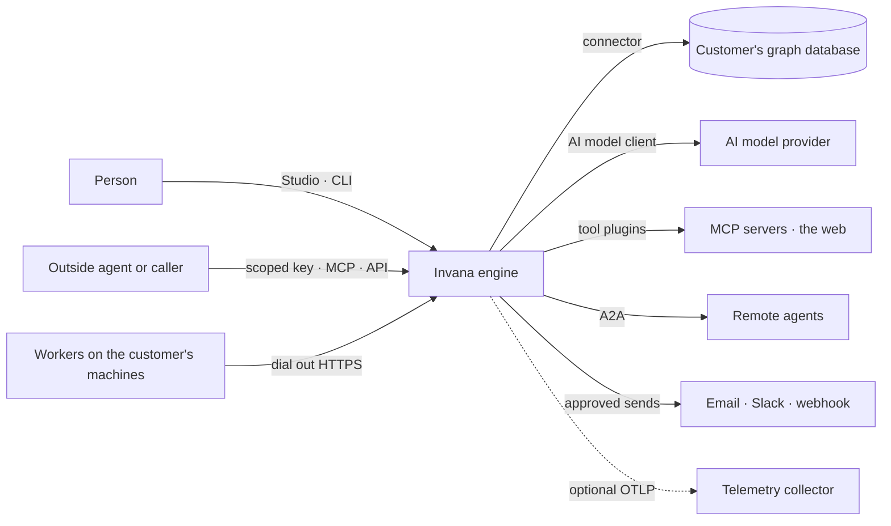
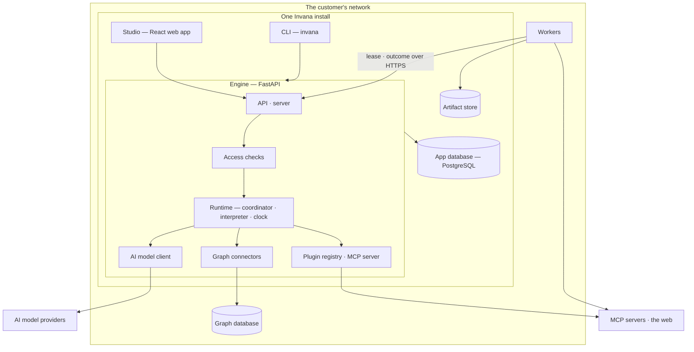

# System design

> How Invana's technology delivers its stories, and how well. What a person can do is the stories in
> [capabilities](capabilities/) and [os](os/); this file is the high-level design and the non-functional requirements.
> Each feature's low-level design is its `feature.md` › `## Engine`; a fact stated there is linked here, never restated.

| § | Section | Answers |
|---|---|---|
| 1 | [Context and scope](#1-context-and-scope) | What the system is, who and what it talks to |
| 2 | [Functional requirements](#2-functional-requirements) | What it does — by link to the stories |
| 3 | [Non-functional requirements](#3-non-functional-requirements) | How well, as numbers |
| 4 | [Constraints](#4-constraints) | What the design may not change |
| 5 | [Capacity estimates](#5-capacity-estimates) | How big it gets |
| 6 | [Data and storage](#6-data-and-storage) | Where facts are kept, and who owns each |
| 7 | [Architecture and components](#7-architecture-and-components) | The parts and their boundaries |
| 8 | [APIs and events](#8-apis-and-events) | How the parts and the outside talk |
| 9 | [Distributed execution](#9-distributed-execution) | How work runs across processes and machines |
| 10 | [AI and agents](#10-ai-and-agents) | How agents plan, act, are bounded and are judged |
| 11 | [Failure modes and the outside boundary](#11-failure-modes-and-the-outside-boundary) | What breaks, and what Invana does |
| 12 | [Qualities](#12-qualities) | Consistency · scalability · reliability · security · privacy · observability · accessibility |
| 13 | [Delivery and operations](#13-delivery-and-operations) | How it ships, installs, upgrades and is developed |
| 14 | [Evaluation](#14-evaluation) | Does the design meet each NFR |
| 15 | [Decisions, risks and not building](#15-decisions-risks-and-not-building) | System-level choices, open risks, non-goals |

## 1. Context and scope

Invana is a self-hosted engine and web app that sits between the people and agents who decide and the customer's own
graph database. It holds no copy of the graph: it holds the ontology, the access rules, the runs and the history, and
reads and writes the graph through a connector ([vision](vision.md)).

| In scope | Out of scope |
|---|---|
| One install is one organisation; a Graph is a bounded domain bound to one graph database | Multi-tenancy, an Organisation record, a shared hosted tenancy |
| The ontology, access, runs, history, boards, projects — in Invana's own app database | A copy of the customer's graph, an extractor, write-back to a source |
| People and agents as members of a Graph, held to the same rules | An agent acting across Graphs |

| Quality goal (top 5) | Why it matters to the person deciding |
|---|---|
| Grounded and traceable | Every answer cites the records behind it; a decision can be followed back to its sources ([NFR-SEC-5](#3-non-functional-requirements)) |
| Acts only as far as the person allows | Every act — a person's, an agent's, a key's — is Allow, Ask or Deny, checked when it runs ([NFR-SEC-1](#3-non-functional-requirements)) |
| Nothing lost, nothing hidden | Work survives a lost process; history is append-only and provably unedited ([NFR-REL-1](#3-non-functional-requirements), [NFR-REL-4](#3-non-functional-requirements)) |
| Bounded spend | Every limit is in tokens, held before each AI model call ([NFR-COST-1](#3-non-functional-requirements)) |
| Installs on the customer's ground | One command up, air-gappable, no service beyond PostgreSQL ([NFR-OPS-1](#3-non-functional-requirements)) |

## 2. Functional requirements

What a person or an agent can do is the stories; every refusal they can meet is a criterion. The index of every story
and its status is [specs/README.md](README.md).

| Part | Product | Features |
|---|---|---|
| Operating system | [Graph](os/graph/product.md) | GR-F01 open · GR-F02 create · GR-F03 find your way · GR-F04 this Graph · GR-F05 the Inbox |
| Operating system | [Access](os/access/product.md) | AC-F01 sign-in · AC-F02 access rules · AC-F03 groups and keys · AC-F04 what an agent may touch · AC-F05 asks and approvals · AC-F06 History |
| Operating system | [Runtime](os/runtime/product.md) | RT-F01 AI models · RT-F02 plugins · RT-F03 workers and the queue · RT-F04 limits · RT-F05 graph database connectors · RT-F06 skill scripts |
| Ontology | [Semantics](capabilities/semantics/product.md) | SE-F01 start a model · SE-F02 change and publish · SE-F03 meaning · SE-F04 taxonomies · SE-F05 standards · SE-F06 links · SE-F07 rules · SE-F08 inference · SE-F09 views of the graph · SE-F10 health |
| Intelligence | [Records](capabilities/records/product.md) | RC-F01 by kind · RC-F02 bring records in · RC-F03 quality · RC-F04 bulk fixes · RC-F05 merge · RC-F06 provenance · RC-F07 annotations |
| Agents | [Agents](capabilities/agents/product.md) | AG-F01 build an agent · AG-F02 catalogue · AG-F03 runs · AG-F04 skills · AG-F05 delegation · AG-F06 plans and functions · AG-F07 schedules · AG-F08 portable agents |
| Evidence | [Explore](capabilities/explore/product.md) | EX-F01 the board · EX-F02 share · EX-F03 ask · EX-F04 the answer · EX-F05 cannot answer · EX-F06 annotate and edit · EX-F07 memory |
| Evidence | [Projects](capabilities/projects/product.md) | PJ-F01 projects and tasks · PJ-F02 objectives and review · PJ-F03 branches and decisions · PJ-F04 simulation and impact · PJ-F05 reports · PJ-F06 alerts |

## 3. Non-functional requirements

Each NFR is a target, how it is measured and what enforces it. `review` means no check holds it yet; its § 14 row names
the recommendation that adds one. A feature names the NFRs it must meet in its `nfrs:`.

| ID | Quality | Target | Measured by | Enforced by | Constrains |
|---|---|---|---|---|---|
| NFR-REL-1 | A lost worker loses no work | A worker silent 30 s is lost; its steps are redelivered within 35 s under the same idempotency key — 0 steps lost, 0 run twice | `SIGKILL` a worker mid-run on the executor workload | `review` | RT-F03 · RT-F06 · SE-F08 · RC-F02 · RC-F03 · PJ-F04 |
| NFR-REL-2 | A lost coordinator costs seconds, not runs | The coordinator lease lapses after 15 s; another engine process takes it and every run finishes — 0 lost, 0 duplicate steps | Kill the coordinator mid-run | `review` | RT-F03 · RT-F04 |
| NFR-REL-3 | A graph database outage stays in its Graph | Reconnect with a doubling delay from 1 s to 60 s; every other Graph keeps answering; a connection test answers within 10 s | Stop one database under load; `system.graph_reconnect` spans | `review` | GR-F02 · GR-F04 · RT-F05 · SE-F08 |
| NFR-REL-4 | History is provably unedited | Hash chain re-verified every 10 minutes; `seq` gapless per Graph; kept 365 days, removed only in whole windows | The verify job's outcome; a tamper test | `review` | AC-F06 |
| NFR-REL-5 | Telemetry never fails the product | With the collector down: 0 request errors; the CLI exits within its 5 s flush budget | Requests and a CLI command against a stopped collector | `review` | Every feature |
| NFR-SEC-1 | Every act is checked | 100% of routes in a Graph run the access check for their action; no line is Deny; a Graph-scoped read without access is `404` | A route-table test over the API schema | `review` | GR-F03 · GR-F04 · AC-F02 · AC-F03 · AC-F04 · AC-F05 · RT-F06 |
| NFR-SEC-2 | Credentials never leave | AI model keys and graph database credentials are encrypted at rest and returned by no route; 0 credentials in any event, log line or span; `token` stripped from every recorded URL | Redaction tests over events, logs and spans; route tests | `review` | GR-F04 · GR-F05 · AC-F01 · AC-F03 · AC-F06 · RT-F01 · RT-F02 |
| NFR-SEC-3 | One door to an AI model, one keeper of keys | Provider SDKs are imported only by the AI model client; keys are read only by the secrets module — 0 other importers | Two `import-linter` contracts | `review` | RT-F01 · AG-F01 |
| NFR-SEC-4 | Sensitive acts need a fresh sign-in | An access change, a confidential send or a raised limit more than 15 minutes after sign-in is `401`; a reused refresh token ends the session | AC-F01 refusal tests | `review` | AC-F01 · AC-F02 · RT-F04 |
| NFR-SEC-5 | An agent sees only its view, and says where each fact came from | 0 reads outside the run's view — enforced at the connector or refused, never filtered after return; 100% of answer parts cite a record or a badged outside source | An eval over views and grounding | `review` | AC-F04 · RT-F05 · SE-F09 · RC-F06 · EX-F04 · EX-F05 |
| NFR-PERF-1 | A question does not wait behind batch work | With a free slot, a question's `queue_ms` p95 ≤ 2 s; questions go before project tasks, project tasks before batch | `queue_ms` on `agents_runs`; `invana.runs.queue_wait` | `review` | RT-F03 · RT-F04 · EX-F03 |
| NFR-PERF-2 | Dispatch and fan-out | Dispatch p95 ≤ 10 ms; throughput within 15% of 409 · 716 · 1,309 steps/s on 1 · 3 · 9 workers; a 700-agent run reaches efficiency ≥ 0.7 at 27 workers; 10,000 parked runs hold no worker and no connection | The executor benchmark | `review` | RT-F03 · SE-F08 · AG-F05 · AG-F06 |
| NFR-PERF-3 | Lists answer fast | A list route answers ≤ 500 ms p95 server time over 10,000 rows with filters applied; at most 200 rows a page | `http.server.request.duration` by route on the demo Graph | `review` | GR-F01 · GR-F03 · GR-F04 · GR-F05 · AC-F02 · AC-F05 · AC-F06 · RT-F01 · RT-F02 · SE-F07 · RC-F02 · AG-F03 · AG-F04 · AG-F06 · AG-F07 · PJ-F01 |
| NFR-PERF-4 | The board stays usable | Layouts up to 3,000 nodes; switching presets glides in ≤ 400 ms under 2,000 nodes; a solve past 400 ms shows a cancellable toast | `ui.canvas.layout.duration` | `review` | SE-F06 · EX-F01 |
| NFR-PERF-5 | Reads on a person's behalf are bounded | A publish preview reads ≤ 1,000 records a kind; an answer speaks from ≤ 50 rows; an impact reach expands ≤ 12 records a hop, 50 neighbours each — and each says it is a sample | The criteria of SE-F02, EX-F04, PJ-F04 | test | SE-F02 · EX-F04 · PJ-F04 |
| NFR-COST-1 | Spend stays inside its budget | Tokens are held before every AI model call; a run never passes its budget by more than the one held call; every limit is in tokens | RT-F04 admission and hold tests | `review` | RT-F01 · RT-F04 · AG-F01 · AG-F05 |
| NFR-COST-2 | Spend is tokens, never currency | 0 currency amounts in any record, route, event or screen | A schema and string check | `review` | GR-F04 · RT-F04 · AG-F03 |
| NFR-COST-3 | Idle costs nothing extra | No telemetry endpoint: 0 exporters started; a worker idle 5 minutes above its group's minimum is drained; a parked run holds no worker | Start-up and drain tests | `review` | RT-F03 |
| NFR-OPS-1 | One command up, on every OS | `docker compose up -d` starts a working stack with demo data on macOS, Linux and Windows; `pip install invana` plus `invana worker` is a whole worker | A CI matrix over the three | `review` | Every feature |
| NFR-OPS-2 | Upgrades by one explicit command | `invana migrate` takes PostgreSQL to head; `invana start` never migrates; the migrated schema equals the models' | The schema and OpenAPI snapshots | CI gate | SE-F08 |
| NFR-OPS-3 | Every action is one trace | 100% of Studio actions open one trace that the engine continues; every 5xx is one error line with its `trace_id`; every run stores its `trace_id` | Span tests with an in-memory exporter | `review` | AG-F03 |
| NFR-OPS-4 | Tests cover the logic | ≥ 80% statements, branches, functions and lines for the engine and for Studio's logic | Coverage reports | CI gate (Studio) · `review` (engine) | Every feature |
| NFR-SUS-1 | The code keeps its shape | 0 violations of the band contracts, the file-shape checks, Studio's package boundaries, dead-code and Biome | `lint-imports` · `tests/golden` · `check-boundaries` · `knip` · Biome | CI gate | Every feature |
| NFR-SUS-2 | Every user-facing change is announced | 100% of user-facing changes carry a changeset | Changeset check | CI gate | Every feature |
| NFR-SUS-3 | Files stay readable | No engine module or Studio file over 400 lines, but listed canvas files | Line counts | `review` | Every feature |
| NFR-UX-1 | Studio is accessible | WCAG 2.2 AA; every control has an accessible name | axe in the end-to-end suite | `review` | Every feature |
| NFR-UX-2 | Every number is the engine's | 100% of numbers on screen are stored or served by the engine; Studio computes no rate, share, change or percentile | Code review against AG-F03's stored figures | `review` | AC-F02 · RT-F03 · SE-F10 · AG-F03 · EX-F07 |
| NFR-UX-3 | Every screen states where it is | Every screen draws loading, empty and error; every write answers with the engine's sentence | One end-to-end spec per surface | `review` | Every feature |

## 4. Constraints

| Constraint | Because |
|---|---|
| Self-hosted, single-tenant, air-gappable | The target is the enterprise's own ground; every added stateful service is the customer's ops cost |
| One Graph binds one graph database in one query language | A Graph is the boundary of meaning, access and agents ([RT-F05](os/runtime/features/RT-F05-graph-database-connectors/feature.md#engine)) |
| The customer's graph database is theirs | Invana reads and writes it through a connector, holds no copy, never writes back to an upstream source |
| Supported databases: Neo4j, Memgraph, ArcadeDB (Cypher); JanusGraph, Amazon Neptune, TinkerGraph, ArcadeDB (Gremlin) | The connectors Invana ships ([RT-F05](os/runtime/features/RT-F05-graph-database-connectors/feature.md#engine)) |
| The app database is PostgreSQL in production, SQLite in development | One store for records, events and the queue; SQLite keeps a contributor's setup to one command |
| No service beyond PostgreSQL | The queue is procrastinate on the app's PostgreSQL; workers dial out |
| Open licences only in the run path | No source-available or commercial part between a question and its answer |
| Python 3.14 engine, React 19 Studio, composed from `@invana/design-kit` and `@invana/canvas` | The stack every package is built on (CLAUDE.md) |
| Spend in tokens | No price is stored or shown |
| The same commands on macOS, Linux and Windows | Community contributors use all three |

## 5. Capacity estimates

Invana scales with acts, runs and tokens — not with page views. The graph's size is the customer's database's.

| Quantity | Estimate | Reached by | Sizes |
|---|---|---|---|
| Graph database size | Unbounded by Invana; reads are bounded per act | Invana never loads a whole graph: a board draws ≤ 3,000 nodes, a preview reads ≤ 1,000 records a kind, an answer ≤ 50 rows | NFR-PERF-4 · NFR-PERF-5 |
| Runs going at once | Hundreds per install; each Graph's ceiling set by an Admin | Each Graph's limits and capacity pools ([RT-F04](os/runtime/features/RT-F04-limits/feature.md#engine)) | NFR-PERF-1 · NFR-PERF-2 |
| Width of one run | 700 agents, 5,000 graph-query lanes | The fan-out acceptance workload | NFR-PERF-2 |
| Parked runs | 10,000 waiting on a person | A run held for days on an approval holds nothing | NFR-PERF-2 · NFR-COST-3 |
| Run length | Seconds to weeks | A run may wait on a person; every `*_ms` column is 64-bit ([AG-F03](capabilities/agents/features/AG-F03-runs-and-how-the-agents-are-doing/feature.md#engine)) | NFR-REL-2 |
| Events and History rows | About 10⁵ a day for an active install; kept 365 days | One event per write, one History row per act, for people and agents alike | NFR-REL-4 |
| Query log | 90 days | The widest health window ([SE-F10](capabilities/semantics/features/SE-F10-health-and-history/feature.md#engine)) | NFR-PERF-3 |
| Tokens | Per Graph a month, set by an Admin | Each Graph's limits; every call held first | NFR-COST-1 |
| Artifacts | Grow with runs; expire before their run | Stored by digest, on its own retention window | NFR-COST-3 |

## 6. Data and storage

| Store | Holds | Consistency | Owner of each record |
|---|---|---|---|
| App database — PostgreSQL (SQLite in development) | Every record table of every feature; the event store; History; the queue's own tables | Transactional per request: a write and its event commit together | The feature whose `## Engine` › *Records* declares the table |
| Event store — `events` in the app database | Every write, append-only, with its principal, on-behalf-of, parent event, scopes and trace | Same transaction as the write; a live tail by notify | [AC-F06](os/access/features/AC-F06-history/feature.md#engine) |
| Queue — procrastinate's schema in the app database | Step envelopes waiting for a worker | At-least-once delivery under one idempotency key; the outcome is a row | [RT-F03](os/runtime/features/RT-F03-workers-and-the-queue/feature.md#engine) |
| The customer's graph database | The records — nodes and relationships — and the schema statements Invana pushes | The database's own; Invana inherits it | Writes: [RC-F02](capabilities/records/features/RC-F02-bring-records-in/feature.md#engine) loads · [SE-F02](capabilities/semantics/features/SE-F02-change-and-publish-a-model/feature.md#engine) schema · [SE-F06](capabilities/semantics/features/SE-F06-links-and-mappings/feature.md#engine) links · [EX-F06](capabilities/explore/features/EX-F06-annotate-and-edit-the-data/feature.md#engine) edits · [SE-F08](capabilities/semantics/features/SE-F08-inference/feature.md#engine) derived facts written back |
| Artifact store — filesystem, or object storage where configured | Files and raw payloads a run produced, by `sha256` digest | Written once; the run row holds the digest | [AG-F03](capabilities/agents/features/AG-F03-runs-and-how-the-agents-are-doing/feature.md#engine) |
| Plugin registry — files, frozen per process | Every plugin, its functions and manifests | Read at start; nothing hot-loads | [RT-F02](os/runtime/features/RT-F02-plugins-and-outside-tools/feature.md#engine) |
| Secrets — encrypted columns, read by one module | AI model keys, graph database credentials, channel secrets | Encrypted at rest; never returned; redacted from every event | [RT-F01](os/runtime/features/RT-F01-ai-models/feature.md#engine) keys · [GR-F04](os/graph/features/GR-F04-this-graph/feature.md#engine) connection passwords · [GR-F05](os/graph/features/GR-F05-the-inbox/feature.md#engine) channel secrets · [RT-F02](os/runtime/features/RT-F02-plugins-and-outside-tools/feature.md#engine) a worker's plugin secrets · [AC-F06](os/access/features/AC-F06-history/feature.md#engine) redaction |

| Decision | Choice | Trade-off | Detail in |
|---|---|---|---|
| One table, one owner | A table is written only by its feature's managers; another feature reads it through them and links its *Reads* row | A read across features is a call, not a join | Each feature's `## Engine` › *Records* · *Reads* |
| Install or Graph | A Graph's table carries `graph_id` and cascades from its Graph; an install table carries none | No row is shared between Graphs | Each feature's *Records* |
| Every write is an event | A manager emits the event of its write in the write's transaction; History, the change list, notifications and traces are readings of it, never copies | Every write path pays one insert | [AC-F06](os/access/features/AC-F06-history/feature.md#engine) |
| Versions are immutable | Models, rules, skills, agents, plans and views publish new versions; a run is frozen onto the versions it used | Storage grows with every publish | [SE-F02](capabilities/semantics/features/SE-F02-change-and-publish-a-model/feature.md#engine) · [AG-F01](capabilities/agents/features/AG-F01-build-an-agent/feature.md#engine) · [AG-F04](capabilities/agents/features/AG-F04-skills/feature.md#engine) · [AG-F06](capabilities/agents/features/AG-F06-plans-and-functions/feature.md#engine) |
| Hard deletes, downward cascade | No soft delete, no trash, no undo; retention removes whole windows; retire, retract and undoing a load keep history resolvable | A mistaken delete is gone | Each feature's *Refusals* |
| The engine stores every number | A per-row figure is a column written when the fact settles; a windowed figure is a query over those columns; a percentile is computed in the engine, so SQLite and PostgreSQL agree | Figures are fixed at settle time | [AG-F03](capabilities/agents/features/AG-F03-runs-and-how-the-agents-are-doing/feature.md#engine) |
| Every element Invana writes says who wrote it | Each write path stamps its run, its time and its origin (`import` · `llm` · `user` · `third_party`) on the element, under the `_inv_` names its *Engine* lists; an element with none predates Invana or came by bulk load | Stamps add properties to the customer's graph | [RC-F02](capabilities/records/features/RC-F02-bring-records-in/feature.md#engine) · [SE-F06](capabilities/semantics/features/SE-F06-links-and-mappings/feature.md#engine) · [EX-F05](capabilities/explore/features/EX-F05-when-it-cannot-answer-and-how-it-reasons/feature.md#engine) · [RC-F06](capabilities/records/features/RC-F06-provenance/feature.md#engine) |
| One migration chain | Alembic revisions applied by `invana migrate`, then the queue's schema; a rename keeps its rows; a migration is proved on PostgreSQL | SQLite is not a migration target | § 13 |
| A table is declared before it is migrated | A new table is a row in its feature's *Records* before its migration is written | — | Each feature's *Records* |

## 7. Architecture and components

| Component | Responsible for | Owns | Serves |
|---|---|---|---|
| Studio | Everything a person reads and does in a browser; formats, never derives | Nothing stored | Every feature with a board |
| CLI — `invana` | Anything scripted; one command per noun and verb over the same managers as the API | Nothing stored | Each feature's `### CLI` |
| API — `server` | Routes, the error-to-status map, the `{ message, data }` answer, `/`, `/health`, the telemetry relay, the generated admin | Nothing of a feature | § 8 |
| Access checks | Allow · Ask · Deny on every act when it runs, for people, agents and keys | Access rules, groups, keys, approvals, History | [AC-F02](os/access/features/AC-F02-access-rules/feature.md#engine) · [AC-F04](os/access/features/AC-F04-what-an-agent-may-touch/feature.md#engine) · [AC-F05](os/access/features/AC-F05-asks-and-approvals/feature.md#engine) · [AC-F06](os/access/features/AC-F06-history/feature.md#engine) |
| Runtime | Walks a plan: the frontier, fan-out, signals, pauses, cancel and resume; admits runs against limits; one coordinator by lease | Runs, steps, the queue's envelopes, limits | [RT-F03](os/runtime/features/RT-F03-workers-and-the-queue/feature.md#engine) · [RT-F04](os/runtime/features/RT-F04-limits/feature.md#engine) · [AG-F03](capabilities/agents/features/AG-F03-runs-and-how-the-agents-are-doing/feature.md#engine) · [AG-F06](capabilities/agents/features/AG-F06-plans-and-functions/feature.md#engine) |
| The clock | One shared tick for schedules, deadlines, chain verification and sweeps | Schedules and firings | [AG-F07](capabilities/agents/features/AG-F07-schedules/feature.md#engine) |
| Workers | Run step envelopes from their pool's queues; no inbound port, no database credential | Nothing; post outcomes back | [RT-F03](os/runtime/features/RT-F03-workers-and-the-queue/feature.md#engine) |
| AI model client | The only caller of an AI model; one structured call to the endpoint a run resolved, recorded | Nothing; endpoints are RT-F01's | [AG-F01](capabilities/agents/features/AG-F01-build-an-agent/feature.md#engine) · [RT-F01](os/runtime/features/RT-F01-ai-models/feature.md#engine) |
| Graph connectors | One package per database family, found by entry point; the view enforced at execution | Connections, capabilities | [RT-F05](os/runtime/features/RT-F05-graph-database-connectors/feature.md#engine) · [GR-F04](os/graph/features/GR-F04-this-graph/feature.md#engine) |
| Plugins and MCP | Tool, simulator, core and pack plugins; every tool plugin an MCP server on the workers; this Graph's own MCP server | The registry, plugin states, MCP servers | [RT-F02](os/runtime/features/RT-F02-plugins-and-outside-tools/feature.md#engine) · [RT-F06](os/runtime/features/RT-F06-skill-scripts/feature.md#engine) |
| Capability packages | Semantics · Records · Agents · Explore · Projects — each its own records, routes, events and boards | Their *Records* | Their features' `## Engine` |
| Graph package | Graphs, members, setup, search, the Inbox and notifications | Graphs, members, notifications | [GR-F01](os/graph/features/GR-F01-open-a-graph/feature.md#engine)–[GR-F05](os/graph/features/GR-F05-the-inbox/feature.md#engine) |

| Decision | Choice | Trade-off | Detail in |
|---|---|---|---|
| A package per product | Each operating-system part and capability is one package, its name the same from spec folder to board (§ 8) | A screen that composes several packages lives in the app's host | § 8 |
| One direction inside the engine | `routes → views → managers → querysets → models`; managers hold every rule and are the Python API; the request owns the transaction | More files per feature | § 13 |
| Two front-ends, one rule set | The API and the CLI are peers over the same managers; neither holds a rule | — | § 13 |
| The runtime talks down, packages talk up | The runtime reaches a package only through the closed function catalogue; a package reaches the runtime through protocols declared in `core` | A new step is a function, not a call | [AG-F06](capabilities/agents/features/AG-F06-plans-and-functions/feature.md#engine) |
| A write across two packages is one manager's | The manager of the first write calls the other's manager in the same transaction, or the second acts on the first's event | — | Each feature's *Mechanisms* |
| Studio packages by tag | `core` → `ui` → `canvases` → `assistant` → `shell` → a product → the app; a product never imports another product; `index.ts` is a package's only border | A shared widget moves down to `ui`, or to the design-kit when domain-free | § 13 |

## 8. APIs and events

| Convention | Rule | Detail in |
|---|---|---|
| One name across layers | A package's name is the same in its spec folder, engine module, tables (`<package>_<records>`), routes, access actions and events (`<package>.<records>.<verb>`), spans, Studio package (`@invana-studio/<package>`), Studio routes and boards (`<package>.<surface>`). Packages: `graphs` · `access` · `runtime` · `semantics` · `records` · `agents` · `explore` · `projects`; shared: `core` · `cli` · `server` | [migrations.md](migrations.md) M5 for the code |
| Records are plural nouns, said once | `access_rules`, `runs`; a record named as its package is said once — table `graphs`, event `graphs.create` | Each feature's *Records* |
| Versioned prefix and scope | In a Graph `/api/v1/u/{u}/{g}/<package>/<records>`; install-wide `/api/v1/<package>/<records>`; a route sits under the package that owns its records, never under the screen that calls it | Each feature's *Routes* |
| A Graph-scoped read without access | `404` — the Graph is absent, not forbidden | [AC-F02](os/access/features/AC-F02-access-rules/feature.md#engine) |
| Errors map once | Not found `404` · conflict `409` · unauthenticated `401` · denied `403` · a shape the model forbids `422`; every error names the field, step or bound, never a bare code | Each feature's *Refusals* |
| A write answers `{ message, data }` | The engine writes the sentence; Studio shows it and composes none; one gesture reports once | Each feature's *Routes* |
| `PUT` replaces, `PATCH` amends | A blank secret on `PUT` keeps the stored one | Each feature's *Routes* |
| Deletes are hard and cascade down | `409` while something still references it | Each feature's *Refusals* |
| One list contract | Every list takes `q` (plain text, contains, over named fields) · named filters (values of one field OR, fields AND; an undeclared one is `422`) · `sort` · `cursor` (keyset, bound to its sort) · `limit` (default 50, at most 200) and answers `Page[T]`: `items` · `total` · `unfiltered_total` · `next_cursor` · `applied` (each filter with its label). Studio carries filters in the URL as `?f.<field>=` and never narrows rows itself | Each feature's *Routes* |
| Streams are server-sent events | A `?token=` and `?traceparent=` fallback where a header cannot be set | [AG-F03](capabilities/agents/features/AG-F03-runs-and-how-the-agents-are-doing/feature.md#engine) · [EX-F04](capabilities/explore/features/EX-F04-the-answer/feature.md#engine) |
| The generated client is the contract | Studio's types come from the API schema; nothing is hand-typed; the schema is a golden file | § 13 |
| Events name the act | `<package>.<records>.<verb>` — imperative when a principal did it (`projects.create`), past tense when the system observed it (`access.auth.login_failed`); an event's action is the access action that wrote it | [AC-F06](os/access/features/AC-F06-history/feature.md#engine) |
| CLI shape | `invana <noun> <verb>`; `--graph <user>/<slug>` in a Graph; `--user` names who it acts as and is checked like the route it stands for; `--json` on every command; `--dry-run` on every write; prompts, or `--non-interactive` with every value a flag | Each feature's *CLI* |
| A CLI refusal names the next command | A route answers a refusal as a code and its facts; the CLI turns the code into what happened, what was written and the command that does what was meant; distinct exit codes for a validation failure | Each feature's *CLI* |
| A name on the wire is public | A module path stored in a row or imported by a connector package changes only through a migration that rewrites the stored values | [migrations.md](migrations.md) |

## 9. Distributed execution

| Decision | Choice | Trade-off | Detail in |
|---|---|---|---|
| Invana runs its own work | A plan interpreter in the engine; no broker or scheduler to stand up first; workers on other machines are optional | The interpreter is Invana's to keep | [RT-F03](os/runtime/features/RT-F03-workers-and-the-queue/feature.md#engine) |
| The queue is procrastinate on the app's PostgreSQL | It matched or beat Dramatiq on throughput, fan-out and latency, recovered a killed worker as fast, and adds no service. Rejected: Prefect (send-bound, lost a dead worker's envelopes), Hatchet (a second service and source of truth), Temporal (heaviest install, history limits on a 700-agent run), DBOS (database access from workers), Restate (no dial-out, BSL), Argo (Kubernetes only) | No queue on SQLite: development runs `inline` | [RT-F03](os/runtime/features/RT-F03-workers-and-the-queue/feature.md#engine) |
| One protocol, versioned | Submit · report · cancel · reconcile; a runtime states its version and a mismatch is refused at start, naming it | — | [RT-F03](os/runtime/features/RT-F03-workers-and-the-queue/feature.md#engine) |
| One run, one executor | The interpreter runs inside one unit of work and reports its steps; a run never spans executors, and the engine never drives a run step by step from outside | Step granularity is reported, not orchestrated | [RT-F03](os/runtime/features/RT-F03-workers-and-the-queue/feature.md#engine) |
| A step travels as an envelope | JSON only; nothing live crosses; secrets never ride it — the worker resolves the ones the function declares | A step that hands over through in-process state stays in-process | [RT-F03](os/runtime/features/RT-F03-workers-and-the-queue/feature.md#engine) |
| At-least-once, effectively once | The idempotency key is `run_id:node_id:attempt`; a redelivered write returns the recorded outcome | Functions must be idempotent under their key | [RT-F03](os/runtime/features/RT-F03-workers-and-the-queue/feature.md#engine) |
| Workers dial out | Long-poll over HTTPS with a pool credential; no inbound port, no database credential; hardware routed by queue labels; a worker runs as Docker, plain Python or on Kubernetes | A worker cannot be pushed to | [RT-F03](os/runtime/features/RT-F03-workers-and-the-queue/feature.md#engine) |
| One coordinator by lease | Renewed every 5 s, lapsing after 15 s; another engine process takes it, woken by notify | Up to 15 s without dispatch | NFR-REL-2 |
| Admission at the coordinator | Each Graph's runs at once, capacity pools and model rate limits are checked before dispatch; a waiting run holds nothing; questions go first | A saturated pool makes work wait, named | [RT-F04](os/runtime/features/RT-F04-limits/feature.md#engine) |
| Capacity is added by a person | The engine suggests how many workers each group needs; nothing scales by itself; an idle worker drains | No autoscaler | [RT-F03](os/runtime/features/RT-F03-workers-and-the-queue/feature.md#engine) |
| One writer per Graph's History | A row lock keeps `seq` gapless | History writes serialise per Graph | [AC-F06](os/access/features/AC-F06-history/feature.md#engine) |

## 10. AI and agents

| Decision | Choice | Trade-off | Detail in |
|---|---|---|---|
| One door to an AI model | The AI model client makes one structured call to the endpoint the run resolved and records it; access and the view decide before it | Every model feature goes through one interface | [AG-F01](capabilities/agents/features/AG-F01-build-an-agent/feature.md#engine) the client · [RT-F01](os/runtime/features/RT-F01-ai-models/feature.md#engine) endpoints and the cache · [SE-F09](capabilities/semantics/features/SE-F09-views-of-the-graph/feature.md#engine) each call recorded |
| A model is pinned, never failed over | Agents, skills and judges pin an exact model version; a run records the one it called; one cache on the call, keyed by content | A provider outage fails the step | [RT-F01](os/runtime/features/RT-F01-ai-models/feature.md#engine) |
| Plans are data | Generated from instructions, packaged with a plugin, or kept from a run — never authored by hand; validated against the agent's envelope before anything runs | No plan editor | [AG-F06](capabilities/agents/features/AG-F06-plans-and-functions/feature.md#engine) |
| A closed catalogue of functions | Every step calls one function from an enabled plugin or an approved library | A new capability is a plugin | [AG-F06](capabilities/agents/features/AG-F06-plans-and-functions/feature.md#engine) · [RT-F02](os/runtime/features/RT-F02-plugins-and-outside-tools/feature.md#engine) |
| Skills are offered, not forced | A skill is bound to agents and offered by its match; its eval cases gate a publish | — | [AG-F04](capabilities/agents/features/AG-F04-skills/feature.md#engine) |
| An agent sees through a view | Every read is grounded in the published models and narrowed by the run's view, enforced at the connector | A view a connector cannot enforce refuses the query | [SE-F09](capabilities/semantics/features/SE-F09-views-of-the-graph/feature.md#engine) · [RT-F05](os/runtime/features/RT-F05-graph-database-connectors/feature.md#engine) |
| Grounding is a contract | An answer states only what the records hold; zero rows is *the Graph does not hold this*; an outside fact is badged with its source; a failure is not a cannot-answer | — | [EX-F04](capabilities/explore/features/EX-F04-the-answer/feature.md#engine) · [EX-F05](capabilities/explore/features/EX-F05-when-it-cannot-answer-and-how-it-reasons/feature.md#engine) |
| Three pauses | Clarification (*I do not know*), approval (*I may not proceed*), verdict (*I may not judge what I made*); a paused run holds nothing | — | [AG-F03](capabilities/agents/features/AG-F03-runs-and-how-the-agents-are-doing/feature.md#engine) · [AC-F05](os/access/features/AC-F05-asks-and-approvals/feature.md#engine) |
| Bounded four ways | Tokens held before each call; sub-task depth, count and tokens from the agent's budget; each Graph's runs at once; a fan-out ceiling | A wide question waits | [RT-F04](os/runtime/features/RT-F04-limits/feature.md#engine) · [AG-F05](capabilities/agents/features/AG-F05-delegation-and-outside-agents/feature.md#engine) |
| No agent accepts its own work | A finding, proposal or task an agent produced is reviewed by a person or another principal | — | [PJ-F02](capabilities/projects/features/PJ-F02-objectives-and-review/feature.md#engine) |
| Judged by evals | An agent's publish and model pin pass its eval gate; drift is re-run on a schedule | Every change runs its cases | [AG-F01](capabilities/agents/features/AG-F01-build-an-agent/feature.md#engine) · [AG-F04](capabilities/agents/features/AG-F04-skills/feature.md#engine) |
| Memory is the graph | Past runs teach through recorded plans and recalled records, cited like any other | No separate memory store | [EX-F07](capabilities/explore/features/EX-F07-memory-what-past-runs-teach/feature.md#engine) |
| Outside agents are asked each time | A2A by card; only allowed fields are sent; what returns goes to a person | — | [AG-F05](capabilities/agents/features/AG-F05-delegation-and-outside-agents/feature.md#engine) |

## 11. Failure modes and the outside boundary

| Fails | The person sees | Invana does | Proven by |
|---|---|---|---|
| A worker dies mid-step | The step running a little later | Marks it lost after 30 s and redelivers under the same key | NFR-REL-1 |
| The coordinator's process dies | Runs pause for seconds | Another engine process takes the lease after 15 s; runs move on | NFR-REL-2 · RT-07 |
| No worker carries a step's label | The step fails naming the label and the command that adds a worker | Fails after the step's limit plus the queue-wait allowance; never hangs | RT-F03 *Refusals* |
| The graph database is down | The Graph says its database is unreachable; other Graphs answer | Retries with a doubling delay to 60 s | NFR-REL-3 |
| An AI model provider fails or rate-limits | The failure in the provider's own words, with the endpoint; a rate-limited step says it waits and roughly how long | No failover; a rate limit is backpressure before dispatch | RT-F01 · RT-F04 *Refusals* |
| An outside MCP server is down | The step fails naming the server | Never retried | RT-F02 *Refusals* |
| A run passes its budget | An ask to raise it, or the run held | Tokens are held before each call | NFR-COST-1 |
| Nobody decides an ask | The run fails at its deadline, naming who was asked | Expired, not sent | AC-F05 *Refusals* |
| The engine restarts mid-run | The run resumes | Running steps close `interrupted` and re-dispatch as new attempts | NFR-REL-2 |
| The telemetry collector is down | Nothing | Exporters drop; requests and the CLI carry on | NFR-REL-5 |
| A query would read outside the view | A refusal naming the view | Enforced at the connector or refused before the wire | NFR-SEC-5 |
| Migrations are pending at start | The engine refuses to start, naming `invana migrate` | Never migrates on boot | NFR-OPS-2 |

| Outside system | Invana guarantees | Inherited from it |
|---|---|---|
| The customer's graph database | Every query goes through one connector door; a view is enforced or refused; every element Invana writes is stamped | Availability, durability, capabilities and its own consistency ([RT-F05](os/runtime/features/RT-F05-graph-database-connectors/feature.md#engine)) |
| AI model providers | Keys encrypted and never read back; tokens held and recorded per call; the exact model version recorded | Availability, latency, rate limits and the answer's content ([RT-F01](os/runtime/features/RT-F01-ai-models/feature.md#engine)) |
| MCP servers and tool plugins | A key on every call; a send asks first; every row cites its source; tools frozen until refreshed | Availability and its tool definitions ([RT-F02](os/runtime/features/RT-F02-plugins-and-outside-tools/feature.md#engine)) |
| Remote agents (A2A) | Asked each time; only allowed fields sent; the result goes to a person | Availability and what it returns ([AG-F05](capabilities/agents/features/AG-F05-delegation-and-outside-agents/feature.md#engine)) |
| Outside callers — this Graph's MCP server and API | A scoped key; every call is a run in History; the only write is a load | — ([RT-F02](os/runtime/features/RT-F02-plugins-and-outside-tools/feature.md#engine)) |
| Channels — email, Slack, webhook | Anything leaving waits on a named approver; at its deadline it is *expired, not sent* | Delivery ([GR-F05](os/graph/features/GR-F05-the-inbox/feature.md#engine) · [AC-F05](os/access/features/AC-F05-asks-and-approvals/feature.md#engine)) |
| Telemetry collector | Optional; carries shape, timing and ids, never record contents or credentials | Storage and alerting of signals |

Open formats Invana reads and writes, each at one pinned version. A format with no upstream version is pinned by the
date it was read; moving a pin is a spec change; a file at another version is refused, naming both.

| Standard | For | Invana | Pinned |
|---|---|---|---|
| Agent Skills — the `SKILL.md` folder | Skills ([AG-F04](capabilities/agents/features/AG-F04-skills/feature.md) · [AG-F08](capabilities/agents/features/AG-F08-portable-agents-and-skills/feature.md)) | Reads and writes; Invana's fields under `metadata:` | agentskills.io specification, read 2026-11-09 |
| Agent file — Markdown with YAML front matter | Agents ([AG-F08](capabilities/agents/features/AG-F08-portable-agents-and-skills/feature.md)) | Reads and writes; Invana's fields under `metadata:` | Claude Code subagent file, read 2026-11-09 |
| `AGENTS.md` | Agents ([AG-F08](capabilities/agents/features/AG-F08-portable-agents-and-skills/feature.md)) | Reads only | agents.md, read 2026-11-09 |
| Codex agent file — TOML | Agents ([AG-F08](capabilities/agents/features/AG-F08-portable-agents-and-skills/feature.md)) | Reads only | Codex CLI agent TOML, read 2026-11-09 |
| Claude plugin bundle — `.claude-plugin/plugin.json` | Agents, skills and the MCP servers it names ([AG-F08](capabilities/agents/features/AG-F08-portable-agents-and-skills/feature.md)) | Reads only | Claude Code plugin manifest, read 2026-11-09 |
| Agent2Agent — the agent card | Outside agents ([AG-F05](capabilities/agents/features/AG-F05-delegation-and-outside-agents/feature.md)) | Client: reads cards, sends tasks | `1.0` |
| Model Context Protocol · JSON Schema · Python entry points · Python in the sandbox | [RT-F02](os/runtime/features/RT-F02-plugins-and-outside-tools/feature.md#engine) · [RT-F05](os/runtime/features/RT-F05-graph-database-connectors/feature.md#engine) · [RT-F06](os/runtime/features/RT-F06-skill-scripts/feature.md#engine) | As each feature says | As each feature pins |

| Rule | Detail |
|---|---|
| Read many, write one | Agents are written as the Markdown agent file and skills as `SKILL.md` folders; every other agent format is read only |
| Invana's own stay Invana's | Simulator and core plugins, plans and evals have no open standard and keep Invana's formats |

## 12. Qualities

### Consistency

| Decision | Choice | Trade-off | Detail in |
|---|---|---|---|
| Strong inside the app database | A request is one transaction; a write and its event commit together | — | § 6 |
| The graph database's own consistency | Invana inherits it; a load is a run that can be undone, never a distributed transaction across both stores | A crash between stores is reconciled by the run, not by two-phase commit | [RC-F02](capabilities/records/features/RC-F02-bring-records-in/feature.md#engine) |
| Paging never repeats or skips | Keyset cursors bound to their sort | No jump to page *n* | § 8 |

### Scalability

| Decision | Choice | Trade-off | Detail in |
|---|---|---|---|
| Scale by workers, per label | Pools carry labels (`cpu` · `llm` · `egress` · `gpu` · `code`), one queue per label and step class | A person adds machines | [RT-F03](os/runtime/features/RT-F03-workers-and-the-queue/feature.md#engine) |
| A Graph never borrows another's capacity | Limits and pools are per Graph | Idle capacity in one Graph is not lent | [RT-F04](os/runtime/features/RT-F04-limits/feature.md#engine) |
| Bounded reads | Every read on a person's behalf has a ceiling and says it is a sample | — | NFR-PERF-5 |

### Reliability

| Decision | Choice | Trade-off | Detail in |
|---|---|---|---|
| Runs are durable | Steps hand over through declared outputs and the app database; a run survives the process that started it | In-process state cannot cross a worker | [RT-F03](os/runtime/features/RT-F03-workers-and-the-queue/feature.md#engine) |
| Attempts and lanes are rows | A failed attempt is never overwritten by the one that succeeded | More rows per run | [AG-F03](capabilities/agents/features/AG-F03-runs-and-how-the-agents-are-doing/feature.md#engine) |
| Health tells the truth | `GET /health` is unauthenticated and cheap and names the component that is down | — | § 13 |

### Security

| Decision | Choice | Trade-off | Detail in |
|---|---|---|---|
| One access model | Every act is Allow · Ask · Deny by the lines a person set; no line is Deny; the strictest line wins; an agent's access change is never Allow | — | [AC-F02](os/access/features/AC-F02-access-rules/feature.md#engine) |
| Identity in a short-lived token, sessions in rows | The access token carries the subject only; the refresh token is an opaque hashed row, rotated, revoked by update | A membership change applies on the next check, not the next token | [AC-F01](os/access/features/AC-F01-sign-in-account-and-sessions/feature.md#engine) |
| Keys only in the secrets module | Encrypted at rest; workers resolve the secrets a function declares; credentials never enter the record, not even encrypted | — | NFR-SEC-2 · NFR-SEC-3 |
| History is append-only and hash-chained | Verified every 10 minutes; exports carry each hash | — | [AC-F06](os/access/features/AC-F06-history/feature.md#engine) |
| Skill scripts run sandboxed | Approved once by hash; run unchanged | — | [RT-F06](os/runtime/features/RT-F06-skill-scripts/feature.md#engine) |

### Privacy

| Decision | Choice | Trade-off | Detail in |
|---|---|---|---|
| The graph stays home | Air-gappable; a remote worker keeps its data and artifacts in its own network; the engine holds only digests | — | [RT-F03](os/runtime/features/RT-F03-workers-and-the-queue/feature.md#engine) |
| What reaches an AI model | Only what the run's view allows; a local model is resolved per call | — | [RT-F01](os/runtime/features/RT-F01-ai-models/feature.md#engine) · [SE-F09](capabilities/semantics/features/SE-F09-views-of-the-graph/feature.md#engine) |
| Who acted, never what they sent | Telemetry and logs carry principal, origin, Graph and ids — never record contents, prompts, answers or credentials | Debugging content needs the record, not the log | Observability below |

### Observability

Telemetry is for whoever runs the server; no product surface reads it — a number a person reads is stored on the
record (§ 6).

| Decision | Choice | Trade-off | Detail in |
|---|---|---|---|
| Three signals over OpenTelemetry | Traces (what happened to one action) · metrics (how often, how slow) · logs (a discrete fact, with `trace_id` and `span_id`); OTLP gRPC from the engine, OTLP HTTP from Studio through the engine's `/api/v1/telemetry/*` relay | — | — |
| Optional | No endpoint means no exporter and no overhead; the relay accepts and drops; a collector that is down never surfaces as an error | — | NFR-REL-5 |
| One action, one trace | Rooted in Studio as `ui.<module>.<action>`, ended when its outcome arrives; streams carry `traceparent` in the URL; a run is a child span of the request that started it and may outlive it; work nobody clicked roots its own trace (`system.*`, `cli.*`) | — | NFR-OPS-3 |
| A record opens its trace | A run stores `trace_id` and `root_span_id`; an event stores `trace_id` and `span_id`, filled by the emitter | — | [AG-F03](capabilities/agents/features/AG-F03-runs-and-how-the-agents-are-doing/feature.md#engine) · [AC-F06](os/access/features/AC-F06-history/feature.md#engine) |
| Metric names follow the modules | `invana.<module>.*` and `ui.*`; HTTP and databases by the OpenTelemetry conventions; attributes bounded — never a user, run or Graph id; durations as histograms in seconds | — | — |
| One redaction rule for events and logs | A sensitive field name is dropped at any depth, a secret-typed value masked, at write; `token` stripped from every recorded URL | — | NFR-SEC-2 |
| Logging configured once | The standard logger, configured at import with an overridable default; plain or one JSON object per line; lifecycle and failures at info and above | — | — |
| Sampling is parent-based | One ratio, recorded on the resource; a sampled action keeps its whole trace | — | — |
| Compose ships a collector | Development points both services at a bundled HyperDX with seeded dashboards | Production brings its own | § 13 |

### Accessibility

| Decision | Choice | Trade-off | Detail in |
|---|---|---|---|
| Accessible by the kit | Every screen composed from `@invana/design-kit`, which owns roles, names and focus | A gap is the kit's to fix | NFR-UX-1 · [design-language.md](design-language.md) |
| Every screen has three states | Loading, empty and error are part of the screen | — | NFR-UX-3 |

## 13. Delivery and operations

| Decision | Choice | Trade-off | Detail in |
|---|---|---|---|
| One monorepo | `engine/` · `studio/` · `integrations/` built together; one SemVer and CalVer tag | — | — |
| Core plus connectors | `pip install invana`, plus one `invana-<database>` package per connector; the core depends on no driver | — | [RT-F05](os/runtime/features/RT-F05-graph-database-connectors/feature.md#engine) |
| One image or two | `invana/engine` and `invana/studio` from one multi-target Dockerfile; Studio can be bundled in the engine | — | — |
| The install's own commands | `invana start` (the engine, and Studio when bundled) · `invana migrate` · `invana version` · `invana worker` · `invana users create` | — | [AC-F01](os/access/features/AC-F01-sign-in-account-and-sessions/feature.md#engine) · [RT-F03](os/runtime/features/RT-F03-workers-and-the-queue/feature.md#engine) · [RT-F05](os/runtime/features/RT-F05-graph-database-connectors/feature.md#engine) |
| Migrations are explicit | `invana migrate` applies the Alembic chain, then the queue's schema; `invana start` never migrates and refuses with migrations pending; Compose runs a migrate service the engine waits on | One more step in a deployment | NFR-OPS-2 |
| Probes | `GET /` names the app, its version and its paths; `GET /health` separates liveness from readiness and names what is down | — | — |
| The generated admin | One view per app-state table at `/admin`, for an install Admin only; follows the product's rules — read-only where the product only appends, deletes only where the product deletes, secrets never shown, no Graph contents | Not a product surface | — |
| Contributor setup | `docker compose up -d` starts Studio `8300`, the engine `8200`, PostgreSQL, the supported graph databases and a telemetry collector; the same commands on every OS | A heavy first pull | NFR-OPS-1 |
| Tests against real databases | Engine and Studio end-to-end tests run against a live engine and a real graph database, never mocks; a few positive and negative tests per surface | Slower suites | NFR-OPS-4 |
| CI gates | Ruff · `lint-imports` · Studio package boundaries · Biome and names · `knip` · `check-types` · golden OpenAPI and schema snapshots · unit tests with coverage · a changeset check; end-to-end nightly | — | NFR-SUS-1 · NFR-SUS-2 · NFR-OPS-2 |
| Every user-facing change has a changeset | Changesets drive the release notes | — | NFR-SUS-2 |
| Code follows the specs | No code without its feature's `## Engine`; a deviation changes the spec first | — | Each feature's `## Engine` |

## 14. Evaluation

| NFR | Met by | Verdict | Gap |
|---|---|---|---|
| NFR-REL-1 | § 9 at-least-once envelopes, idempotency key, lost-worker sweep | at risk — benchmarked, no check | RT-F03 · RT-F06 · SE-F08 · RC-F02 · RC-F03 · PJ-F04 |
| NFR-REL-2 | § 9 coordinator lease | gap — designed, not built | RT-F03 · RT-F04 |
| NFR-REL-3 | § 11 connector reconnect | at risk | GR-F02 · GR-F04 · RT-F05 · SE-F08 |
| NFR-REL-4 | § 12 hash-chained History | at risk | AC-F06 |
| NFR-REL-5 | § 12 telemetry optional | at risk | Every feature |
| NFR-SEC-1 | § 7 access checks on every act | at risk — no route-table check | GR-F03 · GR-F04 · AC-F02 · AC-F03 · AC-F04 · AC-F05 · RT-F06 |
| NFR-SEC-2 | § 6 secrets · § 12 redaction | at risk | GR-F04 · GR-F05 · AC-F01 · AC-F03 · AC-F06 · RT-F01 · RT-F02 |
| NFR-SEC-3 | § 10 one door to an AI model | gap — the contracts are designed, not built | RT-F01 · AG-F01 |
| NFR-SEC-4 | § 12 sessions in rows | at risk | AC-F01 · AC-F02 · RT-F04 |
| NFR-SEC-5 | § 10 views at the connector, grounding | at risk — no eval | AC-F04 · RT-F05 · SE-F09 · RC-F06 · EX-F04 · EX-F05 |
| NFR-PERF-1 | § 9 admission and order | at risk | RT-F03 · RT-F04 · EX-F03 |
| NFR-PERF-2 | § 9 procrastinate | meets on the benchmark — not re-run in CI | RT-F03 · SE-F08 · AG-F05 · AG-F06 |
| NFR-PERF-3 | § 8 list contract | at risk — no budget measured | GR-F01 · GR-F03 · GR-F04 · GR-F05 · AC-F02 · AC-F05 · AC-F06 · RT-F01 · RT-F02 · SE-F07 · RC-F02 · AG-F03 · AG-F04 · AG-F06 · AG-F07 · PJ-F01 |
| NFR-PERF-4 | `@invana/canvas` layouts | at risk | SE-F06 · EX-F01 |
| NFR-PERF-5 | Bounded reads in SE-F02, EX-F04, PJ-F04 | meets — criteria | SE-F02 · EX-F04 · PJ-F04 |
| NFR-COST-1 | § 10 bounded four ways | at risk | RT-F01 · RT-F04 · AG-F01 · AG-F05 |
| NFR-COST-2 | § 4 spend in tokens | at risk | GR-F04 · RT-F04 · AG-F03 |
| NFR-COST-3 | § 12 telemetry optional · § 9 idle drain | at risk | RT-F03 |
| NFR-OPS-1 | § 13 contributor setup | at risk — no OS matrix | Every feature |
| NFR-OPS-2 | § 13 migrations explicit | meets — golden snapshots; the start-time check is not built | SE-F08 |
| NFR-OPS-3 | § 12 one action, one trace | at risk | AG-F03 |
| NFR-OPS-4 | § 13 tests | at risk — engine has no coverage gate; engine CI runs on manual dispatch | Every feature |
| NFR-SUS-1 | § 13 CI gates | meets | Every feature |
| NFR-SUS-2 | § 13 changeset check | meets | Every feature |
| NFR-SUS-3 | — | gap | Every feature |
| NFR-UX-1 | § 12 accessible by the kit | gap — no check; kit controls lack names | Every feature |
| NFR-UX-2 | § 6 the engine stores every number | at risk | AC-F02 · RT-F03 · SE-F10 · AG-F03 · EX-F07 |
| NFR-UX-3 | § 12 three states | at risk | Every feature |

## 15. Decisions, risks and not building

| Decision | Choice | Trade-off |
|---|---|---|
| A plan interpreter, not a job scheduler | The runtime walks plans generated as data and refuses what the envelope forbids | Invana keeps its own interpreter |
| A self-hosted install, one organisation | No multi-tenancy; hosted means one instance per customer | Each customer runs their own |
| The graph is the customer's | Invana is a destination: loads in, no copy, no write-back upstream | Invana depends on the database's availability |
| PostgreSQL is the only service | Records, events, History and the queue in one database | One database carries every write |
| Tokens are the unit of spend | Budgets, limits and figures in tokens | No cost view in currency |
| Low-level design lives with the feature | Each feature's `## Engine` owns its records, routes, events and refusals; this file owns conventions | Cross-cutting readers follow links |

| Risk | Impact | Owner | Mitigation |
|---|---|---|---|
| Most NFRs are enforced by review | A regression ships unnoticed | product-manager | R294–R300 add the checks |
| The code's names lag the specs' | Builders meet two names for one thing | product-manager | [migrations.md](migrations.md) M5 · R301 · R302 |
| One app database for every write | Its throughput bounds the install | product-manager | Bounded reads, windowed retention, a scale test before 1.0 |
| AI model providers are outside | An outage or a rate limit stops agents | Admin | Pinned versions, a local model per call, rate limits as backpressure |
| A connector cannot enforce a view | An agent could read too much | product-manager | Refuse the query rather than filter after return (NFR-SEC-5) |

| Not building | Why not |
|---|---|
| A deployment orchestrator, an external orchestrator adapter, or one required to start | It would end *install it and ask a question*; plan-as-data gives a general executor nothing to do |
| An autoscaler | A person adds workers; the engine suggests how many |
| A memory backend interface | Memory is the graph |
| A cache with pluggable strategies | One cache, one key, one time to live |
| Per-step CPU and memory limits | A pool rations a heavy step; isolation is a container's job |
| Admin as a product surface, a metrics page in it, or admin per Graph | It exists so an Admin avoids SQL; telemetry belongs to a collector |
| Offset paging, a query language in `q`, saved filter sets, client-side filtering, facet counts | Unstable under writes, or one place decides what a list leaves out |
| An interactive shell, or writing graph data from the CLI beyond loads | The API and Studio cover exploration; writes have contracts |
| A logging framework, file log shipping, a vendor exporter, telemetry as a hard dependency | The standard logger and OTLP reach every collector worth using |
| Tracing user data, session replay, click heatmaps, console mirroring | An action is traced; a person is not recorded |
| Alerting and paging on telemetry | The collector's job; product alerts are [PJ-F06](capabilities/projects/features/PJ-F06-alerts/feature.md) and the Inbox |
| A cost metric in currency | Spend is tokens |
| Counter columns for windowed totals, a `wall_ms` column, canvas counts in the engine, server-side relative times | A counter can disagree with its rows; the rest is formatting or drawing |
