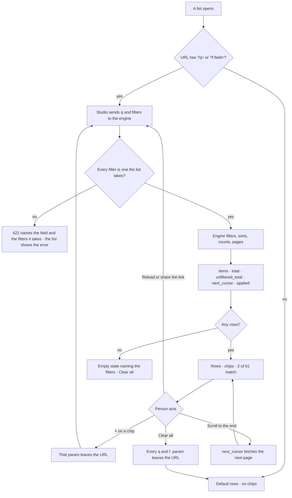

# API and CLI

The two contracts outside Studio: the HTTP API every surface and caller uses, and the `invana` command for anything
scripted. Studio is for anything read, the CLI for anything scripted, and the API is the contract between them
([architecture.md](architecture.md)). What a command starts is [runtime.md](runtime.md); the words behind its nouns are
[terminology.md](../../docs/for-developers/terminology.md).

## API conventions

One shape across every route, so a new endpoint needs no new rules.

| Convention | Detail |
|---|---|
| Versioned prefix | `/api/v1/…` |
| Graph scoping | Everything about a Graph hangs off `/u/{username}/{graphSlug}/…`; user-level routes live under `/auth/…` |
| One list contract | Every list takes `q` · named filters · `sort` · `cursor` + `limit`, and answers `Page[T]` (*One list contract*) |
| Filters run on the server | A list never narrows rows only in the browser |
| Streams are server-sent events | With a `?token=` fallback where a header cannot be set |
| `PUT` is full replace | `PATCH` is partial; a blank secret on `PUT` means *keep the stored one* |
| Deletes are hard, and cascade downward | There is no trash tier |
| `409` for a conflict | A duplicate name, editing a published version, deleting something still referenced |
| `422` for a shape the model forbids | A property type the schema cannot hold, a cycle in dependencies, a filter a list does not take |
| Errors name the thing | The field, the step, the bound — never a bare code |
| A mutation answers `{ message, data }` | The engine writes the success sentence; Studio shows it and never composes its own |
| One gesture, one message | A gesture that fans out into several requests reports once |
| The generated client is the contract | Studio's types come from the schema; nothing is hand-typed |
| A Graph-scoped read without access | `404` — the Graph is absent, not forbidden |

## One list contract

Every list is searched, filtered, sorted and paged by the engine, and answers with the filters it used. Studio carries
the filters in the URL and shows them as chips above the rows, so a list opened by a link, by ⌘K or by the assistant
reads the same as one filtered by hand.

| Part | Shape |
|---|---|
| Request | `?q=` · `?<field>=` (repeatable) · `?sort=` · `?cursor=` · `?limit=` (default 50, at most 200) |
| `Page[T]` | `items: T[]` · `total: int` · `unfiltered_total: int` · `next_cursor: str \| null` · `applied: AppliedFilter[]` |
| `AppliedFilter` | `field` · `value` · `label` — `q` is echoed as field `q` |
| Studio URL | `?q=` · `?f.<field>=` (repeatable) · `?via=assistant` |
| `AppliedFilters` (design-kit) | One chip per filter with ×, *Clear all*, an optional *set by the assistant* note |
| `useListParams` (Studio core) | Reads and writes the URL's `q` and `f.` params and turns them into the request |

| Rule | Detail |
|---|---|
| One helper, every list | A list endpoint takes `ListParams` from `list_params(spec)` and answers `Page[T]`; no list grows its own parameters for search, filtering, sorting or paging |
| Search is plain text | `q` is a case-insensitive contains over the list's named text fields — never a query language |
| Plain field names in the API, prefixed in Studio's URL | The engine reads `?status=`; Studio's address bar carries `?f.status=`, so a page's own parameters (`?tab=`) never collide. `q` is the same word in both |
| Filters are declared, not inferred | Anything else is a `422` naming the field and the filters the list takes; a value outside a filter's enum is a `422` naming the allowed values |
| Values of one field OR; fields AND | `status=failed&status=stopped&agent_id=a1` is *(failed or stopped) and agent a1* |
| The cursor is keyset, opaque and bound to its sort | It encodes the last row's sort value and id; sent with a different sort it is a `422`. Paging never repeats or skips a row under writes. A list read from memory pages the same way |
| `total` counts the matches; `unfiltered_total` the list | Both are counts, never `len(items)` — *2 of 61 match* is these two numbers. With nothing applied they are equal |
| A list's default view is what `unfiltered_total` counts | Runs count root runs without `canvas` and `system` runs; Agents count those not retired and not helpers |
| `applied` carries the label | The engine resolves a value to the words a person reads — an agent id to its name — so Studio and the assistant show one chip. A value that names nothing is labelled with itself, with zero rows |
| Summary fields stay beside the page | A list's whole-Graph figures (the agents list's `persistent` · `ephemeral` · `default_agent_id` · `tokens_this_month`) are fields of a `Page` subclass, counted over the Graph, not the filtered rows |
| Studio never narrows rows | Search boxes, segmented controls and selects write the URL; no client-side filter decides what is shown. A segmented control is a preset of a filter and shows as its chip |
| The chips show what the URL holds | From the response's `applied` once it arrives, from the URL while it loads — a reload never flashes an unfiltered list |
| `?via=assistant` marks the assistant's filters | The chips say *set by the assistant* until a person adds or removes a filter |
| One URL holds one list's filters | A second list on the same page keeps its search in the component and still sends it to the engine |
| Runs and approvals are newest first | Pending approvals are their own filter (`status=pending`) |
| Overview and performance figures are stored | Every figure on the agents' overview and performance views is served from stored columns ([architecture.md › Metrics are stored](architecture.md)) |

| Piece | Does |
|---|---|
| `ListParams` | `q` · `filters: dict[str, list[str]]` · `sort` · `cursor` · `limit` — the one FastAPI dependency every list view takes |
| `ListSpec` | A list's search fields, filters (column or predicate, and a labeller), sorts and default sort; validates a request against itself |
| `Page[T]` · `AppliedFilter` | The response shape |
| `page_of_select()` | Applies `q`, filters, keyset sort and limit to a `select()`; counts `total` and `unfiltered_total` |
| `page_of_rows()` | The same contract over rows in memory — plugins and the catalogue come from the frozen registry, not a table |

### The lists

| List | Route | Search (`q`) | Filters | Sort (default first) |
|---|---|---|---|---|
| Agents | `GET …/agents` | name | `status` (none leaves out retired) · `kind` · `ephemeral=shown` (else helpers are left out) | `name` · `-created_at` · `-updated_at` |
| Skills | `GET …/skills` | name | `status` (published · draft) · `origin` | `name` · `-updated_at` · `-created_at` |
| Plans | `GET …/flows` | name · key | `origin` · `family` | `key` · `name` · `-created_at` |
| Runs | `GET …/runs` | the ask | `status` · `agent_id` · `task_id` · `kind` · `origin` (who triggered it) · `started_by` · `since` (`24h` · `7d` · `30d` · `90d`) · `candidates=true` (served, never promoted) · `interactive=true` (`canvas` and `system` runs shown) | `-created_at` |
| LLM providers | `GET …/llm` | name | `kind` | `created_at` · `name` · `-updated_at` |
| LLM models | `GET …/llm/{provider_id}/models` | model id | `status` | `created_at` · `model_id` · `-updated_at` |
| Plugins | `GET /api/v1/plugins` | name · title | `kind` · `enabled` | `name` |
| Templates | `GET …/projection-templates` | name · surface · intent | `kind` (`result` · `prompt`) · `surface` | `name` · `-updated_at` |
| Catalogue | `GET …/catalogue` | step key · summary | `bound` · `plugin` | `bound` (declared order, then key) · `key` |
| Approvals | `GET …/approvals` | title | `status` · `kind` (the subject's kind) · `mine=true` (waiting on the reader) | `-created_at` |
| Schedules | `GET …/schedules` → `SchedulePage` with `paused` | name | `enabled` | `name` |
| Members | `GET …/members` | username · email | `role` (the stored role, not the ones `owner` implies) | `username` |

## CLI conventions

One binary, `invana`, for every product. Anything scripted happens here.

| Convention | Rule |
|---|---|
| Shape | `invana <noun> <verb>` — nouns are the product's records |
| Graph scope | `--graph <user>/<slug>` on anything that lives in a Graph |
| Install scope | Datasets and standards are named `<publisher>/<name>[@version]` — no `--graph` |
| Acting as | `--user` names the person a command acts as, where access applies |
| Output | Human tables on a terminal, machine output otherwise — detected and overridable; `--json` on every command |
| Writes | `--dry-run` on every write; a refused write exits non-zero and prints the rule that refused it |
| Exit codes | Zero, non-zero, and distinct codes for a validation failure, so a scheduler can branch on them |
| Configuration | By file and environment; flags override both, in that order |
| Usage | Token counts only — never currency |
| Accounts | One command creates every account, `invana users create`, with `--superuser` for an install Admin, the first one included. Nothing creates an account the person at the shell did not name, and no account has a default password |

| Seam | What the person sees |
|---|---|
| Migrations pending at start | Refuses to start, naming the command to run |
| A graph connector not installed | The connector list, and the package to install |
| No configuration found | The defaults it will use, and where to put a file |
| Engine and graph connector versions disagree | Named at start, not at first query |

## Commands

### Install, accounts and Graphs

| Command | Does |
|---|---|
| `invana start` · `migrate` · `version` | Run the engine (and Studio when bundled) · apply migrations · the engine version and every graph connector ([runtime.md › Install, run and health](runtime.md)) |
| `invana users create [--superuser]` · `update-password` | Provision accounts and reset passwords, for whoever has shell access |
| `invana login --url --token` · `logout` · `whoami` | Sign the CLI in with a personal access token; it runs on the person's machine and talks to the engine's API |
| `invana graphs list` · `create` · `show` · `archive` | The Graphs a person can open |
| `invana members list` · `add --role` · `set-roles` · `remove` | A Graph's members and their Graph roles (`--role` repeatable: `operator` · `contributor` · `builder` · `modeller` · `owner`); the last owner cannot be removed or demoted |
| `invana search "<text>"` | The ⌘K search from a terminal, as `--user`, over every Graph they are in or one `--graph` |
| `invana worker` | Runs steps from its pool's queues; heartbeats and reaps silent jobs ([runtime.md › Executor and workers](runtime.md)) |

### Data

| Command | Does |
|---|---|
| `invana records import --graph --model --name --path` · `records check <path>` | Load a folder of records into a model as an import run · check files before loading |
| `invana loader <path> [--graph]` | Load a flat CSV straight through the graph connector; `--graph` supplies the connection and records it as a `bulk` run |
| `invana datasets list [--origin --standard --bound-in]` · `show <publisher/name>` | The install's catalogue of datasets |
| `invana datasets import --path --as <publisher/name> --origin --licence` | A CSV or JSON file as the dataset's next version, with its origin and licence |
| `invana datasets versions <ds>` · `diff <ds> v2 v3` · `history <ds> --record <id>` | Versions, their difference, a record's change log |
| `invana datasets observe <ds> --row k=v …` | Add an observation as yourself |
| `invana datasets collect --instructions <file> --tools …` | An agent collects a dataset |
| `invana datasets share <ds> --visibility lab\|install` · `retract <ds>@v --reason` | Share · retract (an install Admin only) |
| `invana datasets refresh <ds> --schedule "<cron>"` | Set or fire a refresh into new versions |
| `invana datasets bind <ds>@v --graph --model --type` | Add a version to a Graph's model |
| `invana datasets export <ds>@v --format csv\|json --out` | A version as a file, provenance columns included |
| `invana validation list` · `resolve <id> --use official\|collected\|value` | The review queue of conflicting values |
| `invana standards list · show · apply · attach --dataset --mode block\|warn\|report · detach · check --dataset` | Standards: apply a standard file as its next version, attach one to a dataset with a mode, score a dataset version against it |
| `invana standards import --skos <file\|url> [--scheme] [--dry-run]` | A SKOS concept scheme as a standard, or its next version; the CLI fetches a URL itself |

### Model

| Command | Does |
|---|---|
| `invana models list` · `starters` · `export` · `import` · `upgrade` | Models in a Graph; the shipped starters; move models between Graphs as files |
| `invana models export --with-records` · `import --file <bundle> [--with-records \| --restore]` | A model and its records as one `.invana` bundle; import it as a new model, or restore an earlier version as a draft |
| `invana models import --ontology <file\|url> [--types A,B] [--dry-run]` | An RDFS or OWL ontology, schema.org included, as a draft model with its import report |
| `invana models diff --name <m> v1 v2` · `history --name <m>` | Compare versions; who changed what |
| `invana models publish --name <m> [--dry-run]` | Publish a draft: additive at once, breaking through a publish review whose preview runs inline; `--dry-run` says which and previews the migration |
| `invana stitches apply` · `list` · `resolve` · `commit` · `discard` | Declare and manage links between models |
| `invana govern apply` · `list` · `show` | Views of the graph and rules that must always hold, as files |
| `invana rules list · show · apply --file` | Rules at install, Graph (`--graph`) or project scope, a check and a mode included |
| `invana requests list` · `resolve <id> --allow\|--decline\|--model` | Requests from people and agents to change the model |

### Explore

| Command | Does |
|---|---|
| `invana ask "<question>" --graph [--world]` | An answer with its citations; `--json` carries the records and the trace |
| `invana query --graph --lang cypher\|gremlin "<q>" \| -f <file>` | Run a query; `--format table\|json\|csv` |
| `invana sessions list` · `show <id>` | Conversations on a Graph |
| `invana boards list` · `export <board> --format png\|csv\|md` | Saved boards and their snapshots |

### Projects

| Command | Does |
|---|---|
| `invana projects list` · `create <name> --type <type> --question "…" [--private]` · `show` | Projects of a type; `--private` for only its people |
| `invana branches list --project` · `fork <b> --into "…" "…"` · `merge <from> <into>` | The tree of inquiry |
| `invana findings add --branch --stance supports\|contradicts\|context --cites <record…>` · `review` | Evidence for or against; an agent's waits for a person's review |
| `invana branches decide <b> --verdict … --decision … --rationale "…"` | A verdict and a decision; rules checked; superseded, never edited |
| `invana proposals list` · `accept` · `reject` | What agents proposed |
| `invana todos list [--mine]` · `add` · `done` | Todos, with or without a project |
| `invana reports generate --project` · `publish` · `export --format md` | A project's report from its records, published as frozen versions; PDF is Studio's print |
| `invana lineage --decision <id>` | Everything behind a decision |
| `invana simulate --project --branch --plugin <name> --file <spec>` · `simulations list` · `show` | Run a simulator plugin; its ranked result |

### Runs and the Inbox

| Command | Does |
|---|---|
| `invana runs list` · `show` · `log` · `cancel` | Runs across products |
| `invana runs rerun <id> --same-versions \| --current` | Reproduce on the versions it used, or compare on current |
| `invana schedules list · create --file · show · pause · resume · run-now · delete` | A Graph's schedules, as `--user`, with delivery and missed-firing policy; read firings, fire one now |
| `invana approvals list · approve · decline` | What waits on `--user`, and the decision with a note |
| `invana events list [--changes]` · `tail` | Every write; `--changes` is the change log |
| `invana changes show <record>` · `compare <a> <b>` | A record's versions, and two of them side by side |
| `invana notifications list · read` · `notifications rules list · apply --file` · `notifications channels list · add · remove` | The Inbox's updates, the rules that fill it and the channels they send to |

### Plugins

| Command | Does |
|---|---|
| `invana plugins list · show` | Every plugin — core, simulator, tool — with its version, whether it is installed and enabled, and its functions; `show` prints one as JSON |
| `invana plugins enable · disable <name>` | Switch a tool plugin, as `--user`; only an install Admin may, and a core or simulator plugin is always on |
| `invana plugins mcp add <url> --name <name>` · `mcp refresh <name>` | Connect an MCP server and freeze its tools as the `invana.mcp.<name>` plugin, or read them again as a new revision, as an install Admin; takes effect when each process restarts |

## Not building

| Not building | Because |
|---|---|
| Offset paging (`page=3`) | Unstable under writes |
| A query language in `q` | Filters are named parameters; `q` is plain text |
| Saved filter sets | A filtered URL is the saved view — bookmark or share it |
| Client-side filtering as a fast path | One place decides what a list leaves out |
| Facet counts per filter value | Not drawn on any board; a later list may add them to its own page |
| A deployment orchestrator | An image and a command; the rest is the deployment's own platform |
| An interactive shell | The API and Studio cover exploration |
| Writing graph data from the CLI beyond imports | Writes have contracts |
