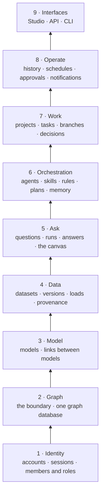
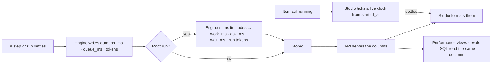

# Architecture

How Invana is put together, one level above the code: the parts it ships, the layers inside it, and the behaviours
every feature keeps. What it is for is [vision.md](../vision.md); its records are [data-model.md](data-model.md); what
it talks to is [integrations.md](integrations.md). The engine's shape is [orchestration.md](orchestration.md) ·
[governance-and-lens.md](governance-and-lens.md) · [runtime.md](runtime.md) · [observability.md](observability.md) ·
[api-and-cli.md](api-and-cli.md) · one file per module in [modules/](modules). The services and the engine's bands are drawn in
[architecture.svg](../../docs/for-developers/architecture.svg).

## The parts

| Part | Is | Stack |
|---|---|---|
| **Engine** | The API, the runtime that runs agents and plans, and the app database | Python · FastAPI · SQLAlchemy async (SQLite in development, PostgreSQL in production) |
| **Studio** | The web app every person uses | React · TypeScript, composed from `@invana/design-kit` and `@invana/canvas` |
| **Graph connectors** | One package per graph database family, installed beside the engine | `invana-neo4j` · `invana-memgraph` · `invana-arcadedb` · `invana-janusgraph` · `invana-neptune` · `invana-tinkergraph` |
| **CLI** | `invana …` — anything a person runs at a terminal | Ships with the engine |

- Engine and Studio are built together and shipped as one image or two.
- The same commands work on every operating system a contributor uses.

## The layers

Each layer consumes only the layers below it.

| # | Layer | Owns | Product |
|---|---|---|---|
| 1 | **Identity** | An account identified by email, a username that is also a URL, a revocable session, a member's roles in a Graph | Shell · Settings |
| 2 | **Graph** | The bounded domain; its one connection to a graph database, tested before it is saved, and the graph connector that speaks to it | Settings › This graph |
| 3 | **Model** | Models and their published versions; links between them; the read-time union of the published models every question is grounded in | Model |
| 4 | **Data** | Datasets and their versions, conforming to a model, validated per record, written with provenance | Data |
| 5 | **Ask** | A question becomes a run; the run's steps stream answers onto a board | Explore |
| 6 | **Orchestration** | Which agent runs, inside what it may do and what it may see, offered which skills and rules, from which plan — and what carries over between runs | Agents · Model |
| 7 | **Work** | What needs doing, who takes it, what done means, who accepts it, and the decisions a project reaches | Projects |
| 8 | **Operate** | Every write as an append-only event; schedules; asks and notifications; the scoped, read-only surface outside callers use | Inbox · Agents |
| 9 | **Interfaces** | Studio for anything read, the CLI for anything scripted, the API as the contract between them | — |

## Cross-cutting

| Behaviour | Detail |
|---|---|
| **The Graph is the boundary** | An agent never crosses it. There are no cross-Graph agent runs, boards or plans |
| **Grounding is a contract** | An answer states only what the records hold. Zero rows is *the Graph does not hold this*, not a guess. Every part of an answer cites its source. A cannot-answer is not answer-shaped, and a failure is not a cannot-answer |
| **Every write is an event** | Append-only, with the acting principal, whom it acted on behalf of, and its parent event for causality. History, evidence and observability are readings of that one record, never copies of it |
| **Versions are immutable** | Models, skills, rules, agents, datasets and plans publish new versions rather than change in place, so a run stays explainable in the terms it ran under |
| **Nothing is inferred** | Links between models and a dataset's model are declared. Guessing produces a schema nobody chose |
| **Streaming is the default** | Steps and answers paint as they arrive, for a question and a load alike |
| **Hard deletes, downward cascade** | No soft deletes, no trash, no undo. Retention removes whole windows, never single rows. Retire and retract exist where history must stay resolvable |
| **The engine owns every number** | The engine computes and stores every number when the fact settles; Studio formats it, never derives it |
| **Acts only as far as the person allows** | Each act — a person's, an agent's or a key's — runs as Allow, Ask or Deny by the lines of the access rules it holds, checked by the engine when the step runs; an Ask waits on the yes of someone who holds Allow on it, recorded as an approval ([one access model](../foundation/settings/product.md#decisions)) |

## Metrics are stored

Every number Studio shows is the engine's: computed once, from stored columns, and served by the API. Studio formats
it. The performance views, the evals and the reply's meta line read the same column, so one fact never shows as two
numbers.

| Column (`task_runs`) | On | Written | Meaning |
|---|---|---|---|
| `duration_ms` | Every row | Whenever the row is flushed | `started_at → finished_at`; empty while either is |
| `queue_ms` | Every row | Whenever the row is flushed | `queued_at → started_at` |
| `work_ms` | Root | When the run settles | Sum of its nodes' `duration_ms`, except a node paused on a person |
| `ask_ms` | Root | When the run settles | Sum, over each paused node, of the gap until the next node started |
| `wait_ms` | Root | When the run settles | `duration_ms − work_ms`: open, with no step working |
| `tokens` | Every row | Whenever the row is flushed | `tokens_in + tokens_out` of the row itself; empty when it spent none |
| `run_tokens_in` · `run_tokens_out` · `run_tokens` | Root | When the run settles | The root's own spend plus its direct nodes' |

| Field served | On | Meaning |
|---|---|---|
| `duration_ms` | Stream step payload · `RunNodeRead` · `TraceStep` · `SimulationRead` | The step's, or the simulation's run's |
| `offset_ms` · `share_of_run` · `share_of_run_tokens` | `TraceStep` | From the run's start to the step's start · the step's share of the run's duration, 0–1 · of its tokens |
| `duration_ms` · `queue_ms` · `work_ms` · `ask_ms` · `wait_ms` | `TraceRead` · `TaskRunSummary` | The root's stored timing |
| `work_ms` | `SessionMessageRead` · stream `message` | Its current run's — the reply's meta-line time |

| Rule | Detail |
|---|---|
| A per-row fact is a column, written by one hook | A mapper hook on `TaskRun` sets `duration_ms`, `queue_ms` and `tokens` before every insert and update, so every path that sets `finished_at` — settle, cancel, failure, restart, eval — writes them; a row whose timestamps are reset (a resumed run) has them cleared by the same hook |
| A roll-up is written once, where the run settles | `work_ms`, `ask_ms`, `wait_ms` and the run tokens are computed in one function from the run's nodes; every path that finishes a root calls it. A run paused on a person has none until it settles; a run still going is summed by the engine on read, from the same rows |
| Work is what the steps did | A node waiting on a person is not work; the gap from a paused node's finish to the next node's start is `ask_ms` |
| A reply's time is its run's `work_ms` | It matches the step rows added up and excludes time a person spent answering |
| Times are 64-bit | The `*_ms` columns are `BIGINT`, so a run held open for weeks still settles |
| A windowed aggregate is a query, never a counter | p95 over 7 days or tokens today is an endpoint's query over the columns; a counter can disagree with the rows it counts |
| A change, a rate or a share is the engine's | `↑ 38%`, `▲ 1.2 pt`, `61% applied` and `72% of the run` come from the endpoint that serves the values they compare |
| A change has one shape | `Change`: `by` (a ratio, or points for a rate) · `unit` · `direction` (flat within ±2%, or ±0.1 pt) · `tone` (better · worse · neutral). Studio picks the arrow and colour and does no arithmetic |
| Per-run figures come with the totals | A change effect returns `tokens` and `tokens_per_run`; a touch and an activity node return `tokens` |
| A count of a pageable list is the API's `total` | `items.length` is never shown as a count |
| A settled row with no stored value shows nothing | Never a number Studio computed |
| Not covered | A count of a small list fully on screen (a tab count, a selection), what the canvas draws right now, a live clock on something running, *3m ago* from a stored timestamp, a meter's fill, and layout such as a bar's width |

| Not building | Because |
|---|---|
| Counter columns for windowed totals | A counter can disagree with the rows it counts |
| A `wall_ms` column | It is `queue_ms + duration_ms`, read through one engine function |
| Canvas counts in the engine | They describe what is drawn, not a stored fact |
| Server-side *3m ago* | A relative time is formatting of a stored timestamp |
| A share on a frozen run report | A saved report gains no new field |
