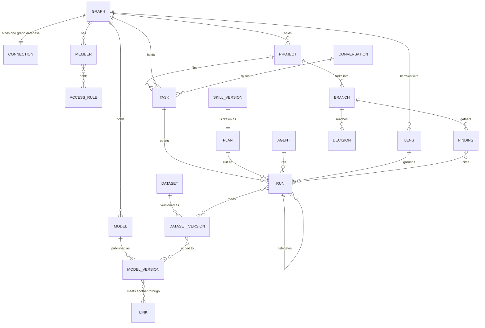

# Data model

The records a person meets, by the scope that holds them, and how they connect. This is the product's picture; the
engine's tables and columns are [orchestration.md](orchestration.md#the-records) and
each module's file in [modules/](modules). The domain term for each record is
[terminology.md](../../docs/for-developers/terminology.md); the word a person reads is [glossary.md](../glossary.md).

## By scope

| Scope | Records |
|---|---|
| **Install** | Account · dataset and its versions · standard and its versions · install rule · agent and its versions · skill and its versions · function · plugin · LLM provider and its model versions · worker |
| **Graph** | Graph and its connection · member (a person or an agent) and its roles · access rule · group · token · model and its versions · link between models · lens (a view of the graph, or a rule that must always hold) · Graph rule · board · annotation · conversation · task · plan · run · schedule · approval · notification · event |
| **Project** | Project · branch · finding · project decision · project proposal · simulation · project report · project rule |

## How they connect

## Rules the records keep

| Rule | Detail |
|---|---|
| A person writes tasks, never plans | A task is the only thing a user authors; a plan is generated, packaged or promoted, and a run is one execution of it |
| A version never changes | A change mints a new version; a draft is not a version |
| A run is frozen onto what it saw | The lens, the model versions and the plan a run used are pinned onto it |
| Lineage reaches the source | A decision → its findings → their runs → the dataset versions they read → the original authors |
| A decision is never edited | Revisiting it supersedes it; the earlier one stays |
| A retracted version stays | It is kept with its reason, and everything citing it is flagged |
