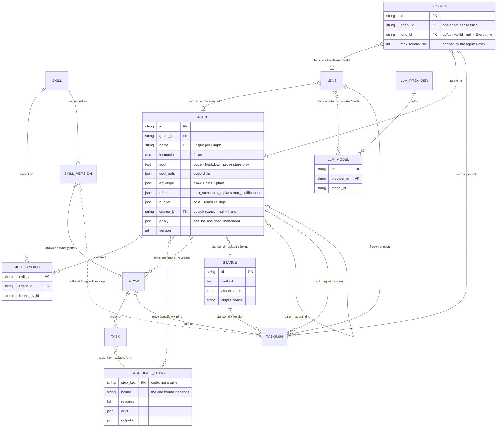

# Agents

The engine shape of an agent: the principal that runs work, its bindings and its standing limits. The product rules
are [Agents](../../products/agents/product.md) and [AG-F01](../../products/agents/features/AG-F01-build-an-agent/feature.md);
the records a run is made of are [orchestration.md](../orchestration.md); what a run may see, use and send is
[governance-and-lens.md](../governance-and-lens.md). Skills are [skills.md](skills.md), plans [workflows.md](workflows.md).
On screen the envelope is *what it may do*, the budget a *token budget* and the soul a *voice* ([glossary.md](../../glossary.md)).

## Where the agent sits

| This module answers | Answered elsewhere |
|---|---|
| What does this agent carry? | What is a skill? → [skills.md](skills.md) |
| What may it run, at what cost? | Which plan runs? → [workflows.md](workflows.md) |
| Who spawned it, and what happens when it retires? | What did it produce? → the run ([orchestration.md](../orchestration.md)) |
| How many may run at once, and what gives when they contend? | When does a job run? → [runtime.md](../runtime.md) |

- Work says what needs doing ([work.md](work.md)); the agent an assignment names turns it into a run.
- The **world** is not the agent's: it comes with the work that opens the run — a session, a Todo, a schedule, a parent
  run. Composition happens at run open ([governance-and-lens.md › Composition](../governance-and-lens.md#composition)).

| Bound | Bounds | Set on |
|---|---|---|
| Envelope | What one agent may run — callables and pinned arguments | The agent |
| World · guardrails | What a run may see, use and send | The work · the Graph · the agent |
| Budget | What a run may spend | The agent, capped per run by the work |
| Delegation | Depth and fan-out | The parent run |
| Graph ceiling | How many run at once | The Graph ([runtime.md › Bounds](../runtime.md#bounds)) |

Each bound is stated, each refuses with the bound named, and none is negotiable at run time.

## What it owns

| Owns | Shape |
|---|---|
| `agents` | `graph_id` · `name` (unique per Graph) · `description` · `kind` · `status` · `lifetime` (`persistent` · `ephemeral`) · `parent_agent_id?` · `spawned_in_run_id?` · `instructions` · `soul` · `soul_traits` · `budget` · `effort` · `stance_id?` · `policy` · `version` |
| `agent_skills` | The skill bindings the agent carries — the record is [skills.md](skills.md) |
| Envelope · budget · effort | On the agent: allowed callable keys, pinned arguments and reusable plans · cost, fan-out and concurrency ceilings · steps, replans and clarifications |
| Lineage | `parent_agent_id` + `spawned_in_run_id`; retirement keeps the row so lineage resolves |
| `llm_providers` + `llm_models` | One configured endpoint holding many models — the two segments of `llm/<provider>/<model>` |

| Not owned | Owner |
|---|---|
| Worlds, guardrails and their casts | [govern.md](govern.md). An agent's own guardrail is a `lenses` row scoped `agent:<id>`; the agent holds no pointer to it |
| The model a run uses | The lens's cast, role → model address — never a field on the agent |

Column list, ER diagram and migration order: [govern-and-agents-data-model.md](../../../docs/for-developers/building-engine/govern-and-agents-data-model.md).

## How an agent is composed

Five groups of settings; only two are tables of their own — the rest is columns on `agents` or a pointer to another
module's record.

| Group | Is | Stored as | Owned by |
|---|---|---|---|
| **Who** | How it sounds | `soul` (Markdown, read only by prose steps) · `soul_traits` (`humour` · `formality` · `emoji` · `greeting`) | This module |
| **Focus** | What it works on | `instructions` — reaches Understand and Translate | This module |
| **Thinking** | How much it tries, and which way | `effort` (`max_steps` · `max_replans` · `max_clarifications`) · `stance_id` | This module · the stance is Ask's |
| **Can do** | How it approaches work, and what it may run | `skill_bindings` · `envelope.allow` · `pins` · `plans` | [skills.md](skills.md) · this module |
| **Limits** | What it may ever spend and reach, and never see | `budget` (cost and reach ceilings) · `policy` (`can_be_assigned` · `unattended`) · its guardrail | This module · [govern.md](govern.md) |
| *The work* | What one run may see and spend | The session's, Todo's or schedule's world · spend per run | The session · [work.md](work.md) · [govern.md](govern.md) |

Solid lines are foreign keys; dashed lines are references held in JSON or derived — the catalogue is code, not a table,
and the envelope names it by `step_key`.

The `FLOW`, `TASK`, `TASKRUN`, `LENS` and `SKILL_VERSION` fields are [orchestration.md › The records](../orchestration.md#the-records).

| Rule | Detail |
|---|---|
| The one derived check | A skill's *needs* are the `step_key`s of the tasks in its current version's plan; they must sit inside the agent's `envelope.allow`, or the bind is refused naming the callable |
| A run records the agent version | `task_runs.agent_id` + `agent_version`, so a run reads as the agent was |
| A session has one agent | `sessions.agent_id`; its `lens_id` is the default world, null is *Everything* inside the guardrails |
| A session's per-run cap never exceeds the agent's | `max_tokens_run` is capped by the agent's own budget |

## Decisions

| Decision | Detail |
|---|---|
| No provider on the agent | `agents.llm_config_id`, `llm_providers.is_default` and `llm_providers.model_id` do not exist; the cast names the model, the provider row the credential |
| Two tables, the rest columns | Only `agents` and `agent_skills` are the agent's tables; envelope, effort, budget and policy are JSON on the row |
| The catalogue is code | The envelope names catalogue entries by `step_key`; there is no catalogue table |
