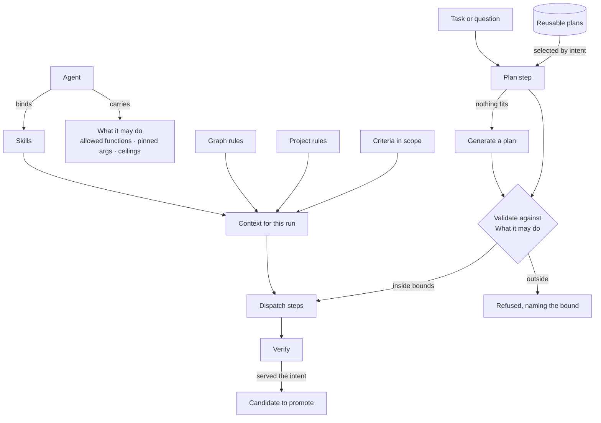

# Ask

The engine shape of a question: the steps it runs through, how a run comes together, and what each step is handed.
The product rules — every answer is grounded, one question is one run, steps show as they happen — are
[Explore](../../products/explore/product.md) and its features
[EX-F03](../../products/explore/features/EX-F03-ask-a-question/feature.md) ·
[EX-F04](../../products/explore/features/EX-F04-the-answer/feature.md) ·
[EX-F05](../../products/explore/features/EX-F05-when-it-cannot-answer-and-how-it-reasons/feature.md). The run itself is
[orchestration.md](../orchestration.md) and [runtime.md](../runtime.md); what it may see is
[governance-and-lens.md](../governance-and-lens.md).

## The pipeline

```
understand → plan → translate → validate → execute → project → verify
```

| Step | Does | Can end the run |
|---|---|---|
| `understand` | Settles what is being asked; asks back when it cannot | Yes — *cannot answer* |
| `plan` | Selects a packaged plan by intent, or generates one inside *What it may do* | Yes — refused, naming the bound |
| `translate` | Intent → query, against the whole model | — |
| `validate` | The query parses and names only what the model has | Yes — repaired once with the error, then stops |
| `execute` | Runs it on the graph database, through the connector's one door | Yes — a failure with a diagnosis |
| `project` | Records → answer parts, through a projection template | — |
| `verify` | Judges whether it served the intent | No — records the verdict |

- Every step streams its state and its answer parts as they arrive.

## How a run comes together

Three separately authored things meet for the first time in a run: the **agent** that runs, the **skills and rules** it
is offered, and the **plan** it runs.



- The agent decides what is possible, the plans decide what is tried, the rules and skills decide what it knows, and *What it may do* is checked before anything runs.
- How a plan is matched or generated is [orchestration.md](../orchestration.md) › *Where a plan comes from*.

## Grounding, in the engine

| Rule | Engine shape |
|---|---|
| Every answer part cites its source | The query that produced it and the records behind it ride on the part |
| Zero rows is an answer | `execute` returning nothing yields *the graph does not hold this*, never a generated guess |
| Three endings never share a shape | *Cannot answer* (`CannotAnswer`), a failure (`TaskFailure`) and an answer are three different signals out of a step, so a reader is never shown one as another |

## The runtime shape

| Rule | Detail |
|---|---|
| One run is one unit of work | The interpreter runs inside it and drives the whole loop, reporting step transitions as it goes; one run never spans several executors |
| Composition stays in data | A plan is data validated against *What it may do*, never a hand-authored graph of jobs |
| Connections are long-lived | The connection manager is a stateful service, not an open per call |
| Executors and the protocol | [runtime.md](../runtime.md) › *Executor and workers* — one versioned protocol, Invana owns the contract and not the scheduling, cancellation is the contract's |

Every step receives one context, and what goes where is fixed:

| Kind of argument | Where it goes |
|---|---|
| Genuine inputs — a query, a prompt, a page size | The step's typed input |
| Ambient dependencies — database, connector, AI model, provider | `resources` |
| Identity of the work — run, Todo, Graph, actor | `task_run` |
| Anything a person should see | `emit` |
