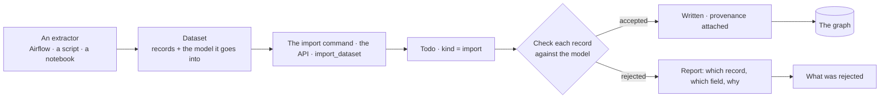

# Loads — `datasets`

The engine shape of a load. Invana is a destination: something else extracts and transforms, and what arrives is a
dataset that already conforms to a model. The product rules — a load names its model, checked one record at a time,
everything written traces back, a load is a run — are [Datasets](../../capabilities/datasets/product.md) and
[DS-F02](../../capabilities/datasets/features/DS-F02-bring-data-in/feature.md). How every kind of run is walked is
[runtime.md](../runtime.md) › *Every kind runs here*; the commands are [api-and-cli.md](../api-and-cli.md) › *Commands*.

## The contract

| Rule | Engine shape |
|---|---|
| `model_id` is required | A dataset states what it conforms to; there is no inference path |
| Checking is per record | One bad row does not fail a load and is never dropped silently |
| Every written element carries its source record | Provenance is what makes an answer traceable to a dataset |
| An import is a run, and is dispatched like one | It inherits the runtime — streamed steps, retries, timeouts, cancellation, signals and approvals — and writes no step rows of its own |

## The import run

A load opens a Todo of kind `import` and a run of the packaged plan `dataset-import@1`. The model is authored first;
the dataset conforms to it or is rejected, and nothing in the run authors a model.

| # | Step | Does |
|---|---|---|
| — | Open | The dataset's records and the model it declares are accepted; the run row opens |
| 1 | `validate_records` | Every record is checked against the model's active version; the report is structured, per record |
| 2 | `write_graph` | Accepted records are written, each stamped with its model, record, file and run |
| 3 | `stitch` | Declared links are resolved — identities against what is already there, and relationships to other models' kinds |
| 4 | `snapshot_model` | The model version checked against is stored with the run, so a person sees exactly what their data was checked against |
| — | Result | The written subgraph, and provenance from every element back to its record |

## Entry points

| Entry | Engine shape |
|---|---|
| Command line | The import command — one dataset into a model, scriptable, with exit codes a scheduler can read · a bundle, every dataset its manifest names, stitched, as one run · the bulk loader, journaled as a `bulk` run with no per-record check ([api-and-cli.md](../api-and-cli.md)) |
| Python | `import_dataset(...)` — for an orchestrator that already holds the data in memory; returns a run id to wait on |
| API | Run status and the validation report, with provenance — what an outside agent polls |

## When it goes wrong

| Case | Engine shape |
|---|---|
| Unknown kind or property | The record is rejected, naming the field and the model version it was checked against |
| Model version changed mid-run | The run keeps the version it started with and states it; it does not switch |
| A relationship link's end is missing | The relationship is rejected with both ends named — never a dangling relationship |
| The database rejects a write | A diagnosis with the next step, never a stack trace |
| The run is cancelled | Accepted records stay, the run is marked cancelled, and the report says where it stopped |
