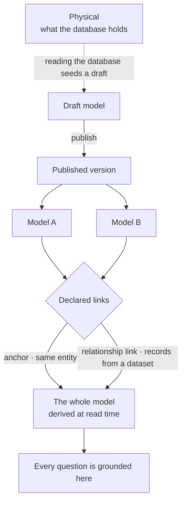

# Connections and models — `graphs` · `model`

The engine shape of binding a Graph to its graph database and of the models every question resolves against. The
product rules — one Graph, one database, a published version never changes, the whole model is derived, declared never
inferred — are [Model](../../capabilities/model/product.md); the connection a person sets is
[GR-F04](../../os/graph/features/GR-F04-this-graph/feature.md); how the engine speaks to the database is
[graph-connectors.md](graph-connectors.md).

## Three layers, one read

| Layer | Is | Engine shape |
|---|---|---|
| Physical | The introspected mirror of what the database holds | Refreshed on demand; shows drift; never the grounding context |
| Published version | An immutable model version | Editing publishes the next version; imports and answers that used an older one still resolve to it |
| The whole model | The union of published models and their active links | Computed on read — no row to edit, nothing to keep in sync |

| Link | Declares | Never |
|---|---|---|
| Anchor | Two kinds are the same entity | Merges records — folding two nodes is lossy and has no undo |
| Relationship link | A cross-model relationship kind whose records arrive in a dataset | Inferred — fuzzy matching would be a decision, not a default |

## Connecting

| Rule | Engine shape |
|---|---|
| One Graph, one graph database | The binding is 1:1, set once |
| A test gates the save | A connection that has not connected cannot be saved |
| The connector is fixed after the first save | Changing the database kind mid-Graph would invalidate everything modelled against it |
| Credentials are encrypted at rest | A blank field on edit means *keep*, never *clear* |
| Capability is resolved, not assumed | The server version decides which property types exist; an unsupported one is refused at authoring, not at write time ([graph-connectors.md](graph-connectors.md) › *Capabilities*) |

## Portability

A model belongs to a domain, not to the Graph that first held it.

| Rule | Engine shape |
|---|---|
| One artefact | A published version exports as a single file |
| Identity is package id + content hash | So upgrade is a real path, not a re-import |
| Links travel only inside a bundle | Both endpoints must be present, or the link is dropped with a named reason |
| A kind the target cannot hold | Arrives as an unpublishable draft — neither refused outright nor silently degraded |
| Files and git are the registry | There is no server to publish to |

- A starter model takes exactly this path: an importable shape a Graph renames on arrival.
