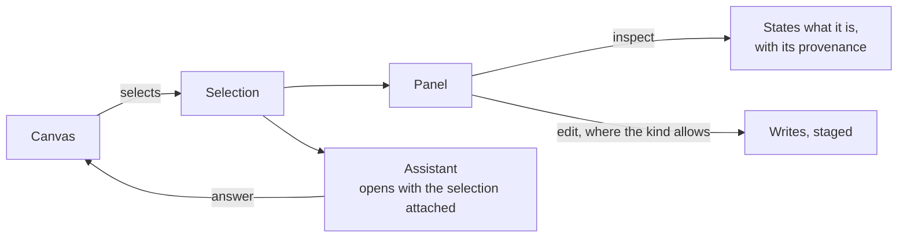

# Explore

The engine shape behind boards: what kinds of board there are, which of them write, and the one selection every
gesture makes. The product rules — the board selects and the panel states or edits, inspect is the default, the seams a
person sees — are [Explore](../../products/explore/product.md) and
[EX-F01](../../products/explore/features/EX-F01-the-board-and-its-canvas/feature.md); editing the data is
[EX-F06](../../products/explore/features/EX-F06-annotate-and-edit-the-data/feature.md).

## Six kinds, one set of gestures

A board's kind is a property of the board, never a mode of the page. Every kind shares pan, zoom, select, hover and
style.

| Kind | Draws | Writes from a gesture |
|---|---|---|
| `data` | Records and their relationships | Yes, in Edit mode — add · connect · edit · delete, staged until saved |
| `model` | Node kinds and relationship kinds | Yes — add · connect · delete, staged |
| `plan` | Tasks as cards, waves as columns | Yes — dragging a card onto a card writes a dependency |
| `workflow` | A plan's steps | No — nobody edits a plan by hand |
| `envelope` | What an agent may do | No |
| `lineage` | Who authored or spawned whom | No |

- Three kinds write from a gesture — `model`, `plan`, and `data` in Edit mode, against the Graph's model. Every other kind selects, and the panel states the fact.
- A new exception is argued and written into this table, never added in code.

## The canvas selects, the panel edits

| Rule | Detail |
|---|---|
| One selection object | The same gesture on any kind produces the same selection shape |
| Edits stage | Model and data edits reach the database only on a commit or a save; the staged set is visible and reversible |
| The assistant inherits the selection | It opens with the selection attached; nobody re-describes what is on screen |
| An answer lands on the board | An answer part of kind subgraph draws into the current `data` board rather than replacing it |

## Seams

| Seam | Engine shape |
|---|---|
| A large result | Drawn progressively; the count is known and stated before the draw finishes |
| An element removed from the graph | The board keeps the element, marked missing, rather than dropping it |
| Restoring an old version | Forks a new version; nothing is overwritten |
