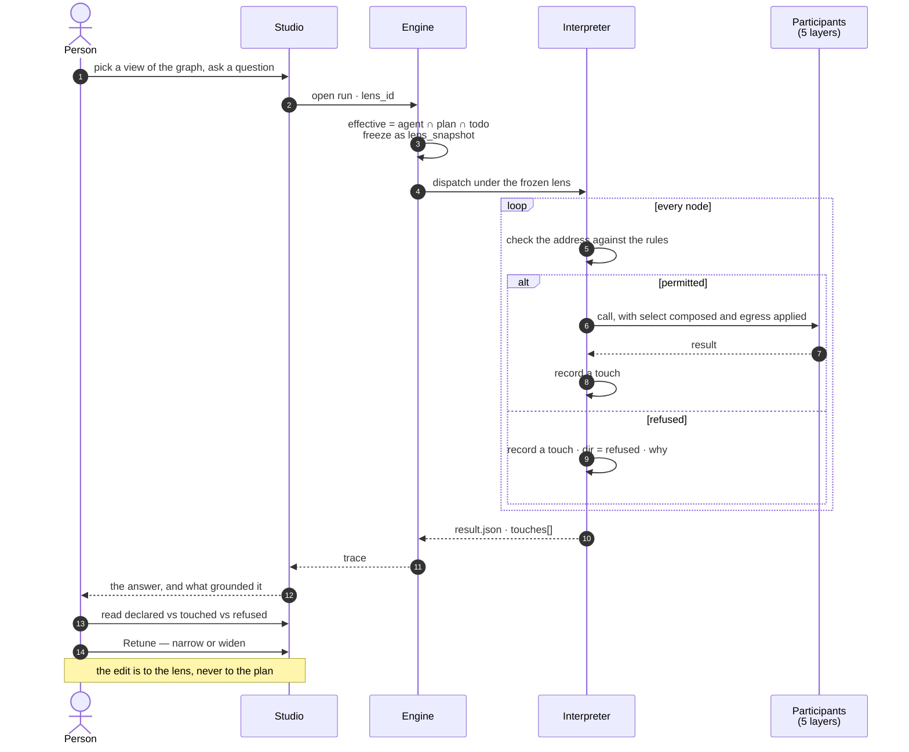

# Govern

The engine shape of what a run may **see**, **use** and **send**: the `lenses` row, where it is enforced, and the routes
and events around it. The product rules are [Model](../../products/model/product.md),
[MO-F05](../../products/model/features/MO-F05-views-of-the-graph-and-what-must-always-hold/feature.md) and
[MO-F06](../../products/model/features/MO-F06-rules-agents-work-by/feature.md). The lens's grammar — layers, addresses,
rules, egress, the touch record and composition — is [governance-and-lens.md](../governance-and-lens.md); this file does
not restate it. On screen a world is *a view of the graph* and a guardrail is *a rule* ([glossary.md](../../glossary.md)).

## The one record

A guardrail and a world are the same row — one table, one enforcement path, one thing frozen onto a run, separated by
`kind`.

```
Lens
├── id · graph_id
├── kind               guardrail | world
├── key                the slug — null: unnamed, private to its run · set: in the Graph's list
├── name               the text a person typed when naming it — null iff key is null
├── scope              graph | agent:<id> | null      (guardrail only — where it is pinned)
├── rules[]            { match, allow, properties?, select?, egress?, options? }
├── closed_layers      the layers this lens allow-lists — anything it does not name is out
├── cast               { role → model address }
├── as_of              transaction time — null means now
├── created_in_run_id  the run an unnamed lens belongs to
└── version            bumped on every rules or cast edit, so a snapshot names what it froze
```

| Field | Carries | Grain |
|---|---|---|
| `rules[].match` | An address with `*` (one segment), `**` (the rest), and `*` inside a segment — `graph_data/model/Deals@*` | Participant |
| `rules[].allow` | `true` or `false`; deny wins at any specificity | Participant |
| `rules[].properties.exclude[]` | Properties of a model that do not exist in this world | Structural |
| `rules[].select` | `time` · `geo` · `dims`, only on axes the model declared | Extensional |
| `rules[].egress.may_send[]` | What may accompany a call to this destination | Boundary |
| `closed_layers` | Layers that admit only what the rules allow; one absent is permitted whole | Layer |
| `cast` | Role → address; innermost wins, then checked against the effective rules | Resolution |

The three grains and where each is enforced are [governance-and-lens.md › graph data](../governance-and-lens.md#graph-data).
Nothing is enforced by filtering afterwards.

## The loop it closes



What each reading of the touches calls for is [governance-and-lens.md › The touch record](../governance-and-lens.md#the-touch-record).

## Where it lands in the engine

| Thing | Shape |
|---|---|
| `lenses` | `graph_id` · `kind` · `key` (unique per Graph, null while unnamed) · `name` · `scope` · `rules` · `closed_layers` · `cast` · `as_of` · `created_in_run_id` · `version` |
| An agent's own guardrail | A `lenses` row, `kind = guardrail`, `scope = agent:<id>`; the agent holds no pointer ([agents.md](agents.md)) |
| `graph_members.roles` | `modeller` or `owner` may edit guardrails; every Graph has an owner ([identity-and-access.md](identity-and-access.md)) |
| `graph_versions.axes` | `time` · `geo` · `dims`, declared per published version — what a lens may slice |
| `llm_providers` + `llm_models` | One configured endpoint holding many models — `llm/<provider>/<model>` has two segments |
| `task_runs.lens_snapshot` | The whole record, all five layers, frozen at open |
| `run_touches` | The indexed projection of the ledger: one row per engagement — `seq` · address · layer · sublayer · participant · direction · rule matched · why · volume · what was applied and sent |
| `TaskStream` | The complete ledger — every touch, spine dispatches included, in `seq` order. Authoritative: `run_touches` is rebuildable from it and loses to it on any disagreement |
| Resolution | `effective = agent ∩ plan ∩ todo`, computed once at run open and frozen; never recomputed mid-run |
| Enforcement | In the interpreter before dispatch (participant, egress) and in the connector at execution (projection, predicate) — never in Studio |

| Module | Holds |
|---|---|
| `runtime/governing.py` | The frozen lens as the thing that decides and records |
| `runtime/catalogue/contract.py` | The three crossings — `open_model`/`close_model` · `open_graph`/`close_graph` · `open_write`/`close_write` — so an entry module reaches one app |
| `apps/govern/query_lens.py` | Compiles the snapshot into the connector's `QueryLens`, and resolves a rule's model address into the types that version declares |

| Routes |
|---|
| `GET · POST · PATCH · DELETE …/lenses` · `POST …/lenses/{id}/promote` · `POST …/lenses/validate` · `GET …/lenses/impact` |
| `GET …/graphs/{id}/participants` — the participant catalogue, resolved live, never stored |
| `GET …/runs/{id}/touches` · `GET …/runs/compare?a=&b=` |

| Event | When |
|---|---|
| `lens.created` · `updated` · `named` · `promoted` · `deleted` | Every lens write — a guardrail edit is an audited write like any other |

| Rule | Detail |
|---|---|
| No governance table beside the record | Every fact is a key in a document the interpreter already writes, a field on the lens, or a projection of the trace |
| No second enforcement path | A guardrail and a world reach the interpreter as one resolved object |
| Nothing is its own table that could be a key | A rule is an element of `rules[]`, the cast is four keys, a world's usage is one `GROUP BY` over `task_runs`. `run_touches` is the one exception, and it is a projection |

Column list, ER diagram and migration order: [govern-and-agents-data-model.md](../../../docs/for-developers/building-engine/govern-and-agents-data-model.md).

## Decisions

| Decision | Detail |
|---|---|
| A default cast ships with the distribution | Providers carry no `is_default`, so a Graph with providers and no cast could run nothing; the shipped default cast is what runs when nobody cast a role |
| Spend reads by layer | Cost groups by layer, then by participant ([operate.md](operate.md)) |
