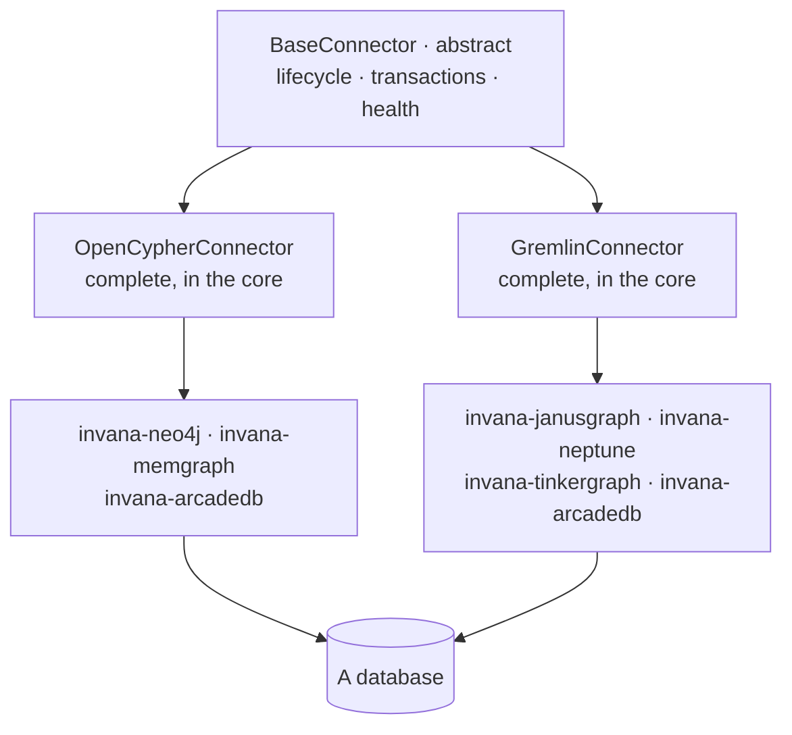
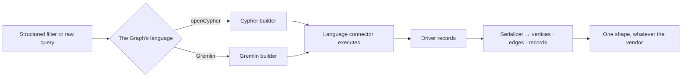
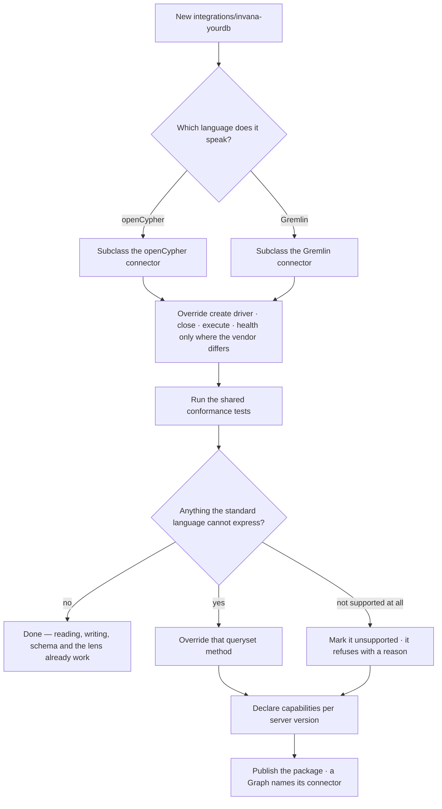
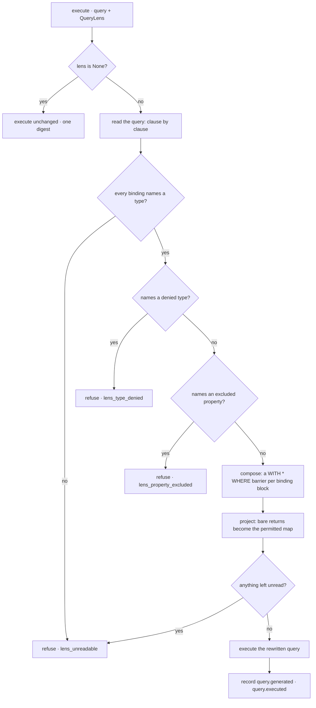
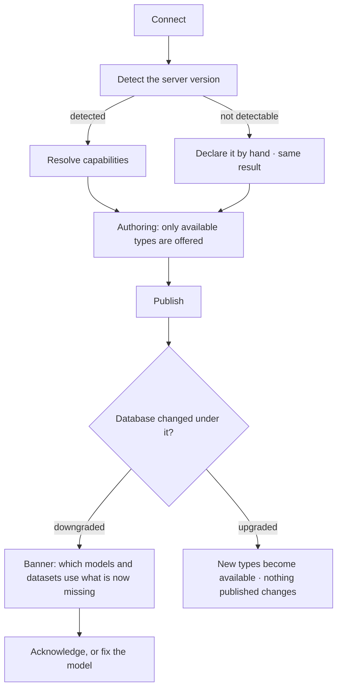

# Graph connectors — `runtime`

How the engine speaks to a graph database, and how someone adds one. The engine knows two query languages, not six
vendors; each vendor is a small package that supplies a driver and overrides only what the standard language cannot
express. Which databases speak which language, and the rule each crossing keeps, is
[integrations.md](../integrations.md); where a Graph is bound to its database is
[GR-F04](../../os/graph/features/GR-F04-this-graph/feature.md); how a view of the graph is composed before it
reaches a connector is [governance-and-lens.md](../governance-and-lens.md).

## Words

| Noun | Is | Is not |
|---|---|---|
| **Graph connector** | The object that speaks to one graph database, over one driver | A source connector — nothing here pulls data in from a mailbox, a bucket or an API · the connection row |
| **Language connector** | A complete implementation in one query language | An abstract base |
| **Integration package** | `invana-<db>` — a driver plus what the language cannot express | A plugin |
| **Queryset** | One area of work — reading, writing, schema, algorithms, vector | A repository |
| **Capability** | What this server version can actually hold and do | A feature flag |

## Three layers

| Layer | Ships in | Holds |
|---|---|---|
| Base | Core | Lifecycle, transactions, health, context-manager support, the queryset contracts |
| Language | Core | A **working** implementation in standard openCypher or Gremlin, with its reference driver — `neo4j` for openCypher, `gremlinpython` for Gremlin |
| Integration | `integrations/invana-<db>/` — its own manifest, dependencies and tests | A driver the reference one cannot replace, a schema dialect, an algorithm library, a vector index. Nothing that reimplements reading or writing |

| Rule | Detail |
|---|---|
| The core knows no vendor | No branching on database name anywhere above this module |
| Two languages, two drivers | Six vendors still mean two reference drivers in the core; a vendor driver ships in its own package, and only when the reference driver cannot reach that server |
| Shared logic is written once | Neo4j and Memgraph share about 80% of their query logic — they differ in the driver and a handful of procedures, not in reading and writing |
| Everything is async | Queryset methods are `async`; no sync wrappers. A driver that is not async is wrapped in its package |
| Pooling is the driver's, lifecycle is the engine's | The driver owns the TCP pool; connect, disconnect, health and reconnection belong to the engine |
| Unsupported is declared, not discovered | A vendor that cannot do something marks the method; the caller gets a refusal naming the vendor and the operation, before the wire — never a driver error |
| A language is fixed per Graph | The connector declares its language and it never switches. ArcadeDB has a connector in each family; the Graph picks one when it is bound |

## Querysets

| Queryset | Covers |
|---|---|
| Data reader | Vertices and edges, filtered, paged; neighbours, counts and resolve |
| Data writer | Creates, updates, deletes, and bulk paths |
| Schema | Labels, relationship types, property keys, constraints, indexes |
| Algorithms | What the vendor's algorithm library exposes |
| Vector | Similarity search where the database has a vector index |

| Part | Shape |
|---|---|
| Filters | A `FilterGroup` — a nested AND / OR of conditions, never a string. The query builder of each family compiles it into the target language; the caller never assembles syntax |
| Query builder | Structured filters → a language string, one per family |
| Serializers | A base plus one per family: driver records become the engine's own vertex and edge shapes. Anything that is not a vertex or an edge — a scalar, a map, a list, a count — becomes a record |

## A query, either way

| Path | Rule |
|---|---|
| `execute()` is the one door for an arbitrary query | In both families. A raw query reaches the database in its language's own raw form — openCypher as a statement over Bolt, Gremlin as a **script** to the server's script engine with parameters passed as bindings |
| Bytecode for what the engine composes, a script for what a person or a model wrote | The querysets build traversals and send bytecode (`execute_traversal`); a raw query has no structure to compose from and goes as text |
| A raw query is validated against the model | Then executed as written. A vendor procedure inside it passes through — validation checks the model, not the vendor's catalogue |
| A server that does not evaluate scripts is declared | Refused at the connector, naming the vendor. Amazon Neptune takes bytecode and its own HTTP API, not Groovy |
| Results are normalised before they leave the connector | The caller never sees driver types |
| No translation between languages | A Graph binds to one database, so there is nothing to translate for |

## The connector contract

What an `invana-<db>` package implements. Everything else is inherited and already works.

| Part | Shape |
|---|---|
| Class | Subclasses a language connector; named by dotted path in the Graph connection's `connector_class` — no registry to update |
| Required | `_create_driver` · `_close_driver` · `execute` · `health_check` — all four already implemented by the language connector. `invana-neo4j` overrides none of them |
| Optional | Any queryset method, plus the unsupported marker |
| Vendor hooks | `message_serializer()` · `query_builder` · `coerce_id()` · `classify_error()` · the serializer's `coerce_element_id()` — a vendor difference is a line, not a fork |
| Dependencies | The driver is the package's, never the core's |
| Tests | A shared conformance suite every integration runs against a live database, never mocked. A method left unimplemented fails it, named |

| Vendor difference | Where it lives |
|---|---|
| Wire serializer | GraphBinary by default. JanusGraph's `RelationIdentifier` cannot be carried by GraphBinary and fails the whole response, so JanusGraph speaks GraphSON and unwraps it |
| Identity function | `elementId()` by default, one name on the query builder (`ELEMENT_ID`). Memgraph has none: it subclasses the builder, sets one name, and coerces the id to the integer `id()` compares against |
| Element ids | Every id entering a queryset passes `coerce_id`, so a vendor storing longs never compares against a string |
| A construct spelled differently | Overridden, not refused — Memgraph writes a shortest path as `-[*BFS ..n]-`. Refusal is for what a vendor genuinely cannot do |
| A difference with nowhere to live | The seam is missing, and that is the bug. A difference worked around inside a queryset is one every other vendor inherits |

## The lens at execution

A view of the graph is enforced here, at execution, or it is not enforced. It reaches the connector already composed
upstream ([governance-and-lens.md](../governance-and-lens.md) › *graph data*), in the connector's own vocabulary: types,
their declared and excluded properties, and a predicate per type. The connector knows nothing of views, rules or layers.

| Part | Shape |
|---|---|
| The contract | `graph/types/lens.py` — `QueryLens` · `TypeBound` · `ComposedQuery` |
| `QueryLens` | `bounds: {type → TypeBound}` · `allowed_types` (`None` = every type the Graph holds) |
| `TypeBound` | `type_name` · `declared` (property set) · `excluded` (property set) · `predicates` (a `FilterGroup`) |
| Entry point | `BaseConnector.execute(query, parameters, *, timeout_s, lens=None)` — the same door an ungoverned query uses |
| The compiler per language | `BaseConnector.lens_compiler()` — `CypherLensCompiler(self.query_builder)` · `GremlinLensCompiler` (refuses) · `UnsupportedLensCompiler` at the base; the seam is `graph/connectors/base/lens.py`, the compilers sit in `cypher/lens.py` and `gremlin/lens.py` beside their query builders |
| The identity function | Read from the connection's own `query_builder.ELEMENT_ID` — a hard-coded `elementId()` is invalid Cypher on Memgraph, a bound failing open on one vendor |
| The refusal | `LensViolationError(code, type, property)` in `graph/connectors/base/exceptions.py`, raised before the wire |
| What comes back | `ComposedQuery` — `generated` · `executed` · `rewritten` · two `sha256:` digests. Equal digests mean nothing was rewritten |
| The trace | `execute_graph_query` records `query: {generated, executed}`; the step reads *… · under a lens* when they differ |

| Rule | Detail |
|---|---|
| Compose, project and reject are one pass | All three need the same reading of the query — which variable is bound to which type — so one compiler per language does all three and returns one `ComposedQuery` |
| Both halves, always | Rewriting a whole-node return does not stop `avg(d.revenue)`; rejecting a named property does not stop `RETURN d`. A compiler that does one is not enforcing a lens |
| Compose the selector | The per-type `FilterGroup` is folded into the dialect before execution — a Cypher predicate, a Gremlin `has()` |
| The predicate sits at a `WITH * WHERE` barrier | Inserted after the clauses that bind a governed variable: a clause boundary found without a grammar, never swallowed by an existing `WHERE`, and it composes with itself when several blocks bind several types |
| Project the permitted properties | A whole-node return becomes a map projection over `declared − excluded`, written as literal keys; a whole-vertex traversal a `valueMap` with keys. Deterministic, no vendor extension |
| Nothing to project to is refused | A type with exclusions and no declared property set is refused — projecting to the empty map would change the answer silently |
| A governed node stays a node | The projection is emitted in the serializer's own shape — `element_id` · `labels` · `properties`, and `type` · `start_node_element_id` · `end_node_element_id` — so the canvas, answers and tables see what they always saw, minus the excluded keys |
| Reject an excluded property | Any reference to it anywhere — a return item, a predicate, an `ORDER BY`, the inside of an aggregate |
| Fail closed | A query whose shape the compiler cannot bound is refused naming the fragment it could not read, never executed. Elsewhere in this module an unknown passes to the driver; under a lens it does not |
| A named exclusion outranks an unreadable shape | `collect(d)` may be unreadable and also name an excluded property; the refusal names the property. Readability complaints are held until the whole query is read and rejection has had its turn |
| An explicit map projection is already a projection | `d { .name }` names what it takes and its keys are checked; it is neither rewritten nor refused |
| An edit replaces an item's own text | A return item's span runs to the next clause's keyword, so the last item owns the space before `LIMIT` · `ORDER BY` · `SKIP`; an edit stops where the text it replaces stops, or the alias welds to the keyword (`… AS dLIMIT 5`). Projection tests carry a clause after the `RETURN` |
| Gremlin enforces on the traversal | Bytecode composes — `.has()` and `.valueMap(keys)` are steps. A raw Gremlin script under a lens is refused; the base Gremlin connector has no raw-script path |
| A structured reader takes the lens as input | The neighbour, count and resolve readers build their own queries, so they receive the `QueryLens` — allowed types, excluded properties, the slice predicate — and compose it into what they build. `read_neighbors` and `count_neighbors` take `lens` and are implemented once per language in the query builders, so every integration inherits them; the count takes the same lens as the read, so *showing X of N* is counted inside the view. The conformance suite proves it on every live backend |
| The rewrite is recorded, never silent | Both queries and both digests ride back on the result and into the trace |
| The digests are internal | They ride the result as a private attribute, read by the trace in process — never a field of `ResultMetadata` serialised in `GraphResponse` |
| A refusal is not a failed query | `LensViolationError` is never flattened into `QueryExecutionError`: nothing ran, and it names the type, the property and the rule |
| No lens, no change | The query executes byte-identical and the two digests are equal |

### The readable subset

String literals and comments are masked before the query is read, so a property name inside a string is text.

| Must | Or it is refused |
|---|---|
| Every variable-binding node or relationship pattern names at least one type | `MATCH (n) RETURN n` |
| Every property access is literal — `d.revenue`, `d { .revenue }` | `d[$key]` |
| No whole-property-bag function over a governed binding | `properties(d)` · `keys(d)` · `elementMap(d)` |
| A governed element may be **counted or identified** whole — `count` · `id` · `elementId` · `labels` · `type` | `collect(d)` · `avg(d)` |
| `RETURN` names its items | `RETURN *` |
| A `WITH` item touching a governed binding is that binding, a bare alias of it, or an explicit projection | `WITH collect(d) AS ds` |
| An `OPTIONAL MATCH` binds nothing the lens narrows by record | A composed predicate would make the optional match required |
| Gremlin arrives as a traversal | A raw Gremlin script |

## Capabilities

What this database, at this version, can hold and do — resolved once and enforced at authoring, so a model is never
publishable against a database that cannot store it.

| Part | Shape |
|---|---|
| Capability set | Property types plus features — constraints, index kinds, algorithms, vector search — keyed by connector and server version |
| Resolution | From the real server version, on connect and on demand; cached with the connection. An undetectable version is declared and treated identically afterwards |
| Enforcement | At authoring (only available types are offered), at publish, and at import — a model version validated against a database that has since changed is refused with the difference named |
| An untested version | Locks the connection read-only until acknowledged: `POST …/connection/acknowledge-version` lifts it and records the acknowledgement |
| A shared model | One whose types the target cannot hold arrives as an unpublishable draft, listing every such type |
| A capability change | Surfaced as a banner naming the models and the datasets affected, not just the type |

## Vector search

| Rule | Detail |
|---|---|
| A queryset, not a subsystem | Same contract as reading, writing and schema; in each language connector, overridden per vendor where syntax differs |
| The database's own index | No vector store beside the graph |
| Declared per vendor | Memgraph has no vector search — marked, not discovered; reported as a capability, so authoring and planning both know |
| Results are records | Nodes with scores — cited, and resolvable to their provenance; reached as a planned query step and shown in the trace |
| Embeddings arrive with the data | Produced upstream and imported as properties |

| Seam | The caller gets |
|---|---|
| No index on the property | Refused, naming the property and the index it needs |
| Vendor without vector support | Declared unsupported, with the vendor named |
| Embeddings missing | Zero results, worded *nothing embedded*, not *nothing similar* |
| Dimension mismatch | Refused at query time with both dimensions named |

## Decisions

| Decision | Detail |
|---|---|
| Languages in the core, vendors in packages | The engine knows query languages; integrations know vendors |
| Language connectors are complete | Not abstract bases — the reference driver per language is what makes them complete, so no integration rewrites the same four methods |
| An integration supplies a driver and vendor-native overrides | Nothing else; each owns its dependencies and is conformance-tested against a live database |
| Filters are structured and compiled | Never concatenated from strings; a lens selector is a `FilterGroup`, not a second filter language |
| A lens is compiled per language, never per vendor | An integration inherits enforcement and overrides nothing |
| `execute(…, lens=None)` is the seam | One door, so there is no second path to the database without the lens and no caller assembles a rewrite itself |
| A lens arrives in the connector's vocabulary | Addresses, model versions and declared axes resolve upstream; a connector that knew about views would be visited by every governance change |
| Capability is the real server's | Never assumed from the connector; an unavailable property type is refused at authoring, not at write time |
| Vector search is the database's | Its own index, a queryset under the same contract, embeddings produced upstream |

## Not building

| Not building | Because |
|---|---|
| An ORM-style query DSL | Traversals, paths and algorithms do not fit a relational-shaped API; a structured filter plus a raw query is more honest |
| A plugin or discovery registry | The set of databases is known; a dotted path and subclassing are simpler to debug and types resolve |
| All connectors inside the core · vendor branching in the core | It would force every driver on every install; preventing it is why the module exists |
| A sync API or a sync-driver shim | It doubles the surface; the CLI runs the event loop, and the package wraps a sync driver or the driver is not suitable |
| A Python fallback for graph algorithms · feature emulation | The target databases have native libraries; if a database cannot do it, the honest answer is that it cannot |
| A full Cypher or Gremlin grammar | The compiler reads the shapes the product generates and refuses the rest; a grammar has to track every vendor's dialect |
| Post-filtering or dropping excluded keys after return | The value has already crossed the wire and leaks through any aggregate |
| Masking or redacting a returned value | A masked value that still identifies someone is a false promise; egress governs whether, not a transformation |
| Rewriting a raw Gremlin script | It does not parse into a lens, so it is refused |
| Enforcing a lens in a queryset method | The querysets build from structured filters and already carry the bound; the seam is `execute` |
| Translation between the two languages · SQL or SPARQL families · dialect detection | A Graph binds to one database; those are not families Invana targets; the connector declares its language |
| Silent type degradation · per-type capability overrides by hand | A duration stored as a string is a lie the model tells everyone; a hand override is how a model becomes unpublishable in production |
| A separate vector database · embeddings generated in the engine · hybrid vector-and-graph ranking | Two stores are two truths; embedding is a pipeline job and Invana is a destination; a ranking nobody can explain is not an answer |
