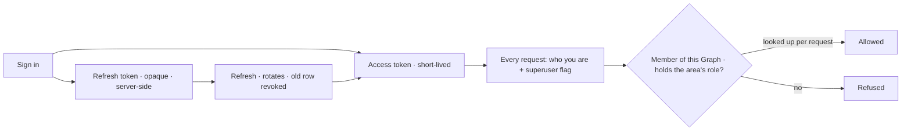

# Identity and access

The engine shape of who a request is and what it may change: membership, Graph roles, and what a token carries. The
product rules are [Settings](../../products/settings/product.md),
[ST-F02](../../products/settings/features/ST-F02-people-and-access/feature.md) and
[ST-F03](../../products/settings/features/ST-F03-you-account-and-sessions/feature.md). The API's auth conventions are
[api-and-cli.md](../api-and-cli.md). On screen a role is a grant — *Operator*, *Can work on projects*, *Can shape the
model* ([glossary.md](../../glossary.md)).

## Membership, then roles

| Rule | Detail |
|---|---|
| A principal is a member of a Graph, or is not | `graph_members` decides who reads; a member reads everything in the Graph |
| A Graph role is the right to change an area | Each role is a managed policy held in `graph_members.roles` |
| The creator is the first owner | The URL namespace is theirs; a second owner is a role, not a transfer |
| The install Admin is separate | `users.is_superuser` is install administration, never a way into a Graph |
| Roles bound people, not agents | What an agent may run is its envelope ([agents.md](agents.md)); what *done* means is a criterion ([work.md](work.md)) |

| Role | May change |
|---|---|
| `operator` | Nothing — looks and asks |
| `contributor` | Projects and tasks |
| `builder` | Agents, skills, evals |
| `modeller` | Models, rules, views of the graph |
| `owner` | Members and settings |
| `iam-admin` | Members, groups, access rules, other people's keys |

## What a token carries

| Rule | Detail |
|---|---|
| The token carries identity only | Not membership and not the username — both can change while a token lives. A personal access token carries the same, for longer |
| Membership is checked per request | Revoking access takes effect immediately |
| The refresh token is not a JWT | It is a server-side row, so revocation is a database update, not a denylist |
| Rotation on every refresh | A reused old refresh token is a signal, not a convenience |
