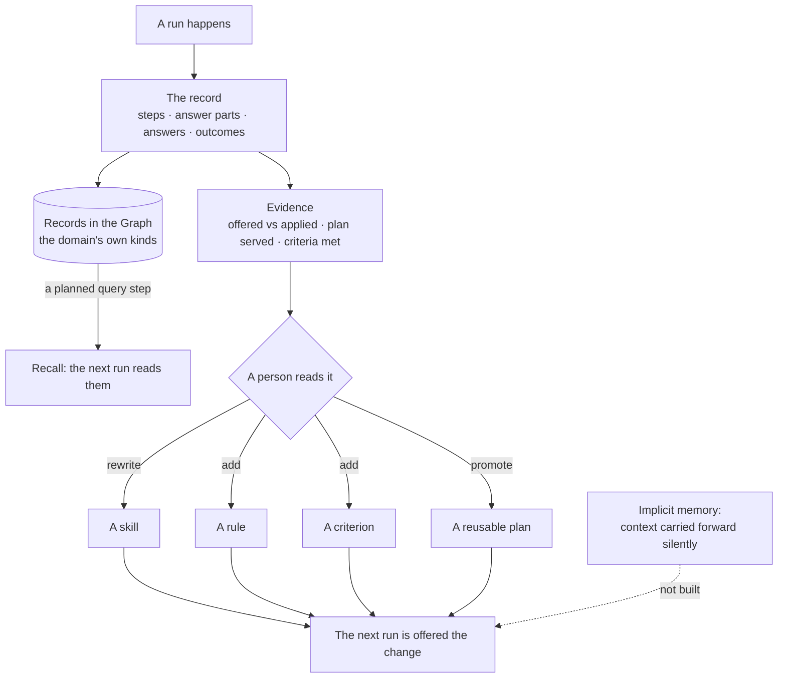

# Memory

The engine shape of what carries over between runs. An agent remembers nothing on its own: what it knows next time is
a record in the Graph it reads with a planned step, or a change a person accepted on the evidence of what happened. The
product rules — recall is a planned step, counts not scores, a suggested change carries its evidence — are
[EX-F07](../../products/explore/features/EX-F07-memory-what-past-runs-teach/feature.md). The run record it reads is
[orchestration.md](../orchestration.md).

## Two paths, and the one that does not exist

| Path | How it works | Why |
|---|---|---|
| **Recall by query** | The domain models its memory as node kinds; an agent reads them with a planned query step | What the agent "remembers" is a record with a source, not a claim in a prompt |
| **Consolidation** | Evidence reaches a person, who changes a skill, rule, criterion or plan | The change has an author, a time and a reason |
| **Implicit memory** | Not built | Context carried forward silently cannot be audited, and its recall cannot be cited |

## The mechanism is the product's, the kinds are the domain's

| Layer | Owns |
|---|---|
| Product | The record · evidence · a query step that reads prior records · the consolidation loop |
| Domain model | Whatever the domain calls its memory — finance models `Pattern` · `Observation` · `Learning`; a medical Graph `Finding` · `Guideline` |
| Skill | When to recall — the finance example's `learn-from-record` |

- "Remember what worked" is a modelling pattern reachable by any domain, never a feature with one domain's nouns in it.
- A starter model ships the importable shape — an observation, a claim derived from observations, how the claim fared — renamed to the Graph's vocabulary on arrival.

## Where memory lives

One test decides it: would you ever query it in the same breath as your domain data?

| Data | Lives in | Because |
|---|---|---|
| Runs · steps · timings · tokens · answer parts | Invana's store | About the run, not the subject. It survives swapping the graph database, and writing it would break a read-only connection |
| Evidence — offered vs applied, plan served, criteria met | Invana's store, derived from the record | About the machine's behaviour |
| Objectives · criteria · rules | Invana's store | About the work |
| *BPCL gapped 2.1% and the setup was taken* | The Graph | Joins to the domain's own kinds, cited in answers |
| *This pattern fares better on high-liquidity names* | The Graph | Queried mid-run, cited by id |

- The two sides join without duplicating: a memory record in the Graph carries the `run_id` that produced it, so provenance crosses the boundary in one direction only.
