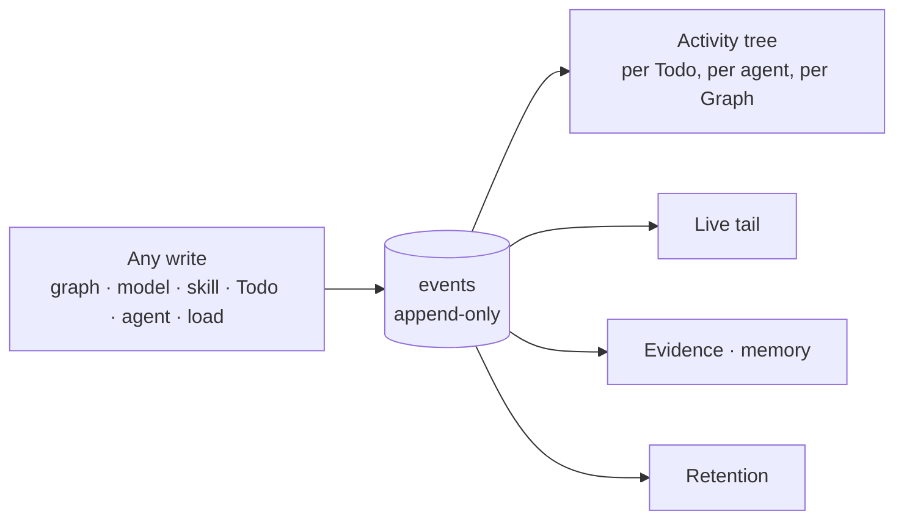
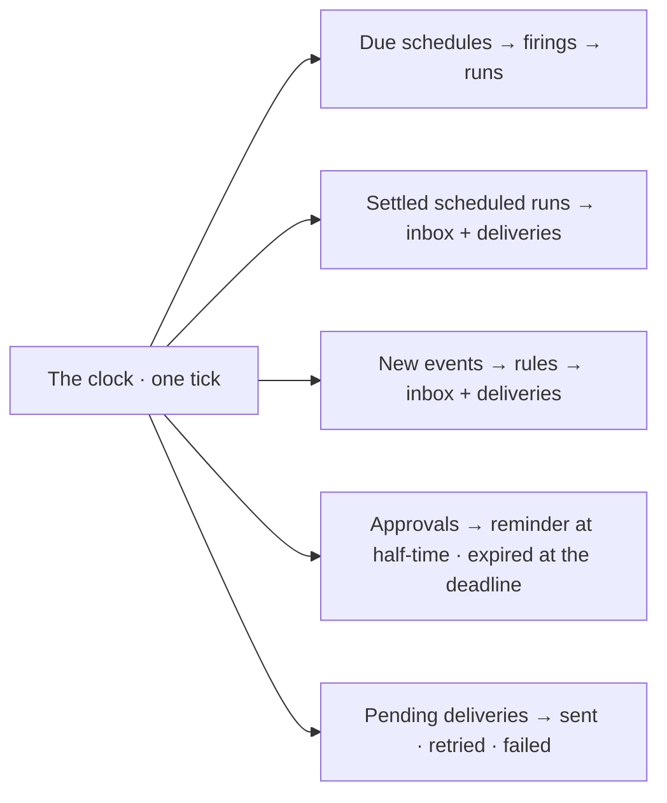

# Operate

The engine shape of running the thing: every write as an event, schedules, notifications and approvals on one clock,
and the numbers read from the record. The product rules are [Inbox](../../products/inbox/product.md) and its features
IN-F01 to IN-F03; schedules are [AG-F07](../../products/agents/features/AG-F07-schedules/feature.md). Logs, traces and
metrics are [observability.md](../observability.md); the runs themselves are [orchestration.md](../orchestration.md).
On screen events are *History* and an approval is an *ask* ([glossary.md](../../glossary.md)).

## Every write is an event

| Rule | Detail |
|---|---|
| Append-only | Events are never edited or deleted; retention removes whole windows, never single rows |
| The actor is a principal | `user` · `agent` · `system` · `external` · `anonymous`, with `on_behalf_of` when they differ |
| Causality is kept | `parent_event_id` links a spawned action to what caused it |
| Sensitive fields are redacted at write | Credentials never reach the record, not even encrypted ([observability.md](../observability.md)) |
| One record, many readings | Audit, activity, evidence and metrics all read `events`; none copies it |

## Schedules

One kind: an agent and instructions on a cron, opening a run per firing, delivered when the run settles.

| Rule | Detail |
|---|---|
| A firing is recorded even when it does nothing | Skipped by an overlap or missed-firing policy is a firing with a stated reason |
| Missed firings follow the schedule's policy | `catch_up` once · `run_all` · `skip` |
| Outward deliveries wait for an approval | Unless the schedule switches it off; never auto-approved |
| Whether a firing creates work is the run's business | The schedule names an agent and instructions, never a Flow or a project |

## What it owns

| Owns | Shape |
|---|---|
| `events` | Append-only: actor principal · `on_behalf_of` · verb · target · payload · `parent_event_id` · time |
| `schedules` · `schedule_firings` | Agent · instructions · cron · zone · missed and overlap policy · delivery · per-firing outcome |
| `notification_rules` · `notification_channels` · `notifications` · `notification_deliveries` · `notification_cursors` | Who hears what, where · each inbox row · each send · how far the clock has read `events` |
| `approvals` | What waits to leave, its approvers and deadline |
| The clock | One loop per engine process: schedules, deliveries, notification rules, approval deadlines — each step idempotent on a unique key, so a restart or a second process repeats nothing |
| Metrics | Per query and per LLM call: latency, tokens, cost, errors — derived from the record |
| `api_tokens` | Scoped tokens for outside agents, with their allowed reads ([ST-F04](../../products/settings/features/ST-F04-plugins-and-outside-tools/feature.md)) |
| Retention | How long task runs, their streams, emissions and events are kept, and what a purge removes |
| The runs journal | A reading of `todos` and `task_runs` — this module owns the surface, never the tables |

## Observability

| Question | Answered by |
|---|---|
| What is slow? | Query latency per graph, per model, per step kind |
| What costs? | Tokens and spend per agent, per project, per day; grouped by layer, then by participant |
| What fails, and where? | Error rates by step and by failure kind |
| Is the budget going? | Spend against each agent's ceiling, before it is reached |

- Metrics are derived from the record; there is no second pipeline to disagree with it.

