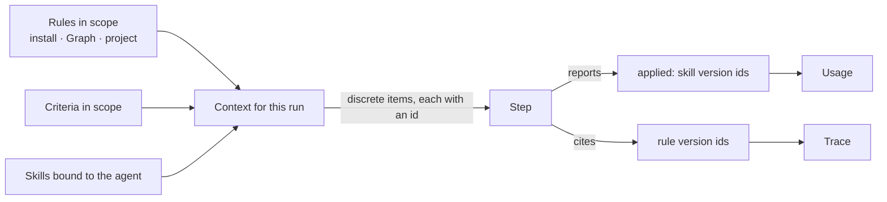
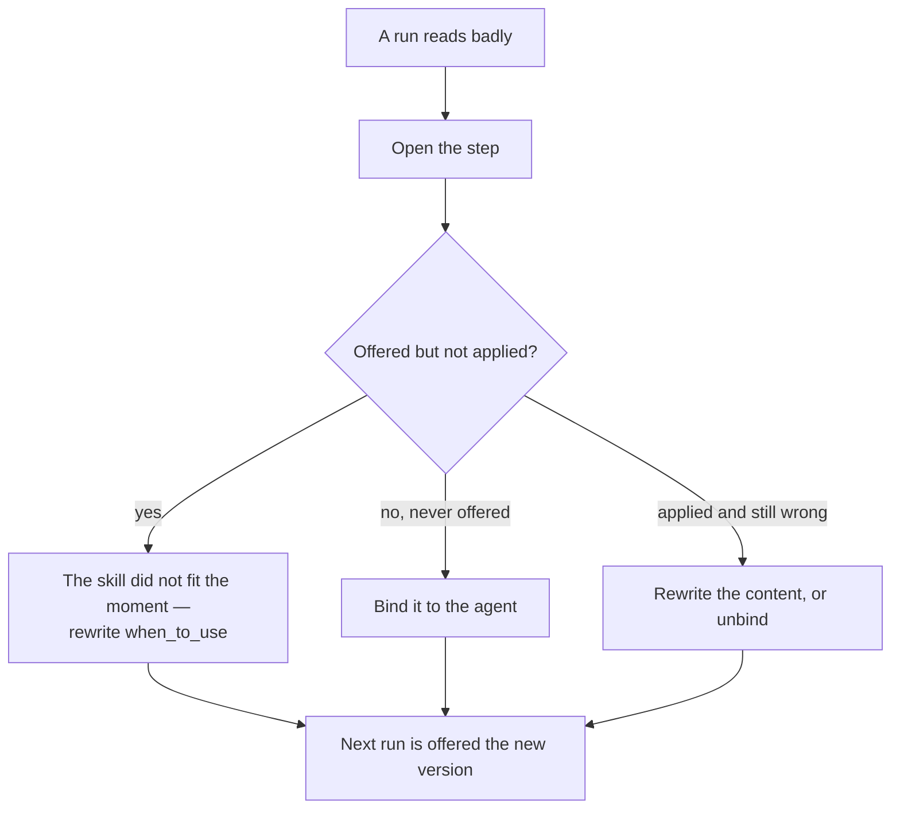

# Skills

The engine shape of what a run is **given** before it runs: a skill is a playbook offered to a step, versioned, and
reached only through the agent that holds it. The product rules are [Agents](../../products/agents/product.md) and
[AG-F04](../../products/agents/features/AG-F04-skills/feature.md); rules travel the same path and are
[MO-F06](../../products/model/features/MO-F06-rules-agents-work-by/feature.md)'s. The agent is [agents.md](agents.md);
the plan a skill draws as is [workflows.md](workflows.md) and [orchestration.md](../orchestration.md).

## Offered, not obeyed

| | Skill | Rule |
|---|---|---|
| Shape | A playbook — how to approach something | One statement — what must hold |
| Reaches a step | Through the agent that holds it | Through its scope — install, Graph or project |
| Recorded per step | Offered · reported applied, by version | Offered · cited, by version |
| Enforced | Never | Only where it carries a check, at the acts the check names ([MO-F06](../../products/model/features/MO-F06-rules-agents-work-by/feature.md)) |

- The gap between *offered* and *applied* is the signal a person acts on: rewrite the skill, or unbind it.
- What must hold on a run is an envelope bound ([agents.md](agents.md)) or a criterion ([work.md](work.md)), never a skill.

## What it owns

| Owns | Shape |
|---|---|
| `skills` | `graph_id` · `name` (unique per Graph) · `current_version_id` |
| `skill_versions` | `skill_id` · `version` · `description` · `content` · `when_to_use` · `folder` (the Agent Skills folder's files beyond `SKILL.md`, stored whole) · `plan_id` (NOT NULL, unique — the one Flow it draws as) · `published_by_id` · `published_at` — immutable once published |
| `skill_bindings` | `skill_id` · `agent_id` · `bound_by_id` · `bound_at` — unique on the pair; the binding follows the current version |
| Usage | Derived: every step that was offered a skill version, and whether it reported applying it |

### Versions

| Rule | Detail |
|---|---|
| A published version is immutable | Publishing a drawn draft makes the next version; the previous one keeps resolving |
| A step records the version it was offered | `skill_version_id` · `rule_version_id`, never the bare id |
| A binding points at the skill, not a version | An agent gets the current version at run time — bindings do not pin |
| Evidence is per version | *Offered 40, applied 2* is a claim about v3; v4 starts its own count |
| Stopping is not a version | A rule no longer offered keeps its versions |

## How they reach a step

| Assembly rule | Detail |
|---|---|
| Order is fixed | Rules, widest scope first → criteria in scope → the agent's skills |
| Nothing is concatenated | Each arrives as its own item, so it can be cited, counted and diffed |
| A skill is offered only if bound | An unbound skill exists but never reaches a step |
| A rule not offered stays out | Stopping a rule is how it stops applying, without deleting the record |

## Editing what an agent knows

- Every edit is an event ([operate.md](operate.md)), so the change and its effect sit in the same history.
