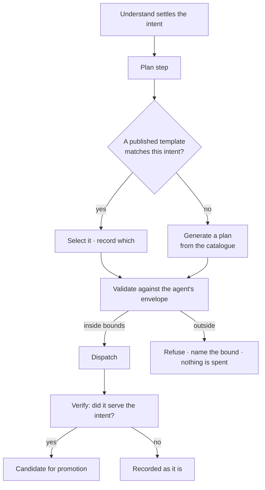

# Plans — `agents`

The engine shape of where a plan comes from: a reusable **Flow** in the library, chosen by intent, generated only when
nothing fits, validated against the running agent's bounds before anything is dispatched, and promoted when it served.
The product rules are [Agents](../../capabilities/agents/product.md) and
[AG-F06](../../capabilities/agents/features/AG-F06-plans-and-functions/feature.md). The records and the plan's grammar are
[orchestration.md](../orchestration.md); how a plan runs is [runtime.md](../runtime.md). On screen a Flow is a *plan* and a
catalogue entry a *function* ([glossary.md](../../glossary.md)).

## Where a plan comes from

| Rule | Detail |
|---|---|
| Selection beats generation | Generation is the fallback, not the default |
| Validation happens before dispatch | A plan outside the envelope costs nothing — it is refused with the step, argument or ceiling named |
| The plan is recorded either way | Selected or generated, the plan and its origin sit on the run |
| Promotion needs a verdict | Only a plan a `plan.verify` Task judged as serving is a candidate; a person still promotes it |

How a Todo reaches a plan — generated, matched or none — is [orchestration.md › Where a plan comes from](../orchestration.md#where-a-plan-comes-from).

## What it owns

| Owns | Shape |
|---|---|
| `flows` | `graph_id` · `key?` · `name` · `intent` · `kind` · `origin` (`packaged` · `generated` · `promoted`) · `reusable` · `todo_id?` · `args_schema` · `source_skill_version_ids[]` |
| `tasks` | The flow's nodes — `flow_id` NOT NULL · `parent_id?` · `key` · `form` · `step_key?` (a catalogue entry) · `depends_on[]` and the rest of the grammar |
| Plan record | On the run: `plan_snapshot` (frozen) and `plan_origin` (`authored:<id>` · `generated` · `reused:<id>`) |
| Validation result | Which bound refused a plan, when one did |

The fields of both tables are [orchestration.md › The records](../orchestration.md#the-records).

### The product's own plans

Every plan the runtime walks resolves from `flows`, including the ones Invana ships. A builtin is seeded at migrate as
a reusable plan the engine owns: `dataset-import`, `bundle-import`, `bulk-load`, `stitch-apply`, the `ask` plans,
`plan-a-todo` and `check-criteria`.

| Rule | Detail |
|---|---|
| A builtin is listed, not hidden | It appears in the library with its origin; its diff and usage read like any plan's |
| It is read-only | No edit, no next version, no retire. Reseeded on migrate, so a deployment never diverges from the plan its engine implements |
| It is composable | `ref: task:dataset-import` inlines it — a bundle load reuses the one-dataset load instead of copying its Tasks |
| It is promotable from, never to | A run that selected a builtin and served is not a candidate — the plan is already in the library |
| Nothing else may hold a plan | A plan constant in a feature package is a defect: `plan_origin` records a plan id, and one the library cannot resolve is a trace that cannot show what ran |

## What the library reads

| Reading | Shows |
|---|---|
| The list | Name · intent · kind · who uses it · last served |
| A diff | Tasks added, removed, reordered, and argument changes, against the plan as a run froze it |
| Usage | Every agent whose runs selected this plan, and every TaskRun that ran it |

## Validation against the envelope

The envelope is authored on the agent ([agents.md](agents.md)); the check happens here.

| Refused when | The refusal names |
|---|---|
| A `step_key` is not in the agent's allowed set | The step key |
| An argument is not pinned as the envelope requires | The argument |
| The plan's projected cost exceeds the ceiling | The ceiling and the estimate |
| Depth or fan-out would exceed the parent's | The bound and the parent |
| The plan reads outside the agent's lens | The model version or link, and that it is *outside the lens* — not *cannot answer* |

- A refusal is an outcome, not an error: the run reports it, the Todo shows why, and nothing is dispatched.
- A generated plan is checked the same way — that is why the catalogue is closed
  ([orchestration.md › The catalogue](../orchestration.md#the-catalogue)).
