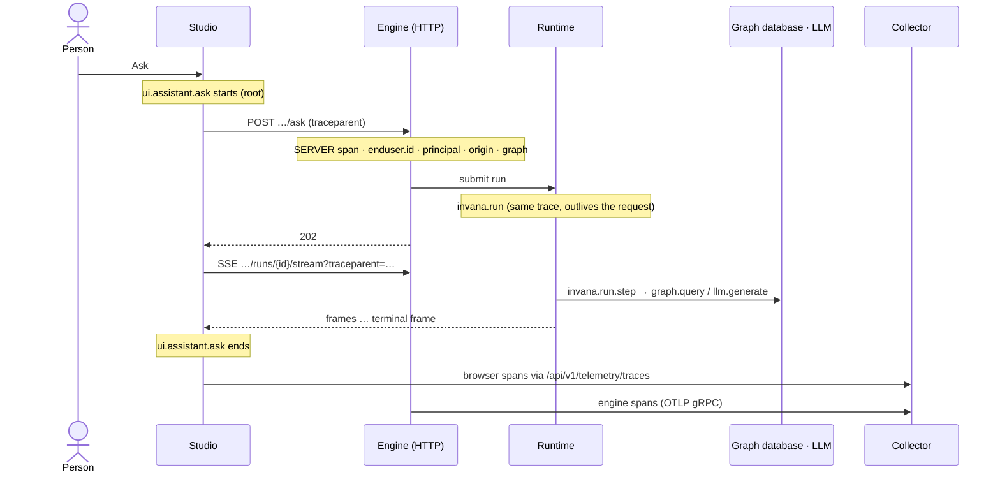
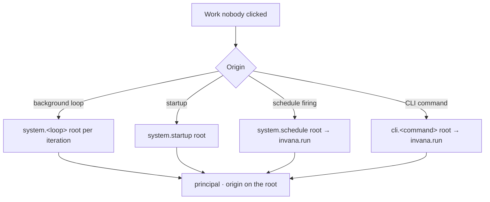

# Observability

How the engine and Studio report on themselves to whoever operates them: logs, traces and metrics over OpenTelemetry,
one trace per person's action. What a run records for the product, and the six outputs one moment produces, are
[runtime.md](runtime.md); the numbers a person reads in Studio are stored on the record ([architecture.md › Metrics
are stored](architecture.md)), never read from here.

## Three signals, one job each

| Signal | Says | Joined by |
|---|---|---|
| **Trace** | What happened to one action | — |
| **Metric** | How often and how slow, across all actions | Exemplars on every histogram point at a sampled trace |
| **Log** | A discrete fact | `trace_id` and `span_id` on every line |

| | Logging | Telemetry |
|---|---|---|
| What | Human- and machine-readable lines from the engine's own modules | Traces, metrics and logs, exported over OTLP |
| Turned on by | One call at startup, with defaults that need no arguments | One idempotent bootstrap; off unless an endpoint is configured |
| Formats | A plain line for a terminal, one JSON object per line for a collector | OTLP over gRPC from the engine; OTLP over HTTP from Studio through the engine's proxy |
| Overridable | A whole configuration dictionary, for a deployment or an integration | Endpoint, sampling and resource attributes |
| Dependency | Standard library only — every `getLogger(__name__)` keeps working | Optional; Studio and the engine run identically without it |

| Rule | Detail |
|---|---|
| This is telemetry for whoever runs the server | Latency, tokens and failure rates a person reads come from the record. No product surface reads telemetry |
| Optional | No endpoint means no exporter, no overhead, no error. A collector that is down never surfaces as a request error |
| Who acted, never what they sent | Principal, on-behalf-of, origin, Graph and ids are recorded; record contents, prompts, answers and credentials never are |
| One redaction rule for events and logs | A sensitive field name is dropped at any depth, a secret-typed value is masked, and message text is never parsed — code does not format a secret into it. Applied at write, by a filter on every handler |
| No credential reaches a span or a log | `token` is stripped from every recorded URL and from the access log |

## Logging

| Rule | Detail |
|---|---|
| Configured once, at startup | Never per module, never at import time. Called when `invana` is imported — the server and the CLI alike |
| Defaults, overridable whole | One default dictionary; a deployment passes its own. Not configured means the default — never silence. Configured twice, the last call wins and says so |
| A level changes in place | `set_level`; the configuration is never rebuilt after startup, because rebuilding closes every handler, the OTLP one included. The CLI lowers to INFO this way |
| Per-logger levels | The engine's modules and noisy dependencies are set separately |
| JSON is one object per line | An exception's traceback is a field, not smeared across lines |
| Every line ties to its trace | `trace_id` and `span_id` in the plain, JSON and OTLP formats, read from the current span; empty without the telemetry extra |
| Structured context is bound, never passed | Code logs with its own ids in `extra=`; `principal` · `origin` · `graph_id` arrive from the context the span helpers bound, so a line and its span agree. A root span starts from none. The Graph is its id |
| Redaction is a handler filter | A logger's filter never sees the records its children propagate |
| A shipped record carries no console-only attributes | The OTLP record takes its trace from the active span; the handler's last filter ships a copy without the console fields |
| Lifecycle, not chatter | Lifecycle and failures at info and above; per-request noise at debug |

| Field | Plain | JSON and OTLP |
|---|---|---|
| timestamp · level · logger · module · function · line · message · exception | Yes | Yes |
| `trace_id` · `span_id` | `[trace_id span_id]`, only inside a span | Fields |
| `principal` · `origin` · `graph_id` | Inline (`principal=user origin=studio`), only when bound | Fields |

### What is logged

| Source | What | Level |
|---|---|---|
| Run lifecycle | `run started` · `run finished` · `run paused for a person` · `run cancelled` — inside the run span, with `run_id` · `run_kind` · `run_role` · `run_triggered_by` · `run_outcome` · `run_duration_s` | info |
| Run failure | `run failed`, with `failure_kind` = `class·cause`; an escaped exception once, with its traceback, as `defect·internal` | error |
| System work | A loop iteration that failed · `startup finished` and its sweep · `graph went down` · `graph came back` | error · info · warning · info |
| Requests | A 5xx once, with method, route template, status and duration — never the body — by the request middleware inside its span, or by the catch-all when telemetry is off. Every other request at debug | error |
| Access log | uvicorn's, with `token` stripped from the path | debug |
| Studio | Uncaught errors, unhandled rejections, the router's error page, failed queries and mutations (network or 5xx only), error boundaries — through `POST /api/v1/telemetry/logs` | error |

## Traces

| Rule | Detail |
|---|---|
| One action is one trace | Rooted in Studio, named `ui.<module>.<action>`, ended when the action's outcome arrives — the terminal stream frame for an ask or a re-run, the response for a write — not when its first request returns |
| Every Studio API call is a span with an explicit parent | Passed in the request config, never a shared *current action*; with no action open it is its own root, so no engine span is an orphan |
| Streams stay in the trace | `EventSource` cannot send headers, so `traceparent` rides the URL; the middleware reads it only when the header is absent. The events tail, which nobody clicked, opens `ui.events.subscribe`, ended when the connection opens or fails |
| A run is a child of the request that started it | It may outlive it — the request span ends at 202, the run span when the run ends. Each step is a child of its run; a delegated child run is a child span with a Link to its parent run |
| Cannot-answer, conversed and needs-input are outcomes, not errors | A failed step or crashed run is an error; a cancelled run is outcome `cancelled`. Queue wait is the `run.queued` and `run.admitted` events on the run span |
| The middleware is pure ASGI | The wrapping kind breaks streaming and background work; it measures a streaming response without buffering it. It is the only source of request spans |
| Graph, model and SQL spans nest under their step | `graph.query.*` · `llm.generate` · SQLAlchemy |
| Outgoing HTTP is a client span | Every httpx call, under whatever caused it. The proxy's forward to the collector is not traced, nor is any `/api/v1/telemetry/` path |
| Queues carry the producer's context | The consumer's span Links to it; `system.query_log` links to each logged query, at most 128 per batch |
| Sampling is parent-based | One ratio from settings (1.0 in development and compose), recorded on the resource as `invana.telemetry.sample_ratio`; a sampled action keeps its whole trace |
| A record opens its trace | A TaskRun stores `trace_id` (read at insert, else from its own run span) and `root_span_id` (the first run span wins, so a resumed run keeps both); a step row has `trace_id`. An event stores `trace_id` and `span_id`, filled by `emit` from the current span, never passed by a caller, null outside any span |

### Work nobody clicked

| Root | Origin | Carries |
|---|---|---|
| `system.startup` | `startup` | Connecting the Graphs, seeding, the sweep that fails runs a dead process left mid-flight |
| `system.graph_health` | `daemon` | One per health sweep; `invana.graph.connections`; outcome `ok` · `degraded`, a failed check an event on it; an empty registry opens none |
| `system.graph_reconnect` | `daemon` | One per reconnect attempt; `invana.graph_id` · `invana.connection_id`; `ok` · `failed` · `stopped` |
| `system.events_listen` | `daemon` | One per LISTEN connect |
| `system.query_log` · `system.query_log.prune` | `daemon` | One per batch written, and per prune |
| `system.schedule` | `schedule` | When a schedule fires |
| `cli.<command path>` | `cli` | Principal `user` with no `enduser.id` — the CLI holds no session to name them; `invana.cli.command`. Never for `start` (a server) or `--help` |

- Each is a new trace, never a child of whatever spawned it; principal `system` unless said.
- The CLI flushes and shuts down its three providers within one 5-second budget on exit, so a collector that is down cannot hold the shell.

### Attributes

| Attribute | Values |
|---|---|
| `enduser.id` | The signed-in account |
| `invana.principal` | `user · agent · system · external · anonymous` |
| `invana.on_behalf_of` | Whom the principal acted for |
| `invana.origin` | `studio · api · cli · schedule · startup · daemon` |
| `invana.graph` · `invana.graph_id` | `user/graph` · the id |
| `invana.run_id` · `invana.outcome` | — |
| On `invana.run` | `invana.agent_id` · `invana.run.role` · `invana.run.kind` · `invana.run.triggered_by` |
| On `invana.run.step` (per attempt) | `invana.task_key` · `invana.step_key` · `invana.run.attempt` |
| On Studio action spans | `enduser.id` · `invana.graph` · `invana.session_id` · `invana.run_id` · `invana.outcome` |

- A request starts `anonymous` from `api`; authentication sets `enduser.id` and principal `user`, with origin `studio` for a session token and `api` for a personal access token; resolving a Graph URL sets the Graph.

## Metrics

Names follow the modules (`invana.<module>.*`, `ui.*`) and, for HTTP and databases, the OpenTelemetry semantic
conventions. Durations are histograms in seconds, exported every few seconds; engine histograms carry exemplars from
sampled spans. Attributes are bounded: a user id, run id or Graph id is never a metric attribute, and HTTP metrics use
the route template — an unmatched path is one fixed value.

| Metric | Kind | Attributes |
|---|---|---|
| `http.server.request.duration` | histogram | `http.request.method` · `http.route` · `http.response.status_code` |
| `http.server.active_requests` | up-down counter | `http.request.method` · `http.route` |
| `invana.runs.duration` · `invana.runs.queue_wait` | histogram | `kind` · `role` · `triggered_by` · `outcome` (duration only) |
| `invana.runs.count` · `invana.runs.active` | counter · up-down counter | `kind` · `role` · `triggered_by` · `outcome` (count only) |
| `invana.runs.step.duration` | histogram | `step_key` (the catalogue's key — a plan's own step ids are unbounded) · `outcome` |
| `invana.llms.request.duration` · `invana.llms.request.count` | histogram · counter | `provider` · `model` · `role` · `outcome` |
| `invana.llms.tokens` · `invana.llms.cost` | counter | `provider` · `model` · `direction` (`input · output`, tokens only) |
| `invana.graph_connectors.query.duration` · `.count` · `.result_size` | histogram · counter | `connector` (the class) · `language` · `operation` · `outcome` |
| `invana.assistant.streams.active` | up-down counter | `stream` (`run · events`) |
| `invana.events.emitted` | counter | `action` |
| `invana.system.loop.duration` · `.failures` | histogram · counter | `loop` |
| `invana.graphs.pool.connections` | observable gauge | `state` (`healthy · backoff · down`) |
| `ui.action.duration` | histogram | `module` · `action` · `outcome` |
| `ui.request.duration` | histogram | `http.route` · `outcome` |
| `ui.web_vitals.{lcp,inp,cls,ttfb}` | histogram | `module` |
| `ui.stream.reconnects` · `ui.errors` | counter | `stream` · `module` and `source` (`uncaught` · `unhandled_rejection` · `boundary` · `route` · `query` · `mutation`) |
| `ui.canvas.layout.duration` · `ui.canvas.render.duration` | histogram | `layout` · `size_bucket` — recorded by `@invana/canvas` |

| Rule | Detail |
|---|---|
| One counter with a status attribute | Not one counter per status |
| Graph-query metrics are graph-connector metrics | Gremlin and Cypher alike, with `connector` as an attribute |
| An ask is a run | A conversation message is measured by `invana.runs.*`; `invana.assistant.*` holds the streams |
| A run's metrics use `triggered_by` | The request's `origin` is on its span |
| Recorders are no-ops without the extra | Every instrument is defined in one place and recorded through one module |

## Studio

| Thing | Shape |
|---|---|
| Providers | Traces (parent-based sampler on `VITE_TELEMETRY_SAMPLE_RATIO`), metrics and logs — service `invana-studio`, exported through `/api/v1/telemetry/{traces,metrics,logs}` on its own gate, `VITE_TELEMETRY_ENABLED` |
| Actions | `startAction(module, action)` opens a root; its handle's `end(outcome)` or `fail(err)` ends it once |
| Action names | `ui.<module>.<action>` — `ui.assistant.ask` · `ui.assistant.rerun` · `ui.explorer.load` · `ui.runs.cancel` · `ui.plans.promote` · `ui.events.subscribe` |
| Errors | `reportError(error, source)` — one OTLP log (`exception.type` · `exception.message` · `exception.stacktrace` · `module` · `ui.error.source`) in the failed request's trace when it has one, else the active one, and one `ui.errors`. Sources: the window's `error` and `unhandledrejection`, the query and mutation caches (network errors and 5xx only), the router's error page (not a 404), and the kit's `ErrorBoundary` around each shell region, keyed so opening another starts it afresh |
| Errors only | Warnings and console output stay in the browser; a 4xx is an outcome the screen handles and `ui.request.duration` counts |
| Web Vitals | The `web-vitals` package, as `ui.web_vitals.*` |
| No exemplars | The browser SDK records none, so Studio latency links to traces through its spans |
| Trace link | `VITE_TELEMETRY_TRACE_URL` — the collector's trace view with `{trace_id}` and optionally `{from}` · `{to}` (epoch ms): the record's time ± 15 minutes, or the last day when nothing says when. Without it the id is shown, not linked — Studio never guesses a collector. A run's and an event's details show a `trace` row this way |

## Transport and settings

| Setting | Does |
|---|---|
| `INVANA_TELEMETRY_OTLP_ENDPOINT` | The collector for the engine's OTLP gRPC export; unset means off |
| `INVANA_TELEMETRY_SAMPLE_RATIO` | 0–1, default 1.0 |
| `INVANA_TELEMETRY_OTLP_HTTP_ENDPOINT` | The collector's OTLP/HTTP base URL; `POST /api/v1/telemetry/{traces,metrics,logs}` forwards to `<base>/v1/{traces,metrics,logs}` |

| Rule | Detail |
|---|---|
| Bootstrap is idempotent | The second call does nothing |
| The proxy is always mounted | Three routes; with engine telemetry off each accepts the batch and drops it, so the browser console stays clean |
| Compose ships a collector | Both services point at the bundled HyperDX; service names are `invana-studio` and `invana-engine` |

## Dashboards

Seeded into HyperDX by one script, idempotent by name; its check runs every tile's SQL so a renamed metric fails loudly
instead of drawing nothing.

| Dashboard | Tiles | Reads |
|---|---|---|
| Invana — API | Requests · 5xx · 5xx rate · p95; requests by status class over time; active requests; p95 and 5xx by route; each 5xx (opens its trace) | `http.server.*` · `SERVER` spans |
| Invana — Runs | Runs · failed · p95 run · mean queue wait; by outcome, kind and trigger; active runs; runs over time by outcome; slowest steps by `task_key`; each failed run with `failure_kind` (opens its trace) | `invana.runs.*` · run spans · run logs |
| Invana — LLMs | Calls · failed · tokens · cost; calls and mean by provider and model; tokens by model and direction; p95 over time; slowest calls | `invana.llms.*` · `llm.generate` spans |
| Invana — Graph queries | Queries · failed · p95; by connector, language and outcome; mean result size; p95 over time; slowest queries | `invana.graph_connectors.*` · query spans |
| Invana — System | Loop failures and mean duration by loop; pool connections by state; open streams; events by action; `system.*` and `cli.*` roots; warnings and errors by line; startups | `invana.system.*` · `invana.graphs.pool.connections` · spans · logs |
| Invana — Studio | Actions · errors · p95 action; actions by name and outcome; requests by route; Web Vitals by module; errors by module and source; recent errors | `ui.*` metrics, spans and logs |
| Invana — Trace | Recent and slowest `ui.*` actions with their engine spans and error counts (a row opens the whole trace); engine spans under actions by total time | Spans joined on `TraceId` |

- Counts come from metrics, which sampling does not thin; latency percentiles from span durations, which are exact and open their trace; levels from each series' last value; discrete facts from logs. Engine metrics are cumulative and Studio's delta; each count is read as its increase over the range.

## Seams

| Seam | What happens |
|---|---|
| Collector unreachable | Studio and the engine keep serving |
| Engine telemetry off, Studio's on | The proxy answers 202 and drops the batch |
| A run outlives its request | The run span ends with the run; the request span at 202 |
| A call with no action open | It starts its own root |
| Sampling on | A sampled action keeps its whole trace; the ratio is on the resource, so a missing trace is explainable |
| A structured field in the plain formatter | Rendered inline, never dropped |
| A 5xx | One error line, whichever middleware sees it |

## Not building

| Not building | Because |
|---|---|
| A logging framework that replaces the standard logger | It breaks every `getLogger(__name__)` already written |
| Environment-driven logging settings | A constant plus an override covers it |
| Log shipping from files | OTLP export is telemetry's; tailing files belongs to the platform running the engine |
| A vendor-specific exporter | OTLP reaches every collector worth using |
| Telemetry as a hard dependency | Studio and the engine run with none of it present |
| Tracing user data | Spans carry shape, timing and ids, never record contents |
| Session replay or click heatmaps | An action is traced; a person is not recorded |
| Automatic instrumentation of every DOM event | A span is named for an action a person means |
| Alerting and paging | The collector's job |
| Browser console mirroring | Noise; Studio sends errors only |
| Engine method-level decorators and their instruments | Unused; the layers above cover them |
