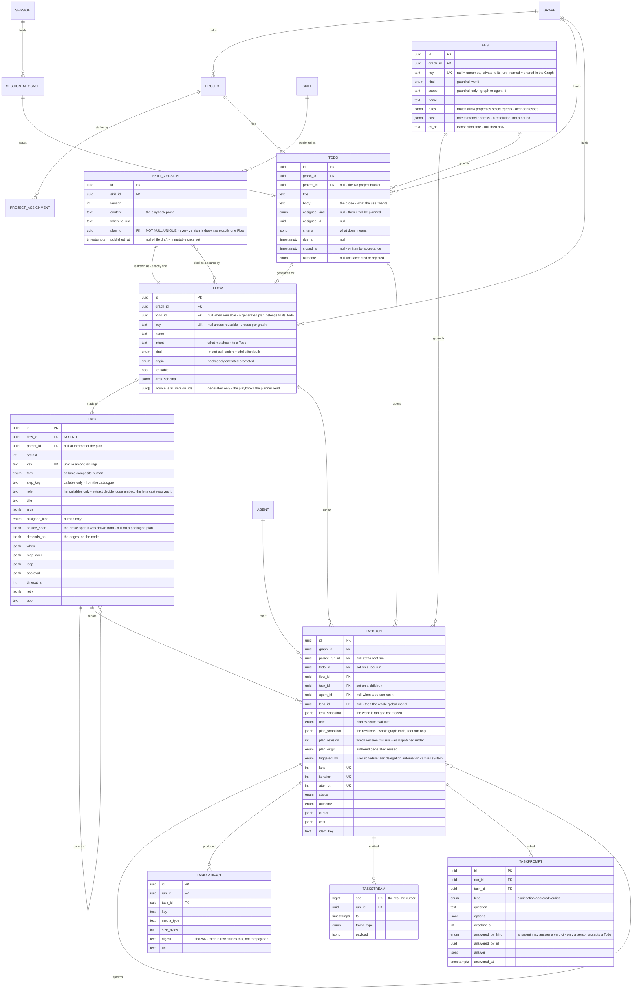
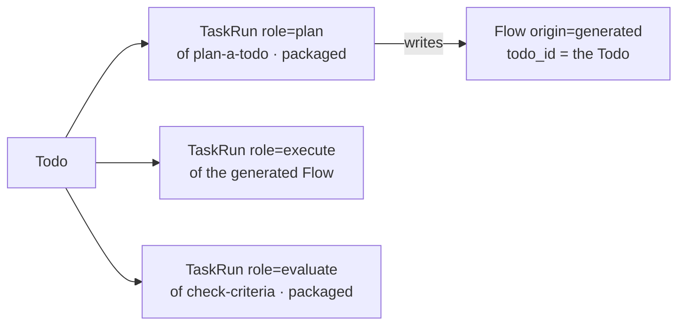
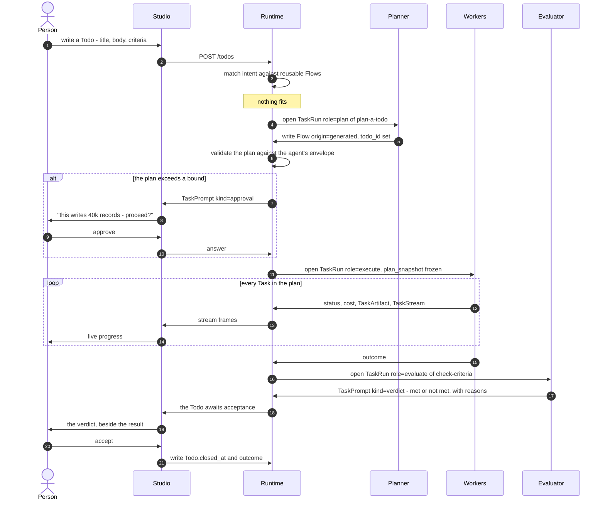
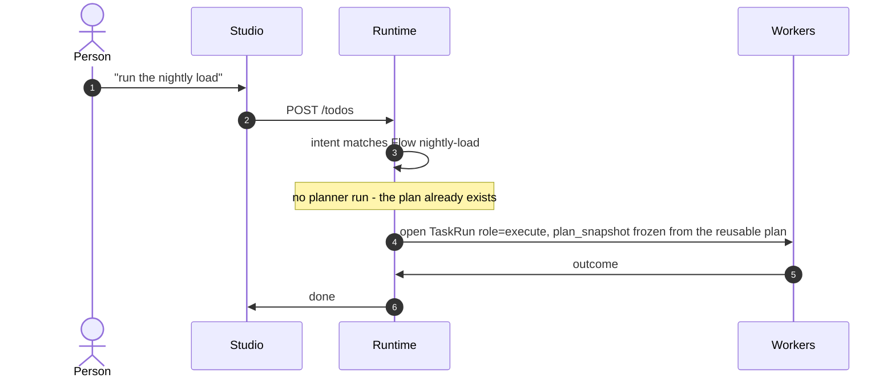
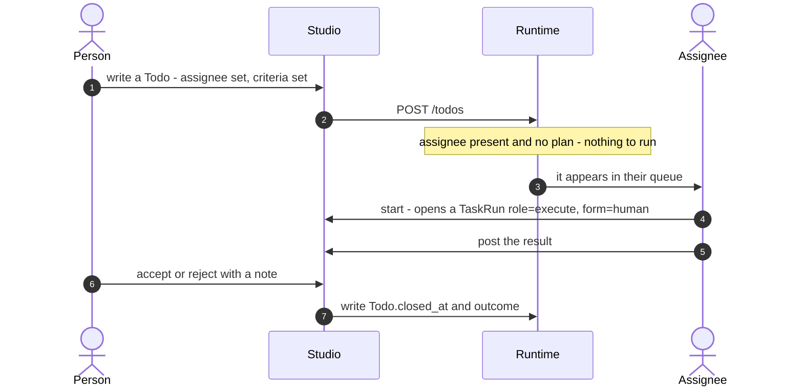
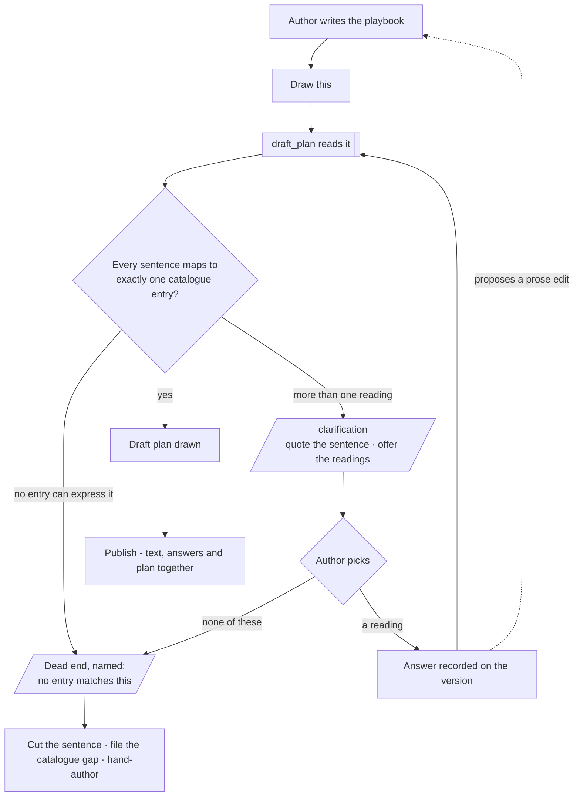

# Orchestration

The engine's task model: a person writes a **Todo**, a **Flow** of **Task**s carries it out, and a **TaskRun** is one
execution of it. Nothing a user authors is ever a `Task`. The layers it sits in are [architecture.md](architecture.md);
the records a person meets are [data-model.md](data-model.md); what a run may see, use and send is
[governance-and-lens.md](governance-and-lens.md). The plan grammar, repetition, pauses, triggers, pool bounds and worked
examples are still in [orchestration.md](../../docs/for-developers/orchestration.md) §§ 4–11. On screen a Todo is a
*Task*, a Flow is a *Plan* and a TaskRun is a *Run* ([glossary.md](../glossary.md)).

## The records



The lens's fields and rules are [governance-and-lens.md](governance-and-lens.md).

### The edges

| Edge | Cardinality | Why |
|---|---|---|
| Project → Todo | 0..1 → many | A Todo needs no project — the Graph's *No project* bucket |
| Todo → Flow | 1 → 0..1 | Optional both ways: a Todo assigned to a person never gets a plan; a reusable Flow belongs to no Todo |
| Flow → Task | 1 → many | The plan is the unit that is drawn, frozen onto runs and reused; a Task has no life outside one |
| Task → Task | self | Nesting lives inside the plan, never in the filing cabinet |
| Todo → TaskRun | 1 → many | Root runs only. Many per Todo: one to plan it, one to execute, one to evaluate |
| Task → TaskRun | 1 → many | Child runs. A `map_over` of 200 makes 200 runs of one Task |
| TaskRun → TaskRun | self | The only execution record — there is no separate step table |
| TaskRun → TaskArtifact · TaskStream · TaskPrompt | 1 → many | The three things a run emits that the run row does not hold |

## Rules the records keep

| Rule | Detail |
|---|---|
| A user authors Todos, never Tasks | `TASK.flow_id` is `NOT NULL`; a person never writes a plan node by hand |
| Evaluation is a Flow, not a property | `TASKRUN.role = evaluate` runs the same machinery and writes a `TaskPrompt` of `kind = verdict`. It recommends; a person writes `TODO.closed_at` |
| History is never rewritten | Editing a Flow touches no run; a replan appends a revision to `plan_snapshot` and never alters a settled node. So a Flow needs no version table |
| Planning is a role on the run, never a kind on the plan | `kind` is the subject — `import` · `ask` · `enrich` · `model` · `stitch` · `bulk`; planning is not a subject and stays out of every subject filter |
| Human versus machine is a type | A person's work is a Todo; a machine's is a Task. There is no `kind = work` |

### Names

| Name | Is | Kept apart from |
|---|---|---|
| `Flow` | the plan record | — |
| `TaskRun.role = plan` | a run whose job is drafting a Flow; it writes a `Flow` row | — |
| `step_key: plan_queries` | a callable inside the **ask** plan that plans queries; it never writes a `Flow` | `plan` as a step key |
| `TaskRun.plan_snapshot` | the frozen plan on a run | `plan` as a column name |
| `TaskStream` | the run's frame stream | — |
| `TaskPrompt` | a question a run asks and its answer | — |

### Not tables

| Fact | Goes to | Because |
|---|---|---|
| A log line | OpenTelemetry, correlated by `run_id` | It would be stored twice and is the fastest-growing output |
| An event | `core/events` — a fact about a write with its principal | It is not task-shaped |
| A metric | Telemetry | — |

## Where a plan comes from

A reusable Flow is what the product calls a plan; `workflows` and `workflow_versions` are not separate records. A Todo
reaches a plan three ways, and only one runs a planner.

| Path | `Flow.origin` | A `role = plan` run? |
|---|---|---|
| **Matched** — a reusable Flow's `intent` fits the Todo | `packaged` or `promoted`, reused as-is | No |
| **Generated** — nothing fit, so one is drafted | `generated`, `todo_id` set | Yes, one |
| **None** — a person does it | — | No |



| Rule | Detail |
|---|---|
| The planner is an ordinary Flow | Its run writes a `Flow` row instead of graph records. There is no planner service and no runtime of its own |
| A generated plan always comes from a packaged one | `plan-a-todo` (steps `understand` → `draft_plan`) and `check-criteria` ship as `origin: packaged` and are never generated |
| The chain is one level deep | packaged → generated, never generated → generated |
| The evaluator recommends; a person accepts | A `role = evaluate` run writes a verdict; only a person writes `Todo.closed_at` |
| Promotion closes the loop | A generated plan that served is promoted — `origin: promoted`, `reusable: true`, `todo_id` cleared. The next matching Todo is matched and never plans again |
| Promotion is the only way a generated plan becomes reusable | Otherwise skills × phrasings fill the library with near-identical plans |
| A builtin is seeded, never registered | The plans Invana ships enter the library as `flows` + `tasks` rows, `origin: packaged`, published and read-only. The runtime resolves every plan from rows; a builtin has no privileged path |
| Validation is the runtime's job | The runtime checks what `draft_plan` wrote against the envelope before any `role = execute` run opens. No callable approves its own plan |

## Who does what

| Lane | Is |
|---|---|
| **Person** | The author of intent and the only acceptor |
| **Runtime** | The plan interpreter and policy engine — opens runs, freezes snapshots, enforces the envelope |
| **Planner** | A TaskRun with `role = plan` |
| **Workers** | TaskRuns with `role = execute` — agents and callables |
| **Evaluator** | A TaskRun with `role = evaluate` |

### Generated — nothing reusable fit



### Matched — a reusable Flow fit



### Human — no plan at all



### Who writes each field

| Field | Written by | Never by |
|---|---|---|
| `Todo.title · body · criteria · due_at` | A person | Anything else — this is what a Todo is |
| `Flow` rows and their Tasks | The planner or a skill's draw (`generated`), a package seed (`packaged`), promotion (`promoted`) | A person by hand · a worker mid-run |
| TaskRun rows — `plan_snapshot` · `lane` · `iteration` · `attempt` | The runtime, at open | Anyone, afterwards |
| `TaskRun.status · outcome · cost · cursor` · TaskArtifact · TaskStream | Workers | — |
| `TaskPrompt.answer` where `kind = approval` | A person | An agent |
| `TaskPrompt.answer` where `kind = verdict` | An agent or a person | — |
| `Todo.closed_at · outcome` | A person | An agent, ever |

- **The seam:** an evaluator writes a verdict and stops. `Todo.closed_at` has exactly one writer; if an agent could
  write it, an agent would be accepting its own work.

## The catalogue

A plan names only callables that already exist — that is what makes the envelope a real bound. A planner that could
invent a callable could escape any ceiling. The vocabulary has two tiers, and only the lower is closed.

| Tier | Is | Closed? | Named by |
|---|---|---|---|
| **Callable** | One act, one bound, one failure mode | Yes | `step_key: run_query` |
| **Flow** | A composition of callables, already proven | No — grows by promotion | `ref: task:nightly-load` |

- Plans get richer by composing plans, not bigger callables; the set of things that touch a database, a network or a
  token budget stays where it started.

### What earns an entry

| Test | Detail |
|---|---|
| It passes the three questions | Observable steps · can fail halfway · worth a trace ([§ 4.1](../../docs/for-developers/orchestration.md#41-what-is-a-task--and-what-is-not)) |
| It declares typed outputs | `when`, `until` and `${steps.x.y}` bind against them; an undeclared output is an undocumented API |
| It spends exactly one bound | The envelope check is per callable; an entry spanning two bounds cannot be ceilinged |
| It is not control flow | `if` · `loop` · `map` · `retry` · `stop` are plan grammar, never entries |

### The declaration

```yaml
run_query:
  bound:    graph_read
  requires: [validate_query]          # a plan naming this must already order that before it
  args:
    query:  {type: str, required: true}
    params: {type: obj, default: {}}
  outputs:
    rows:      list                   # concatenated across lanes
    count:     int                    # summed across lanes
    truncated: bool                   # not exposed on a fan-out - bind it per lane
```

| Read by | For |
|---|---|
| The planner | What it may name and what it must order first — the tool description it plans against |
| The validator | Whether a plan is legal, before anything is dispatched |
| The interpreter | How lane outputs roll up on a fan-out |
| `when` · `until` · `${steps.x.y}` | What there is to bind |

- `requires` is declared on the entry, so the planner writes the `depends_on` edge while drafting; the validator
  enforces the same line. It is never only an envelope check that refuses after the fact.

### Entries by the bound they spend

The group is what the envelope ceilings. The count stays near twenty-five; growth belongs in the Flow tier.

| Bound | Entries |
|---|---|
| *none* — pure data | `emit_table` · `read_artefact` |
| `network` | `fetch_source` · `test_connection` |
| `graph_read` | `run_query` · `introspect_schema` · `expand_neighbours` · `count_types` · `resolve_elements` |
| `graph_write` | `write_records` · `write_properties` · `bulk_write` · `apply_stitches` · `commit_stitches` · `withdraw_stitch` |
| `schema_write` | `diff_models` · `check_capabilities` · `publish_model_version` · `snapshot_model` · `project_model` |
| `ingest` | `check_bundle` · `import_dataset` · `validate_records` · `import_report` · `read_stitches` · `resolve_stitch_rule` |
| `llm` | `understand` (outputs `intent` · `entities` · `clarification_needed`) · `plan_queries` · `translate` · `summarise` · `enrich_properties` · `judge` |
| `plan_write` | `draft_plan` — the only entry that writes a `Flow` row |
| `work_write` | `spawn_agent` · `delegate` · `create_task` — an agent making a child, or work for a person |

- `work_write` is the bound delegation spends: the three acts that create work nobody has yet paid for, and the ones the
  budget ceiling must see.

### Granularity

Cut at the bound and the failure mode, not at the function call.

| Too fine | Too coarse | The grain |
|---|---|---|
| `open_connection` · `send_query` · `read_cursor` | `do_the_import` | `run_query` |
| `download_file` · `read_from_url` · `read_s3` | `ingest_everything` | `fetch_source`, parameterised by scheme |
| `tokenize` · `call_llm` · `parse_json` | `answer_the_question` | `understand` |

- Query dialect is a connector concern: Cypher and Gremlin share `run_query`.

## Agents, skills and plans

Three things, composed at run time. A skill is never a Flow: a skill is *offered, not obeyed*, and the gap between
offered and applied is the signal a person acts on.

| | **Agent** | **Skill** | **Flow** |
|---|---|---|---|
| Is | The principal that runs work | A playbook, offered | A plan, executed |
| Authored by | A person | A person | A person's prose drawn by the planner, or the planner from a Todo |
| At run time | Carries the envelope and the budget | Enters the context, with an id | Frozen onto the run and dispatched |
| Can be ignored | — | Yes | No |
| On the run | `TaskRun.agent_id` | Offered / applied, per step | `TaskRun.plan_snapshot` |

### The two links

| Link | Shape | Column |
|---|---|---|
| A skill is **cited as a source** by a Todo's generated plan | Many skills → one plan; `draft_plan` reads the bound skill versions and records which | `Flow.source_skill_version_ids[]` — provenance, not a dependency |
| A skill version **is drawn as** a plan | One version ↔ exactly one Flow; binding the skill to an agent grants the plan its current version is drawn as | `skill_versions.plan_id`, `NOT NULL UNIQUE` — on the version, because what was offered must be reconstructible |

| Rule | Detail |
|---|---|
| A binding is refused if the plan escapes the envelope | Binding a skill whose plan names a `step_key` the agent may not call fails at bind time, naming the bound |
| A drawn plan is still only offered | An agent given a skill with a plan may answer without running it |
| A skill that ships a plan is matched; one without is prose the planner reads | Both stay offered |
| A second offered-versus-applied reading | Whether the plan drafted from a skill names the steps the skill describes — a skill never reflected in a plan needs rewriting |

### What the agent supplies

The runtime interprets plans; the agent supplies four things and no loop.

| The agent supplies | Bounds |
|---|---|
| Model (by the lens cast) | Which endpoint an `llm` callable spends against |
| Envelope | Which `step_key`s a plan may name, and which reusable Flows it may `ref` |
| Budget | What a run may spend, and what happens at the ceiling |
| Bindings and instructions | What enters the context |

- A generated plan is checked against the envelope before any `role = execute` run opens.
- The loop lives outside the model: the model proposes a plan, the runtime executes it. An agent that must improvise
  regenerates its plan per run or replans — and the new plan is checked.

| Pattern primitive (deep-agent style) | Here |
|---|---|
| A planning to-do tool | `draft_plan` → a durable, envelope-checked `Flow` row |
| Spawning sub-agents | Delegation — a child TaskRun with bounds ⊆ its parent's |
| A scratchpad filesystem | TaskArtifact — addressable by digest, survives the run |
| The system prompt | Skills (offered) + the agent's instructions, versioned |
| The agent loop | The runtime |

## A skill drawn as a plan

Drafted automatically, published deliberately. The drawn plan is a comprehension check on the prose: if it reads wrong,
the prose was ambiguous.

| Stage | Rule |
|---|---|
| Drafted | On every edit — debounced, never per keystroke — by a `role = plan` run, into the unpublished version |
| Published | With the skill version — one act, not two |
| Runnable | Only once published |

| Rule | Detail |
|---|---|
| The plan hangs off the version | A published version is immutable, so a plan cannot be stale: change the prose → a new version → a new plan; v1 runs v1's plan forever |
| A draw is the only writer of a skill's plan | Nobody edits a plan by hand; a plan that reads wrong is fixed in the prose. Redrawing is offered, never automatic |
| Exactly one plan per version, never zero | No surface or engine path branches on *does this skill have a plan?* |
| `form: human` is the universal fallback | Anything the catalogue cannot express becomes a `human` Task, so a catalogue gap never blocks publishing |
| No separate skill-plan record | The same `Flow` record, runtime, snapshot and envelope check; provenance is a column, not a type |
| One surface draws plans | A skill's plan is drawn by the surface that draws any plan; there is no bespoke skill editor |
| If it cannot be drawn as a plan, it is a rule | A skill is a playbook with steps; a rule is one statement with none |

### Ambiguity stops and asks

`draft_plan` does not resolve ambiguity; it pauses with a `TaskPrompt` of `kind = clarification`. The `role = plan` run
waits on a person and writes no plan yet. The question is asked against the sentence, in the editor.



| Rule | Detail |
|---|---|
| Ambiguity is declared, not felt | The planner asks when a span matches more than one entry, or none |
| Quote the span, never the playbook | `Task.source_span` names the one sentence |
| Offer the readings | Two or three, each naming the `step_key` it would produce, plus *none of these* |
| Ask at most a few per draft | Past the cap it is a dead end, and hand-authoring is offered |
| The answer repairs the playbook | Recorded on the version so a redraw never re-asks, and it proposes the prose edit that avoids the question |
| A redraw is a revision | The previous plan goes back to `draft_plan`; the result is shown as a difference |

| What the drawing shows | Means | The fix |
|---|---|---|
| A sentence with no step | The planner could not act on it | A wish, not an instruction — or a catalogue gap |
| A step with no sentence | The planner invented it | The prose is under-specified |
| A sentence mapped to the wrong step | It was read differently than meant | Rewrite that sentence |

## The lens on a run

| Bound | Answers | At the limit |
|---|---|---|
| **Envelope** | What a run may **do** — which `step_key`s, which pinned arguments | Refuses before dispatch; nothing spent |
| **Lens** | What a run may **see**, **use** and **send** | *Outside the lens*, which a person can widen |
| **Budget** | What a run may **spend** | Pauses and asks; the work so far is kept |

| Frozen on the run | Is | Because |
|---|---|---|
| `plan_snapshot` | The plan that ran | Editing a Flow must not rewrite past runs |
| `lens_snapshot` | The world it ran against | The global model is derived at read time and moves; publishing a version must not rewrite what an answer meant |

- A named `Lens` row is the definition; the snapshot is what applied — the same split as `Flow` and `plan_snapshot`.
- A lens may be set on the agent, the Flow or the Todo; they compose by narrowing. The grammar, composition and touch
  record are [governance-and-lens.md](governance-and-lens.md).

## Budget

The only bound that stops a run without ending it. At the ceiling the runtime raises an approval and waits; nothing is
discarded or rolled back.

| | An authored approval | A budget approval |
|---|---|---|
| Declared | `approval: required` on a node | Not declared — the runtime raises it at a ceiling |
| Asks | May this node proceed | May this run spend more |
| Shape | `TaskPrompt`, `kind = approval` | The same row, naming the bound that was hit |
| Status | `awaiting_approval` | `awaiting_approval` |
| Deadline | Expires; an expired deadline fails the run | None by default — it parks until a person decides; `deadline_s` may be set |

| Rule | Detail |
|---|---|
| It stops dispatch, not execution | In-flight work finishes; a `map_over` with eight lanes running completes them and dispatches no ninth |
| The final cost may overshoot | By at most the in-flight set |
| A hard ceiling cancels | An optional `hard_ceiling` above the budget cancels the run — the only cost bound that does |
| Suspending releases the pool slot | A parked run holds no capacity; resuming waits for a slot like any other |
| Partial writes stay | The run resumes from its cursor; a run is not a transaction |
| The effective ceiling is the smallest | `min(agent.budget, plan.budget, todo.budget)` |
| An extension never exceeds the agent's ceiling | Otherwise the agent's bound is advisory |
| An agent never raises its own budget | `spend_more` is not a catalogue entry |
| The prompt names the number | Tokens spent, the ceiling, which bound it is, the next node's estimate |
| Checked between dispatches | By the runtime, every node — which works only because the loop is outside the model |
| Budgets are tokens | Never currency |

| Bound hit | Lifted by | Where |
|---|---|---|
| The run's allowance | Anyone who can act in the Graph | At the pause — a one-time extension recorded on the run |
| The plan's budget | The same | At the pause, optionally written back to the plan |
| The agent's ceiling | A separate act on the agent | Its envelope, with its own audit trail |

## Replan

A run's plan may change while it runs; the work done is kept and the cursor does not move back. **The frozen boundary is
the frontier, not the plan**: everything behind the cursor is history, everything ahead is editable.

| Node state | May a replan touch it |
|---|---|
| Settled — succeeded, failed, skipped | No |
| In flight | No — wait for it, or cancel it as its own decision |
| Queued or not yet reached | Yes — change, remove, add beside it |

| Rule | Detail |
|---|---|
| Adding a node is always legal | A new node naming a settled predecessor is ready at once |
| Inserting between two settled nodes is not | Nothing can be made to have waited retroactively |
| A replan appends a revision | `plan_snapshot` on the root run holds every revision — the whole graph each, with its cause and time; `plan_revision` on every run says which it ran under |
| Every revision is validated in full | The envelope over the whole new graph, cycles over settled nodes too, the budget re-estimated (over what remains raises the budget approval first), `requires` |
| Never the lens | A different lens is a different run |
| Bounded | `max_replans` on the envelope |
| An ambiguous replan asks | A clarification, as in drafting |
| Not an acceptance | It may extend the work, never close a Todo |

| | `back(step)` | Replan |
|---|---|---|
| Changes | Nothing — the same node runs again | The graph ahead of the cursor |
| Produces | A new attempt | A new revision |
| Re-validated | No | Yes, in full |
| For | A transient failure, a repairable input | The plan was wrong about what to do |

| Trigger | Raised by |
|---|---|
| `verify` finds the plan did not serve | The plan itself |
| A person edits the plan at a pause | The pause — most naturally a budget approval |
| A clarification answer changes the shape | The planner, on resume |

## Not building

| Not building | Because |
|---|---|
| A visual Task-graph authoring UI | A plan is data validated against an envelope; drawing from prose and promotion from a run that served are the authoring paths |
| Versioned Tasks | The run freezes what ran; a version table records it twice |
| Cloning a reusable plan on use | Copies drift, and *which copy is right* becomes a question |
| Auto-approval · auto-acceptance | Nothing set to Ask first is ever decided by itself: an agent acts without asking only where a person set Allow ([the three modes](../products/settings/product.md#decisions)), and a raised pause waits for a person |
| Backfill · polling sensors | A missed firing is handled by its schedule's policy — one catch-up run, every missed one (at most 24), or none. A run waits on a person or an event, never a spin loop |
| Generating prose from a plan | Two generators pointing at each other drift, and neither stays authoritative |
| Redrawing on every keystroke | Half a sentence is not an instruction |
| A free-text answer to a clarification | It is a second way to write the playbook, outside the playbook |
