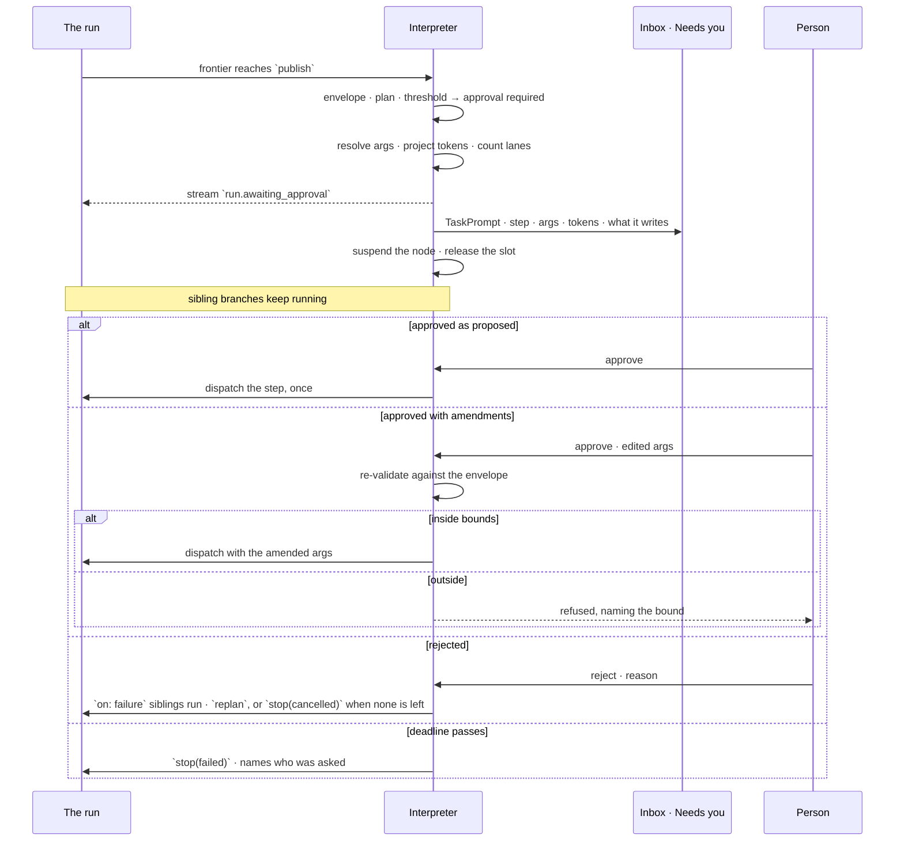
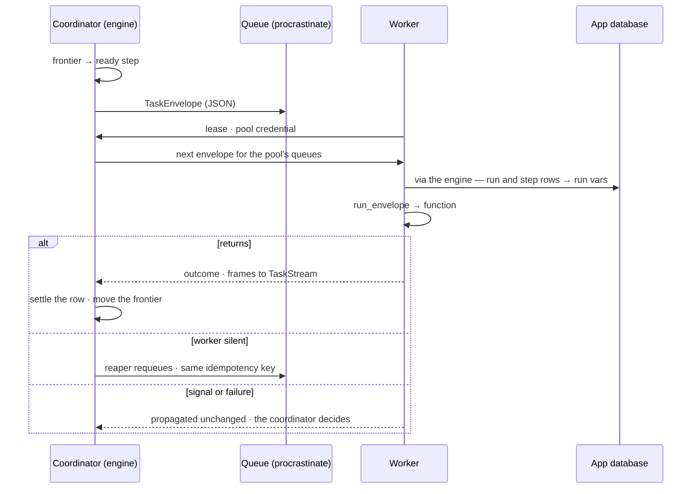

# Runtime

The one engine module that runs every plan: it walks a Flow's Tasks, fans out, branches, loops, stops for a person and
records all of it as TaskRuns, whatever opened the run. The records it walks are [orchestration.md](orchestration.md);
the layers it sits in are [architecture.md](architecture.md); the signals it emits are [observability.md](observability.md);
the commands that start it are [api-and-cli.md](api-and-cli.md). On screen a Flow is a *Plan*, a Task is one of *its
steps* and a TaskRun is a *Run* ([glossary.md](../glossary.md)).

## What it is

| It is | It is not |
|---|---|
| A **plan interpreter** — it walks a validated plan graph, holds a frontier, honours the signals steps return | A job scheduler — no backfill, no catch-up |
| Closed to the **catalogue** — every step calls one function from it | A plugin host for steps — a function reaches the catalogue only through an enabled plugin or an approved library ([AG-F06](../products/agents/features/AG-F06-plans-and-functions/feature.md)) |
| A **policy engine** — its abstractions exist to refuse, not to permit | A framework or a package — there is no second implementation of anything |

| Property | Means |
|---|---|
| **Observability** | At every moment: what is running, how far it got, what it has spent, what it is waiting on |
| **Auditability** | Afterwards: who decided what, on whose behalf, with which arguments, against which bound — reconstructed from the record, never inferred |

- The module is the **runtime**; *agent orchestrator* is what Invana is as a product, and *orchestrator* unqualified is never used.
- It takes a plan **generated at runtime, as data, validated against an agent's envelope before anything executes**. A general executor takes a plan written ahead of time as code; putting this interpreter inside one of its tasks costs its whole infrastructure and gives nothing back.

## The parts

| Part | Answers |
|---|---|
| **Planner** | Which plan runs — selected by intent, generated when nothing fits, expanded, then validated against the envelope |
| **Interpreter** | What happens next — the frontier, the control signals, suspend and resume |
| **Catalogue** | What a step *is* — the closed set of functions, each with a declared input schema and a default pool |
| **Executor** | *Where* a step runs — every step is a `TaskEnvelope` called by `run_envelope()`, in-process or in a worker (*Executor and workers*) |
| **State** | The run, its child runs, lanes, iterations and attempts, durably |
| **Artifacts** | What a step produced that is too big for a row |
| **Stream** | What the reader sees, in order — `TaskStream` frames |

## Todo, Flow, TaskRun

```
Todo                       what someone wants done · assignee · criteria
└── Flow                   the plan that carries it out · generated, packaged or promoted
    └── TaskRun (root)     one execution · plan_snapshot · lens_snapshot · agent · outcome
        ├── run of Task  translate    a function from the catalogue
        ├── run of Task  execute      attempt 1 failed · attempt 2 succeeded — two rows, never one mutated
        ├── run of Task  enrich       200 lanes, 8 at a time — one row per lane
        └── run of Task  delegate ──▶ child TaskRun
                                       └── …
```

| Rule | Detail |
|---|---|
| A *step* is a Task in the role of a child | The authoring format writes `steps:`; a step is never a second record. The TaskRun is the only execution record |
| Assigning a Todo opens one **root run** | `triggered_by = task`, `todo_id` set. A retry is a **new run**, never a mutated one |
| A reusable Flow is a plan, not a kind of run | Selected from the library by intent; `plan_origin = reused` |
| A Task never becomes a Todo | A node that needs a person is an `approval` on it or a `form: human` Task. **A plan produces Todos; it is never made of them** |
| The plan that ran is frozen on the run | `plan_snapshot` — the trace replays after the plan or the agent's envelope changes |
| So is the world it ran against | `lens_snapshot` — the model versions and links between models it resolved ([orchestration.md › The lens on a run](orchestration.md)) |
| A run's `role` says what it is for | `execute` · `plan` · `evaluate`. Planning and evaluating are ordinary runs, not a second mechanism |

### Every kind runs here

A kind (`ask` · `import` · `bulk` · `stitch` · `enrich` · `model`) is the subject of a Flow. What differs between kinds is
the plan and the catalogue entries in it — never the interpreter, the frontier, the child-run rows, the events or the
trace.

| Rule | Detail |
|---|---|
| A kind is the Flow's subject, never the machinery's | It selects a plan; nothing downstream branches on it |
| Every run has a plan, including the trivial ones | A bulk load is a one-step plan (`bulk_write`). Its weaker guarantees — no per-record check, no provenance — are properties of that step, not of the run |
| No feature writes step rows by hand | An import's stages are catalogue entries the interpreter dispatches; its events are the closed `run.*` set |
| A packaged plan lives in the library | Seeded as a published, read-only reusable Flow. A `plan_origin` the library cannot resolve is a trace that cannot show what ran |
| Kind-specific detail is read-time | An import's *what was rejected* and *what landed* are how Runs renders one kind, not a second write path |
| No surface holds a run the record does not | A load that records nothing says so; there is no third place it could land |

### A multi-stage load is an ordinary Flow

*Load three datasets, link them, enrich what landed, and stop if a check fails* is a Flow, and its stages are steps.

| Question | Answer |
|---|---|
| What is a stage? | A **step**. The plan grammar carries every part: `depends_on` for order, `on: failure` for the unhappy branch, `when` for a conditional stage, `map_over` for per-dataset fan-out, `approval` for a gated write |
| Is a stage a Todo? | **No.** A plan node has no owner beyond the run and no acceptance, and nobody accepts a load |
| Where does the fan-out collection come from? | The bundle manifest — `stitches.json` already names the datasets and the links between them |
| How does it ask a person? | An `approval` on a node that may not proceed alone; a `form: human` Task when someone must go and *do* something |
| How does it recur? | The one kind of schedule — it names the Flow and opens a run. Whether a firing creates work a person accepts is a property of the plan, not of the schedule |
| What holds the stages together? | The run: one run, one trace, one token roll-up, one row in Runs with its lanes and delegated children under it |

## The plan is a graph

A plan is **data**: a list of nodes with declared edges. Never code, never a hand-drawn diagram.

```yaml
steps:
  - id: understand
  - id: translate    depends_on: [understand]
  - id: execute_a    depends_on: [translate]           # these two
  - id: execute_b    depends_on: [translate]           # run in parallel
  - id: merge        depends_on: [execute_a, execute_b]
  - id: enrich       depends_on: [merge]
                     map_over: ${steps.merge.rows}
                     max_parallel: 8
                     on_lane_failure: continue
  - id: recover      depends_on: [{step: execute_a, on: failure}]
  - id: publish      depends_on: [enrich]
                     when: ${steps.enrich.written} > 0
                     approval: required
                     timeout_s: 120
```

| Field | Does |
|---|---|
| `id` | The node's name — what `${steps.<id>.<key>}` binds to and every record references |
| `depends_on` | Its upstream edges. A bare id means `on: success` |
| `when` | A predicate over prior outputs. False ⇒ the step is **skipped**, and skipping propagates |
| `map_over` | Fan out over a collection — one **lane** per element |
| `loop` | Repeat this node until a predicate holds — one **iteration** per pass |
| `max_parallel` | The lane ceiling for this step |
| `on_lane_failure` | `fail` · `fail_fast` · `continue` |
| `uses` | Inline a reusable Flow's version here |
| `approval` | This step may not be dispatched without a person |
| `timeout_s` | This step's own deadline |
| `retry` | Attempts, backoff, and which failure classes retry |
| `pool` · `pool_slots` | The named capacity it draws from, and how many slots it takes (default 1) |

| Rule | Detail |
|---|---|
| Declared cycles are rejected at validation | Named, with the loop shown. This bans declared cycles, not repetition |
| `uses` expands **before** validation | The envelope checks the whole expanded graph, so a composed plan never smuggles a step past it. Expansion depth is bounded |
| Arguments are schema-checked at validation | Each catalogue entry declares its input shape. A bad argument is refused with the plan, not at dispatch — a bad plan costs nothing |
| A generated plan obeys the same grammar | An LLM emits this structure and it is validated identically to a packaged one |
| Edge conditions are `success · failure · any_outcome` | The same three Todo dependencies use — one word for one idea at both altitudes |

## Repetition — the plan is acyclic, the execution is not

A cycle is allowed exactly where a counter bounds it — on a node or in a signal, never on an edge.

| | Cyclic? | Bounded by |
|---|---|---|
| The plan's declared `depends_on` edges | Never | — |
| `repeat` — a failure retried | Yes | `retry.max_attempts` |
| `back(id)` — a mistake repaired | Yes | The repair budget, once |
| `replan` — a plan that did not serve | Yes | The run's replan count |
| `loop` — deliberate iteration | Yes | `max_iterations`, and a deadline when it waits on a person |

`repeat`, `back` and `replan` are exception paths. `loop` is the one that iterates on success.

```yaml
- id: research
  depends_on: [understand]
  loop:
    until: ${steps.research.confidence} >= 0.8
    max_iterations: 5
    on_exhausted: continue              # or: fail
    accumulate: rows                    # optional — else the last pass wins
```

| Rule | Detail |
|---|---|
| Repetition is a property of a node | `map_over` is parallel repetition, `loop` serial; neither is an edge, so the DAG check never changes |
| The node stays `running` while it iterates | Downstream nodes are simply not ready yet |
| The model influences termination; the interpreter decides it | A step returns a *value*; `until` is a predicate in the same expression language as `when` — data, validated at plan time, and it cannot hang |
| `max_iterations` is required | Refused at validation above the envelope's ceiling. A model that never says *done* costs the bound, nothing more |
| The body may be a subgraph | `loop` composes with `uses`; the body expands before validation, so the envelope sees every step |
| The binding surface does not change | Downstream sees one output — the last pass, or every pass under `accumulate`. Inside the body `${self.previous}` is what the last pass produced |
| Cost is projected as `per-iteration × max_iterations` | Checked at validation, as a fan-out's size is |
| Repetition nests | Lane (parallel) · iteration (serial) · attempt (retry) — each pass its own row |

### A loop may wait for a person — the verdict

```yaml
- id: draft
  depends_on: [gather]
  loop:
    until: ${self.verdict} == 'accepted'
    max_iterations: 5
    on_exhausted: fail
    verdict:
      ask: "Good enough to publish?"
      options: [accepted, revise]
      deadline_s: 86400
```

| Rule | Detail |
|---|---|
| Asked **after** the pass produced output | An approval is asked before dispatch, so nothing is spent; a verdict when the work exists, and the question is whether to pay for another pass |
| Two bounds, two actors | `max_iterations` bounds how often the agent may redo it; `deadline_s` how long the person may take. Both are envelope-capped |
| The note is bound into the next pass | A verdict carries a choice and an optional note, bound as `${self.feedback}` beside `${self.previous}` — without it the loop is a retry, not a refinement |
| Only a person gives a verdict | An agent judging output is a `verify` step with an `until` predicate — no pause, no deadline |
| Never auto-accepted | A passed deadline is `stop(failed)` naming who was asked; the last pass is kept as an artifact, neither accepted nor thrown away |
| Exhausting the iterations fails by default | Five *revise* and no acceptance means nobody accepted. `on_exhausted: continue` is an explicit *take the best of five* |
| The person sees the cost | The pass's output, the iteration number, how many remain and what has been spent |
| Once per iteration, not per lane | A fanned-out body asks one verdict and states the lane count |
| A waiting verdict releases the slot | A run waiting overnight on a person holds no concurrency |
| Accepted early, nothing more is spent | Accepted on iteration 2 of 5, the node settles `succeeded` and iterations 3–5 never run |

## The frontier

The run's `cursor` is a frontier, not an index.

```json
{"done": ["understand","translate"],
 "running": ["execute_a","execute_b"],
 "settled": {"execute_a": "succeeded"},
 "lanes": {"enrich": {"done": 140, "failed": 2, "total": 200}}}
```

| Rule | Detail |
|---|---|
| A step is **ready** when every edge is satisfied and its `when` holds | `on: success` needs the upstream succeeded; `on: failure` needs it failed; `on: any_outcome` needs it settled |
| Every ready step dispatches | Up to the run's parallelism ceiling — not one step at a time |
| A skipped step settles `skipped` | Downstream `on: success` edges are unsatisfied; `on: any_outcome` edges are satisfied. It renders with the predicate that was false |
| The run ends when no step is ready and none is running | Any required step failed ⇒ `failed`; all settled ⇒ `answered` or `cannot_answer` |
| On resume, a `running` step closes as `interrupted` | It re-dispatches as a new attempt if its retry budget allows, and fails the run with a diagnosis if not. A half-finished step is never assumed complete |

## Fan-out

| Rule | Detail |
|---|---|
| One lane is one row | Keyed by run, Task, `lane`, `iteration` and `attempt` |
| Lanes retry independently | Lane 37's transient failure does not re-run lane 36 |
| The step settles when every lane settles | `fail` ⇒ any lane failing fails the step · `fail_fast` ⇒ the first failure cancels the rest · `continue` ⇒ the step succeeds and the failures are reported by lane index, grouped by reason |
| Bounded twice | `max_parallel` on the step and the run's own ceiling; the lower wins |
| The collection is bounded | A `map_over` over the envelope's fan-out ceiling is refused at validation, naming the ceiling and the size |
| Emissions merge in lane order | Not completion order — the same plan over the same rows reads the same way twice |

## Control signals

Every cycle is a signal plus a budget. A signal is data a step returns; exceptions are for faults.

| Signal | Frontier | Bounded by | Raised when |
|---|---|---|---|
| `next` | The node settles `succeeded` | — | The step did its job |
| `repeat` | The node re-dispatches | `retry.max_attempts` | A transient failure |
| `back(id)` | `id` and everything downstream re-open | The repair budget — once | `validate` can name a fix for `translate` |
| `replan` | The whole graph is replaced | The run's replan count | `verify` says the plan did not serve |
| `ask` | The node suspends | The run's clarification count | The step cannot proceed without an answer |
| `approve` | The node suspends **before dispatch** | A deadline | The step may not proceed without permission |
| `judge` | The node suspends **after the pass**, holding its output | `max_iterations` and a deadline | A `loop` declares a `verdict` |
| `skip` | The node settles `skipped` | — | `when` was false |
| `stop(outcome)` | The run ends | — | `answered` · `cannot_answer` · `failed` · `cancelled` |

| Rule | Detail |
|---|---|
| The envelope owns every ceiling | The counter lives on the run, the ceiling on the agent. A signal that would exceed one becomes `stop(failed)`, naming the bound |
| One returned enum | Not one exception type per signal. `NeedsInput` and `CannotAnswer` become signals |
| Every signal is streamed | `step.retrying` · `plan.revised` · `run.awaiting_input` · `run.awaiting_approval` · `run.awaiting_verdict` · `step.skipped` |
| A suspended run releases its slot | Ceilings are for work in flight; a run waiting on a person holds nothing |

## Bounds

| Bound | Set on | At the limit |
|---|---|---|
| **Step timeout** `timeout_s` | The step, defaulted per catalogue entry | Cancelled, settles `failed`, classified `timeout` |
| **Run deadline** | The envelope | `stop(failed)`, naming what was still running |
| **Approval deadline** | The envelope | `stop(failed)`; nobody decided, and who was asked |
| **Verdict deadline** | The step, envelope-capped | `stop(failed)`; nobody judged it, who was asked, what the last pass produced. Never an acceptance |
| **Iterations** `max_iterations` | The step, envelope-capped | `on_exhausted` — `fail` by default for a verdict loop |
| **Parallelism** | The run, and `max_parallel` per step | Ready steps stay `queued`; the lower ceiling wins |
| **Graph concurrency** `max_concurrent_runs` | Graph settings | Queue or refuse, per policy |
| **Flow concurrency** `max_concurrent_runs` | The reusable Flow | A further run of that Flow queues; others are unaffected |
| **Agent concurrency** `max_concurrent_steps` | The envelope | The agent's next step queues — an agent set to 1 never fans out, whatever its plan says |
| **Pool** `pool_slots` | A named pool | The step waits for a slot, holding none |
| **Token budget** | The agent · the plan · the Todo — the lowest | Pauses and asks, as an approval ([orchestration.md › Budget](orchestration.md)) |

**Provider rate limits are backpressure, not failure.**

| Rule | Detail |
|---|---|
| Per provider, requests and tokens per minute | A step that would exceed the bucket waits before dispatch, `queued`, holding no slot |
| A 429 is `transient` | It retries with backoff and jitter |
| Waiting is visible | The step row says it is rate-limited, by which provider and roughly for how long |

**Priority** decides who gets a slot first: a person's run outranks a Todo's, which outranks a schedule's or an
automation's. A delegated child inherits its parent's. The queue orders by priority, then by `queued_at`, and the
position is readable.

### Pools

Capacity is bounded on the contended resource, not on the thing producing demand — fifty Flows each capped at ten
still exhaust one provider. A **pool** is named capacity (on screen, *Workers · runs at once*).

```yaml
pools:
  llm:      {slots: 20}     # every provider call in the Graph
  graphdb:  {slots: 50}     # connection-bound steps
  heavy:    {slots: 4}      # graph algorithms — CPU and memory bound
```

| Rule | Detail |
|---|---|
| Graph-scoped and named | Defaults ship for `llm`, `graphdb` and `heavy`; a deployment sizes them to its machine. A pool never spans Graphs |
| A step declares its pool and weight | `pool_slots` defaults to 1; the catalogue entry gives the default pool |
| Waiting on a pool is not running | The step stays `queued`, holds no run slot and costs nothing |
| Fair share within a pool | Slots are granted round-robin across runs, then by priority — one run's 200 lanes never take every slot while another waits with one |
| A lane takes a slot, not the step | The lowest of pool · step `max_parallel` · run · agent · Flow · Graph always wins |
| Starvation is visible | The waiting step names its pool, its position and the free slots; `pool.saturated` is an event an automation can alert on |
| Delegation manufactures no capacity | A child run draws from its parent's pools |
| The agent ceiling is per agent | An agent working three runs is bounded across all three; it lives on the envelope beside the budgets |
| Undersized pools fail loudly | A step needing more slots than its pool has is refused at plan validation, naming the pool and its size |

## Cancellation

| Rule | Detail |
|---|---|
| Cooperative | Every step receives a cancel token and honours it at its own await points |
| Enforced by the timeout | A step that ignores the token is cancelled at its `timeout_s`; ignoring it is a defect in that catalogue entry |
| Checked at the frontier | Nothing new dispatches once a run is cancelling |
| Propagates down | Cancelling a run cancels every descendant run, each recorded in its own right |
| Never up | A cancelled child settles `cancelled`; the parent applies its edge rule — `on: failure` fires, `on: success` does not |
| A terminal outcome, not a failure | The diagnosis says who cancelled it and when |

## Three pauses

Each stops a run for a person, for a different reason, at a different moment, with a different bound. Each is a
`TaskPrompt` row of its `kind`, answered by a person ([orchestration.md › The records](orchestration.md)).

| | **Clarification** | **Approval** | **Verdict** |
|---|---|---|---|
| Means | The agent does not know something | The agent knows, and may not proceed alone | The agent made something and may not judge it |
| Comes from | Inside a step | Before a step is dispatched | After a pass produced output |
| Asks for | An answer, with options | Permission, with the exact call named | A judgement, with the output shown |
| Its answer is a | **answer** | **decision** — approve · reject | **verdict** — accept · revise |
| Spent so far | The step is mid-flight | Nothing | The pass is already paid for |
| On resume | The step runs again with the answer | The gated step runs, once | The loop iterates again with the note, or settles |
| Bounded by | The run's clarification count | A deadline | `max_iterations` and a deadline |

| Rule | Detail |
|---|---|
| Five approvals need five | Counting approvals down would punish exactly the caution they exist for |
| A verdict is counted | Each *revise* buys another pass at the agent's expense; the count bounds the spend, the deadline the wait |
| Only a person decides or judges | An agent never approves anything, its own step included |
| None auto-resolves | A passed deadline is `stop(failed)` naming who was asked — never an auto-approval or auto-acceptance |
| A token budget reached is an approval | The runtime raises it; it has no deadline and parks until a person decides. It gates dispatch, so lanes in flight finish and the overshoot is at most that set |
| A verdict is not a Todo's acceptance | Acceptance closes work somebody owns (`closed_at`); a verdict decides whether a loop goes round again. Both wait in the Inbox's *Needs you* ([IN-F01](../products/inbox/features/IN-F01-needs-you/feature.md)) |

## What requires approval

| Source | Shape | Example |
|---|---|---|
| **The envelope** | `requires_approval: [step_key, …]` on the agent | Every `delegate`, for a junior agent |
| **The plan** | `approval: required` on one step | This particular write, in this version of the plan |
| **A threshold** | Projected tokens, fan-out size or write volume over a ceiling | An enrich touching more than 10,000 nodes |

| Rule | Detail |
|---|---|
| Evaluated before dispatch | Nothing is spent by a step waiting for approval |
| The request names the call | Step, resolved arguments, what it reads, what it writes, what it will spend — never "the agent wants to continue" |
| Who may decide is the Inbox's | Set per ask in [IN-F01](../products/inbox/features/IN-F01-needs-you/feature.md); a Graph of one is not an exemption — still asked, one click |
| A fanned-out step asks once | One approval covers the step and all its lanes, and states the lane count |
| Amending is bounded | A person may edit the arguments; the amended call is re-validated against the envelope at resume, and a bound that changed in between refuses it |
| The decision is a record | The `TaskPrompt` holds who answered, when, and the answer with any amended arguments, beside an event — never a synthetic step |
| First decision wins | A second person deciding at once sees the run has moved, and by whom |



## Starting a run

| Trigger | `triggered_by` | Opened by |
|---|---|---|
| A person asks, or runs a plan | `user` | The composer, or the library's start |
| A Todo is assigned | `task` | The assignment |
| A schedule fires | `schedule` | The one kind of schedule, naming a Flow |
| An automation fires | `automation` | An automation whose action opens a run |
| A parent delegates | `delegation` | A `delegate` step |
| A canvas expansion | `canvas` | `run_inline` — a person waits on it |
| A link between models committed or removed, a connection test | `system` | `run_inline` |

| Rule | Detail |
|---|---|
| Opening a run is an ordinary call | Whatever decides to open one uses the same API a person does; the runtime does not know what matched |
| Attributable | `triggered_by = automation` records the automation and the originating event on the run |
| Depth-bounded | A run opened from outside is held to the envelope's chain depth; one past it is refused, naming the bound and who asked, as an event |
| Starting by hand widens nothing | The envelope check is identical |
| `idem_key` means once | The same key twice in a Graph returns the existing run — a retried CLI call, a re-delivered event and a double click all mean once |
| An interactive run is awaited, not queued | `run_inline` runs a committed run inside the caller's request — same plan, lens, stream and trace as a submitted one, and admission still applies. Under contention a `canvas` run waits with a `user` run's precedence and a `system` run with a schedule's |
| Interactive runs are full runs | Runs leaves `canvas` and `system` runs out of its default view, and its history ceiling is counted per side, so a busy canvas never prunes last night's import |

### The events it emits

The runtime emits a closed set of event kinds into `events` — the same append-only record everything reads — and
publishes nowhere else. Matching, filtering, alerting and notifying belong to notification rules.

| Event kind | Emitted when |
|---|---|
| `run.queued` · `run.admitted` · `run.started` · `run.succeeded` · `run.failed` · `run.cancelled` | A run changes dispatch or terminal state |
| `run.awaiting_input` · `run.awaiting_approval` | A run suspends, with what it waits on |
| `step.failed` · `step.retrying` · `step.skipped` | A node settles or re-dispatches |
| `plan.refused` | The envelope refused a plan, with the bound |
| `pool.saturated` | A pool has had no free slot for a stated interval |
| `budget.exceeded` | An agent reached a ceiling |

## Caching

| | |
|---|---|
| What | The provider call, and only that |
| Key | A hash of provider, model, prompt and the call's parameters |
| Scope | The Graph |
| Expiry | A configured time to live |
| Recorded | The step row says the response was cached, so a cached run is never mistaken for a cheap one |
| Never cached | Query results — the graph moves, and a stale answer is worse than a slow one |

## Six outputs, one moment

| Output | Is | For | Where |
|---|---|---|---|
| **TaskRun row** | What the step *did* — status, timings, tokens, attempt, lane | The product | `task_runs` |
| **Event** | A fact about a write, with its principal | Audit | `events` |
| **Stream frame** | What the reader sees, in order | The reader | `TaskStream` |
| **Log line** | What the step *saw* — diagnostic prose | Whoever is debugging | OpenTelemetry, correlated by `run_id` |
| **Metric** | A number to aggregate | Whoever operates the server | OpenTelemetry |
| **Artifact** | The raw payload behind a digest | Evidence | `TaskArtifact` and a blob store |

| Rule | Detail |
|---|---|
| Each has one consumer | A log line carries no number the metrics need; a metric carries no id the log has; the run row is the only one the product reads |
| No product surface reads telemetry | Tokens, duration and outcome in Studio come from `task_runs`. Metrics are derived; where they disagree, the record is right |
| The runtime records facts and correlates them | Durations, attempts, lanes, outcomes, pool waits and refusals are facts on the record; instruments, formatters, transport, sampling and retention are [observability.md](observability.md)'s |
| Every log line is correlated | `graph_id` · `run_id` · Task · `lane` · `attempt` |
| Raw payloads are never log lines | A prompt, a response or a generated file is an artifact the line cites |
| Redacted at write | By field name and by type, the rule events follow — redaction cannot be downstream |
| Telemetry is optional | Runs, events, frames and artifacts work with no collector configured |

## Auditability

Everything below is answered by query, never by inference.

| An auditor asks | Answered by |
|---|---|
| What ran, in what order, beside what? | `task_runs` and the frozen plan's edges |
| What failed before it succeeded? | Earlier `attempt` rows — never overwritten |
| Which lane failed, out of how many? | `lane` on the row; the step's lane tallies |
| Which branch was not taken, and why? | `skipped` rows carry the `when` that was false |
| Which plan ran, where from, was it revised? | `plan_snapshot` · `plan_origin` · `plan_revision` |
| What was composed into it? | The expansion is in the frozen plan — `uses` leaves which version was inlined |
| Who asked, and who started it? | The Todo's author · `triggered_by` · the opening event · on-behalf-of on every event |
| Which agent ran it, in which version? | `agent_id` and its version — a retired agent still resolves |
| What was it allowed to do? | The envelope at dispatch, and the bound that refused anything |
| Who decided a pause, and did they change it? | The `TaskPrompt` — who answered, when, the answer |
| Was this answer served from a cache? | The flag on the step row |
| What did it read, what did it write? | The query on the step; provenance on every element written |
| Who spawned whom? | `parent_run_id` down, and the child runs up |

| Guarantee | Detail |
|---|---|
| Append-only | Events, attempts and stream frames are never edited and never individually deleted |
| Attempts and lanes are rows | A failed attempt is never overwritten by the one that succeeded |
| A principal on every event | `user · agent · system · external · anonymous`, with on-behalf-of when they differ |
| Nothing inferred from timestamps | Chain membership and graph edges are explicit columns and frozen data |
| Credentials never enter the record | Not even encrypted |
| Retention removes windows | Never selected rows. The run keeps its counts and says the detail was purged; the purge is itself an event |

`GET …/task_runs/{id}/chain` walks every link above and returns one tree: runs, steps, lanes, attempts, pauses, child
runs, and the principal on each.

## Artifacts

| Term | Is | Reader sees it |
|---|---|---|
| **Emission** | A rendered thing in an answer — subgraph, table, metric, chart, prose | Yes |
| **Artifact** | A file or blob a run produced — a generated file, a raw model response | Only through a step or emission that cites it |

| Rule | Detail |
|---|---|
| The word is *artifact* | Never *asset* — that means a materialised data table elsewhere |
| Stored by digest | `sha256`; the run row carries the digest, never the payload |
| Cited, never inlined | A step or emission holds the artifact's id |
| Retention is its own window | Artifacts expire before the run does; the run keeps its counts and says the blob is gone |
| Local by default | Filesystem on one node, object storage where configured — one interface, chosen at deploy |

## What the runtime adds to the records

Beyond the fields in [orchestration.md › The records](orchestration.md):

| Record | Adds |
|---|---|
| TaskRun | `priority` · `deadline_at` · `opened_by_event_id` · `pool` · `pool_slots` · `cached` · `trace_id` · `root_span_id` · the stored timings and tokens ([architecture.md › Metrics are stored](architecture.md)) |
| TaskRun key | Unique on parent run, Task, `lane`, `iteration`, `attempt` — three kinds of repetition, because they nest |
| Run and step status | `skipped` · `interrupted` · `awaiting_approval` · `awaiting_verdict` beside the existing states |
| `triggered_by` | `canvas` · `system` beside `user · schedule · task · delegation · automation` |
| Flow | `max_concurrent_runs` on a reusable Flow |
| `pools` | `graph_id` · `name` · `slots`; who waits on which pool, with position, is read — never stored twice |
| Envelope | `requires_approval: [step_key]` · `max_concurrent_steps` · fan-out ceiling · run deadline · approval deadline · verdict deadline · `max_iterations` ceiling · threshold ceilings · chain depth |
| Catalogue entry | A declared input schema and a default pool |

## Executor and workers

Invana runs its own work: no broker, no external scheduler to stand up first, so the first question works the day it
is installed. Workers on other machines are optional ([ST-F06](../products/settings/features/ST-F06-workers-and-limits/feature.md)).



| Rule | Detail |
|---|---|
| One protocol, versioned | Submit · report · cancel · reconcile. A runtime states the version it speaks; a mismatch or a configured package that is missing is refused at startup, naming it |
| Invana owns the contract | What runs, what it produces, how it reports — never scheduling mechanics. Nothing above the protocol depends on which executor is behind it |
| One run is one unit of work | The interpreter runs inside it and reports transitions as it goes; one run never spans several executors — attribution and cancellation would become unanswerable |
| In-process by default | One asyncio task per run, persisting to the app database, no external dependency |
| A step travels as `TaskEnvelope`; nothing live crosses | The worker rebuilds the step's context from ids with the same `run_vars` the interpreter uses, so a step sees one world wherever it runs |
| `run_envelope()` is the only place a function is called | In-process and in every worker. A `key@version` the process has not loaded is a `defect · unknown_task_type` before any context opens — never a neighbouring version |
| The idempotency key is `run_id:node_id:attempt` | Redelivery keeps it, a retry the coordinator decides changes it; a redelivered write returns the outcome already recorded |
| `timeout_s` is applied by `run_envelope` | In-process and in a worker alike, as a `transient` failure with cause `task_timeout`. Retry policy is the coordinator's; redelivery is the queue's |
| Signals and failures cross unchanged | `NeedsInput` · `CannotAnswer` · `Converse` · `TaskFailure` propagate out of `run_envelope`; the coordinator decides what they mean |
| Only steps that hand over through outputs run remotely | State an earlier step left on run vars does not cross a process; such a step stays in-process until that state is an output |
| The worker owns its transaction | It commits when the function returns and rolls back when it raises |
| The queue is procrastinate, on the app's Postgres | No added service: `pip install invana` plus `invana worker` is the whole deployment |
| Workers reach it only through the engine | A worker on any machine long-polls `POST /api/v1/workers/lease` over HTTPS with its pool credential and holds no database credential; the engine takes heartbeats (every 2 s) and outcomes, and its reaper requeues the jobs of a worker silent 30 s |
| A lost worker is reconciled | Its runs are marked and reported, never left running forever |
| Frames from a worker | Land in `TaskStream` by run id; a live reader on another process sees them when the stream reader polls the table |

| `TaskEnvelope` field | Type | Notes |
|---|---|---|
| `run_id` | str | The run (the step row's parent) |
| `node_id` | str | The step row |
| `attempt` | int | The row's attempt |
| `plugin` | str | `name@version` |
| `task` | str | `key@version`, or a bare key |
| `args` | dict | Resolved, JSON only |
| `graph_id` · `lens_id` · `actor_id` | str, optional | What the worker rebuilds from |

## Install, run and health

| Command | Does |
|---|---|
| `invana start` | Runs the engine, and Studio when bundled |
| `invana migrate` | Applies database migrations |
| `invana version` | The engine version and every installed graph connector |
| `invana worker` | Runs steps from the queues of its pool |

| Rule | Detail |
|---|---|
| Core plus graph connectors | The engine installs on its own; each graph connector is its own package, and the core depends on no driver |
| One image or two | Engine and Studio ship together or separately, from the same build |
| Cross-platform | A contributor on any operating system runs the same commands |
| Migrations are explicit | Nothing migrates itself on boot; a start with migrations pending refuses, naming the command |

| Probe or tool | Shape |
|---|---|
| `GET /health` | Unauthenticated and cheap; distinguishes liveness from readiness and names the component that is down — the app never pretends |
| Admin | Views generated from the app-state tables, mounted beside the API, for an install Admin only. It opens no Graph's contents in the product; a superuser without membership still sees no Graphs |
| Admin writes | Events like any product write, attributed to the person — never to *system* |

## Seams

| Seam | What happens |
|---|---|
| 2 lanes of 200 failed | The step succeeded under `continue`; the failures are reported with their lane indices, grouped by reason |
| A fan-out over the ceiling | Refused at validation, naming the ceiling and the size; nothing dispatches |
| Rate-limited mid-fan-out | Lanes queue; the step says which provider is throttling and roughly for how long |
| The engine restarts mid-run | `running` nodes close as `interrupted` and re-dispatch as new attempts; the frontier resumes from the database |
| Nobody decides, ever | The deadline passes; the run fails naming who was asked |
| Nobody judges a draft, ever | The run fails naming who was asked and what the last pass produced; the output is kept as an artifact |
| Five *revise* and no acceptance | The run fails by default, with every pass on the record and each note on the pass it produced |
| A rejected step mid-graph | Its `on: failure` siblings run; the parent replans if it has replans left, else the chain stops and every descendant is cancelled, named |
| A pool saturated for an hour | Every waiting step names the pool, its position and the free slots |
| An agent capped at one step | Its plan still validates; its fan-out runs one lane at a time and the step says which ceiling binds |
| A purged window | The run and its counts stay; the detail says it was purged |
| Cancel during a step | The step finishes or aborts per the executor, and the run is `cancelled` either way |

## Decisions

| Decision | Detail |
|---|---|
| Interpreter, not scheduler | The runtime is a plan interpreter and a policy engine — never a job scheduler, never a framework |
| Repetition on nodes and signals | Declared back-edges were weighed: legible, but the bound becomes a global recursion limit that does not know which loop it bounds. A child run per iteration costs a plan, a stream and an await per pass — right for delegation, too heavy for iteration. `replan` as the loop regenerates the plan every pass and loses the structure being iterated on |
| Three pauses, three nouns | Clarification is *I do not know*; approval *I may not proceed*; verdict *I may not judge what I just made*. When, relative to dispatch, sets the bound |
| Every kind runs here | One interpreter, one frontier, one set of rows, events and trace for every kind of plan |
| procrastinate is the distributed executor | It matched or beat Dramatiq on throughput, fan-out and latency, recovered a killed worker as fast, and adds no service; Prefect was send-bound and lost a dead worker's envelopes ([the benchmark](../../docs/for-developers/modules/platform/features/distributed-execution.md)). Hatchet, Temporal and DBOS are compared in [workers-and-orchestration.md](../../docs/for-developers/building-engine/workers-and-orchestration.md) |
| One cache | On the provider call, keyed by content hash |

## Not building

| Not building | Because |
|---|---|
| A plugin-registerable catalogue | The closed set is the policy |
| Arbitrary user callbacks (`on_failure` hooks) | Events are the extension point; running user code inside the interpreter reopens everything the envelope closed |
| A memory backend interface | Memory is the graph; `recall_by_query` is a step that queries it and cites records |
| A cache with pluggable strategies | One cache, one key, one time to live |
| Sensors that poll outside systems | A run waits on a person or an event, never on a spin loop |
| Backfill and catch-up | A schedule's missed firing is recorded as missed, not replayed |
| Approval quorums and escalation chains | Unproven complexity |
| Auto-approval, or auto-acceptance on a verdict timeout | Nothing set to Ask is ever decided by itself: nothing acts without asking but where a person's line says Allow ([one access model](../products/settings/product.md#decisions)); an unjudged draft is a failed run |
| An agent giving a verdict on output | A mechanical judgement is a `verify` step with an `until` predicate |
| A plan authoring UI | A plan is data validated against an envelope, never a hand-drawn graph of steps |
| An external orchestrator adapter | The plan-as-data model gives a general executor nothing to do; another executor would be its own package implementing the protocol |
| Requiring an orchestrator to start | It would kill *install it and ask a question* |
| Moving the question-answering chain to workers | Its steps hand over through run vars, not outputs |
| Alerting, log transport, metric instruments | Separate concerns: notification rules read events; [observability.md](observability.md) ships the signals |
| Per-step CPU and memory limits | A pool rations a heavy step; real isolation is a container's job |
| Pools shared across Graphs | A Graph is the boundary; capacity never crosses one |
| Admin as a product surface, or per Graph | It exists so an Admin avoids SQL; a Graph's contents belong to its members |
| A metrics page inside admin | That is telemetry, and a collector reads it better |
| Deployment orchestration | An image and a command; the rest is the deployment's own platform |
